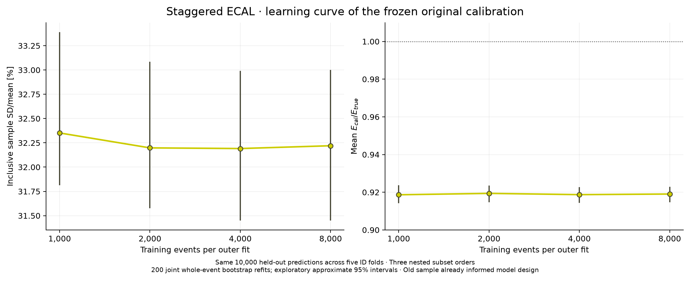

# Staggered ECAL: learning curve and independent high-statistics calibration

**PROTOTYPE**, authorized on 2026-11-12. This follows
[draft PR136](https://github.com/asalzburger/nodd/pull/136) and keeps only its
physical staggered geometry. There is no geometry, material, field or native
factory change. The original 10k, baseline and continuous-silicon samples remain
unchanged and local. Statistical choices are fixed in the
[prospective protocol](protocol.md); they are analysis design choices, not
engineering requirements or detector acceptance.

## Completed learning curve

[SVG](learning/learning-curve.svg) · [PDF](learning/learning-curve.pdf) ·
[Compact learning-curve statistics](learning/learning-curve.json).

| Training events per outer fit | Inclusive width [%] | Mean Ecal/Etrue |
| --- | --- | --- |
| 1,000 | 32.3518 | 0.91866 |
| 2,000 | 32.1980 | 0.91940 |
| 4,000 | 32.1912 | 0.91873 |
| 8,000 | 32.2201 | 0.91905 |

The dependence is weak and nonmonotonic over this range for the original
architecture. This does not establish an asymptotic limit for a revised model.
Three nested subset orders share the same original 10k held-out population
through five outer folds. They are correlated, and never counted as 30k events.
At 8k, all three predictions are bit-identical to each other and to the original
retained model. All 42 zero signals remain. Two hundred joint whole-event
bootstrap refits supply approximate global pointwise intervals; angular values
in the compact data are points. The old sample already informed model design,
so this is an exploratory development diagnostic.

## Independent campaign and revised method

The new sample contains 100k training and 20k fresh validation electrons,
independently uniform in total energy 10–80 GeV, eta −3…3 and full phi, from the
origin. Twelve serial 10k DDSim batches each use 12 workers, independent primary
and transport seeds and explicit global campaign IDs. No old primary is reused.
A 24-event pilot passes saved-primary/hit and all twelve native-worker audits.
The full campaign is currently in progress; final outcomes are not yet claimed.

Training roles are prospectively fixed: 70k fit, 15k tuning, 15k closure. Compare
the original ten-feature response architecture retrained on this budget with a
piecewise-linear spline response model using the same measured features and
predeclared interactions. Both choose settings on tuning data, then refit on
85k. The last 15k determine a single global scale factor, including zeros. No
response coefficients are refitted on that closure set. A global factor changes
means/tails while leaving SD/mean exactly unchanged.

Inference uses persisted cell signal/positions/IDs and physical mask probes.
Truth energy supplies training labels and evaluation denominators only. No
truth direction or absolute-signal proxy enters the primary correction model.
Frozen feature names and extractor/recipe/helper hashes must match across all
batches and between training and validation, before any validation NPZ opens.
The complete calibration and analysis source are hash-bound and committed before
fresh-validation predictions are inspected. Validation may undergo mandatory
physics/input audits beforehand; it never selects model settings.

Final reporting will retain raw, the old10k-model ensemble, retrained original,
and revised pre/post-closure responses; inclusive means, SD/mean, fractional-error
RMS, quantiles, zeros, clipping and tails; ten |eta| and ten signed folded-phi
bins, fourteen five-GeV energy slices and signed-direction/sector controls.
The raw tail/RMS comparator uses a training-only global energy scale. Historical
ensemble clipping means at least one member clips, and historical training
uncertainty remains conditioned on that already frozen reference.

One thousand shared validation bootstrap draws provide conditional-on-calibration
intervals. Separately, two hundred full refits resample independently within
70k/15k/15k roles, repeat knots/preprocessing/model selection/85k refit/15k closure,
and use common validation multiplicities across models. These include training
and model-selection uncertainty. Their percentile tails are approximate and
coarse. Width covariance is structurally singular because pre/post global
closure widths are identical; this is expected. No quadrature decomposition or
intrinsic fixed-energy resolution claim follows.

## Execution and review

The existing ACTS Spack setup/lock fingerprints changed; this was disclosed and
the current runtime doctor passed before use. Runtime versions are DD4hep/DDG4
1.38, Geant4 11.4.3, ROOT 6.40.04, EDM4hep 1.1.1 and podio 1.8. Existing NumPy
2.5.4 and Matplotlib 3.11.2 provide fitting and plotting, with no new dependencies.
Conservative disk planning requires twice the projected 120k output plus a
30 GiB reserve, less than the roughly 375 GiB initially available. A live guard
remains enabled and retained earlier data are not deleted.

A combined C++ ROOT pass checks saved primaries, every hit, all workers and
extracts reconstructed features. Thirteen pipeline/native controls pass. The
full retained 10k regression checks all 6,346,815 cells and matches original
identity, worker allocation, primary errors and ROOT hash exactly; feature
arrays agree at 1e-10 relative/absolute tolerance. It takes 114.4 s. Six model
controls verify weighted quantiles, training/closure separation, zero preservation,
truth-free inference, serialization and full weighted-refit equivalence to
explicit duplicate populations. Two boundary controls reject changed
feature semantics before arrays open.

Separate PhysVal reviews cover the prospective model, learning curve and
analysis orchestration. Their sole material source finding was the missing
cross-sample feature-semantics guard; it is fixed and independently reassessed
at 62261934588a38437b5e115475c82c99727478ba. That review includes independent
weighted quantiles, all learning-curve points, 840 grouped metric fields,
within-role budgets and covariance ordering. Final results will receive a
separate exact-revision review after campaign completion.

[Reproduction recipe](reproduce.md) ·
[Curated session](../../../logs/codex/SESSION-2026-11-12-ecal-staggered-highstat-calibration.md).
Only source, compact aggregate/binwise evidence, plots and curated records enter
Git. ROOT, exact input/event ledgers, features and predictions stay local/ignored.
All scientific figures are retained as PNG, PDF and vector SVG.
