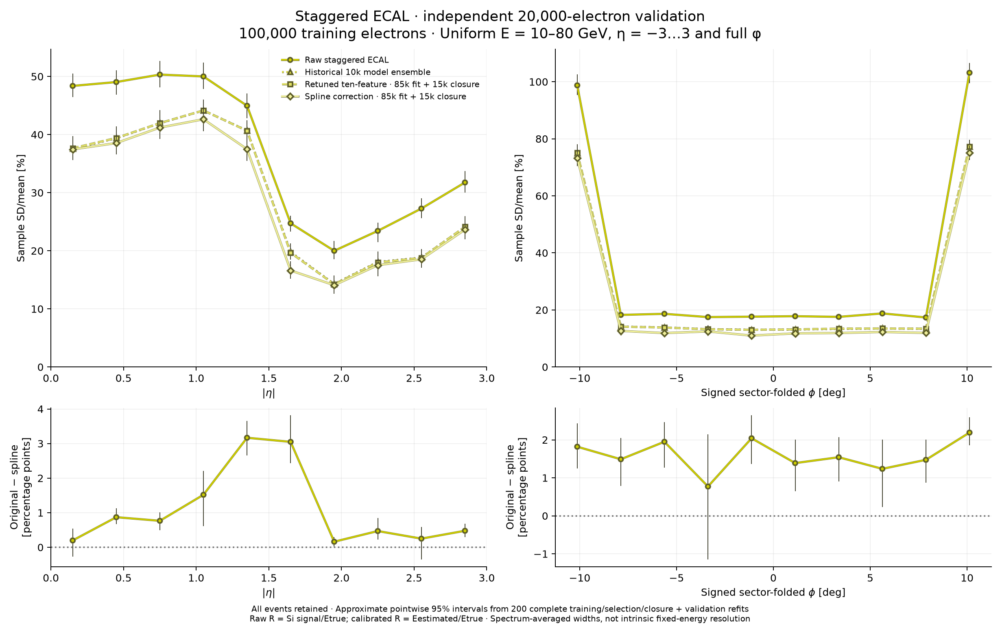

# Staggered ECAL: independent high-statistics calibration

**PROTOTYPE**, [draft PR137](https://github.com/asalzburger/nodd/pull/137), authorized on 2026-11-12, following
[draft PR136](https://github.com/asalzburger/nodd/pull/136). Only its physical
staggered geometry is studied. Geometry, materials, native factories, field and
transport policy are unchanged. The prospective choices and pre-fit common-grid
amendment are retained in the [protocol](protocol.md). This is a calibration
study, with no detector engineering acceptance or intrinsic-resolution claim.

The recorded model is **`nodd-ecal-staggered-spline-v1`**. See the
[reuse contract and inference commands](reuse.md) and
[versioned model manifest](frozen/manifest.json). Coefficients and numerical
source remain unchanged; reuse requires no training or truth inputs.

## Independent result

All **100,000 training + 20,000 fresh validation electrons** completed transport
and full saved-primary/hit/worker audits. The models were committed at
`e65962c259cec1f8744252fccfa17211004f4d61` before validation performance was
inspected. No model was retuned after that freeze.

[Vector SVG](results/angular-comparison.svg) · [PDF](results/angular-comparison.pdf) ·
[Compact statistics, populations, intervals and covariance](results/summary.json).

All rows below use the **same fresh 20k**. Width means sample SD(R)/mean(R),
including zeros and non-Gaussian tails. For calibrated rows R is estimated energy
over truth energy. RMS is sqrt(mean((R−1)²)), a different measure.

| Calibration | Mean R | Width [%] | Fractional-error RMS [%] | Estimated energy < half truth [%] |
| --- | ---: | ---: | ---: | ---: |
| Raw, training-only global energy scale | — | 38.313 | 38.396 | 12.420 |
| Historical 10k-model ensemble | 0.92388 | 31.338 | 29.936 | 10.115 |
| Retuned ten-feature, before closure | 0.92365 | 31.322 | 29.920 | 10.090 |
| Retuned ten-feature, after closure | 1.00287 | 31.322 | 31.412 | 9.790 |
| Spline, before closure | 0.92404 | 30.209 | 28.929 | 9.575 |
| Spline, after closure | 1.00300 | 30.209 | 30.301 | 9.380 |

The spline gains **1.112 percentage points**, or 3.55% relative, against the
retuned linear comparator. Its inclusive full-refit approximate 95% width range
is 29.596–30.817%, versus 30.663–31.987% for the linear comparator. These are
marginal ranges, not an interval on their paired global difference. Angular
paired differences use shared bootstrap events: pointwise ranges lie above zero
in 8/10 |eta| and 9/10 folded-phi bins; none lies wholly below zero. They are not
simultaneous confidence bands.

More training with this linear recipe changes the width little relative to the
historical ensemble on the same population (31.338% to 31.322%). This comparison
also changes tuning/refitting and ensemble construction, so it does not isolate
training size. The historical 32.220% figure used cross-fitted predictions on
the old 10k and must not be treated as a directly paired improvement here.

A global closure factor restores the mean but leaves SD/mean exactly unchanged.
It can increase fractional-error RMS: the closed spline has RMS 30.301%, versus
28.929% before closure. Closed-to-closed, the spline improves RMS relative to
31.412% for the linear comparator. The old biased ensemble's 29.936% RMS is
therefore not evidence of better mean closure.

All **84 zero signals** remain in every row. The raw silicon response mean is
0.01193593; its RMS and half-energy tail comparator use a training-only global
scale, not the unscaled silicon fraction. Pre-closure gain bounds are 0.5–3;
7.905% of linear and 8.790% of spline validation events clip. The spline retains
219 feature-extrapolated events (1.095%); none is dropped.

## Control plots and remaining limitations

[Angular means](results/angular-means.svg),
[energy closure and tails](results/energy-closure-and-tails.svg), and
[signed-direction/sector means](results/direction-sector-closure.svg) accompany
the width comparison. The energy controls retain pre/post closure curves.
Spline means across fourteen five-GeV slices range from **0.96975 to 1.02622**.
The inclusive mean 1.00300 does not imply local closure: means range
0.92760–1.07052 across |eta| and 0.61376–1.10597 across folded phi.

The two sector-edge folded-phi bins still have widths **73.23% and 75.06%**,
versus **11.01–12.65%** in the eight interior bins. The distributions expose the
large low-response population. Recovering the mean cannot reconstruct energy
that leaves little or no measured silicon signal.

| Response distribution in each of ten bins | Absolute eta | Signed folded phi |
| --- | --- | --- |
| Raw silicon response | [SVG](results/distributions-raw-abs_eta.svg) | [SVG](results/distributions-raw-folded_phi.svg) |
| Closed linear and spline overlay | [SVG](results/distributions-calibrated-abs_eta.svg) | [SVG](results/distributions-calibrated-folded_phi.svg) |

The corresponding PNG and PDF files use the same basename. Histogram bins are
shared, counts retain every event, and widths come from unbinned sample moments.
No Gaussian fit, quadrature subtraction, electronics/noise model, fixed-energy
intrinsic resolution or engineering acceptance is inferred. The next scientific
question is how to address residual local bias and seam losses; this frozen
validation cohort is now inspected and cannot serve as an untouched test for
future changes.

## Sampling, training and uncertainty

New origin electrons are independently uniform in total energy 10–80 GeV,
eta −3…3 and full phi. Twelve serial 10k DDSim batches each use **12 workers**,
independent primary/transport seeds and campaign-global event IDs. Exact primary
momenta are disjoint from the old 10k and between batches. The
[input-only distribution checks](input-distributions.json) retain 14 energy ×
10 |eta| × 10 folded-phi cell counts: training 46–96 and validation 4–29, with no
empty cells. These counts do not imply uniform detector acceptance.

Training roles are fixed at 70k fit, 15k tuning, 15k closure. Both new methods
search the prospectively shared ridge grid {0.0001, 0.01, 1, 100}, select on
tuning only and refit response coefficients on 85k. A single scale is fitted on
the separate 15k, including zeros. The new ten-feature comparator is retuned;
it is not the identical historical tuning recipe. The spline uses the same ten
measured features, quantile hinge bases and eight predeclared interactions.
Bases, interactions and feature clipping differ, so this compares complete
calibration recipes rather than isolating one architectural change.

Inference uses persisted silicon cell signals, positions, IDs and fixed
physical mask probes. Truth energy supplies training labels and evaluation
denominators only; truth direction and absolute-signal proxies are absent from
correction features. Feature semantics and source/core/helper hashes are bound
to the [frozen models](frozen/models.json) and checked before validation arrays
open. The linear model selects regional lambda 0.0001/0.01 (11/11 coefficients).
The spline selects seven nominal knots and lambda 0.0001 in both regions
(80/82 coefficients after deduplication). Closure factors are 1.0857735 and
1.0854609 respectively.

One thousand shared whole-validation-event bootstrap draws give intervals
conditional on the fitted calibrations. Separately, **200 full refits** resample
independently within the 70k/15k/15k roles, repeat preprocessing, knots, tuning,
85k refit and closure, and share validation multiplicities across methods.
Historical training remains conditioned on its already frozen ensemble.
Percentile tails are approximate and coarse. Bootstrap offsets, tie fractions,
choices and closure variation are retained; no interval recentering occurs.
The 120×120 angular-width covariance has rank 80 because pre/post-closure CVs
are identical. Its 60×60 paired-contrast covariance matches AΣAᵀ; both are
positive semidefinite within floating-point tolerance.

## Exploratory original-method learning curve

[SVG](learning/learning-curve.svg) · [PDF](learning/learning-curve.pdf) ·
[Compact learning statistics](learning/learning-curve.json).

| Training events per outer fit | Inclusive width [%] | Mean R |
| --- | ---: | ---: |
| 1,000 | 32.3518 | 0.91866 |
| 2,000 | 32.1980 | 0.91940 |
| 4,000 | 32.1912 | 0.91873 |
| 8,000 | 32.2201 | 0.91905 |

Dependence is weak and nonmonotonic over 1–8k for this original architecture;
this does not establish an asymptotic limit for a revised model. Three nested
subset orders share the same old 10k held-out population through five outer
folds; they are never counted as 30k independent events. At 8k all three
predictions are bit-identical to the retained original result. All 42 zeros
remain. Two hundred joint whole-event refits supply approximate intervals.
The old sample already informed model design, making this exploratory.
The paired 1k-minus-8k point is 0.1317 percentage points, while its shifted
bootstrap percentile range is 0.1570–0.5869 points. Both are retained without
post-hoc adjustment; this is not a calibrated significance claim.

## Execution, verification and provenance

[Campaign receipts and resource summary](campaign-and-run.json) bind all batches
to geometry, libraries, input, output, extraction and worker policy hashes.
Every one of **120,000 events and 76,941,173 silicon cell hits** passes the full
native readback. A 24-event pilot passed all twelve workers beforehand.
Transport used FTFP_BERT, 0.7 mm range cuts, 5 mm sensitive charged-step limit and
zero magnetic field, unchanged from the source staggered sample.

Transport took **118.6 minutes of summed wall time** (118.8 minutes elapsed),
20.93 CPU-hours and at most **2.672 GiB child RSS** with 12 workers. ROOT files
occupy **152.506 GB** (decimal). Minimum recorded free disk afterward is
249.856 GB (232.7 GiB). The conservative two-copy projection plus 30 GiB reserve
fit the initial 375 GiB; **no trimming or deletion was needed**. RSS is the
measured transport child peak, not a total-memory guarantee for other settings.

The ACTS Spack setup/lock fingerprint change was disclosed before use and the
runtime doctor passed. Runtime versions: DD4hep/DDG4 1.38, Geant4 11.4.3,
ROOT 6.40.04, EDM4hep 1.1.1, podio 1.8; fitting/plotting use existing NumPy 2.5.4
and Matplotlib 3.11.2, with no new dependency.

Twenty-two distinct narrow controls pass: 13 pipeline/native, six model and
three analysis boundary/centering tests. The frozen-source full old10k reader
regression checks 6,346,815 hits and reproduces identity, worker allocation,
primary errors and ROOT hash exactly; features agree at 1e-10 relative/absolute
tolerance (114.4 s). Final point/count/zero/CV/covariance/render-hash/vector-SVG
checks pass. Separate PhysVal assessments covered the protocol, learning curve,
source and guard remedy. Before unblinding, the complete saved linear and spline
model records were independently reproduced bit-for-bit from training only at
`e65962c259cec1f8744252fccfa17211004f4d61`. Final independent PhysVal review at `83eb6a8828eea3cfd54da07650ca226a88f7c2e9`
reproduces all six frozen-inference series and 438 population summaries, checks
all 1,680 metric/120 contrast interval diagnostics, provenance/covariance and
all nine figure families without a material finding. It does not repeat ROOT
readback or full-bootstrap generation. The assessment is recorded in the
[curated session](../../../logs/codex/SESSION-2026-11-12-ecal-staggered-highstat-calibration.md).

[Exact reproduction recipe](reproduce.md). Only source, compact aggregate/binwise
evidence, plots and curated records enter Git. ROOT, exact input/event ledgers,
features, full audits and predictions remain local and ignored. All nine
scientific figure families are stored as PNG, PDF and vector SVG.
