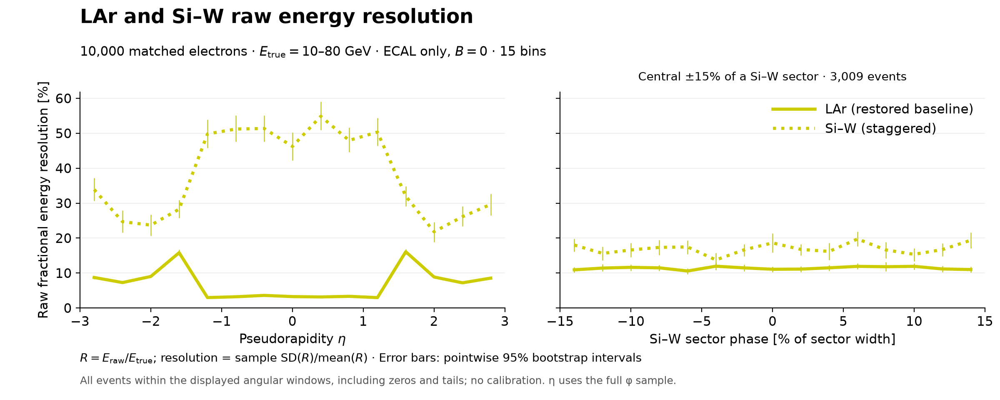

# LAr baseline / Si–W raw energy resolution versus eta and phi

2026-11-19. Fifteen equal signed-eta bins over −3…3 and fifteen equal sector-phase
bins over **−15%…+15% of the Si–W sector width**, shown side by side. The user
confirmed percentages rather than degrees. A sector is 22.5°, so the phi window
is ±3.375° about each sector centre, pooling equivalent sectors. LAr is solid;
Si–W is dotted. Both use the project ECAL color `#cccc00`.



[PDF](figures/raw-energy-resolution.pdf) · [SVG](figures/raw-energy-resolution.svg) ·
[Bin statistics and covariance](summary.json) · [Render hashes](figures/render.json).

The LAr sample is the [selected restored 1.8 mm Pb working baseline](../../design/inputs/ECAL-baseline-selection-2026-11-18.md),
with 1248 barrel periods and 650 mm endcap sampling. Si–W uses the physically
staggered comparator from the [matched 10k study](../lar10k/README.md).
The separate [400 mm gap prototype](../lar-gap400/README.md) has pilot controls,
not a matched 10k production sample, and is not used in this plot.

Each model contains the same 10,000 electron primary IDs, independently uniform
total energy 10–80 GeV, eta −3…3 and phi −π…π. The saved ECAL-only, zero-field
transports include local services, with no tracker or solenoid. The generation
seed is 13310000; transport uses event seed 133812341, FTFP_BERT, 0.7 mm cuts,
5 mm maximum active charged step and twelve workers. Exact source, compact,
material, primary, ledger, receipt and readback identities are retained in the
summary and linked original reports. No transport is rerun for this task.

The plotted statistic is sample SD(R)/mean(R), with R=Eraw/Etrue and ddof=1.
All events within each declared angular window, including zeros and tails,
remain. The eta panel retains all **10,000 events** and is unchanged from the
original figure. The phi panel contains **3,009 matched events per model**;
6,991 are outside the requested directional window. No response-based selection
is applied. Lower bin edges are inclusive; upper edges are exclusive except the
final edge. Phi is folded as `((phi + P/2) modulo P) − P/2`, P=π/8, then expressed
as `100 * folded_phi/P`. The same Si–W reference coordinate is applied to both
models; it is not LAr electrode symmetry. No reflection is imposed.
The other angle and full energy spectrum are marginalized.
These widths include angular response variation,
losses and leakage; they are not intrinsic reconstructed resolution at fixed
energy. No calibration or digitization is applied.

Error bars are pointwise 95% percentile intervals from 1000 shared whole-event
bootstrap replicates, seed 13001000. The labelled 60×60 covariance retains the
correlations between both models and both projections, in squared fractional
width units. Intervals condition on the saved transports, without systematic
uncertainties or simultaneous coverage. Counts, mean response, sample SD,
quantiles, zero counts and mean primary energy accompany every bin.

## Reproduce

Use the existing analysis Python with NumPy 2.5.4 and Matplotlib 3.11.2; no native
DD4hep/ROOT imports are needed. Run from the repository root:

```sh
plot_python=/Users/salzburg/Documents/work/installed/acts-nodd/pyvenv/bin/python
"$plot_python" -B software/analysis/lar_response/raw_angular.py analyze \
  --lar-run ../nodd-lar-compact-hadron/build/lar-restored/production12 \
  --siw-run ../nodd-ecal10k/build/ecal-staggering/production12 \
  --sector-half-width-percent 15 \
  --output build/raw-angular/summary.json
MPLCONFIGDIR="$PWD/build/raw-angular/mpl" XDG_CACHE_HOME="$PWD/build/raw-angular/cache" \
  "$plot_python" -B software/analysis/lar_response/raw_angular.py plot \
  --summary build/raw-angular/summary.json --output build/raw-angular/figures
```

Analysis verifies the event ledger and receipt hashes against successful saved
readbacks, and binds those readbacks and geometry identities to the committed
original summaries. It checks complete IDs, matched primary energies/directions
and input byte hashes, plus inclusive widths against the published results.
This rebinning does not repeat the native ROOT/worker audit; those results and
their provenance are inherited from the exact bound readbacks.
Full event files remain local and ignored. To regenerate transport, use the
[restored LAr recipe](../lar-restored/reproduce.md) and the
[matched Si–W source and reproduction references](../lar10k/reproduce.md).

Replot using only committed aggregates:

```sh
MPLCONFIGDIR="$PWD/build/raw-angular/mpl" XDG_CACHE_HOME="$PWD/build/raw-angular/cache" \
  "$plot_python" -B software/analysis/lar_response/raw_angular.py plot \
  --summary docs/validation/ecal-raw-angular/summary.json --output build/raw-angular/replot
"$plot_python" -B -m unittest discover \
  -s software/analysis/lar_response -p test_compare.py -v
"$plot_python" -B -m unittest discover \
  -s software/analysis/lar_response -p test_raw_angular.py -v
```

All 30 updated phi-bin means, sample SDs, widths, counts and zeros were checked
against the local ledgers using independent degree-based nearest-sector folding
and Python's standard-library `statistics` module. Each phi projection sums to
3,009 events. The eta bin records are exactly identical to the original figure.
The complete bootstrap covariance is finite, symmetric and positive semidefinite
to numerical precision. The exported PNG was visually inspected.

The [original full-phi figure and statistics](https://github.com/asalzburger/nodd/tree/3f270c4fc14b2689ebe5bbf67c1c474fc15f3993/docs/validation/ecal-raw-angular)
remain preserved in Git. Omitting `--sector-half-width-percent` reproduces the
original full-phi analysis from the same local inputs.
