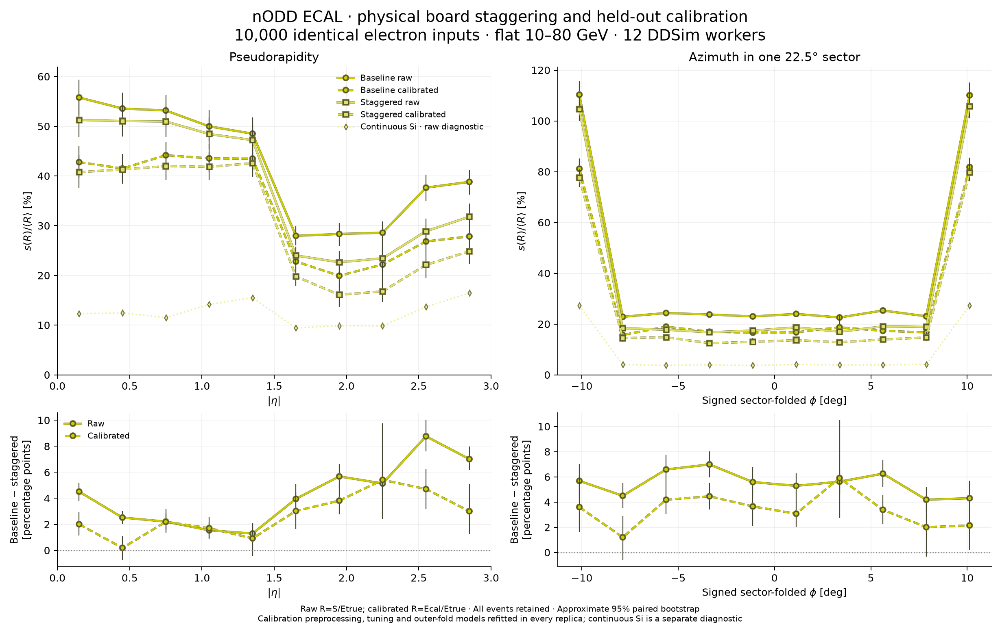
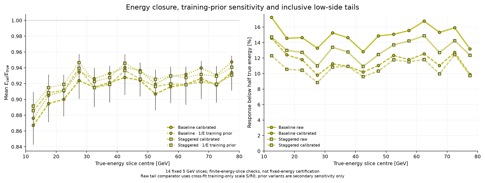

# Physical module staggering and held-out ECAL calibration

**PROTOTYPE**, authorized on 2026-11-12 as a follow-up to the
[continuous-silicon comparison](../ecal10k-untiled/README.md).
The [prospective protocol](protocol.md) fixes physical phases, feature probes,
training folds, regularization, gain bounds and paired refitting uncertainty.
The geometry is isolated; the maintained detector and its acceptance state are
unchanged. This test retains the inherited full-depth sector seams.

## Results

Physical module staggering gives a modest improvement, far smaller than the
fictional continuous-silicon control. The inclusive raw width falls from
**43.09% to 39.27%**. The frozen calibration gives **34.43% / 32.22%** for
baseline / staggered geometry. **Mean calibrated energy remains 8.64% / 8.09%
low, with 8.99% / 8.54% gain clipping.** This is a demonstrator with scale bias,
not a production calibration. No post-hoc rescaling or retuning is applied.

| Geometry / response | Inclusive SD/mean [%], 95% interval | Mean Ecal/Etrue | Tail below half energy [%] | Zeros |
| --- | --- | --- | --- | --- |
| baseline raw | 43.09 [42.16, 44.01] | — (raw Si) | 14.93 | 42 |
| baseline calibrated | 34.43 [33.63, 35.41] | 0.9136 | 11.60 | 42 |
| staggered raw | 39.27 [38.31, 40.26] | — (raw Si) | 13.08 | 42 |
| staggered calibrated | 32.22 [31.36, 33.06] | 0.9191 | 10.80 | 42 |

In all twenty angular bins the raw baseline-minus-staggered 95% paired
interval is positive. Calibrated layout differences are positive at that
pointwise level in 16/20 bins; two eta and two phi intervals include zero.
The strongest residual losses stay near the sector seams: raw folded-phi
edge-bin widths are 104.63/105.79% after staggering, versus 110.31/110.09%
originally. Interior raw phi widths fall to 16.76–19.07%; combined staggering
and calibration gives 12.49–14.78% in those interior bins.

Primary calibrated mean energy in the fourteen true-energy slices ranges
0.867–0.934 for the baseline and 0.886–0.939 for staggering. The secondary
inverse-energy training prior gives ranges 0.876–0.947 and 0.891–0.947; it
does not establish closure either. A train-only closure treatment and a fresh
independent validation sample are needed before using this as a calibration.
The frozen model is retained despite these limitations.

[Vector SVG](results/angular-comparison.svg) · [PDF](results/angular-comparison.pdf) ·
[Compact statistics, models and covariance](results/summary.json).

The plotted width is sample standard deviation divided by the population's own
mean: raw R=S/Etrue for sensitive silicon deposits S; calibrated R=Ecal/Etrue.
All generated events, including zeros, remain in every applicable denominator.
These are spectrum-averaged response widths for uniform 10–80 GeV electrons,
not an intrinsic fixed-energy reconstructed energy resolution. The continuous
silicon curve is a separate, material-changing diagnostic. Do not subtract
these widths or variances in quadrature to assign an independent gap term.

## Calibration and closure controls

An energy-weighted persisted-hit centroid defines an axis from the known origin.
Ten measured features describe reconstructed direction, exact physical-mask
exposure, missing-layer streak, seam proximity, longitudinal energy fractions,
other-section fraction and lateral width. Primary truth energy/direction and
absolute energy proxies are absent from inference. Training uses S/Etrue labels;
truth is used separately for evaluation. `Model.infer(features,signal)` returns
energy without a truth argument. Tests vary held-out truth while requiring the
full inferred energy to stay unchanged.

Each geometry has its own barrel/endcap fit. Five fixed event-ID outer folds
supply held-out predictions; three inner folds select from ridge strengths
0.01, 1 and 100, using training-only normalization, centring and scaling. Relative
gains are limited to 0.5–3. Invalid axes use a training-global scale fallback;
zero signal stays zero. The secondary inverse-energy training prior is a frozen
sensitivity check, not a replacement selected after viewing test performance.

[Energy closure SVG](results/energy-closure-and-tails.svg) ·
[Angular mean-response SVG](results/mean-response-controls.svg) ·
[Signed-direction and sector SVG](results/direction-sector-closure.svg).

Energy-slice means have primary bootstrap intervals. Secondary-prior lines,
energy-slice tail points and direction/sector means are point diagnostics
without their own plotted intervals. Signed-eta and eta-sign controls include
both barrel and endcaps. The central quantile fraction in the data is
(q84−q16)/(2·q50). Raw low-side tails use a cross-fit training-only global region
scale S/R0, so the half-energy threshold is comparable to Ecal/Etrue.

All twenty angular populations have underlying shared-bin histograms. Their
widths come from unbinned moments, not Gaussian fits:

| Populations | Raw response | Calibrated response |
| --- | --- | --- |
| Ten \|eta\| bins | [SVG](results/distributions-raw-abs_eta.svg), [PNG](results/distributions-raw-abs_eta.png), [PDF](results/distributions-raw-abs_eta.pdf) | [SVG](results/distributions-calibrated-abs_eta.svg), [PNG](results/distributions-calibrated-abs_eta.png), [PDF](results/distributions-calibrated-abs_eta.pdf) |
| Ten folded-phi bins | [SVG](results/distributions-raw-folded_phi.svg), [PNG](results/distributions-raw-folded_phi.png), [PDF](results/distributions-raw-folded_phi.pdf) | [SVG](results/distributions-calibrated-folded_phi.svg), [PNG](results/distributions-calibrated-folded_phi.png), [PDF](results/distributions-calibrated-folded_phi.pdf) |

## Physical layout tested

The four-layer tangential/axial phases are (0,0), (48,0), (0,48), (48,48) mm,
superimposed on the inherited ±96 mm mechanical slab phases. With 96 mm board
pitch, the original ±96 mm phases alone leave the internal board lattice aligned.
Full barrel slabs shift axial rows 48 mm away from their service bay. Short
slabs use a declared 24 mm quarter-phase chosen from clearance constraints before
response inspection; no rows are removed. Full-slab frame clearance is at least
16 mm; short-slab clearance at least 9 mm and bay gap at least 27 mm.

Tangential half-phases use two actual narrow edge boards in place of one full
board. The narrow PCB/wafer/active dimensions are 46×94 / 42×90 / 40×88 mm,
with 2 mm PCB margins, 1 mm guards and two complete ASIC/thermal stacks. The
(N−1) full plus two narrow construction preserves the outer PCB span and ASIC
capacity, but changes sensitive/guard/PCB area. It has 386,400 barrel boards
versus 359,904 originally. Endcaps use four distinct physical packing, wafer,
PCB, electrode and ASIC families with 112/107/110/101 modules per sector-layer.
The radial half-phase admits an inner partial row; unsupported shapes still
fail the original minimum-area/width rules. Aperture, absorber, carrier skins,
support, cooling and sector transforms stay fixed.

Net silicon mass changes by −1.576 kg (barrel −16.661 kg, endcaps +15.085 kg).
Active silicon volume changes by −0.67% in the barrel and +1.05% in the endcaps.
The total net modeled mass change is +23.156 kg. Other PCB/conductor/package changes are explicit in the
[material and geometry ledger](geometry-and-run.json). This is a physical
packing intervention, not a coordinate shift applied only to reconstruction.
It remains a prototype without manufacturing, thermal or services sign-off.

## Validation and uncertainty

Native construction verifies 551,520 unique physical sensitive IDs, 1,120 logical
mask profiles and 252,484 electrode references. Active volumes match the XML
polygons. ROOT finds zero overlaps/extrusions at 1e-5 mm tolerance, seed 136.
The native factory and audit libraries are byte-identical to the baseline.
The 24-event pilot and all 10,000 saved production primaries pass truth/hit and
all twelve native worker audits. The new run contains 6,346,815 valid cell hits.
It takes 591.953 s, peaks at 2,650,996,736 bytes RSS (2.469 GiB), and writes
12,613,183,659 bytes ROOT. About 375.75 GiB remains after transport; no disk
reduction or guard activation was needed. Host load was not isolated.

A [dense exact-mask ray screen](coverage-screen.json) uses 1,080,360 directions
per geometry. Mean summed barrel/endcap plane intersections change from 33.020
to 33.199; zero central-ray intersections from 8.789% to 7.918%. This geometric
screen is neither shower efficiency nor energy resolution. Summed crossings
can exceed 48 near the barrel/endcap transition.

The paired analysis retains the identical primary bytes and event-ID pairing.
All twenty original baseline populations and moments match the published
reference to 1e-12 relative tolerance. One thousand common whole-event bootstrap
resamples, seed 1338000, refit preprocessing, inner selection and all outer models
for both geometries. Duplicate IDs retain their original folds. Intervals are
approximate pointwise 95% percentiles; they include training uncertainty and are
not simultaneous bands. The compact result preserves the joint 80-width and
80-contrast covariance with explicit order labels. Contrast covariance is
structurally singular because the four contrasts are linearly dependent.

[Reproduction commands and environment](reproduce.md) ·
[Render hashes](results/render.json) ·
[Curated session and specialist assessments](../../../logs/codex/SESSION-2026-11-12-ecal-calibration-staggering-tests.md).
All eight figure families are stored as PNG, PDF and vector SVG. Raw ROOT,
inputs, ledgers, full geometry/pad audit, features and predictions stay local.

## Angular width table

Values are percentages, all-event sample SD/mean. Full uncertainty and direct
paired contrasts are in the compact JSON and the overlaid SVG.

Ten |eta| bins

| Bin | Events | Baseline raw | Baseline calibrated | Staggered raw | Staggered calibrated |
| --- | --- | --- | --- | --- | --- |
| 0.00–0.30 | 973 | 55.78 | 42.78 | 51.26 | 40.77 |
| 0.30–0.60 | 1002 | 53.56 | 41.49 | 51.04 | 41.30 |
| 0.60–0.90 | 1009 | 53.16 | 44.17 | 50.95 | 41.97 |
| 0.90–1.20 | 1015 | 49.97 | 43.54 | 48.43 | 41.84 |
| 1.20–1.50 | 999 | 48.50 | 43.48 | 47.21 | 42.56 |
| 1.50–1.80 | 1019 | 27.95 | 22.80 | 24.00 | 19.78 |
| 1.80–2.10 | 1007 | 28.33 | 19.92 | 22.65 | 16.10 |
| 2.10–2.40 | 997 | 28.58 | 22.19 | 23.44 | 16.78 |
| 2.40–2.70 | 943 | 37.64 | 26.83 | 28.88 | 22.12 |
| 2.70–3.00 | 1036 | 38.80 | 27.84 | 31.79 | 24.83 |

Ten signed folded-phi bins, degrees

| Bin | Events | Baseline raw | Baseline calibrated | Staggered raw | Staggered calibrated |
| --- | --- | --- | --- | --- | --- |
| -11.25–-9.00 | 1000 | 110.31 | 81.15 | 104.63 | 77.55 |
| -9.00–-6.75 | 1005 | 22.85 | 15.69 | 18.35 | 14.49 |
| -6.75–-4.50 | 944 | 24.34 | 18.96 | 17.76 | 14.78 |
| -4.50–-2.25 | 987 | 23.74 | 16.95 | 16.76 | 12.49 |
| -2.25–0.00 | 994 | 23.00 | 16.61 | 17.42 | 12.96 |
| 0.00–2.25 | 967 | 23.98 | 16.75 | 18.69 | 13.67 |
| 2.25–4.50 | 1038 | 22.59 | 18.71 | 16.97 | 12.81 |
| 4.50–6.75 | 1028 | 25.32 | 17.31 | 19.07 | 13.93 |
| 6.75–9.00 | 1036 | 23.05 | 16.71 | 18.86 | 14.70 |
| 9.00–11.25 | 1001 | 110.09 | 81.83 | 105.79 | 79.68 |

## Separate final assessment

PhysVal reviewed source/results revision
`4bbd9a9bdfd8813804dc8adeaffda07b03a01b0d` and found no actionable material
finding. It independently matched all 80 angular populations to local arrays
(moments, means, zeros, tails, clipping and inclusive histograms), checked frozen
primary/secondary model inference and training means/scales without fitting,
energy/control tables, baseline invariance, covariance transforms (residual
1.6e-18; contrast rank 60), all 24 render hashes and source/run/feature bindings.
All eight PNG families were visually inspected. Both geometries have 42 zeros,
of which 41 are common primary IDs. It confirmed all twenty raw and sixteen
calibrated positive pointwise layout intervals. This review did not rerun
simulation, refit the calibrations or reread full ROOT files, and grants no human
acceptance. The user explicitly authorized draft PR publication on 2026-11-12.
