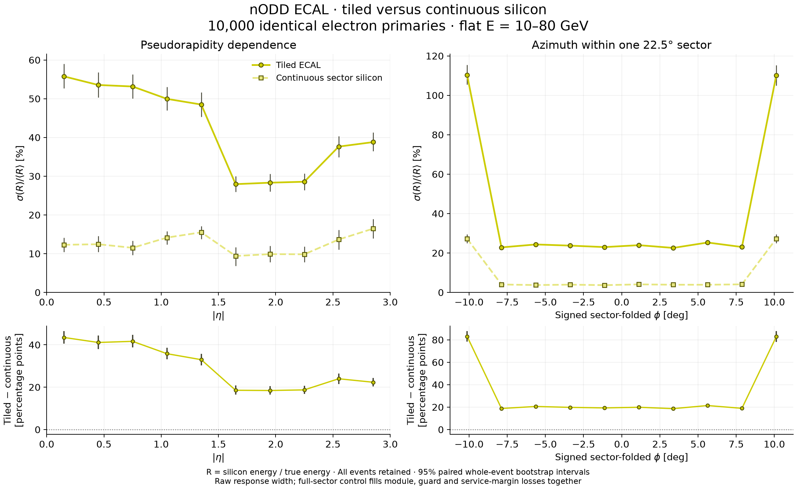
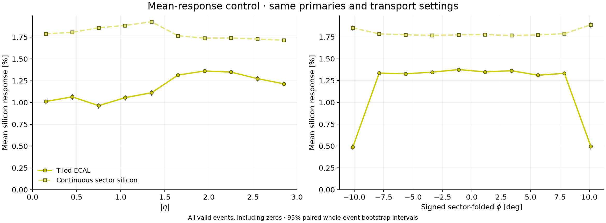

# Continuous silicon ECAL control

**PROTOTYPE: deliberately unbuildable geometry control requested on
2026-11-12.** Compare the [original tiled 10k study](../ecal10k/README.md)
with continuous sensitive silicon across the existing DES-030/DES-031 sector
carrier faces. The [prospective protocol](protocol.md) fixes the intervention,
observable, paired uncertainty treatment and scope before production.

Review package: [draft PR135](https://github.com/asalzburger/nodd/pull/135),
stacked on the original study in draft PR134.

## Geometry intervention

Replace the original active and guard wafers with one 0.5 mm sensitive silicon
sheet per sector/layer: 768 barrel sheets and 1,536 sheets across both endcaps.
Keep the original 48-layer pitch, planes, 16-sector transforms, beam aperture,
negative-end rotations, tungsten, cooling, electronics, wafer films and other
nonintersecting passive pieces. Preserve the inherited 1 mm carrier half-seam;
this is continuous silicon **within each existing carrier**, not a closed
silicon cylinder with no mechanical sector seams.

The barrel sheets span |z| ≤ 3900 mm at radial x = 1702.5 + 10.9·l mm.
Endcap sheets span 100 ≤ x ≤ 2223.2 mm at local z = 2.5 + 10.9·l mm.
Both use the inherited sloping carrier face |y| ≤ x·tan(pi/16) − 1 mm.
Exact sloped Boolean faces preserve the barrel boundary through wafer thickness.

Full sheets fill guards, module/slab gaps and service margins together. Their
intersections with the barrel rails/slab-end frames and endcap supported frame
are subtracted from aluminium to avoid overlaps. The added silicon is
2,475.64 kg; removed aluminium is 447.43 kg. Guard silicon also becomes
sensitive. These material and coverage changes are intentional parts of the
counterfactual. Existing absorber/support structure elsewhere, sector seams and
barrel/endcap transitions remain. This does not isolate electronics or virtual
pad segmentation, for which no threshold/noise/readout model is applied.

Both readouts use virtual 5.5 mm Cartesian cells, with signed 12-bit X/Y fields
instead of the tile-local six-bit fields. Parent system/side/sector/layer/module
fields retain their offsets; the continuous sheet has module 0. Barrel local
readout axes are tangential and axial. Virtual edge-cell centres may fall
outside a clipped physical edge; physical sensitive deposition is still bounded
by the silicon shape. No response threshold or masked-edge cell rejection is used.

The unchanged native factory and audit libraries are reused byte for byte.
The XML-only transform rejects any source that differs from the retained tiled
compact, materials or exact primary files. [Compact geometry evidence](geometry-summary.json)
contains material changes, active/guard volumes, hashes and native results.
The full per-part/plane subtraction ledger remains local and reproducible.

## Validation before production

Ten geometry controls pass, including exact barrel faces, wafer/readout axes,
guard subtraction, touching boundaries, support cuts and rejection of unsupported
geometry. Three statistical controls pass, including multiplicative-response
cancellation under paired bootstrap and explicit undefined zero-signal bins.

Native construction finds all 2,304 sensitive sheets and unique volume IDs.
The 3,136 synthetic wide-address checks preserve both cell coordinates and
parent fields. ROOT reports zero overlaps/extrusions at 10⁻⁵ mm tolerance,
seed 135. This numerical tolerance is not an engineering clearance.

The 24-event, 12-worker pilot passes saved truth/hit and native worker audits.
It takes 24.118 s and produces 30,643,802 bytes, or 1,276,825 bytes/event.
Twice its 10k projection plus a 30 GiB reserve requires 53.783 GiB, versus
about 397 GiB available before the run. Retain all 10,000 events and keep the
runtime free-space guard; do not delete the original sample.

## Completed transport

All **10,000 requested events completed with 12 workers**, exit code zero,
without disk reduction or guard activation. Wall time was 1514.572 s
(25.24 minutes), child CPU time 17413.550 s and peak child RSS
2,471,362,560 bytes (2.302 GiB). The ROOT file is 13,145,892,754 bytes
(13.146 GB). The retained free-space measurement is 413,696,000,000 bytes
(385.284 GiB); `df` reports about 385 GiB. Host load was not isolated.
All twelve native worker audits complete, with 812–868 events per worker.
The original tiled run remains unchanged and retained locally.

## Observable and paired comparison

Each geometry uses the identical retained primary-input file: 10,000 electrons,
independent uniform total energy 10–80 GeV, eta −3 to 3 and full phi, at the
origin. The input and truth-ledger files are copied byte for byte, not regenerated.
Transport uses 12 DDSim workers, seed 133812341 with per-event seeds,
FTFP_BERT, 0.7 mm cuts, 5 mm charged steps in sensitive silicon and zero field.
Source geometry/estimator revision is
`528db706de8a07c3cb39c2d12be758d8223fdd39`.

For each primary ID define R = sum(raw sensitive-silicon deposits)/true total
energy. The width is sample SD(R), ddof=1, divided by that geometry's own mean R.
All valid zero responses remain included. Keep ten equal |eta| bins over 0–3
and ten signed folded-phi bins over [−11.25,+11.25)° with period 22.5°.
The original tiled populations/moments must match all twenty published points.

Use 5,000 paired whole-event bootstrap replicas, seed 1335000, with common
resampled primary IDs across both geometries and both projections. Show 95%
percentile intervals for each width and the direct difference
w_tiled − w_continuous. Preserve joint 40-width and 20-difference covariance.
Equal seeds do not establish identical shower histories after material changes.

This is a broad-spectrum raw visible-response width, including losses, leakage
and within-bin variation. Mean response, absolute SD, quantiles, zero counts and
shared-bin response histograms accompany the overlay. Do not subtract widths or
variances in quadrature to infer an independent tiling term. The residual width
is not an intrinsic fixed-energy reconstructed resolution.

## Result and underlying populations

All **10,000 unique saved primaries pass readback**, with maximum input/energy
error 4.3e-14 GeV and **10,006,736** valid silicon cell hits. The geometry pair
has identical saved primary IDs, energy, eta and phi, identical primary/truth
file hashes and unchanged native libraries/transport settings. All twenty
original tiled-bin counts, zeros and unbinned moments match the published
baseline. The continuous control retains **37 zero-response events**, compared
with 42 originally; no response cut is applied.



[PDF overlay](results/resolution-overlay.pdf) ·
[All binwise statistics, histogram counts and covariance](results/comparison.json)

The ten |eta| widths fall from **27.95–55.78%** to **9.41–16.46%**.
In the eight folded-phi interior bins they fall from **22.59–25.32%** to
**3.69–4.10%**. The two seam-adjacent bins fall from **110.31/110.09%**
to **27.22/27.26%**. All twenty paired width-difference 95% intervals are
strictly positive in this matched-input counterfactual. Joint 40-width and
20-difference covariance matrices are finite, symmetric and positive definite.

Mean silicon response also rises: |eta| bins move from about 0.96–1.36% to
1.71–1.93% of true energy. Interior phi bins rise from 1.31–1.38% to
1.77–1.79%; the two seam bins rise from 0.487/0.495% to 1.854/1.889%.
Thus the normalized-width reduction includes a changed mean as well as a
narrower population. Retained seams and non-Gaussian tails remain visible.
The five-event reduction in exact zeros does not account for the overall
population change seen in the distributions.



[Mean-response PDF](results/mean-response-overlay.pdf) ·
[Ten overlaid |eta| response histograms](results/response-distributions-abs_eta.png) ·
[PDF](results/response-distributions-abs_eta.pdf) ·
[Ten overlaid folded-phi response histograms](results/response-distributions-folded_phi.png) ·
[PDF](results/response-distributions-folded_phi.pdf)

Every histogram population retains all events and uses common response bins.
Widths use unbinned moments, not histogram fits. [Render provenance](results/render.json)
binds the unchanged statistics and final figures. The analysis records HEAD
76f3c940 and the exact producer hash; those producer bytes were committed in
cedf6ee4 (host command paths excluded from public metadata). Visual QA then
corrected mean-plot scaling in 389b623b; only figures were rerendered, with
initial previews retained locally. No statistical result was recomputed.

### Ten |eta| bins

| Bin | N | Tiled width [%] | Continuous width [%] | Tiled − continuous [pp] | Paired 95% interval [pp] | Continuous zeros |
| --- | ---: | ---: | ---: | ---: | --- | ---: |
| 0.00–0.30 | 973 | 55.78 | 12.30 | 43.48 | 40.59–46.53 | 2 |
| 0.30–0.60 | 1002 | 53.56 | 12.44 | 41.11 | 37.99–44.33 | 2 |
| 0.60–0.90 | 1009 | 53.16 | 11.52 | 41.65 | 38.74–44.77 | 3 |
| 0.90–1.20 | 1015 | 49.97 | 14.15 | 35.82 | 33.17–38.56 | 1 |
| 1.20–1.50 | 999 | 48.50 | 15.52 | 32.99 | 30.29–35.77 | 0 |
| 1.50–1.80 | 1019 | 27.95 | 9.41 | 18.55 | 16.45–20.81 | 5 |
| 1.80–2.10 | 1007 | 28.33 | 9.89 | 18.44 | 16.43–20.46 | 2 |
| 2.10–2.40 | 997 | 28.58 | 9.85 | 18.73 | 16.86–20.62 | 2 |
| 2.40–2.70 | 943 | 37.64 | 13.66 | 23.98 | 21.48–26.49 | 8 |
| 2.70–3.00 | 1036 | 38.80 | 16.46 | 22.35 | 20.38–24.40 | 12 |

### Ten signed folded-phi bins

| Bin [deg] | N | Tiled width [%] | Continuous width [%] | Tiled − continuous [pp] | Paired 95% interval [pp] | Continuous zeros |
| --- | ---: | ---: | ---: | ---: | --- | ---: |
| -11.25–-9.00 | 1000 | 110.31 | 27.22 | 83.09 | 78.52–87.91 | 15 |
| -9.00–-6.75 | 1005 | 22.85 | 4.03 | 18.82 | 17.65–19.94 | 0 |
| -6.75–-4.50 | 944 | 24.34 | 3.74 | 20.60 | 19.37–21.77 | 0 |
| -4.50–-2.25 | 987 | 23.74 | 3.95 | 19.79 | 18.55–20.95 | 0 |
| -2.25–0.00 | 994 | 23.00 | 3.69 | 19.31 | 18.06–20.50 | 0 |
| 0.00–2.25 | 967 | 23.98 | 4.09 | 19.89 | 18.58–21.09 | 0 |
| 2.25–4.50 | 1038 | 22.59 | 3.91 | 18.67 | 17.53–19.80 | 0 |
| 4.50–6.75 | 1028 | 25.32 | 3.90 | 21.42 | 20.25–22.59 | 0 |
| 6.75–9.00 | 1036 | 23.05 | 4.10 | 18.94 | 17.82–20.09 | 0 |
| 9.00–11.25 | 1001 | 110.09 | 27.26 | 82.83 | 78.09–87.83 | 22 |

## Reproduce

Follow the existing [ACTS Spack workflow](../../../skills/acts-spack/SKILL.md)
and reverify changed setup fingerprints with the runtime doctor. The existing
installation provides DD4hep/DDG4 1.38, Geant4 11.4.3, ROOT 6.40.04,
EDM4hep 1.1.1 and podio 1.8. Plotting uses the existing Python with NumPy 2.5.4
and Matplotlib 3.11.2; set `ECAL10K_PLOT_PYTHON` to that executable.
No dependencies are installed or changed by this control.

First reproduce the original [tiled input/run and library build](../ecal10k/README.md#reproduce),
or use the exact retained local artifacts. Input hashes are pinned by the
control preparation script. Each output directory below must be fresh. The
local execution used `production-input`/`production12` in place of `repeat-*`.

```sh
python3 -B software/analysis/calorimeter_digitization/untiled_geometry.py \
  --source build/ecal10k/production-input \
  --output build/ecal10k-untiled/repeat-input
software/env/run.sh python3 -B software/analysis/calorimeter_digitization/untiled_native.py \
  --sample build/ecal10k-untiled/repeat-input \
  --library build/ecal10k/calo/libnODDCalorimeterPrototype.dylib \
  --output build/ecal10k-untiled/repeat-native.json
software/env/run.sh python3 -B software/analysis/calorimeter_digitization/angular_sample.py run \
  --sample build/ecal10k-untiled/repeat-input \
  --output build/ecal10k-untiled/repeat12 \
  --geometry-library build/ecal10k/calo/libnODDCalorimeterPrototype.dylib \
  --audit-library build/ecal10k/audit/libnODDAngularAudit.dylib \
  --events 10000 --threads 12 --bytes-per-event 1276825.0833333333
software/env/run.sh python3 -B software/analysis/calorimeter_digitization/angular_analyze.py audit \
  --sample build/ecal10k-untiled/repeat-input --run build/ecal10k-untiled/repeat12
MPLCONFIGDIR="$PWD/build/ecal10k/mpl-cache" XDG_CACHE_HOME="$PWD/build/ecal10k/cache" \
  "$ECAL10K_PLOT_PYTHON" -B software/analysis/calorimeter_digitization/untiled_compare.py \
  --tiled build/ecal10k/production12 --continuous build/ecal10k-untiled/repeat12 \
  --reference docs/validation/ecal10k/summary.json \
  --output build/ecal10k-untiled/repeat-comparison
```

Use `--events 24` and a separate output directory for the pilot, audit it, then
substitute its actual bytes/event for disk planning. The displayed native
validation ran against `input-dev`, whose compact bytes match the frozen
production input exactly; the public native record pins both script and compact
hashes. Later provenance-only preparer changes did not alter the compact.

Mathematical tests need no native packages; run the three specific suites:

```sh
python3 -B -m unittest discover -s software/analysis/calorimeter_digitization -p 'test_untiled_geometry.py' -v
"$ECAL10K_PLOT_PYTHON" -B -m unittest discover -s software/analysis/calorimeter_digitization -p 'test_untiled_compare.py' -v
"$ECAL10K_PLOT_PYTHON" -B -m unittest discover -s software/analysis/calorimeter_digitization -p 'test_angular_response.py' -v
```

Raw ROOT files, exact primary/event ledgers, caches, builds and bulky logs remain
local and ignored under `build/`. Only figures, recipes, provenance and compact
binwise evidence belong in this review package. No production detector,
engineering approval or design lifecycle state changes.

The committed compact result can be replotted without ROOT or event files:

```sh
"$ECAL10K_PLOT_PYTHON" -B software/analysis/calorimeter_digitization/untiled_compare.py \
  --replot docs/validation/ecal10k-untiled/results/comparison.json \
  --output build/ecal10k-untiled/standalone-replot
```

Separate PhysVal result assessment at
`66a444a4d38d972d658bb4daeb93d11c7274b286` found no actionable findings.
It independently matched both local ledgers and recomputed all forty geometry/bin
moments, quantiles, zeros and histogram populations; checked covariance block
identities, all twenty difference intervals and render/source hashes; and viewed
all four PNG families. It did not rerun Geant4, reread the full ROOT files or
independently regenerate all 5,000 replicas. Technical assessment is not human
acceptance. See the [curated session](../../../logs/codex/SESSION-2026-11-12-ecal10k-untiled-control.md).

## Vector SVG exports

All four plot families are also stored as vector SVG:

- [Width overlay and paired differences](results/resolution-overlay.svg)
- [Mean-response overlay](results/mean-response-overlay.svg)
- [Ten |eta| distributions](results/response-distributions-abs_eta.svg)
- [Ten folded-phi distributions](results/response-distributions-folded_phi.svg)

The existing replot command now emits PNG, PDF and SVG. The new SVG companions
were rendered from the unchanged compact comparison; the accepted statistics
and original eight PNG/PDF files remain byte-identical.
[SVG render provenance](results/svg-render.json) records the plotter and file
hashes. SVG IDs use a fixed hash salt and omit creation-date metadata. XML
checks find vector paths with no embedded raster, script or external references.
All four SVG previews were rendered with the existing optional
`rsvg-convert 2.62.3` and visually inspected; that tool is not needed to export
the SVG from Matplotlib. No Geant4 or bootstrap rerun was performed.

## Possible next studies

[Calibration and staggered-layout options](calibration-layout-options.md) proposes
a held-out local-position response correction and independent layer-dependent
board phases, while distinguishing existing slab staggering and full-depth
carrier seams. These are unimplemented proposals with no performance or
engineering-acceptance claim.
