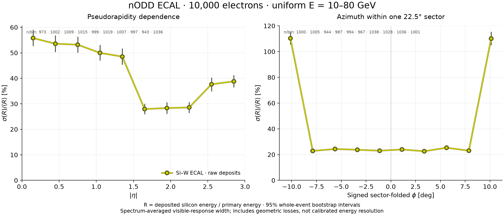
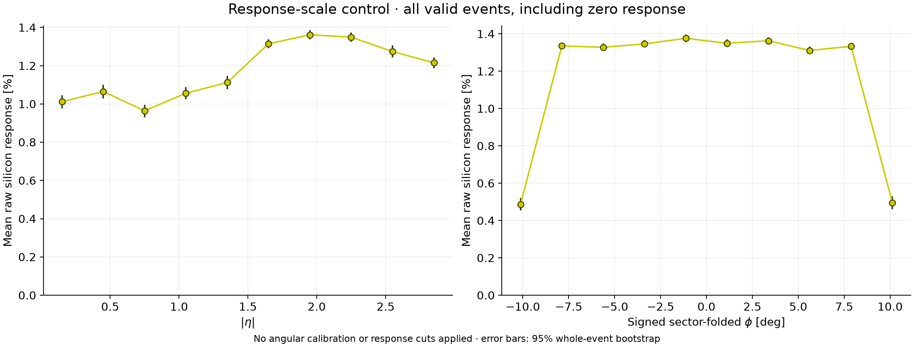

# ECAL10K — Electron response versus pseudorapidity and sector azimuth

**PROTOTYPE characterization; no detector acceptance or reconstructed energy
calibration.** This extends the [PR133 benchmark](../issue131/README.md) using
its exact ECAL-only compact/materials and the DES-030/DES-031 factories.
There is no tracker, beam pipe or magnetic field. The prospective
[analysis protocol](protocol.md) was fixed before production.

Review package: [draft PR134](https://github.com/asalzburger/nodd/pull/134).

## Sample and observable

The requested sample is 10,000 single electrons at the origin, with independent
uniform total energy 10–80 GeV, eta -3 to 3 and full phi. Input seed is 13310000;
DDSim transport seed is 133812341 with per-event seeding enabled. Production
uses 12 Geant4 workers. The exact generator, input, geometry, library and
analysis identities accompany the compact result.

For each event, define R as the sum of all `BARRELHits` and `EDGEHits` raw
silicon deposits divided by persisted primary total energy. The plotted
fractional width is sample SD(R)/mean(R). Normalizing event by event avoids
mistaking the broad beam-energy spectrum for calorimeter fluctuations; an
overall multiplicative calibration cancels. No angular calibration, Gaussian
core fit or post-hoc response cut is applied. Valid no-hit events remain zeros.

This spectrum-averaged visible-response width includes shower fluctuations,
geometric losses, leakage and response variation within a bin. It is not an
intrinsic reconstructed energy-resolution measurement at fixed energy.
Mean response, zero counts and quantiles are retained to expose scale/losses.

Ten equal |eta| bins cover 0–3. Both ECAL sections have sixteen azimuthal
replicas. Phi is folded modulo 22.5 degrees into the **signed** interval
[-11.25,+11.25) degrees, then divided into ten bins. Zero is a sector centre;
the ends are sector seams. Folding does not additionally assume reflection
symmetry. Both projections use the same events and have correlated errors.

## Executed result

DDSim completed all **10,000 events with 12 workers**, without reducing
the sample or triggering the disk guard. The whole process took
585.694 s (9.76 min), consumed
6066.617 child CPU seconds, and reached **2.371 GiB
peak child-process RSS**. The ROOT file is **12,604,492,755 bytes
(12.604 GB)**, or 1.260 MB/event.
The retained free-space check reported 400.5 GiB;
post-run `df` reported about 401 GiB. Host load was not isolated.

All **10,000 unique saved primaries passed readback**, with all twelve worker
audits complete and 6,289,322 valid ECAL cell hits. Maximum saved/input energy
error was 4.3e-14 GeV. There are **42 valid zero-response events**; all fall in
the two seam-adjacent folded-phi bins. No event was rejected for low response.



[PDF figure](angular-resolution.pdf) · [Compact binwise result and covariance](summary.json)

The |eta| projection ranges from about 28% to 56% in this inclusive sample.
The folded-phi interior bins are about 23–25%; the two seam-adjacent bins are
about 110%. Their mean silicon response is about 0.49% of incident energy,
compared with 1.31–1.38% in the interior bins. These measured losses and broad
tails are retained, rather than fitting or cutting them away. This does not
isolate the causal contribution of individual mechanical components or establish
intrinsic calorimeter resolution.



[PDF mean-response figure](mean-response.pdf). Error bars use 5,000 joint
whole-event bootstrap replicas, seed 1335000, and show 95% percentile intervals.
All 20 widths/intervals and the symmetric 20x20 covariance are finite.
The spectrum mix is fixed by the requested uniform generation; each angular
bin's incident-energy mean/range, quantiles and valid zero count remain in JSON.

| Absolute eta bin | Events | Width [%] | 95% interval [%] | Zero response |
| --- | ---: | ---: | --- | ---: |
| 0.00–0.30 | 973 | 55.78 | 52.67–58.98 | 2 |
| 0.30–0.60 | 1002 | 53.56 | 50.32–56.80 | 5 |
| 0.60–0.90 | 1009 | 53.16 | 50.08–56.33 | 3 |
| 0.90–1.20 | 1015 | 49.97 | 47.03–53.06 | 1 |
| 1.20–1.50 | 999 | 48.50 | 45.34–51.67 | 0 |
| 1.50–1.80 | 1019 | 27.95 | 25.93–29.97 | 5 |
| 1.80–2.10 | 1007 | 28.33 | 26.06–30.60 | 3 |
| 2.10–2.40 | 997 | 28.58 | 26.44–30.70 | 2 |
| 2.40–2.70 | 943 | 37.64 | 34.93–40.30 | 8 |
| 2.70–3.00 | 1036 | 38.80 | 36.48–41.26 | 13 |

| Folded phi [deg] bin | Events | Width [%] | 95% interval [%] | Zero response |
| --- | ---: | ---: | --- | ---: |
| -11.25–-9.00 | 1000 | 110.31 | 105.48–115.45 | 20 |
| -9.00–-6.75 | 1005 | 22.85 | 21.67–23.98 | 0 |
| -6.75–-4.50 | 944 | 24.34 | 23.12–25.52 | 0 |
| -4.50–-2.25 | 987 | 23.74 | 22.48–24.92 | 0 |
| -2.25–0.00 | 994 | 23.00 | 21.75–24.18 | 0 |
| 0.00–2.25 | 967 | 23.98 | 22.66–25.20 | 0 |
| 2.25–4.50 | 1038 | 22.59 | 21.43–23.73 | 0 |
| 4.50–6.75 | 1028 | 25.32 | 24.14–26.48 | 0 |
| 6.75–9.00 | 1036 | 23.05 | 21.91–24.15 | 0 |
| 9.00–11.25 | 1001 | 110.09 | 104.99–115.33 | 22 |


## Disk and multithreading checks

Initial `df` reported about 408 GiB available; Python exposed about 412 GiB
when preparing the input. The 24-event MT pilot wrote 28,752,276 bytes,
1.198 MB/event, projecting 11.98 GB for 10,000 events. Twice that projection
plus a 30-GiB reserve needs 52.31 GiB, so no event reduction was needed.
The runner retains the reserve and checks free space throughout transport.

All twelve worker audits passed in the pilot, with every worker processing at
least one event. A separate serial control used identical primary inputs and
transport seeds. All 24 event summaries matched exactly by ID: same deposited
energy, response and per-collection hit counts. ROOT bytes differ because
physical output order/metadata differ. The sample check does not claim equality
of every individual cell payload or byte-identical ROOT output.

## Reproduce

Use a fresh task directory and the verified ACTS Spack node environment; follow
the [Spack preflight](../../../skills/acts-spack/SKILL.md) and reverify changed
fingerprints with `software/env/run.sh python3 -B software/env/doctor.py`.
Executed native software is DD4hep/DDG4 1.38, Geant4 11.4.3, ROOT 6.40.04,
EDM4hep 1.1.1 and podio 1.8. The separate existing plotting Python provides
NumPy 2.5.4 and Matplotlib 3.11.2. No dependencies were installed or modified.

Set `ECAL10K_SOURCE_RUN` to the local PR133 `build/issue131/run` directory.
The preparation command verifies and copies only its exact compact/materials,
then generates new primaries. Set `ECAL10K_PLOT_PYTHON` to the existing Python
with NumPy/Matplotlib; this pure analysis stage needs no native ROOT imports.

```sh
software/env/run.sh cmake -S prototypes/calorimeter -B build/ecal10k/calo -G Ninja -DCMAKE_BUILD_TYPE=Release
software/env/run.sh cmake --build build/ecal10k/calo --target Components_nODDCalorimeterPrototype --parallel 3
software/env/run.sh cmake -S docs/validation/ecal10k -B build/ecal10k/audit -G Ninja -DCMAKE_BUILD_TYPE=Release
software/env/run.sh cmake --build build/ecal10k/audit --parallel 3
python3 -B software/analysis/calorimeter_digitization/angular_sample.py prepare \
  --source "$ECAL10K_SOURCE_RUN" --output build/ecal10k/repeat-input
software/env/run.sh python3 -B software/analysis/calorimeter_digitization/angular_sample.py run \
  --sample build/ecal10k/repeat-input --output build/ecal10k/repeat12 \
  --geometry-library build/ecal10k/calo/libnODDCalorimeterPrototype.dylib \
  --audit-library build/ecal10k/audit/libnODDAngularAudit.dylib \
  --events 10000 --threads 12 --bytes-per-event 1198011.5
software/env/run.sh python3 -B software/analysis/calorimeter_digitization/angular_analyze.py audit \
  --sample build/ecal10k/repeat-input --run build/ecal10k/repeat12
MPLCONFIGDIR="$PWD/build/ecal10k/mpl-cache" XDG_CACHE_HOME="$PWD/build/ecal10k/cache" \
  "$ECAL10K_PLOT_PYTHON" -B software/analysis/calorimeter_digitization/angular_analyze.py analyze \
  --run build/ecal10k/repeat12 --output build/ecal10k/repeat-analysis/summary.json
```

The macOS library suffix is shown. Each transport/input directory must be fresh;
failed attempts remain separate. Native audits record each worker's detector
roles, step policy, field, cuts, RNG engine and completed count. Saved events are
checked by identity rather than completion order. Every primary is bound to the
generated input ledger and all cell energies/IDs are validated on readback.

The compact summary supports replotting without event files:

```sh
"$ECAL10K_PLOT_PYTHON" -B software/analysis/calorimeter_digitization/angular_analyze.py replot \
  --summary docs/validation/ecal10k/summary.json --output build/ecal10k/replot
"$ECAL10K_PLOT_PYTHON" -B -m unittest discover \
  -s software/analysis/calorimeter_digitization -p 'test_angular_response.py' -v
```

Raw ROOT files, primary/event ledgers, full logs, builds and caches remain local
and ignored under `build/ecal10k/`. They are required to repeat transport hash
and event-level validation. Public evidence contains only recipes, figures,
provenance and binwise statistics, including the joint bootstrap covariance.
