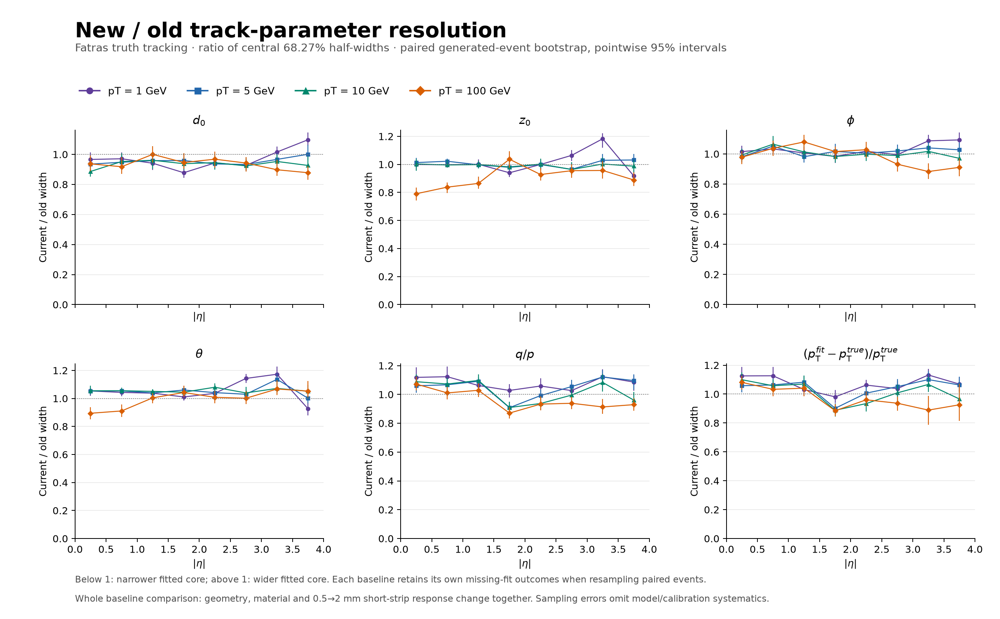

# Old/new nODD Fatras muon truth-fit resolutions

- Status: PROTOTYPE characterization; no design or performance acceptance.
- Date: 2026-11-03.
- Task: TASK-TRACK-BASELINE-FATRAS-RESOLUTIONS; DES-025, DES-043; ADR-003.

This compares the same generated single muons in the old 0.5 mm short-strip
baseline and current 2 mm/reduced-service baseline used for the preceding
[material](../baseline-material-comparison/README.md) and
[sensitive-crossing](../baseline-hit-comparison/README.md) comparisons.
The four values are fixed **pT=1,5,10,100 GeV**. Each baseline/momentum uses
20,000 events (160,000 performance events total), random muon charge, origin,
uniform eta[-4,4], full phi and Bz=3 T. No detector or fitter parameters are tuned
against these performance samples.

## Results and plots

Each per-momentum figure compares the six parameters against |eta|. The ratio
overview shows new/old widths with pointwise paired-bootstrap intervals;
values below 1 indicate a narrower fitted core.

- [1 GeV](figures/resolutions-pt1.pdf) · [5 GeV](figures/resolutions-pt5.pdf) · [10 GeV](figures/resolutions-pt10.pdf) · [100 GeV](figures/resolutions-pt100.pdf)
- [New/old ratios](figures/resolution-ratios.pdf) · [Fit and charge accounting](figures/fit-accounting.pdf)

Central |eta|<0.5 core widths, **old → new** (sampling uncertainties in the plots
and profiles.json.gz; these are not global acceptance summaries):

| pT [GeV] | d0 [µm] | z0 [µm] | phi [mrad] | theta [mrad] | q/p [e/GeV] | relative pT [%] |
| ---: | ---: | ---: | ---: | ---: | ---: | ---: |
| 1 | 52.92 → 51.13 | 61.75 → 61.7 | 1.586 → 1.611 | 1.48 → 1.56 | 0.005193 → 0.005809 | 0.5434 → 0.6118 |
| 5 | 19.63 → 18.35 | 25.09 → 25.42 | 0.4396 → 0.4313 | 0.4334 → 0.4563 | 0.001249 → 0.001325 | 0.6463 → 0.6836 |
| 10 | 14.11 → 12.51 | 17.42 → 17.48 | 0.25 → 0.2482 | 0.2462 → 0.2597 | 0.0006141 → 0.0006684 | 0.6379 → 0.7013 |
| 100 | 6.715 → 6.29 | 10.26 → 8.108 | 0.04304 → 0.04211 | 0.06992 → 0.06253 | 7.473e-05 → 8.01e-05 | 0.771 → 0.8336 |

The changes are mixed across parameter and eta. Centrally d0 becomes narrower
and relative-pT cores become wider. Central z0 is similar at 1–10 GeV and about
21% narrower at 100 GeV. This does not establish
a causal effect of a particular service or readout change, and pointwise
sampling intervals should be used before interpreting small differences.

Every case generated 20,000 muons. No attempted fit failed to return a fitted
parameter state, and no returned fit had nonfinite bound parameters or invalid
covariance. The losses below are selection losses. The native-unmatched count
identifies guarded zero-barcode primary-derived partial fits retained in the
residual populations, rather than silently discarded.

| Baseline | pT [GeV] | Selected | Attempts | Returned fits | Finite fits | Native unmatched | Wrong charge |
| --- | ---: | ---: | ---: | ---: | ---: | ---: | ---: |
| Old | 1 | 19992 | 19992 | 19992 | 19992 | 1 | 0 |
| New | 1 | 19997 | 19997 | 19997 | 19997 | 0 | 0 |
| Old | 5 | 19999 | 19999 | 19999 | 19999 | 0 | 0 |
| New | 5 | 20000 | 20000 | 20000 | 20000 | 0 | 0 |
| Old | 10 | 19998 | 19998 | 19998 | 19998 | 0 | 0 |
| New | 10 | 20000 | 20000 | 20000 | 20000 | 0 | 0 |
| Old | 100 | 19999 | 19999 | 19999 | 19999 | 0 | 467 |
| New | 100 | 20000 | 20000 | 20000 | 20000 | 0 | 419 |

At 100 GeV the forward momentum residual is strongly non-Gaussian. For
3.5≤|eta|≤4, all finite fits (including wrong-charge fits) give:

| Baseline | Generated / finite fits | Wrong charge | Relative-pT width68 [%] | Relative-pT SD [%] | Relative-pT RMS [%] |
| --- | ---: | ---: | ---: | ---: | ---: |
| Old | 2529 / 2529 | 401 | 114 | 5294 | 5309 |
| New | 2529 / 2529 | 351 | 105.5 | 1.815e+04 | 1.815e+04 |

The new forward sample has a narrower core and a substantially larger full
RMS than the old sample. These are sample statistics with very heavy tails.
The large SD/RMS arises from the untrimmed sample near zero fitted q/p;
the central width is not a complete momentum-performance statement. The q/p
panels and retained signed-curvature diagnostics provide complementary
observables without the inverse-momentum singularity.

## Definition and response

Native Fatras, unique primary associations, the corrected truth proto finder,
at least seven unique measurements, ideal truth seeds with the established
finite covariance and native Kalman smoothing to the origin perigee are used.
This does not measure pattern recognition. Native zero-barcode partial fits
remain under the audited primary-input rule; their counts are reported above.

The six plotted quantities are d0, z0, wrapped phi, theta, q/p and relative pT
residuals (fit minus truth). Time is unmeasured and prior dominated; it is omitted.
The signed relative q/pT observable is retained as an additional diagnostic.
Resolution means the central empirical 68.268949% half-width, not a Gaussian
fit or full RMS. Each baseline uses all of its finite values without residual,
pull, tail, charge or quality cuts. Missing outcomes remain in the generated
accounting. Minimum 30 entries; eight |eta| bins of width 0.5; 32 signed-eta bins
retained in the compact evidence.

Pixels are 50×50 µm; short strips 75 µm × old 0.5 mm/new 2 mm; long strips 80 µm loc0
with actual stereo faces. Geometric digital cell-center response, native
clustering, exact path-length charge, zero threshold and no drift/diffusion are
shared. Old errors are the original frozen, independently trained table after
geometry/response/training identity checks. Current errors come from an
independent 50,000-event log-uniform pT 1..100 GeV Fatras training sample, seed 142042:
741,888 measurements, 54 sensitive volumes, 94 measured-coordinate pairs and 107
cluster/overflow groups (3341..48801 entries). The maintained calibration wrapper
and pinned ACTS algorithm calculate postcluster errors without fit-pull tuning.
Every observed measurement variance in every performance case is independently
checked against its frozen table.

## Statistical interpretation

Per-baseline width bars are 400-bootstrap sampling SE. New/old ratio intervals
are pointwise 95% percentile intervals from 400 paired generated-event resamples;
each baseline independently retains its unavailable fits in each resample.
Common-finite-fit ratios are diagnostic only. Generated/selected/attempted/fit,
finite parameters, covariance, native association and wrong charge counts are
retained, with Wilson 95% fractions. Bias, median, full SD/RMS and pull tails are
also retained. Pulls require valid covariance and include theta–q/p covariance
for derived pT/curvature. Intervals condition on fixed calibration and maps;
model/calibration systematics are not included.

## Provenance and reproduction

Native execution source: 326fed57a3c3aa75466756f47cee2e69d5d22b9b.
The analysis revision and executed-helper hashes are in profiles.json.gz;
plotter/data/artifact hashes are in figures/plot-report.json.
Old geometry: 530080cfe16c7513228bf60238b99d4b9938538a;
current geometry: 62f6056395e0dfee0c7985cf24e88dc9919c4e2d (PR110+112).
Native adapter 530080c; ACTS 355ea68493b326956756c9386d2fd9eaf9328568;
Python 3.14.5, ROOT 6.40.04, DD4hep 1.38, Geant4 11.4.3. Source trees and
compact/material/five factory/map identities are checked, rather than inferred
from filenames. The stale Spack registry fingerprint/full-source preflight
limitation remains; actual runtime imports, binaries and native controls passed.
No dependencies or shared installations were changed.

The [analysis recipe](../../../software/analysis/fatras_baseline_comparison/README.md)
and [native recipe](../../../software/analysis/fatras_baseline_comparison/README_native.md)
give exact commands, source gates, seeds and local dependency paths. Compact
runs.json.gz retains configuration, sources, library/geometry/map/calibration
and ROOT hashes and counts. The current corrected/raw error tables and training
audit are retained as configuration evidence. Full ROOT/event samples, caches
and large logs remain local and ignored under build/fatras-baseline-comparison;
full audits require these files, while replotting only requires profiles.json.gz.
The fresh old pT1,10,100 samples exactly reproduce the generated inputs and all
five fitted parameter branches of their original 20k references. The pT1 case
also reproduces its published
central 52.92 µm d0, 61.75 µm z0 and 0.543% relative-pT core widths.

## Limits

This compares complete baselines: geometry, material and readout change together.
It cannot isolate services or strixel pitch. The inherited Gen3 material model
has one-phi-bin averaging, material locality/order approximations and known
Geant4/TGeo graphite CSG discrepancies documented in the material report. These
are model limits, not statistical errors. Ideal truth seeds/associations and the
simplified response omit pattern recognition and realistic detector effects.
Forward high-pT momentum residuals can be non-Gaussian and nonlinear near zero
fitted q/p; core widths must be read with signed-curvature, RMS and charge
accounting. Successful runs and a separate agent recommendation do not grant
engineering approval or performance acceptance.

## Validation assessment

Eight focused tests pass. Separate PhysVal assessed exact revision
795f7861c61abfe9ee69302162f69b8f60dffd62 and independently reproduced full-data
statistics and calibration audits, checked representative bootstrap intervals
and inspected every figure. No material delivery blocker was found for this
qualified prototype; see the [assessment](review.md) for actual checks and scope.
Scientific data and plots are unchanged after that review.
