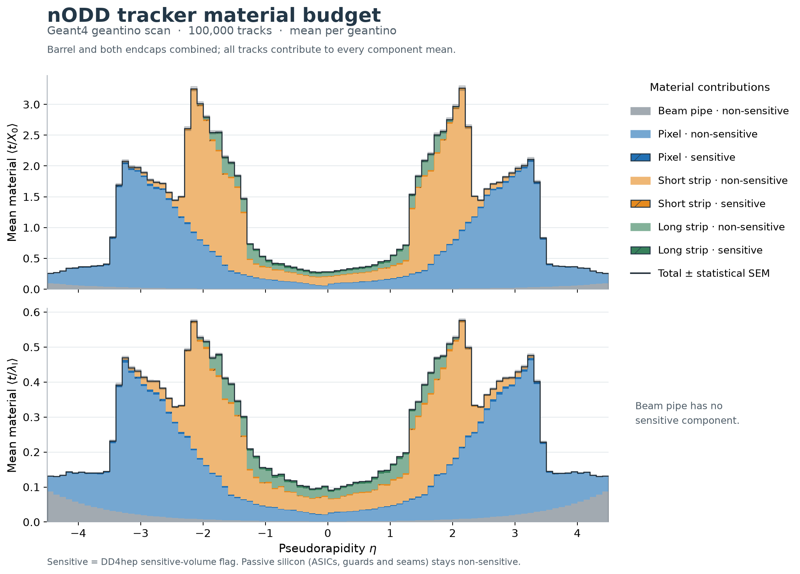

# Geant4 tracker material profiles — 100,000 geantinos

- Date: 2026-10-26
- Scope: characterization of the existing DRAFT / PROTOTYPE DES-024/025 model;
  no geometry changes, detector sign-off or reconstruction-performance claim.
- Input: user-provided `storage/nodd-tracker.root`, latest `material_tracks` cycle,
  100,000 geantino tracks in 1,000 events, covering eta [-4.5, 4.5] and full phi.
- Original generator seed, command and recording geometry revision: unknown.

[PDF](figures/material_budget_eta.pdf) · [SVG](figures/material_budget_eta.svg) ·
[subdetector panels](figures/material_budget_subdetectors_eta.pdf) ·
[folded |eta|](figures/material_budget_abs_eta.pdf) ·
[phi](figures/material_budget_phi.pdf)

## Observable and normalization

For each geantino, sum the recorded `mat_step_length/mat_X0` and
`mat_step_length/mat_L0` separately in beam pipe, pixel, short strip and long
strip, and in their sensitive/non-sensitive parts. Barrel and both endcaps are
combined. Every track, including a zero contribution, fills every component.
The plotted bins are means per incident geantino, not means per material step
or per track crossing the selected component. Eta has 90 bins of width 0.10;
|eta| has 45 bins and phi has 72. Minimum occupancies are 1,036, 2,124 and 1,300.

The total statistical band is the ROOT TProfile error on the mean, M2/N²,
calculated from each track's complete sum. This includes component covariance.
Independent-component errors are not added. The band measures finite-scan
statistics and does not include detector-model or geometry-identity uncertainty.

## Labels and precision limits

The recording has material properties and positions but no detector names,
volume IDs or sensitive flags. The classifier reconstructs the existing local
tracker compact from source checkout `530080cfe16c7513228bf60238b99d4b9938538a`,
then locates step interiors using TGeo and reads DD4hep's `isSensitive()` flag.
Silicon ASICs, guards and seams are non-sensitive; pixel active patches are
sensitive. The pipe has no sensitive component. The complete step-density check
supports association with this local geometry; it cannot establish the missing
recording revision or prove identical same-density recipes/sensitive boundaries.
Exact compact, material XML, factory, recording and classifier hashes are retained
in [provenance.json](provenance.json). Local build products are not source SHAs.

The Geant4 recorder stores the step start in `mat_x/y/z`; use half a step along
its recorded direction to locate the interior. Treating `mat_x/y/z` or the
midpoint of synthetic `mat_s/e` as the interior mislabels boundary steps.

All 17,137,021 steps are assigned, with recorded/geometric densities agreeing
within relative tolerance 5e-6 after unit conversion. Three steps use another
strict interior fraction; six need a search on a five-point grid per coordinate
inside the half-ulp rounding cell of the stored float32 position. Rescues require
density agreement. The grid candidates must agree on the subdetector. Two
short-strip silicon edge steps have candidates on both sensitive and passive
sides: their full budgets are allocated non-sensitive, retaining their full
budgets as a bound on the sensitivity split. The largest eta-bin mean shifts
are **1.46e-10 X0** and **2.99e-11 interaction lengths**. Totals are unaffected.
This is a finite grid search, not a proof over every point in the rounding cell.
[Diagnostics](classification-diagnostics.csv) retain all six corrections.

Per-track component sums agree with recorded totals to float32 accumulation
precision: maximum absolute differences are 5.78e-6 X0 and 1.23e-6 interaction
lengths. The independent export requires rtol 6e-6 plus atol 2e-6. Profile means,
variances and common counts are independently checked from the categorized
per-track arrays. These checks establish the reported reduction, not design acceptance.

## Retained data and reproduction

The [portable native rerun](native-rerun.json) identifies the packaged classifier
and launcher at corrected source revision `7c00121` (full SHA in the report). It
processed the complete scan and reproduced every retained bin edge, count,
component/total mean and variance exactly. This rerun is distinct from the
initial workspace scripts identified in provenance.json. The separately reviewed
[earlier run](native-rerun-4008abf.json) is retained. Native component counts,
means and variances were independently checked against per-track arrays.

[profiles.json](profiles.json) contains bin edges, common counts, component/total
means and variances, classification summary and precision bounds. The adjacent
six CSVs expose means and standard errors. [classification.json](classification.json)
retains the full material/category inventory. [original-validation.json](original-validation.json)
identifies the original numerical/export checks; interactive HTML and native
ROOT outputs were generated locally and remain outside Git. Static figures are
retained here. [Analysis commands](../../../software/analysis/material_profiles/README.md)
reproduce the plots from compact data and document optional native classification.

The software layout follows [ADR-008](../../decisions/ADR-008-software-source-layout.md).
The geometry remains governed by [DES-024](../../design/DES-024-beryllium-beampipe.md)
and [DES-025](../../design/DES-025-tracker-dd4hep-gen3.md). The plotting dependency
is pinned by the existing [unrooted setup](../../../software/analysis/README.md).
