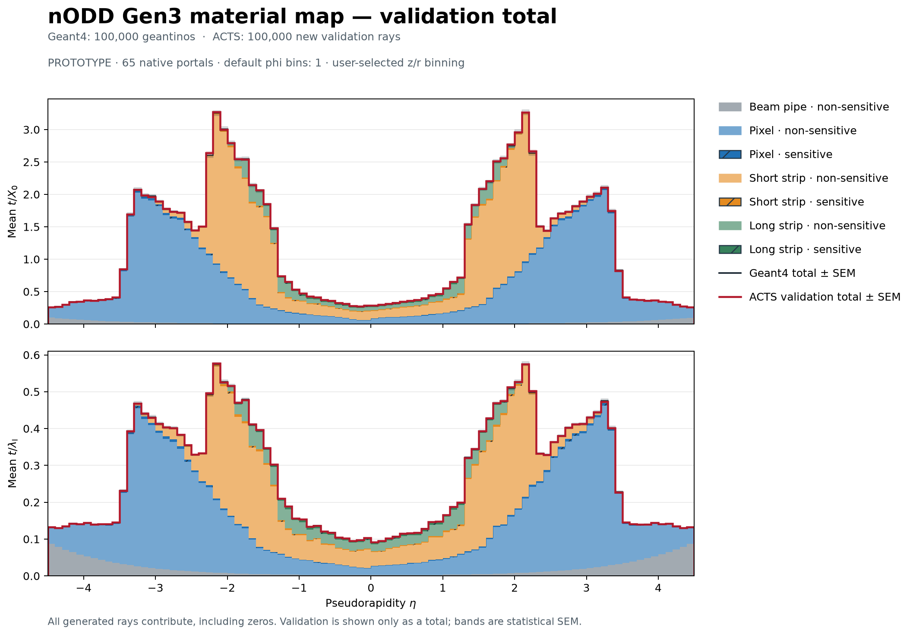
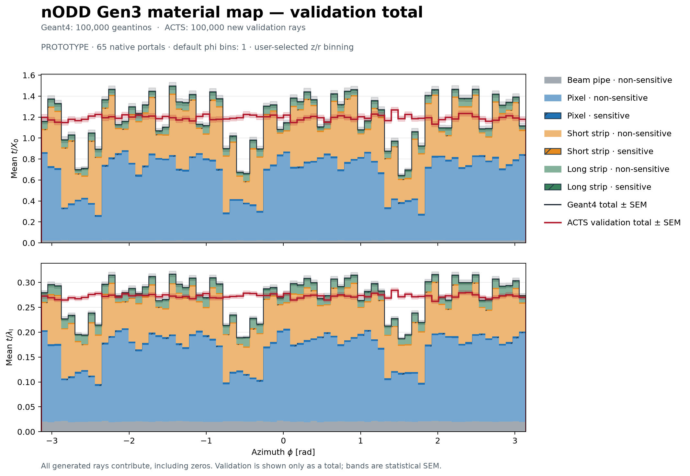
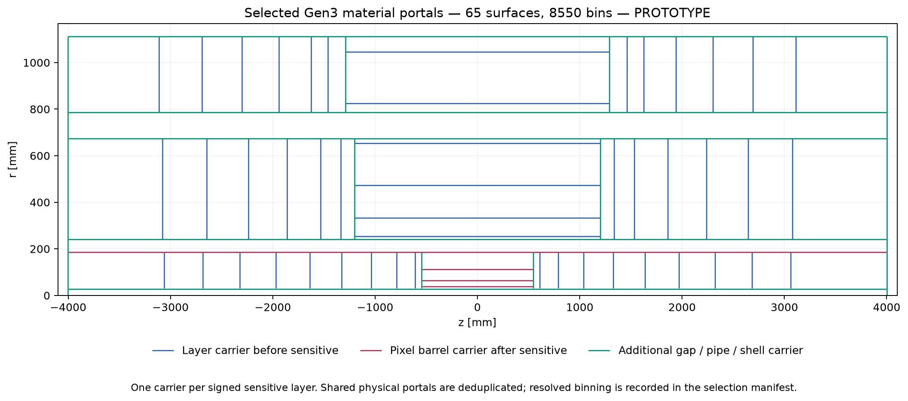

# Configurable Gen3 portal material-mapping trial

**PROTOTYPE / DRAFT — user-selected configuration, 2026-10-26.**
This continues [PR100](https://github.com/asalzburger/nodd/pull/100) under
[DES-025](../../design/DES-025-tracker-dd4hep-gen3.md). The
[first surface survey](../gen3-material-mapping/README.md) is retained as a
separate control; its face-by-face proposal is superseded for this trial.

## Observed result

The full native run mapped **100,000 recorded geantinos / 17,137,021 steps**
onto the selected portals, with **zero unmapped steps or material**. For every
recorded ray, mapped plus unmapped step counts and X₀/λI budgets close exactly
at the native reader's precision. This is an assignment conservation check;
the separate validation below tests the resulting averaged map.



The red curve is **only the ACTS validation total** over the original Geant4
sensitive/non-sensitive component stack. Bands show each sample's statistical
SEM, including within-bin angular/material variation; map-training uncertainty
and geometry systematics are not included. All generated rays contribute to
means, including zero budgets. The actual validation has 100,000 rays and no
zero-budget rays. It recorded 1,417,441 portal interactions.

| Quantity | Geant4 mean per ray | Validation mean per ray | Relative difference |
| --- | ---: | ---: | ---: |
| t/X₀ | 1.18926151 | 1.19529416 | +0.5073% |
| t/λI | 0.27191627 | 0.27268667 | +0.2833% |

Across the 90 η bins, the maximum absolute relative differences are **1.1004%
X₀ and 0.8281% λI**; the binwise RMS differences are 0.4194% and 0.3556%.
These are descriptive results, without a declared accuracy acceptance threshold.
The map has 8,550 nominal bins, including **1,672 zero-thickness bins**. A zero
slab alone does not distinguish unsampled bins from sampled bins with no assigned
material; bin-occupancy uncertainties have not been quantified.



One phi bin removes the original azimuthal structure. The φ profiles differ by
up to **84.895% X₀ and 46.498% λI** relative to the Geant4 bin means; their RMS
differences are 26.617% and 16.676%. The near agreement after φ averaging is
therefore insufficient for an azimuth-resolved or tracking-performance claim.
The independent rays also introduce finite η-mixture fluctuations within φ bins.

The [absolute-η overlay](figures/material_validation_abs_eta.png),
[PDF η figure](figures/material_validation_eta.pdf), vector SVGs and six
`comparison_*.csv` tables are retained in [figures](figures).



The earlier [material-point/portal scatter](../gen3-material-mapping/README.md)
retains the Geant4 locations and remote-material flags. Mapping every step here
does not establish that all such material is locally represented: nearest
intersection assignment can move distant service material onto a carrier.

The authoritative [mapping report](mapping-report.json),
[validation report](validation-report.json), [reduced total profiles](validation-profiles.json),
and losslessly compressed [native keyed map](material_map.json.gz) identify the
actual input, source and binary hashes. Large ROOT recordings stay under ignored
build/storage paths. CI checks those retained inputs and grids and replays the
figures; native physics execution was performed locally, not in hosted CI.

## Selection and binning

The [configuration](../../../software/analysis/gen3_material_mapping/mapping_config.json)
sets the layer policy, all phi/z/r bin counts, extras, shared-portal conflict
policy and validation generation defaults. The
[selection manifest](selection.json) gives every actual native geometry ID,
finite extent, requested logical role, resolved bins and input/source hashes.

There are **52 signed native sensitive layers**. One outer-cylinder portal is
selected for each pixel barrel;one inner-cylinder or upstream signed-z disc
for every other layer. Additional roles select the pipe,inner/outer cylinders
of both inter-subdetector gaps,two barrel-end separator discs per subdetector,
and the native World exterior cylinder and both end discs. They total66 logical
roles,**65 unique physical portals (15 cylinders,50 discs)** after deduplicating
one shared portal. The approximate50 target is not enforced by dropping layers.

| Role | Phi bins | z/r bins |
| --- | ---: | ---: |
| Pixel barrel | 1 | 250 z |
| Short-strip barrel | 1 | 250 z |
| Long-strip barrel | 1 | 100 z |
| Beam pipe and full inter-subdetector gap cylinders | 1 | 500 z |
| Outer full shell cylinder | 1 | 500 z |
| Pixel endcaps and pixel barrel/endcap separator discs | 1 | 50 r |
| Short-strip endcaps and separators | 1 | 100 r |
| Long-strip endcaps and separators | 1 | 50 r |
| Full shell end discs | 1 | 250 r |

The outermost pixel barrel portal at r=185.961969mm is also the inner full
pixel–short-strip gap cylinder. It requests250 and500 z bins. The configurable
`maximum_requested` policy resolves that one physical surface to500;both
requests remain visible. Use `shared_portal_binning: error` to reject this
conflict or `surface_overrides` to select an explicit per-portal grid. All other
default grids match the table. The selected inventory has8550 nominal bins.

## Native mapping and validation

SoftEng provides isolated native `ProtoSurfaceMaterial` support and the
[native build/run guide](../../../software/source/ActsExamples/MaterialMapping/README.md).
The sidecar resolves actual portal IDs,validates finite bounds,clears existing
sensor/pipe/volume slabs,and attaches only the65 requested keyed proto maps.
This maps the **complete recorded material inventory once**,including silicon
and beam pipe. Physical DD4hep solids/materials and sensor transforms are
unchanged. The preceding native-slab survey remains a control.

The CLIs follow the pinned ACTS examples `material_mapping.py` and
`material_validation.py`;no substitute Python physics mapper is used. Mapping
uses native `RootMaterialTrackReader`,a local native midpoint-adapter algorithm,
`IntersectionMaterialAssigner`,`BinnedSurfaceMaterialAccumulator` with empty-bin
correction,and `MaterialMapper`. The saved map is reloaded natively and every
material key/grid is checked. Validation uses newly generated origin rays,
`MaterialValidator` and `MaterialValidation`;its total is overlaid on the
original Geant4 component stacks.

The original recording stores **pre-step positions**;upstream ACTS reads them
without shifting. The native adapter moves each interaction by half its slab
thickness along the recorded unit direction before mapping,without changing
material properties or budgets. No derivative recording is written.

“Before/after” selects the carrier side **relative to the sensitive layer**.
The current ACTS accumulator assigns each material step to its nearest finite
selected intersection. It does not enforce strict forward/backward step
assignment from the proto material MappingType field. This convention and
shared two-face order approximations must remain visible when interpreting
the trial.

Validation generation defaults are1000 events ×100 tracks,seed43,uniform
eta−4.5…4.5 and uniform phi−π…π. The original recording's seed and geometry
revision are unknown;this is a new generated sample,not a claim of known seed
separation from the recording. One phi bin deliberately averages azimuthal
structure;the phi overlay exposes that approximation. All profile means include
zero contributions and retain their own sample counts/statistical SEM. A good
mean profile alone does not establish material order or tracking performance.

## Reproduce

After building the isolated native sidecar and activating the existing native
runtime as described in its guide:

```sh
python3 -B software/analysis/gen3_material_mapping/select_surfaces.py \
  --geometry docs/validation/gen3-material-mapping/geometry-summary.json \
  --config software/analysis/gen3_material_mapping/mapping_config.json \
  --output build/gen3-material-map-run/selection.json

"$NATIVE_PYTHON" software/running/nodd_material_mapping.py \
  --input "$MATERIAL_RECORDING" \
  --manifest build/gen3-material-map-run/selection.json \
  --nodd-dir "$NODD_RUNTIME_CHECKOUT" --build-dir "$DD4HEP_BUILD" \
  --events 1000 --output build/gen3-material-map-run/mapping

"$NATIVE_PYTHON" software/running/nodd_material_validation.py \
  --map build/gen3-material-map-run/mapping/material_map.json \
  --manifest build/gen3-material-map-run/selection.json \
  --nodd-dir "$NODD_RUNTIME_CHECKOUT" --build-dir "$DD4HEP_BUILD" \
  --events 1000 --tracks 100 --threads 1 --seed 43 \
  --eta-range -4.5 4.5 --phi-range -3.141592653589793 3.141592653589793 \
  --output build/gen3-material-map-run/validation
```

Then use the pinned documentation plotting environment from
[software/analysis](../../../software/analysis/README.md):

```sh
"$PLOT_PYTHON" software/analysis/gen3_material_mapping/export_validation.py \
  --input build/gen3-material-map-run/validation/material_validation.root \
  --truth docs/validation/geantino-material-profiles/profiles.json \
  --expected-tracks 100000 \
  --output build/gen3-material-map-run/validation-profiles.json

"$PLOT_PYTHON" software/analysis/gen3_material_mapping/plot_validation.py \
  --truth docs/validation/geantino-material-profiles/profiles.json \
  --validation docs/validation/gen3-material-map-run/validation-profiles.json \
  --selection docs/validation/gen3-material-map-run/selection.json \
  --output build/gen3-material-map-run/figures

python3 -B software/analysis/gen3_material_mapping/verify_trial.py
```

To reuse the retained map without retraining, decompress it into the ignored
build directory before passing its JSON path to the validation CLI:

```sh
gzip -dc docs/validation/gen3-material-map-run/material_map.json.gz > build/gen3-material-map-run/material_map.json
```

The native build must match the existing ACTS bindings' pybind11 internals ABI.
This run uses already-installed pybind11 3.0.4 (v11),rather than the current
Spack view's3.1.0 (v12). Default symbol visibility also preserves cross-library
ProtoSurfaceMaterial RTTI;native core-side key/bin checks reject a silent
homogeneous fallback. No shared dependency or ACTS source change is required.

The full runs used new source bytes on base commit
`a16cee6b8d2f590ac422983fe10f7c43e955175e`; their reports retain each exact
source/binary hash rather than implying that those files were already committed.
The supplemental [source-relocation record](source-relocation.json) and [reversible patch](source-relocation.patch)
reconcile those bytes with the final native source location and the later
audit-only support for finalized homogeneous 1×1 maps. That extension does not
change mapping/validation physics or the requested multi-bin configuration.
The authoritative full-run reports and saved map are preserved unchanged.
Seven manifest/runtime controls and six [native rejection/atomicity checks](native-config-checks.json)
passed. The final-source [full-map audit](final-full-map-audit.json) reproduces
every original native grid entry. A separate [all-axes-one fixture](homogeneous-config.json)
exercises configurable 1×1 grids: 100 recorded tracks map onto 65 homogeneous
slabs with exact budget closure, then 100 new rays validate that saved fixture
([mapping report](homogeneous-smoke/mapping-report.json),
[validation report](homogeneous-smoke/validation-report.json)). It is a software
control, separate from the requested 8,550-bin result.
