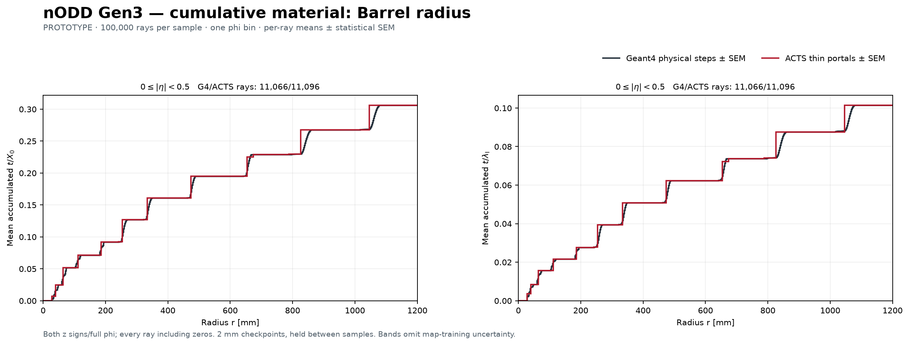
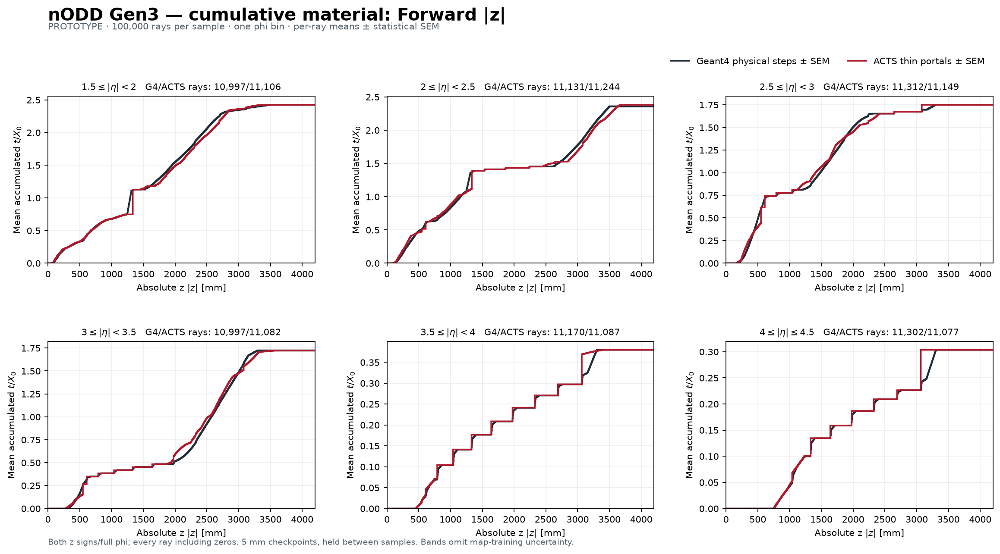
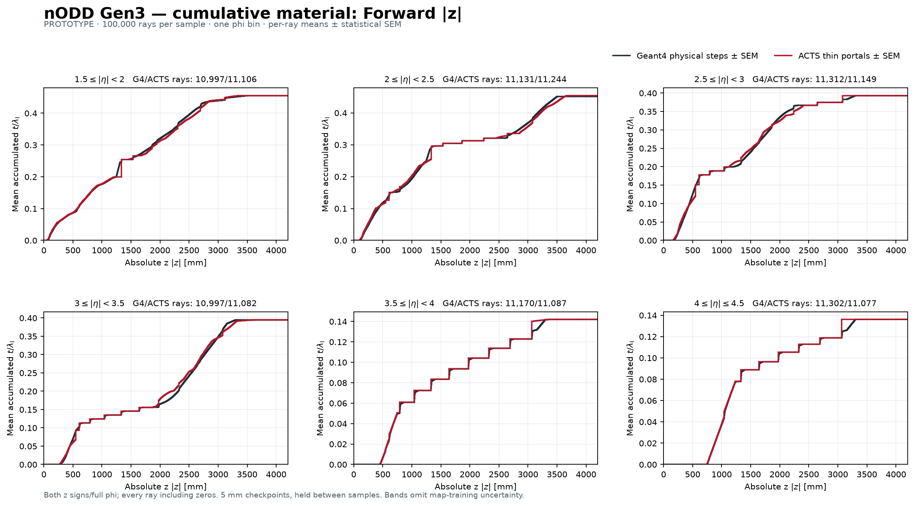
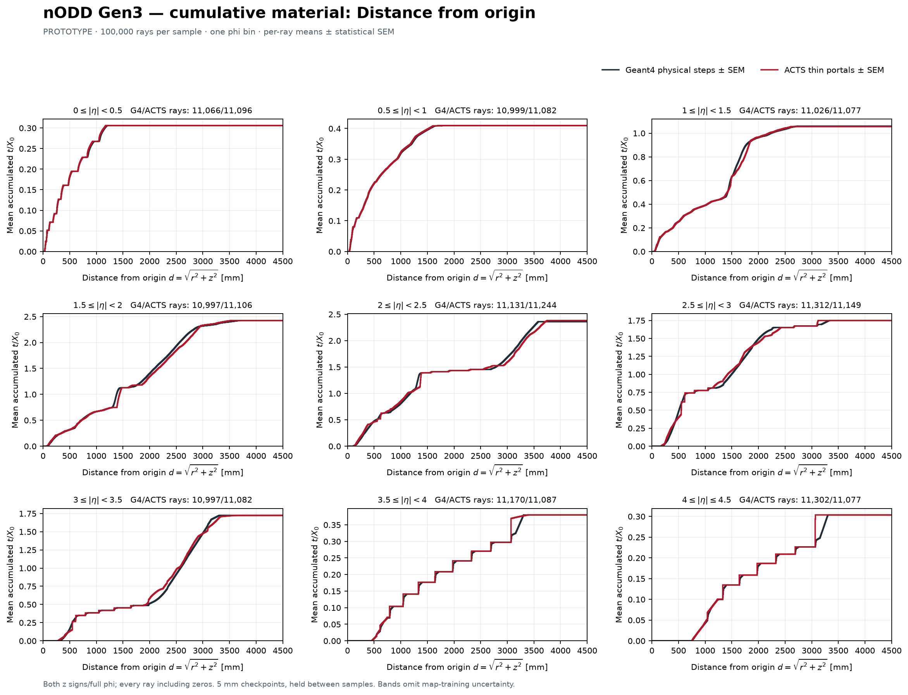
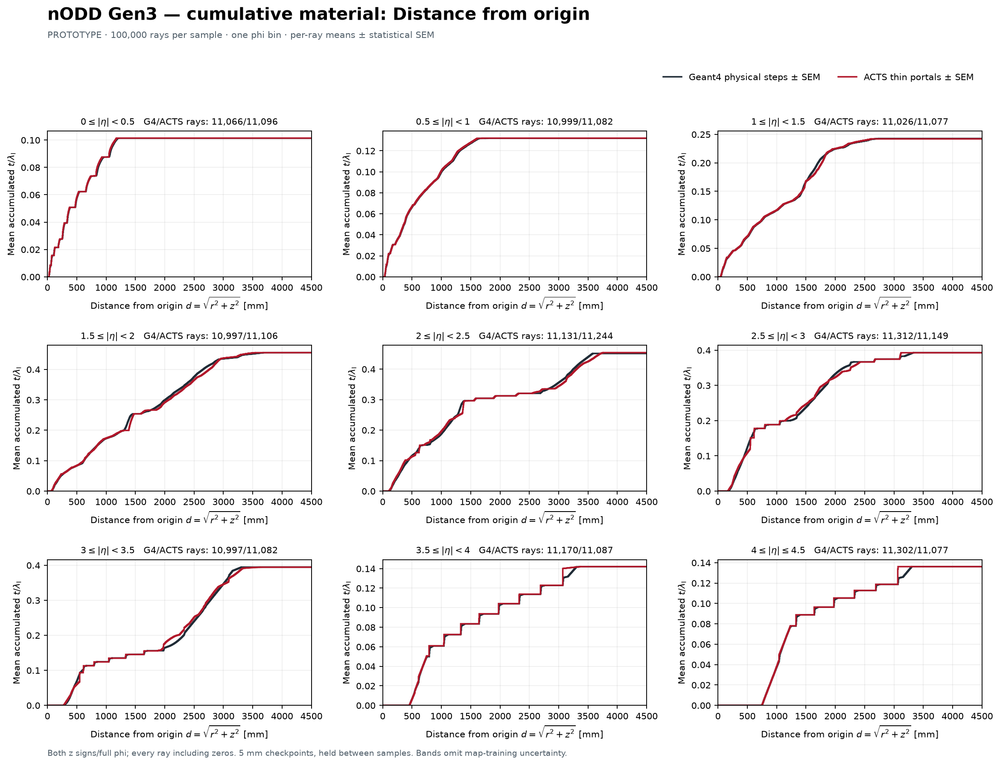

# Cumulative Geant4 and ACTS material comparisons

**PROTOTYPE / DRAFT — 2026-10-26.** Response to
[noemina's expert comment on PR100](https://github.com/asalzburger/nodd/pull/100#issuecomment-6415806657),
under [DES-025](../../../design/DES-025-tracker-dd4hep-gen3.md).
These plots reuse the original **100,000 Geant4 geantinos / 17,137,021 steps**
and the existing **100,000 ACTS validation rays / 1,417,441 interactions**.
The 65-portal map and validation sample are unchanged; no simulation is rerun.

## Barrel radius

Mean accumulated t/X₀ and t/λI up to r for **0≤|η|<0.5**:



## Forward axial distance

Mean accumulated material up to |z|, in six **1.5≤|η|≤4.5** intervals:





## Distance from the origin

Mean accumulated material up to **d=√(r²+z²)**, in every configured |η| interval:





Every figure also has a PDF and losslessly compressed SVG (`.svgz`) in
[figures](figures), keeping the generated vector paths out of the source diff. The
[summary CSV](figures/comparison-summary.csv) gives all 32 axis/slice/quantity
comparisons, endpoint totals and maximum absolute differences at checkpoints.
The compressed [profile data](profiles.json.gz) retains every checkpoint mean,
SEM squared, ray count, normalization, configuration and input/source hash.

## Definition and normalization

Both z signs and full azimuth are included. The configurable
[diagnostic settings](../../../../software/analysis/gen3_material_mapping/cumulative_config.json)
use |η| edges 0, 0.5, …, 4.5. Intervals are lower-inclusive/upper-exclusive,
with the final upper edge inclusive. The barrel view uses the first interval;
the forward view begins at 1.5; the origin-distance view includes all nine.
These are display choices rather than detector acceptance boundaries.

For each **Geant4 ray**, the input position is the physical pre-step point.
The post-step point is `position + mat_step_length * recorded_direction`.
At a coordinate threshold q, a step contributes its full budget multiplied by
`clip((q-q_start)/(q_end-q_start), 0, 1)`. Thus a threshold inside a homogeneous
step includes only that fraction of its material. Projected coordinates are
monotonic for the supported outward origin straight rays; zero-projection
steps contribute at that coordinate. Synthetic `mat_s*`/`mat_e*` branches are
not physical endpoints and are not used.

For an **ACTS validation ray**, each stored interaction contributes its full
material budget when q reaches the recorded portal position. It is a thin
surface interaction; the effective slab length is not spread through space.
Both samples use the stored path length divided by material X₀ or λI; no extra
incidence-angle correction is applied to the already-recorded budgets.

The reduction accumulates all contributions **within each ray first**, then
computes the slice mean over every ray, including zero material before its
first crossing and any ray with no material. At every checkpoint the displayed
SEM squared is `(mean(C²)-mean(C)²)/N`, the population convention used in the
preceding profiles. This preserves correlations between a ray's steps; summing
step variances would give a different uncertainty. Neighboring checkpoints
are also correlated. Bands omit map-training uncertainty and geometry systematics.
The samples use different rays; their finite within-slice η/φ mixtures differ.

| Absolute η interval | Geant4 rays | ACTS rays |
| --- | ---: | ---: |
| 0–0.5 | 11,066 | 11,096 |
| 0.5–1.0 | 10,999 | 11,082 |
| 1.0–1.5 | 11,026 | 11,077 |
| 1.5–2.0 | 10,997 | 11,106 |
| 2.0–2.5 | 11,131 | 11,244 |
| 2.5–3.0 | 11,312 | 11,149 |
| 3.0–3.5 | 10,997 | 11,082 |
| 3.5–4.0 | 11,170 | 11,087 |
| 4.0–4.5 | 11,302 | 11,077 |

Checkpoint spacing is 2 mm in r and 5 mm in |z|/d. Values are evaluated at
those coordinates and held to the next checkpoint in the unrooted figures.
The displayed location/maximum is limited by that spacing. No curve closes to
zero at its final endpoint. Original steps are integrated continuously at
checkpoints; mapped interactions remain thin. Neither is moved to a common
midpoint convention that could obscure the spatial comparison.

## Observed differences and controls

The final weighted means reproduce the prior totals: Geant4 **1.1892615083 X₀,
0.2719162735 λI** and validation **1.1952941585 X₀, 0.2726866691 λI**.
Every ray's cumulative endpoint conserves its sum of step budgets, and the
same slice's final r/|z|/d means and SEM agree where all these views are present.
Float32 recorded per-ray total branches differ slightly from recomputed step
sums: maximum absolute residuals 5.77×10⁻⁶ X₀ / 1.23×10⁻⁶ λI for Geant4 and
2.90×10⁻⁷ / 4.35×10⁻⁸ for validation, within the declared rounding checks.

Close final totals do not imply close cumulative curves. The largest sampled
absolute differences in each requested view are:

| View | Absolute η interval | Coordinate [mm] | Maximum absolute Δ accumulated X₀ | Maximum absolute Δ accumulated λI |
| --- | --- | ---: | ---: | ---: |
| Barrel r | 0–0.5 | 826 | 0.03792 | 0.01332 |
| Forward abs z | 1.5–2.0 | 1330 | 0.36268 | 0.04763 |
| Origin distance d | 1.5–2.0 | 1385 | 0.26698 | 0.03451 |

The maxima of both quantities happen at the same checkpoint/slice in each
row. The forward X₀ difference is about 15.0% of that slice's final Geant4
material. These are descriptive maxima, with no accuracy acceptance threshold
or significance assigned after searching checkpoints. They diagnose effects
of material relocation/averaging and sample mixtures; they do not isolate a
unique cause. The original recording geometry revision/seed remain unknown.
One phi bin, distant assignments and before/after carrier semantics retain
their limitations from the [parent trial report](../README.md). No individual
sensor-order, displaced-origin, curved-track or tracking-performance validation
is established by these average curves.

Seven analytic controls cover partial and overlapping steps, thin interactions,
zero rays, correlated prefix SEM, interval edges, truncated grids, and agreement
of difference arrays with a direct independent segment integral. The full
36-test portable suite passes. CI audits retained input/source identities,
counts, monotonicity and endpoints, and replays the five figures; it does not
rerun native physics or read the ignored large ROOT files.

## Reproduce

Use the existing pinned [plotting environment](../../../../software/analysis/README.md).
No native ACTS, DD4hep or C++ ROOT import is needed for this analysis.

```sh
"$PLOT_PYTHON" -B software/analysis/gen3_material_mapping/cumulative_profiles.py \
  --geant4 ../storage/nodd-tracker.root \
  --validation build/gen3-material-map-run/validation/material_validation.root \
  --config software/analysis/gen3_material_mapping/cumulative_config.json \
  --expected-tracks 100000 --output build/gen3-cumulative-material/profiles.json

"$PLOT_PYTHON" -B software/analysis/gen3_material_mapping/plot_cumulative.py \
  --data build/gen3-cumulative-material/profiles.json \
  --output build/gen3-cumulative-material/figures

"$PLOT_PYTHON" -B -m unittest discover \
  -s software/analysis/gen3_material_mapping -p 'test_*.py' -v
```

The replay accepts the retained `profiles.json.gz` as well. The original
recording and validation SHA-256 values must match the authoritative parent
mapping/validation reports; the replay audit checks this explicitly.
