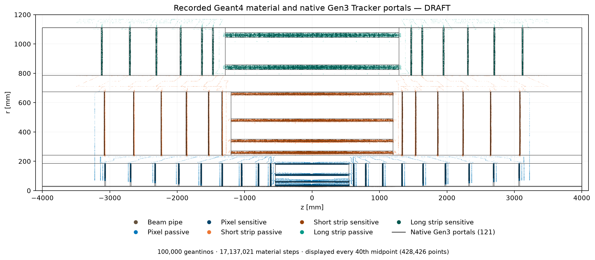

# Gen3 Tracker material-mapping surface survey

**DRAFT — first-step proposal, 2026-10-26.** This uses the existing 100,000
geantinos in `storage/nodd-tracker.root`; it installs no material map and changes
no detector geometry. Task `TASK-TRACK-GEN3-MATERIAL-SURVEY`, DES-024/025.

[PDF](figures/material-portals-rz.pdf) · [SVG](figures/material-portals-rz.svg) ·
[pixel detail](figures/pixel-portals-detail.png) ·
[remote material](figures/remote-material-rz.png) ·
[nearby carriers](figures/proposed-carriers-rz.png).

The scatter displays every 40th recorded step: **428,426 midpoints**. All
17,137,021 steps enter the classification, material budgets, distance survey
and flags. The separate material heat map also uses every step; neither step
counts nor dot darkness alone measure a material budget.

## Suggested surfaces

Keep native silicon on the sensitive sensor surfaces and the existing Be slab
on the finite r=27.4 mm beam-pipe material cylinder. The 1,299,291 sensitive
steps and 100,000 pipe steps are therefore excluded from passive remapping.
Do not add them again when a passive map is produced.

For passive layer material, use finite native portal crossings along the
outgoing geantino flight, rather than an infinite cylinder/disc extension or
an r-z Euclidean nearest-surface assignment. “Before” and “after” below are
relative to the **material-step midpoint** along that flight; sensor orientation
selects which rule to use. This convention is explicit for this proposal.

For each passive pixel step, find the nearest recorded sensitive crossing in
the **same native system/layer and same geantino**. Physical front is opposite
local +w: the pixel factories put +w toward the support (DES-015 PD-C02;
`PixelBarrel.cpp`, `PixelEndcap.cpp` and `PixelComponents.cpp` at adapter source
`530080cfe16c7513228bf60238b99d4b9938538a`). Native barrel normals all point
outward. Endcaps have both axial normal signs. A local normal alone is not a
physical-front definition.

Measure “most material behind” as the sum of recorded passive **length/X₀**
after that sensitive crossing divided by all associated passive length/X₀,
separately for each native layer and facing direction. It is a scan-weighted
radiation-length diagnostic, not a mass inventory or an acceptance average.
Choose the nearest finite portal afterwards only for an inward-facing pixel
association with a strict majority (>50%) downstream. Otherwise choose the
nearest finite portal before. All strip passive material uses the before rule.

The inward-facing barrel groups have **82.9–84.5%** downstream X₀, so the
dominant after carriers are the outer cylinders below. Inward-facing endcap
groups have **90.6–91.3%** downstream; outward-facing groups have **22.6–28.4%**
and use before. Preserve both rules on each two-face disc; do not select one
side for the entire disc.

These are the dominant nearby barrel carriers; the complete per-layer set is
`survey.json:layer_carriers`. Merged portal extent and owners are preserved in
`geometry-summary.json`; an apparent layer edge can be a much longer shared
portal. IDs identify this exact native export, not arbitrary future rebuilds.

| Native system / layer | Rule | Cylinder r [mm] | Finite z [mm] | Native geometry ID |
| --- | --- | ---: | --- | --- |
| 1 / 1 | after | 38.806 | -546.600 … 546.600 | `2522578741280899072` |
| 1 / 2 | after | 63.509 | -546.600 … 546.600 | `2594636335318827008` |
| 1 / 3 | after | 111.551 | -546.600 … 546.600 | `2666693929356754944` |
| 1 / 4 | after | 185.962 | -4000.000 … 4000.000 | `144678138029277184` |
| 4 / 0 | before | 253.746 | -1201.000 … 1201.000 | `5116370651669594112` |
| 4 / 1 | before | 333.494 | -1201.000 … 1201.000 | `5188428245707522048` |
| 4 / 2 | before | 473.257 | -1201.000 … 1201.000 | `5260485839745449984` |
| 4 / 3 | before | 653.102 | -1201.000 … 1201.000 | `5332543433783377920` |
| 6 / 0 | before | 825.261 | -1288.333 … 1288.333 | `7638386442997071872` |
| 6 / 1 | before | 1044.981 | -1288.333 … 1288.333 | `7710444037034999808` |

For example, positive pixel disc 1 uses z=608.175 mm before and z=621.825 mm
after, r=30.141…185.962 mm. Positive short-strip disc 0 uses z=1333.900 mm
before, r=240.500…673.486 mm; long-strip disc 0 uses z=1460.900 mm before,
r=786.243…1110.327 mm. Negative-end flight order reverses signed z.

[proposed-surfaces.csv](proposed-surfaces.csv) lists **118 directional candidate
portals**, with native IDs, finite extents, before/after counts and material
weights. **101** receive at least one step within 10 mm of the selected
carrier. This is a candidate set with explicit exclusions, not an installed map.
Some merged portals collect both rules. Retain their link partitions when
implementing designators instead of assigning duplicate full-surface maps.

## Material requiring additional carriers

“Close” is provisionally **10 mm shortest distance to a finite native r-z portal
segment**. Full-phi axisymmetry makes this a true spatial distance for these
portals. This is an analysis choice, not a construction tolerance or acceptance
cut. A separately reported flight distance can be large at grazing incidence.
Two conditions are recorded: remote from **every** portal, and too far from the
**selected directional** portal even if another portal is nearby.

- 962,351 passive steps are >10 mm from every portal: **62.58% of passive tracker
  X₀** in this scan. At 5/20 mm the fractions are **78.27% / 46.79%**.
- 7,124,429 steps have a selected carrier >10 mm away: **74.41% of passive X₀**.
  These candidate assignments require additional/closer carriers or revised
  segmentation. They are not silently accepted into the nearby set.
- There are no missing finite directional crossings, but that does not make a
  distant crossing a suitable material carrier.

[flag-clusters.csv](flag-clusters.csv) retains all **33** connected groups of
occupied 20 mm r × 50 mm z cells, separated by subdetector and ranked by summed
X₀. Their boxes can span long connected routes and contain empty space; they
are locators, not a solid-volume or geometry-fit claim. Exact native
component/child paths and all-region extents are retained for **2,745** flagged
regions in [remote-regions.csv](remote-regions.csv) and `survey.json:remote_regions`.

Start additional-carrier work with these locations:

| Material concentration | Flag locator / observed extent | Suggested carrier family |
| --- | --- | --- |
| Pixel accumulated trunks | F001; trunks around r=192…232 mm, along both endcaps | Cylinders or conical-route segments near r≈211 mm, split at the native axial trunk boundaries; use multiple radial carriers where the 40 mm spread exceeds the proximity criterion. |
| Short-strip endcap services | F002/F003; r≈240…780 mm, abs(z)≈1100…3500 mm | Separate the outer axial corridor from radial service turns; add cylinders along the trunk and finite discs at its turns. The current r=673.486 mm portal is too remote for much of it. |
| Long-strip endcap services | F004; native service region r=1100…1169 mm, both ends | Split the service region radially/axially before placing cylinders; a single r≈1149 mm weighted-center fit has 15.6 mm radial RMS and is explicitly flagged for segmentation. |
| Pixel terminal service panels | F005/F006; r≈60…680 mm, abs(z)≈3200…3250 mm | Additional finite signed-z discs at the actual panel datums; do not stretch the last pixel sensor disc to cover this material. |
| Pixel disc-local passive tails | F007 onwards; examples abs(z)≈2000…2050, 2350…2400, 2700…2750 mm | Check dedicated disc-support/service carriers outside the narrow sensitive-layer z envelopes, preserving both module faces. |

These positions are initial surface suggestions, not new detector geometry.
Per-region fits use **all passive steps in the flagged native region**, not
only its remote tail. Their width and fraction within 10 mm of the fit are
retained; wide regions explicitly require segmentation. Resolve real volume
ownership, native portal-link splits and before/after flight order before
inserting any extra material surface.

## Unresolved cases and scope

8,013,352 passive pixel steps have a same-ray, same-layer sensitive crossing.
Another **968,999** do not; they carry **76.21% of pixel passive X₀**, largely
heavy services. They receive a provisional before candidate and are explicitly
marked unresolved in the survey summary. No sensor face is invented for those
steps. These service carriers need source-component association before a final
orientation-aware map is made. The measured layer majority must not be
extrapolated into a claim that all pixel services lie behind a sensor.

This is an azimuth-integrated r-z survey of finite full-phi portals. It does
not qualify phi/z binning, support-to-module ownership, whether relocating
material crosses an intervening sensitive plane, a final map, or tracking
performance. Preserve phi information from the original recording for mapping.
A shared two-face pixel backing needs an explicit treatment between sensors;
after/before carrier choices alone do not prove the final material ordering.

## Input identity and checks

The scan has 100,000 tracks in 1,000 events and contains no geometry revision,
seed or original command. Its SHA256 is
`034fe2f6ceb7dad9c4786254b9821777e8db093704a5d77528c47a8a5926b3cf`.
The selected native runtime is separately identified: adapter
`530080cfe16c7513228bf60238b99d4b9938538a`, ACTS
`355ea68493b326956756c9386d2fd9eaf9328568`, ROOT6.40.04, DD4hep1.38,
Geant4 11.4.3. See [geometry-summary.json](geometry-summary.json) and
[classification-provenance.json](classification-provenance.json) for source,
compact, material, factory and installed-module hashes. Generated/built artifacts
are distinct from source revisions; density agreement cannot establish exact
recording geometry identity.

- Native export: **121 portals (27 cylinders, 94 discs)**, 117 volumes,
  45,646 sensitive surfaces, 52 sensor layers, 244 link subsurfaces and 469 owner
  references. All actual portal IDs are nonzero/unique. Finite transforms/bounds
  are axisymmetric; unsupported shapes fail. Full ACTS JSON round trip is exact;
  sensor centers/axes match the independent detector report exactly.
- Full scan: no missing classification or density mismatch. The inherited
  float32 treatment retains six rounding-cell rescues and two sensitivity
  ambiguities; the ambiguous tiny silicon budgets stay passive. See
  [classification.json](classification.json) and diagnostics; the prior profile
  report bounds their effect. It does not dominate any flag reported here.
- Position convention: `mat_x/y/z` is the pre-step position; plotted and
  associated points are `position + 0.5 * length * direction`. Averaging synthetic
  `mat_s/e` would give the wrong point.
- Every starting vertex is zero. Maximum ray residual is 0.000171 mm and
  direction residual 4.67×10⁻⁸. Per-track length/X₀ and length/λI sums close to
  recorded totals within float32 tolerance (max absolute 5.77×10⁻⁶ and 1.23×10⁻⁶).
- Portable tests cover finite bounds, missed crossings, negative/positive flight
  order, coincidence, nearest sensitive association and the strict pixel-majority
  rule. Hosted CI replays retained plots and tests without native dependencies.

The [reproduction guide](../../../software/analysis/gen3_material_mapping/README.md)
provides native export, labels, full survey and portable plot commands. Full
native sensor/link data and the recording stay outside Git; retained compressed
scatter/occupancy data reproduce the four figures. A first held-out map replay,
material closure on individual sensors, binning convergence and reconstruction
validation remain **NOT RUN**.
