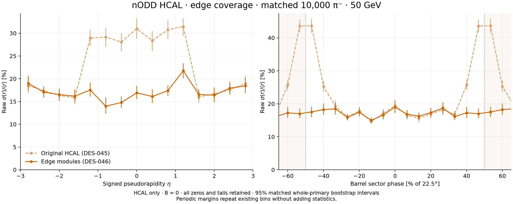
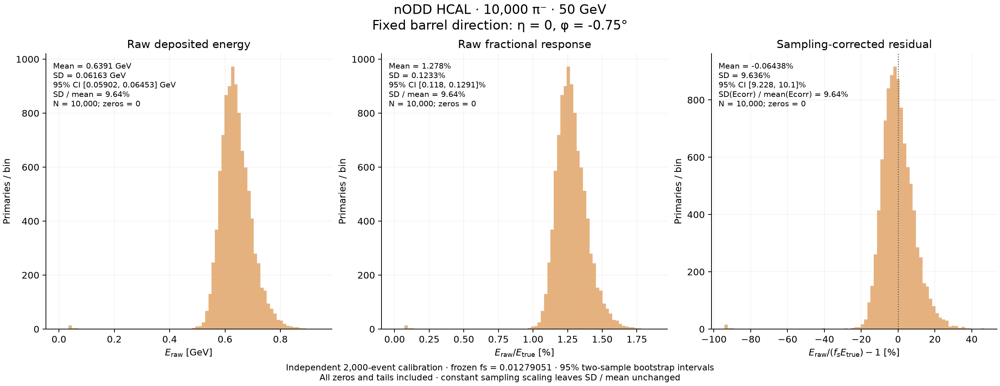
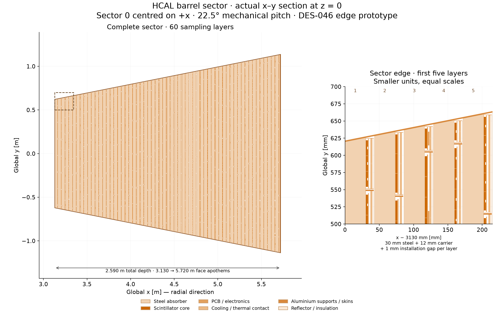

# HCAL barrel sector-edge coverage and 50 GeV pion response

[DES046](../../design/DES-046-hcal-sector-edge-coverage.md), **DRAFT / PROTOTYPE**,
2026-11-20. Frozen geometry, transport and prospective direction source:
`7059bf6c1ffb673e020eb96d16f51006190c64a7`. The original
[DES045 10k sample](../hcal50/README.md) remains an unchanged control.

The **10000-event angular sample passed full transport and saved-hit readback**.
Its inclusive raw SD/mean is **17.24%**, compared with
24.03% in the original geometry. The two folded-phi
edge bins are now 17.53%
and 16.99%, versus about
44% previously. These are conditional observed sample widths, not digitized or
reconstructed detector-resolution claims.

[New angular curves](angular-figures/raw-energy-resolution.png) ·
[Mean response](angular-figures/mean-response.png) ·
[Angular statistics/covariance](angular-summary.json).

| Inclusive angular quantity | New edge geometry |
| --- | ---: |
| Mean raw sensitive energy | 0.519338 GeV |
| Sample SD of raw energy | 0.089537 GeV |
| Sample SD / measured mean | 17.2406% |
| Zero-response primaries, retained | 3 /10000 |

The **independent 10000-event fixed-direction evaluation also passed full
readback**. A separate 2000-event calibration had frozen **fs=0.01279050527**
before validation transport started; its 95% interval is
[0.01274215206,0.01283810683].

[Fixed statistics, uncertainties and covariance](fixed-summary.json) ·
[Fixed figure PDF](fixed-figures/fixed-direction-response.pdf).

| Fixed-direction quantity, all10000primaries | Value |
| --- | ---: |
| Mean raw sensitive energy | 0.639114 GeV |
| Raw energy SD | 0.061627 GeV |
| Raw fractional SD, SD(S)/50 | 0.123254% |
| Corrected relative SD, SD(S)/(fs×50) | 9.636377% |
| Raw/corrected SD divided by its measured mean | 9.642584% |
| Corrected mean energy / residual bias | 49.967811 GeV / -0.064379% |
| Zero responses | 0 |

The corrected relative width has a 95% two-sample interval
[9.2282%,10.0968%].
The scalar changes the response scale and SD/Etrue; it leaves SD/mean exactly
unchanged. This fitted factor is direction/energy/geometry-specific and includes
represented sampling/geometric/hadronic losses. It is not an independent
material-only sampling-fraction measurement or a compensation model.

Transport and statistical producers were frozen at7059bf6c. Later visual QA
changes only two rendering functions: annotation placement, typography and
figure DPI. [AST/source comparison](render-source-equivalence.json) separates
this renderer revision from the unchanged statistical definitions. All
published distributions keep every original histogram count and tail.

## Geometry change

[Dimensioned vector PDF](barrel-xy/hcal-barrel-sector-xy.pdf) ·
[Physical unit/count/material ledger](geometry.json) · [Native gates](native.json).

| Quantity | New prototype |
| --- | ---: |
| Original common carriers in barrel | 178224 |
| New narrow barrel edge carriers | 90240 |
| Endcap common carriers, unchanged | 110880 |
| Total raw carrier contexts / logical tile channels | 379344 / 23157216 |
| Manufactured edge widths | 32–305.574485 mm,100 variants |
| Edge tile dimensions | 15.556633–29.690774 ×29.7×3 mm |
| Sector half-seam / aluminium guide | 1 /2 mm |
| Inactive tangent strip at each outer core plane | 7.047825 mm per side |
| Nominal stack / steel depth | 2590 /1800 mm |
| Complete represented mass | 8831.376 tonnes |

New PCBs, smaller moulded cores, reflectors/recesses/SiPMs/LEDs, ASIC/contact
stacks, cold plates, skins and Ti/water branches back the added sensitive regions.
The original common unit remains unchanged; no old board/tile is clipped.
The guide/steel amendment and central repacking accompany the active addition;
response differences do not isolate a scintillator-only causal contribution.
Endcap packing, axial collector strips and the barrel/endcap transition remain.

The former 20 mm rail is now a 2 mm guide, without an inherited qualified structural
load path. The guide-only change removes 50.075 t Al and adds 101.573 t Steel235;
including cassette repacking, total mass increases 131.528 t from the reconstructed
old source ledger. Nominal local heat increases 1.735→2.126 MW(+22.52%); ideal
water allocation at 5 K rises 83.013→101.710 kg/s. These are material/planning
budgets, not structural, thermal, hydraulic or external-plant qualification.
Global HCAL/ECAL envelopes, nominal plate depth and service handoffs stay fixed.

## Prospective fixed direction and samples

The [immutable direction receipt](direction.json) selects **eta0, phi−0.75°**
from 5551 geometry-only candidates before any new showers. Its central ray crosses
all 60 active layers and 1800.154224 mm steel. Nine front-face neighbours at±5mm
have minimum 58/mean 59.333 active layers. This is a declared sampled neighbourhood,
not continuous angular acceptance or a response-optimized cut. Independent ROOT
navigation confirms every layer set and material/sensitive path.

All samples contain origin pi-minus primaries with 50 GeV **total energy**,
FTFP_BERT, 0.7 mm range cuts, 5 mm charged active-step cap and no ECAL, tracker,
beam pipe, FCAL, solenoid or magnetic field. No Birks/optical/SiPM/electronics,
noise, threshold or time-window model is added. All zeros/tails are retained.
The [prospective protocol](protocol.md) fixes sample identities and statistics.

The angular cohort reuses the old 10000 primary vectors byte-for-byte and retains
15 signed eta bins and15 signed folded-phi bins. Outer 15% windows periodically
repeat existing bins without adding statistics. Phi is a barrel-reference
coordinate; unchanged endcap quarter packing has fourfold physical symmetry.
Matched whole-primary bootstrap resampling supplies before/after differences
and covariance. A separate 2000 calibration population sets fs before the
independent 10000 fixed validation starts; both use their own transport seeds.

The fixed figure reports rawS[GeV], rawS/Etrue, and corrected residual
S/(fsEtrue)−1. Its full-population sample widths explicitly distinguish SD(S),
SD(S)/50 and SD(S)/(fs50). A positive scalar correction leaves SD/mean unchanged.
Independent calibration/evaluation resampling propagates both uncertainties.

## Validation and reproduction

The source-bound native audit passes all 102 distinct sensitive solids and all
physical unit parts/cell centres, 379344 contexts, 88 finite material rays and zero
overlaps at 10 nm. Actual native graph capacities/masses reproduce all 15 materials.
ROOT/Geant4 surface conventions are isolated for exact zero-measure boundary
probes; analytic non-surface and±1e−4 mm neighbour controls remain separate.

Serial/12-worker 24-event controls match exact saved cell IDs/energies/positions.
Every run additionally closes positive sensitive steps→native→saved hit sums and
checks every saved cell centre. See [controls](controls.json),
[calibration receipt](calibration.json), [exact recipe](reproduce.md),
[geometry source](../../../tools/hcal_response/README.md) and
[transport/analysis source](../../../software/analysis/hcal_response/README.md).
Full geometry, event/ROOT, scan-candidate and bulky log payloads remain ignored
under build/hcal50-edge. Compact published summaries support plot replay;
full integrity checks need the retained data or a fresh source-bound run.

Nominal nuclear interaction depth and terminal-layer activity do not guarantee
all-angle/high-energy containment. The exact sector seam remains a pointing
crack. Escaped kinetic energy excludes rest mass and nuclear invisible losses.
Physics-list/response-model/engineering systematics are outside bootstrap errors.
The maintained tracker+ECAL detector is unchanged; no production or human
engineering sign-off is inferred.

## Observed execution integrity

Angular, calibration and fixed-validation runs used12workers and completed
from clean7059bf6c with unchanged producer/library hashes. Their transport
receipts record700.50s,184.92s and703.28s wall respectively; complete ROOT
payloads are9.259GB,1.868GB and9.309GB, all retained locally. The angular and
fixed cohorts have17102894 and17433422saved hits. Every primary, cell ID,
physical centre and accepted-sensitive-step/native/saved energy sum passed.
Maximum step/native discrepancy is3.7748e−15GeV, native/saved1.3023e−8GeV and
saved-layer7.9899e−9GeV; maximum saved-centre error is0.000244103mm, below0.001mm.
These are observed finite persistence residuals, not exact float equality.

Calibration fs froze at2026-11-20T15:14:33.568939+00:00; validation started
at15:15:21.959400+00:00. All bootstrap replicates have defined values. A
[separate empirical stream check](independent-stream-check.json) found no
duplicate shower signatures between2000calibration and10000validation events,
including nearby event-index offsets; distinct seeds and sample identities
remain the prescribed independence design. This check is not a mathematical
proof of random-stream independence.
