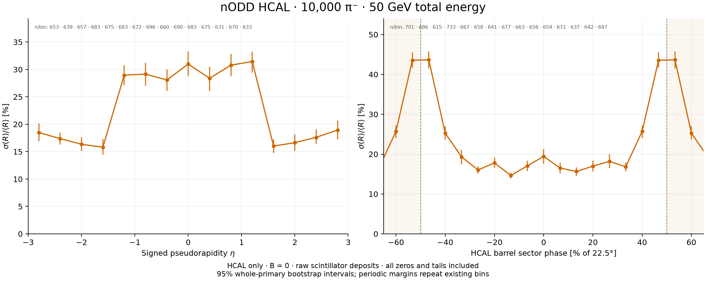
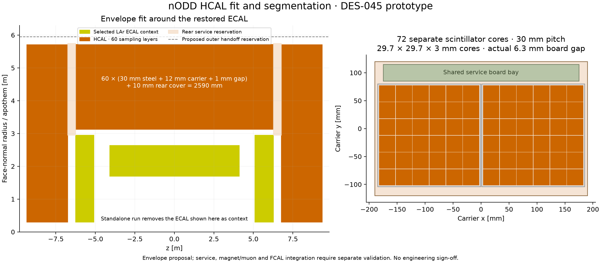

# Deep segmented HCAL around the restored LAr ECAL

2026-11-20. [DES-045](../../design/DES-045-hcal-restored-ecal-pion50.md)
implements the user-requested standalone HCAL study. DRAFT/PROTOTYPE; no
engineering sign-off or full-detector acceptance. The selected restored ECAL
context is pinned by the November18 selection, rather than the separate400 mm
gap experiment. The requested **10,000 pi-minus primaries at 50 GeV total
energy** completed with no ECAL, tracker or field. Full saved-data readback
passed for all 16,531,599 hits and every physical cell centre.

[Resolution PDF](figures/raw-energy-resolution.pdf) ·
[Mean response](figures/mean-response.png) ·
[Eta-bin distributions](figures/response-distributions-eta.png) ·
[Phi-bin distributions](figures/response-distributions-phi.png) ·
[Longitudinal/inclusive controls](figures/depth-response-controls.png) ·
[Bin statistics and covariance](summary.json).

| Inclusive raw result, all primaries | Value |
| --- | ---: |
| Mean sensitive deposited energy | 0.486495 GeV |
| Sample standard deviation | 0.116898 GeV |
| Sample SD / mean | **24.03%** |
| Zero-response events | **4 / 10,000** |
| Mean fraction in final six sampling layers | **0.1795%** |
| 95th / 99th percentile of that fraction | 0.4523% / 3.9747% |
| Events with final-six fraction above 10% | 35 / 10,000 |

Signed-eta bin widths range from 15.82% to 31.46%. The folded-phi plot shows
broader raw response near sector edges. These are visible response nonuniformities
in the first uncalibrated sample, including physical gaps and tails; the study
does not separately fit intrinsic sampling resolution or isolate each loss
mechanism. Small terminal-layer activity supports the nominal depth for this
first 50 GeV study, with the seam and containment qualifications below.

Transport took 551.13 s wall and 6041.0 s CPU with 12 workers, peak RSS1.44 GB,
and produced9.204 GB of local ROOT data. Saved IDs0–9999 are complete. Maximum
step/native energy discrepancy is3.11×10⁻¹⁵GeV; native/saved discrepancy is
1.16×10⁻⁸GeV; saved layer-sum discrepancy is8.58×10⁻⁹GeV. The largest
saved-centre error is0.00024414 mm, consistent with float32 position rounding
and below the 0.001 mm check tolerance. Saved/native energy tolerance is
`1e-7 + 2e-6 × signal`GeV; observed residuals are much smaller.

Mean world-escaped kinetic energy is0.914747 GeV; it is a separate proxy with
the limitations below, not an inference of rear leakage or calorimetric balance.
All four zero-response primaries and every tail remain in the angular statistics.

## Fit and physical readout

The HCAL has 60 layers of30 mm Steel235, unchanged12 mm DES036 common carriers
and 1 mm installation allowance, followed by a10 mm rear cover:2590 mm total
depth and 1800 mm steel. The front apothem3130 mm, barrel half-length6260 mm and
endcap front6760 mm retain the restored ECAL interfaces and 500 mm rear service
gap. Barrel outer apothem is5720 mm; endcaps end at 9350 mm, outer apothem5710 mm.
The5950 mm outer handoff is a reservation, with 47.939 mm margin after a50 mm
service radius and 20 mm clearance beyond the barrel corner.

Readout retains21,032,064 individual tile channels in292,112 complete carriers.
Each carrier contains72 separate29.7×29.7×3 mm recessed scintillator cores on
30 mm pitch, reflectors, SiPM/electronics proxies, cold plate and cooling material.
The6.3 mm board seam and service bay remain physical gaps. An anchored balanced
union preserves the exact disjoint sensitive regions while providing one native
context per carrier. Custom segmentation returns the original module/tile
addresses and positions. It does not replace the tiles with a continuous plane.

## Geometry and depth

The native material model gives Steel235 nuclear interaction length171.928151 mm.
The nominal1800 mm steel stack therefore provides **10.46949 nuclear interaction
lengths** in ROOT. The actual Geant4 transport material has interaction length
170.194699 mm, corresponding to **10.57612 nuclear lengths** in1800 mm steel.
These backend material conventions are recorded separately. The finite ROOT
face-centre ray confirms1800 mm steel; the off-joint eta3,
phi0.123ray gives10.52152steel lengths. These exceed the prospective8length
nominal-depth screen. Total-material path sums additionally include real carrier
and support material and must not be confused with steel-only depth.

Exact fixed barrel sector seams remain pointing cracks: at phi=pi/16 and eta0,
±0.5or±0.8 the finite rays encounter zero steel and no sensitive cores. Endcap
quarter-joint rays at phi0 and |eta|3 see7.89114steel lengths because the
quarter seams rotate through the layer cycle. These adverse probes remain
explicit; the nominal-depth pass is not an all-angle8length or containment
claim. The uniform-phi shower sample includes the actual finite crack regions,
all zero-response primaries and all tails.

Full standalone native overlap checks inspect every distinct direct-daughter
mother, including the world. Reused placements are covered by their common
mother checks; no claim of combined tracker/ECAL/HCAL overlap validation is made.
ROOT core membership is checked against original leaf dimensions/transforms;
the actual converted Geant4 solids are independently checked against frozen
core/gap/recess regions. This second gate catches conversion discrepancies that
a ROOT-only check cannot detect.

## Response definition

The [prospective protocol](protocol.md) fixes10000origin pi-minus primaries with
50 GeV total energy, independent uniform eta−3…3 and phi−pi…pi, no tracker,
beam pipe, ECAL, FCAL, solenoid or magnetic field. FTFP_BERT,0.7 mm range cuts,
5 mm charged step cap in active PSHost and event seeding are explicit.
The signal is raw scintillator deposited energy, with no Birks, optical,
SiPM, threshold, noise, time-window, digitization or calibrated response model.

Resolution plots use sample SD(R)/mean(R), ddof1, with R=Eraw/Etrue. Fifteen
signed-eta bins and fifteen folded-phi bins match the latest ECAL display. Phi
is a22.5degree barrel reference coordinate, because the whole-carrier endcap
packing has fourfold rather than16fold symmetry. The15% display padding on each
side repeats existing points and errors without adding statistical bins or
events. Full-phi controls are retained. Error bars are pointwise95% intervals
from 1000joint whole-primary bootstrap draws, seed13001000, with 30×30width
covariance. All zeros and tails are included.

Longitudinal profiles and terminal-six-layer activity diagnose rear shower
tails, but a shower can leave through a side or transition before those layers.
World-escaped kinetic energy excludes rest mass and nuclear invisible energy;
it is a separate diagnostic, not a calorimetric energy balance. A single50 GeV
sample does not certify multi-TeV hadron containment.

## Reproduce and inspect

See [the exact commands](reproduce.md), [geometry source](../../../tools/hcal_response/README.md)
and [transport/closure source](../../../software/analysis/hcal_response/README.md).
The final saved-data auditor adds physical-centre checks after transport, with
its own source hash. The unchanged launch producer/library hashes remain in
the transport receipt; this additional validation does not rerun simulation.

Full XML, ROOT files, placements, event ledgers, build products and bulky logs
remain local under ignored build/hcal50. Published aggregates and plots suffice
for replotting; full native/readback/identity checks need the retained local
artifacts or a fresh source-bound reproduction.

Magnet/muon placement, FCAL routing, connected services, thermal/hydraulic,
mechanical and high-rate/radiation qualification remain separate work. This
HCAL proposal is not inserted into the maintained tracker+ECAL compact by the
standalone run. [Layout context](../../layouts/LAYOUT-002-tracker-3t-lar.md).
