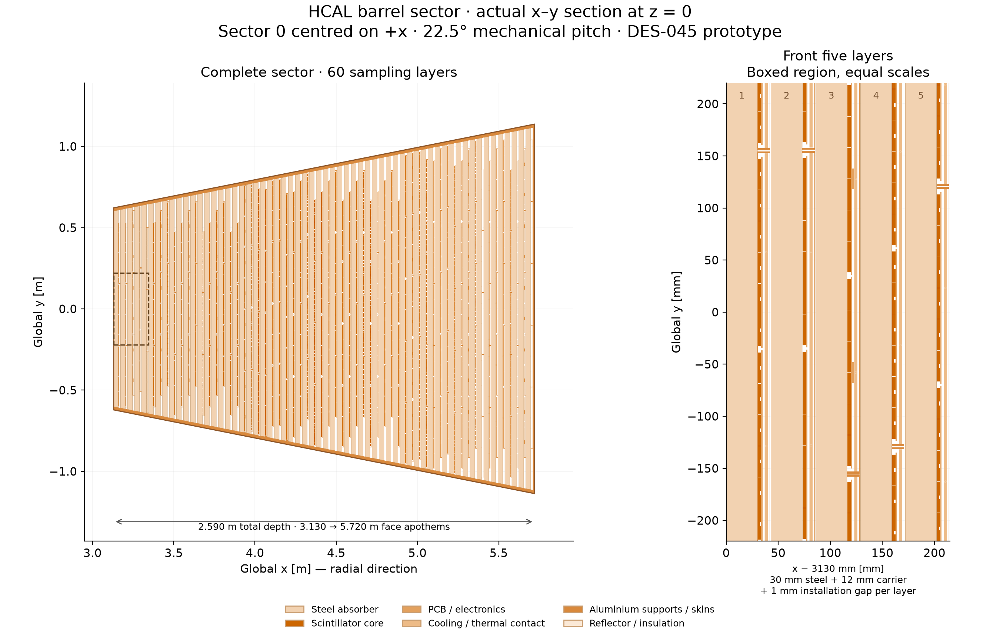

# HCAL barrel sector in the x–y plane

2026-11-20. A true **z = 0 transverse section** of sector 0, centred on the
global +x direction. The mechanical sector pitch is 22.5°. Both panels use
equal x/y scales, with no radial-depth exaggeration.



[Vector PDF](hcal-barrel-sector-xy.pdf) · [Source and checks](provenance.json) ·
[Drawing generator](../draw_barrel_xy.py).

The complete sector spans face apothems 3130–5720 mm. It contains all 60 actual
30 mm steel plates, the 12 mm readout carriers and their physical components,
1 mm installation allowances, edge rails and 10 mm rear cover. The right panel
enlarges the first five sampling layers in the boxed central region.

This cuts the solids generated by the maintained DES-045 barrel exporter and
the unchanged DES-036 common carrier. It retains the actual tangent/axial
layer shifts, whole-carrier packing, board seams, individual recessed cores,
reflectors, PCB/copper, skins and cooling. White space inside the outline is
air or a physical packing/installation gap. Parts outside the chosen axial
plane, including the barrel end flanges and many small electronics packages,
do not appear in this section.

The cut intersects one axial carrier row per layer: **241 carriers and 2892
individual scintillator-core sections** across the complete sector. It does
not project all 47 axial rows on top of one another. Circular tube sections
are polygonized only for rendering; source dimensions and material domains
are unchanged. The drawing adds no new native-geometry or shower validation
claim; those remain the scope of the [original study](../README.md).

Reproduce from the repository root using the existing Matplotlib environment:

```sh
plot_python=/Users/salzburg/Documents/work/installed/acts-nodd/pyvenv/bin/python
MPLCONFIGDIR="$PWD/build/hcal-xy/mpl" "$plot_python" -B \
  docs/validation/hcal50/draw_barrel_xy.py
```

The generator checks all 60 absorber layers and the intersected carrier-row
counts against the exported geometry. The provenance record binds source and
render hashes. This is a visualization-only follow-up to DES-045 / PR155;
detector geometry and the 10k-pion evidence are unchanged.
