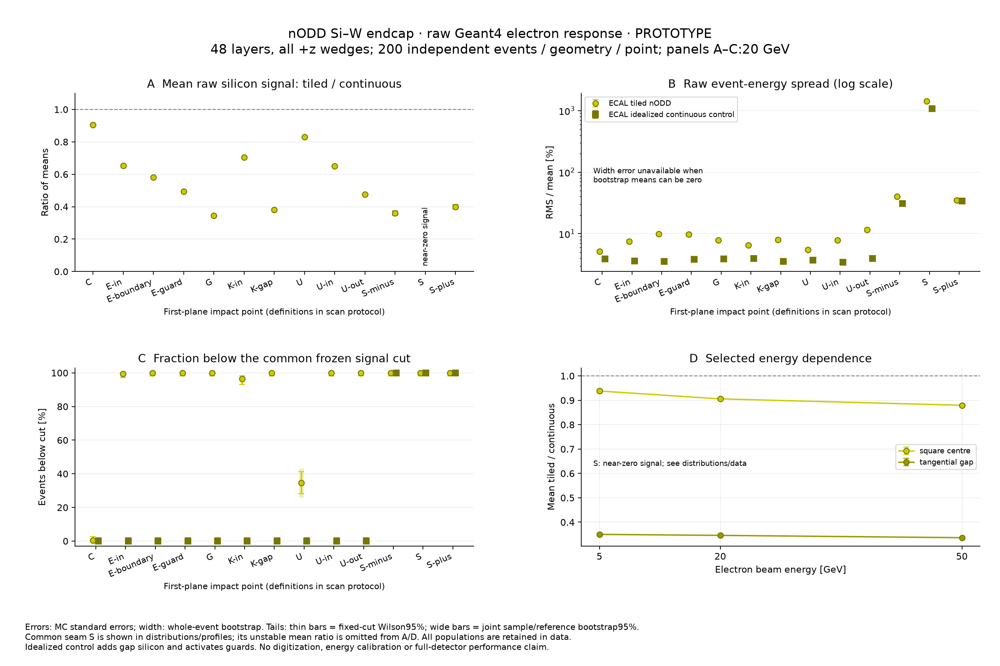
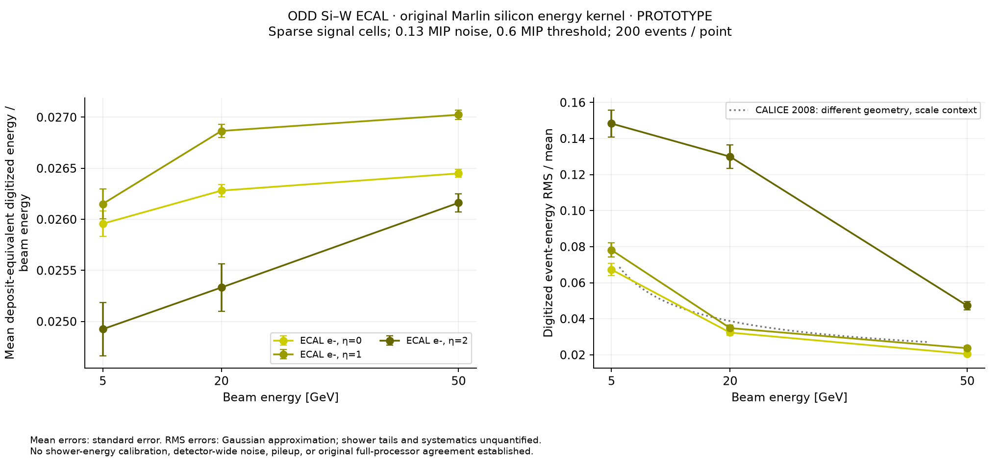
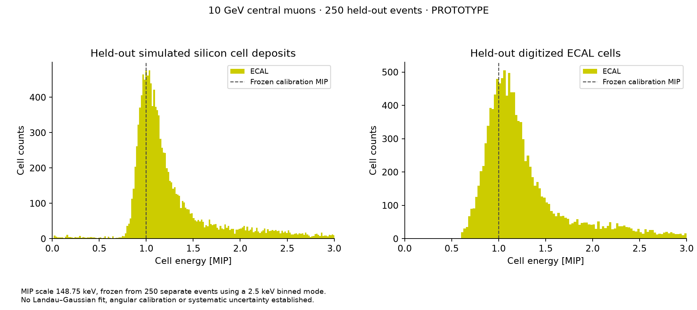
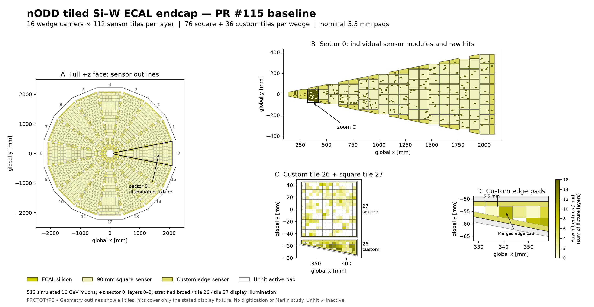
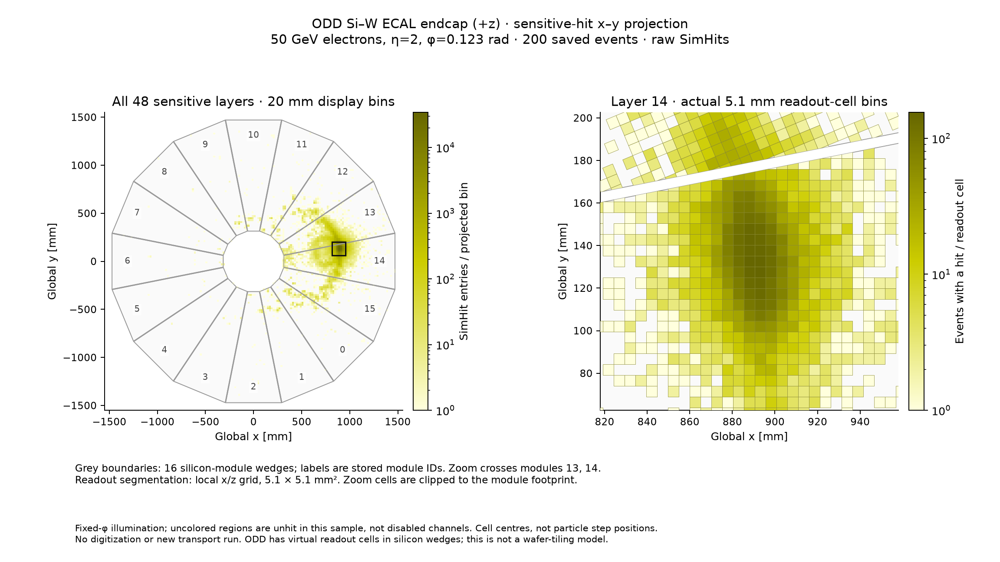

# Issue #117 — existing-model Si–W digitization prototype

Current update: **2026-11-09, PROTOTYPE**. The user resumed the reviewer-requested
checks after [PR #123 installed the original Key4hep runtime](pr123-framework-install.md).
The [frozen digitization protocol](digitization-protocol.md) and
[executed comparison/response report](digitization-results.md) cover original
processor agreement, digitized muon MIP/SNR/threshold response and paired
raw/digitized electron/photon characterization. The full nODD tiling investigation
remains [separate geometry evidence](tiling-response.md).

The [additional nODD request](https://github.com/asalzburger/nodd/pull/118#issuecomment-6744059438)
is addressed by the [matched zero-field LAYOUT-001/ODD study](nodd-digitization-results.md),
under its own [frozen protocol](nodd-digitization-protocol.md). All 9,500 transport
events, 48 native jobs, geometry/cell-position checks and muon/shower statistics
close normally, with four response figures and a separate scientific assessment.
The full original-framework comparison matches 1,712,671 accepted cells with
zero deterministic mismatches. Three stochastic replay cases pass; the
pair-only muon width gate fails and is retained, so full stochastic validation
is not established. All five plots and the failed interval are in the report.
These results remain separate from the completed ODD-only benchmark.

The November 5 software-dependent deferral and November 6 missing-runtime
[review follow-up](pr118-review-request.md) are historical. The preparation,
original environment description and exploratory figures below retain their
original scope; the November 9 report supersedes their current execution status.
No design sign-off, production integration or physics acceptance is recorded.
The proposed endcap geometry issue split remains a maintainer decision.

## Implementation and reference identity

Starting nODD main: `96dbf57d0da7f3027e59109c1846d992d68d4d44`.
The implementation uses MarlinReco
`255967eb855ebbc8f75ebaac190b268b63332e8b`:
the unchanged `RealisticCaloDigiSilicon.cc` translation unit and complete unchanged
`RealisticCaloDigi::EnergyDigi` method. SHA-256 checks reject changed upstream
bytes. A separate GPL executable compiles those methods with real CLHEP and
small framework-registration adapters; it exchanges event batches with the MPL
ACTS algorithm through files and `posix_spawnp`, without a shell or linked GPL
code. Full upstream sources remain external. [Notices](../../../software/source/NOTICE.md)
and the [implementation guide](../../../software/source/ActsExamples/Calorimeter/README.md)
describe the boundary, source retrieval and disabled operations.

The subset includes Poisson charge generation, conversion to MIP units, range
clipping before Gaussian noise and a strict float-precision threshold. It merges
all deposits by cell and preserves native deposited-energy-weighted time. It
does not reproduce upstream Standard/ROC timing integration, gain/dead-cell
effects, ADC/ToA, pulse shapes, ageing or pileup. The cell-position converter is
explicitly opt-in for producer-defined cell positions. Empty-channel enumeration
is an adapter extension; noise-only output has no invented truth link.

Compiling original methods proves source reuse. Analytic controls of those
methods are **kernel tests**, and cannot establish agreement with the complete
original event processor on the same `ddsim` hits.

## Historical preparation environment — 2026-11-05

- Node: `acts-mac-studio-01.cern.ch`, Darwin arm64; AppleClang 21.0.0.21000334.
- Existing pristine ACTS source/build: sibling
  `nodd-software-layout/software/submodules/acts` and `nodd-software-layout/build/acts`,
  source `355ea68493b326956756c9386d2fd9eaf9328568`.
- DD4hep 1.38 `/3yd4hz3`, Geant4 11.4.3 `/wfg55xi`, EDM4hep 1.1.1 `/bsgcccc`,
  podio 1.8 `/hg64alv`, ROOT 6.40.04 `/szgev3e`; Python 3.14.5.
- Setup SHA-256 `53ed8ad1854b592a01f6b9f9d3b8b49dbbb8a06bddb6677805d4099af2432a97`;
  Spack lock SHA-256 `d51753ae83a710850d06413f3dc0a6bf6ad18554d3911108774c48671dda2cde`.

The registry preflight returned exit 2 because recorded fingerprints changed.
The user was warned before dependent work. Actual `software/env/run.sh python3
software/env/doctor.py` passed DD4hep/DDG4 imports and all twelve Geant4 dataset
presence checks, followed by successful compilation, native tests and `ddsim`.
Sandbox `sysctl`/`ps` and CMake policy warnings were retained. No shared dependency
installation or ACTS build was changed. Marlin, `k4run` and `gaudirun.py` were
not found. A separate SciPy availability probe failed; the retained analysis
uses no SciPy and makes no fitted-MIP claim.

## Native tests

Six CTest suites pass, including eight silicon cases, converter validation and
the existing three-event synthetic ROOT I/O round trip. The latter supplies
fixed fixture hits; it is not a digitized shower reference. The sixth suite
checks the same-hit comparison utility using synthetic files, including corruption
rejection; it executes no original framework.

The signed noise fixture uses 200,000 draws with configured RMS 0.2 MIP and
threshold 0.4 MIP: mean `0.0004413758` MIP, measured RMS `0.200103546` MIP,
and 4,518 accepted draws versus Gaussian expectation 4,550.026. Mean, RMS and
tail checks use the plan's five-standard-error criteria. These are software-test
settings and a declared test-cell inventory, not measured ODD/nODD noise.
Other tests cover Poisson variance, deterministic MIP/range controls, strict
threshold equality, stable event replay, malformed/range-overflow input,
position modes, all-channel empty events and signal/noise truth semantics.

## Raw nODD tiled-endcap response

On 2026-11-06 the user authorized a raw Geant4 electron scan on the PR #115
tiled nODD endcap, compared with an idealized continuous-silicon control in the
same retained absorber/hardware stack. All 48 layers and 16 positive-end wedges
are included. This uses no Marlin processor or digitization.

The [executed report](tiling-response.md) records 7,600 response events plus a
separate 100-event reference. At 20 GeV, the first-plane centre point records
9.4% less silicon energy than the control; a tangential gap records 65.4% less.
Statistical errors are 0.4 and 0.2 percentage points. The scan is intentionally
concentrated on boundaries and supplies no area-averaged loss or reconstructed
resolution. The control adds silicon and makes guards sensitive; mechanical
seams and other hardware remain. Marlin/reference and design acceptance gates
are unchanged.



See the [protocol](tiling-response-plan.md), [all figures and recipe](tiling-response.md)
and [compact distributions/moments/provenance](previews/nodd-tiling-response.json).

## Existing exploratory previews

At the user's request, the PR embeds two plots prepared from the retained
**pre-deferral** electron/muon summaries. Publishing and replotting these
summaries does not resume the Marlin study. The full original-framework
comparison and physics qualification remain deferred.



Electron-only preview: 200 events at each of 5, 20, and 50 GeV and η=0/1/2
(1,800 events). Energies are deposit-equivalent, with no shower calibration.
RMS errors use the retained preview's Gaussian approximation; rare tails and
systematics are unquantified. The CALICE curve supplies scale context for a
different geometry and is not an acceptance criterion or a source-framework
agreement test. The η=2 tails remain unresolved.



Central 10 GeV muons: 250 held-out events, with the 148.75 keV MIP scale frozen
from a separate 250-event calibration half. The spectra are binned
characterization, without a Landau–Gaussian fit or angular/systematic validation.

The compact [binwise data](previews/binwise.json) contain edges, units, counts,
normalizations, event-energy moments and source/configuration/input identities.
Machine-specific directory prefixes in descriptive metadata are replaced by
`${NODD_WORKSPACE}` and `${USER_HOME}`; numeric values and original file hashes
are unchanged. The metadata records the unmodified local summary's SHA-256.
There are no event-level samples in this file. The additional η=2 muon control
is retained in the data but not plotted here; there are no photon digitization
results in this preview.

Replot these existing summaries without ROOT, ACTS, Geant4 or Marlin:

```sh
/path/to/matplotlib-python software/analysis/calorimeter_digitization/plot.py \
  docs/validation/issue117/previews/binwise.json docs/validation/issue117/previews
```

The preview was rendered with Python 3.14.5 and Matplotlib 3.11.2. The plotter
explicitly labels Gaussian RMS errors when third/fourth moments are absent,
while newer summaries retain the empirical-moment mode. Regenerating transport
or digitization remains a separate future workflow below.

## nODD tiled endcap — geometry restored by PR #115

**Correction to the first endcap view:** [PR #115](https://github.com/asalzburger/nodd/pull/115) restored the tiled nODD Si–W
endcap. The earlier 5.1 mm-cell plot below uses the upstream ODD comparison
detector and does not show those tiles. The existing digitization response and
MIP previews also use that upstream ODD sample, as requested in #117; they have
not been rerun on the nODD tiled baseline.

The nODD readout hierarchy is:

| Level | PR #115 Si–W endcap representation |
| --- | --- |
| Endcap | 16 wedge carriers (`sector`), 48 sensitive layers |
| Wedge/layer | 112 individual sensor modules: 76 square + 36 custom edge sensors |
| Square sensor | 90 mm outer silicon, 88 mm active window, 0.5 mm thickness |
| Readout pad | Nominal 5.5 × 5.5 mm; custom-edge fragments are clipped and small connected fragments merged |

These are **NODD DESIGN CHOICE** prototype parameters recorded in
[DES-030](../../design/DES-030-ecal-edge-sensors.md), not new choices in this PR.
The `module` field identifies a sensor tile; `sector` identifies its wedge.
The standalone component uses system 8; the integrated LAYOUT-001 package
remaps the endcap to system 9, as documented in the
[integration contract](../../design/inputs/ECAL-baseline-integration-2026-11-04.md).



Panel A shows the complete **geometry guide**, 1,792 sensor tiles per layer.
Panel B overlays raw Geant4 hit cell reference positions on one wedge. Panels C/D
show adjacent square/custom sensors and the true custom electrode polygons,
including connected merged edge pads; pad colors sum stored hit entries over
the three simulated layers. Light/dark yellow sensor shades distinguish square
and custom silicon. White pads received no hit in this display sample.

The isolated **display fixture** retains all 112 modules and unchanged local
hardware in +z sector 0, layers 0–2. Other wedges, the opposite endcap, remaining
layers and the supported wedge frame are omitted. This is not full-detector
transport. The gun uses 512 10 GeV muons from the origin, zero field,
`FTFP_BERT`: 256 broadly illuminate the wedge, 128 sample the angular bounding
rectangle of custom module 26, and 128 that of square module 27. Seeds are
118030/118031/118032. Bounding rectangles include misses; this sampling is a
display choice and supplies no efficiency, response or acceptance measurement.
No digitization or Marlin study is run.

There are 1,231 saved hits in 1,001 occupied layer/pad bins across 87 modules;
92 events have no saved hit. Layers 0/1/2 contain 407/417/407 entries. Every
parent and pad ID matches the current catalogue. Maximum saved cell-reference
position residual is 0.000098 mm, below the stated 0.002 mm float-persistence
consistency tolerance. These are software correspondence checks.

All ten geometry source/configuration files match PR #115 head
`14898df4022363bb038577d170daaf5ed8cdc547` byte for byte. A fresh export also
reproduces the executed component's `calorimeter.xml` and `materials.xml`
byte for byte. The compact [layout guide](previews/nodd-tiled-endcap-layout.json)
contains sensor/board/active outlines and zoom electrode polygons; the
[raw-hit bins](previews/nodd-tiled-endcap-hit-bins.json) contain pad keys, counts,
energy sums/moments, event denominator, seeds and source/input/library hashes.
They contain no event-level payload. Full ROOT files and logs remain ignored.

Replot the committed summaries without DD4hep, ROOT, Geant4 or Marlin:

```sh
/path/to/matplotlib-python software/analysis/calorimeter_digitization/tiled_endcap_xy.py plot \
  --layout docs/validation/issue117/previews/nodd-tiled-endcap-layout.json \
  --hits docs/validation/issue117/previews/nodd-tiled-endcap-hit-bins.json \
  --output docs/validation/issue117/previews/nodd-tiled-endcap-xy.png
```

To regenerate the display transport, first run the Spack preflight and runtime
doctor described above. Use task-owned outputs and the unchanged PR #115 inputs:

```sh
python3 -B tools/calorimeter_hardware/edge_export.py --output build/tiled-endcap-source
software/env/run.sh cmake -S prototypes/calorimeter -B build/tiled-endcap-view/factory -G Ninja -DCMAKE_BUILD_TYPE=Release
software/env/run.sh cmake --build build/tiled-endcap-view/factory --target Components_nODDCalorimeterPrototype --parallel 4
python3 -B software/analysis/calorimeter_digitization/tiled_endcap_transport.py prepare --component build/tiled-endcap-source
software/env/run.sh python3 software/analysis/calorimeter_digitization/tiled_endcap_transport.py run --component build/tiled-endcap-source --events 512 --seed 118030
software/env/run.sh python3 software/analysis/calorimeter_digitization/tiled_endcap_transport.py analyze --component build/tiled-endcap-source
python3 -B software/analysis/calorimeter_digitization/tiled_endcap_xy.py prepare \
  --expected build/tiled-endcap-source/expected.json \
  --output docs/validation/issue117/previews/nodd-tiled-endcap-layout.json
```

The original local execution reused the source-matched component export from
the PR #115 campaign; the fresh-export check above establishes correspondence.
The factory build must include its `.components` registration target. The first
launch without it failed before transport; building that target resolved the
failure. No shared installation or detector geometry was changed.

## Upstream ODD comparison — continuous-wedge sensitive-hit projection



**This is the upstream ODD comparison geometry, not PR #115's tiled nODD
endcap.** This view uses the saved 200-event 50 GeV electron sample at η=2, φ=0.123 rad.
It selects the **+z ECAL endcap** and stored `SimCalorimeterHit` cell centres;
no digitization, new transport or Marlin study is run. The left panel sums
309,693 hit entries across 48 sensitive layers into 20×20 mm display bins. The
right panel resolves the actual 5.1×5.1 mm local readout grid in layer 14, the
layer with the most stored entries (12,924). Its 140 mm window is centred on
the most frequently hit cell and crosses the boundary between modules 13/14.

Grey outlines are the source geometry's 16 silicon-module wedges, with 2.5 mm
removed from each module's tangential half-width. Labels use the stored
four-bit `module` field; factory module 16 is encoded 0. The zoom's nominal
readout-cell polygons are clipped to the silicon-module footprint. ODD models
a continuous sensitive silicon wedge per layer with virtual readout cells;
this does not introduce an individual-wafer tiling model. Uncolored regions
mean unhit in this fixed-φ sample, not missing/disabled channels.

**FACT — pinned primary source:** ODD
`d70556f33b1c36abdf101a07ad8cf57eb56fbdf1`,
`xml/detectors/CalorimeterECal.xml` (CartesianGridXZ, cell pitch, layers/slices),
`xml/OpenDataDetectorEnvelopes.xml` (endcap dimensions), and
`factory/calorimeter/ODDPolyhedraEndcapCalorimeter_geo.cpp` (`placeStaves`,
module/layer/slice placements). The source hashes and readout encoding are in
[the compact occupancy data](previews/endcap-xy-binwise.json).

The extractor checks every selected stored global cell centre against its
source placement and signed local cell indices. Maximum residuals are
0.000061/0.000057/0.000098 mm in x/y/z, within a per-coordinate bound of
`4 × float32 epsilon × max(1 mm, |expected coordinate|)` for float persistence.
It rejects repeated cell IDs within an event and checks the event/count
normalization. Thirty opposite-endcap entries are excluded. These are
source/representation checks, not geometry or detector-performance acceptance.

The compact JSON contains a projected count histogram, layer-selection
metadata, readout-cell occupancy bins for the zoom, geometry/input/script
hashes and denominators. It contains no per-event payload. Replot without
ROOT, DD4hep, Geant4, ACTS or Marlin:

```sh
/path/to/matplotlib-python software/analysis/calorimeter_digitization/endcap_xy.py plot \
  --input docs/validation/issue117/previews/endcap-xy-binwise.json \
  --output docs/validation/issue117/previews/endcap-xy.png
```

Re-extract from the retained raw simulation file with the verified ROOT/podio
runtime (no transport or digitization):

```sh
software/env/run.sh python3 software/analysis/calorimeter_digitization/endcap_xy.py extract \
  --manifest build/issue117/showers/samples.json \
  --odd-source /path/to/pinned/OpenDataDetector \
  --output docs/validation/issue117/previews/endcap-xy-binwise.json
```

The input SHA-256 must match the generation manifest. `--layer N` overrides
the default most-populated-layer choice; `--zoom-width-mm` and
`--overview-bin-mm` are display settings, not detector parameters.

## Prepared reproduction recipe — Marlin phase deferred

This historical recipe reconstructs the original raw-input preparation. For the
resumed original-framework execution and new digitized plots, use the
[November 9 report](digitization-results.md). The former deferral below describes
the November 5 state, not the current disposition. First run the repository's Spack preflight and doctor. Build the native backend
using the implementation guide and an existing matching ACTS source/build.
The local execution used `/private/tmp/nodd-digitization117-build`; substitute
your task-owned build below. Build ODD at
`d70556f33b1c36abdf101a07ad8cf57eb56fbdf1`, preserving its tracked source.

```sh
software/env/run.sh cmake -S /path/to/pinned/OpenDataDetector -B build/odd -G Ninja -DCMAKE_BUILD_TYPE=Release
software/env/run.sh cmake --build build/odd --parallel 4
software/env/run.sh ctest --test-dir /path/to/calorimeter-build --output-on-failure
software/env/run.sh python3 software/analysis/calorimeter_digitization/generate.py \
  --odd-source /path/to/pinned/OpenDataDetector \
  --odd-library build/odd/factory/libOpenDataDetector.dylib \
  --output build/issue117/muons --events 500 --energies 10 --etas 0 2 --particles mu-
software/env/run.sh python3 software/analysis/calorimeter_digitization/generate.py \
  --odd-source /path/to/pinned/OpenDataDetector \
  --odd-library build/odd/factory/libOpenDataDetector.dylib \
  --output build/issue117/showers --events 200 --energies 5 20 50 --etas 0 1 2 --particles e- gamma
software/env/run.sh python3 software/analysis/calorimeter_digitization/calibrate.py \
  build/issue117/muons/mu-_E10_eta0/sim.edm4hep.root build/issue117/calibration.json
software/env/run.sh python3 software/analysis/calorimeter_digitization/analyze.py \
  --samples build/issue117/showers/samples.json build/issue117/muons/samples.json \
  --calibration build/issue117/calibration.json \
  --binary /path/to/calorimeter-build/EDM4hep/nodd_silicon_campaign \
  --backend /path/to/calorimeter-build/nodd_marlin_silicon_backend \
  --work build/issue117/analysis --output docs/validation/issue117/binwise.json
/path/to/matplotlib-python software/analysis/calorimeter_digitization/plot.py \
  docs/validation/issue117/binwise.json docs/validation/issue117
```

On Linux substitute the built `.so` ODD library. Generation invokes the active
Python interpreter on `ddsim`, avoiding the macOS executable-shebang environment
issue. `generate.py` records actual commands, full input hashes, library/script
hashes, seeds, exits and elapsed times in ignored local manifests. It refuses to
overwrite existing samples. An initial pilot attempt supplied an unsupported
boolean argument; this was corrected before the successful smoke and campaigns.
The gun has fixed φ=0.123 rad, `FTFP_BERT`, the full unchanged ODD detector and
its configured field; positive η points alone are not a signed-η/φ acceptance scan.

`calibrate.py` freezes the first 250 central muon events' most populated 2.5 keV
silicon-energy bin as one MIP, giving **148.75 keV**. The remaining 250 events
are held out. This is an empirical bin convention, with 1.25 keV half-bin
quantization; it supplies no Landau–Gaussian fit or systematic uncertainty.
Noise 0.13 MIP and threshold 0.6 MIP reproduce *comparator settings* from CALICE
arXiv:0811.2354v1, not approved nODD parameters. The 2,500-MIP pre-noise range
is the upstream default. Physics/response seeds and every sample input digest
are captured by the prepared binwise workflow; the transport manifests already
retain the completed input identities. Digitization uses all event deposits without
a time cut and sparse signal cells; empty detector cells are not simulated here.

The full ROOT events, intermediate summaries and run logs stay ignored under
`build/issue117/`. The two existing exploratory plots and compact binwise summaries above are
retained at the user's subsequent request. They do not establish the completed
Marlin study. Replotting them needs JSON and Matplotlib. Regeneration, the MIP split,
per-event correlated checks and a full original-framework comparison need the
local or regenerated event files and verified runtime.

## Remaining issue gates

| Issue deliverable | State / evidence |
| --- | --- |
| Draft recommendation per technology | Available: DES-044, six pinned source implementations and explicit pp/μ=200 gaps |
| Si–W implementation and unit tests | Available: opt-in prototype, six passing native suites |
| Original-framework same-hit comparison | Executed: noise-off exact-cell and conditional P/PN distribution gates; [November 9 report](digitization-results.md) |
| Muon expected MIP peak | New held-out detailed muons: digitized MIP/fit, SNR and threshold characterization; approximate paths and conditional fit/crossing limits remain explicit |
| Shower plots / linearity / resolution | Paired raw/D/PN electron/photon characterization and independent calibration; no reconstructed-resolution or complete detector qualification |
| Remaining technology follow-ups | Three bounded issue drafts listed in DES-044 for maintainer triage |

The November 9 study uses an independent fixed shower calibration per direction;
the older deposit-equivalent previews do not. Physical active-plus-passive
sampling fraction, scored leakage, signed-η/transition coverage, empty-detector
noise, pulse/ADC, irradiated conditions and pileup qualification remain open.
The CALICE comparison context in the original plan is a different detector,
not a transferred acceptance band. Issue #117 remains open for remaining
technology, review and physics requirements; no agent grants acceptance.

## Historical user-directed deferral and retained preparation — 2026-11-05

The user stated: “Hold on for the Marlin study, we will add that when we the appropriate software is installed”.
The Docker inventory approval was interrupted; no inventory result or container
execution is claimed, and no installation was attempted. Six native software
suites passed before this direction. A partial electron-only exploratory analysis
and muon calibration were run before the deferral, not accepted as the completed
Marlin/physics study. The code, source survey, comparison utility and future
recipe are retained. The user subsequently asked to embed the existing
pre-deferral plots; these previews are now included above. That software-dependent deferral was superseded by the November 9 continuation
after the PR123 installation; see the current report above. Full Geant4 input-generation counts are recorded in the session
journal; these are independent transport inputs, not a Marlin validation pass.
