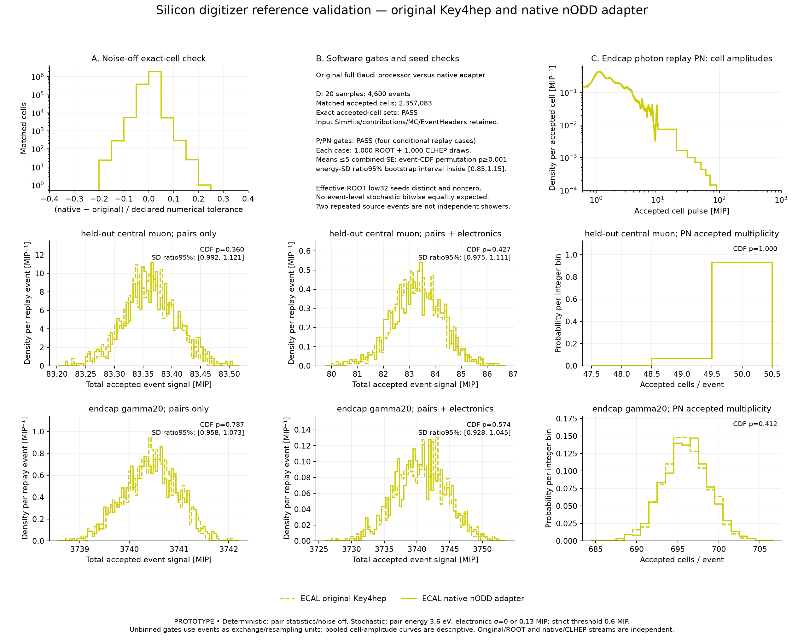
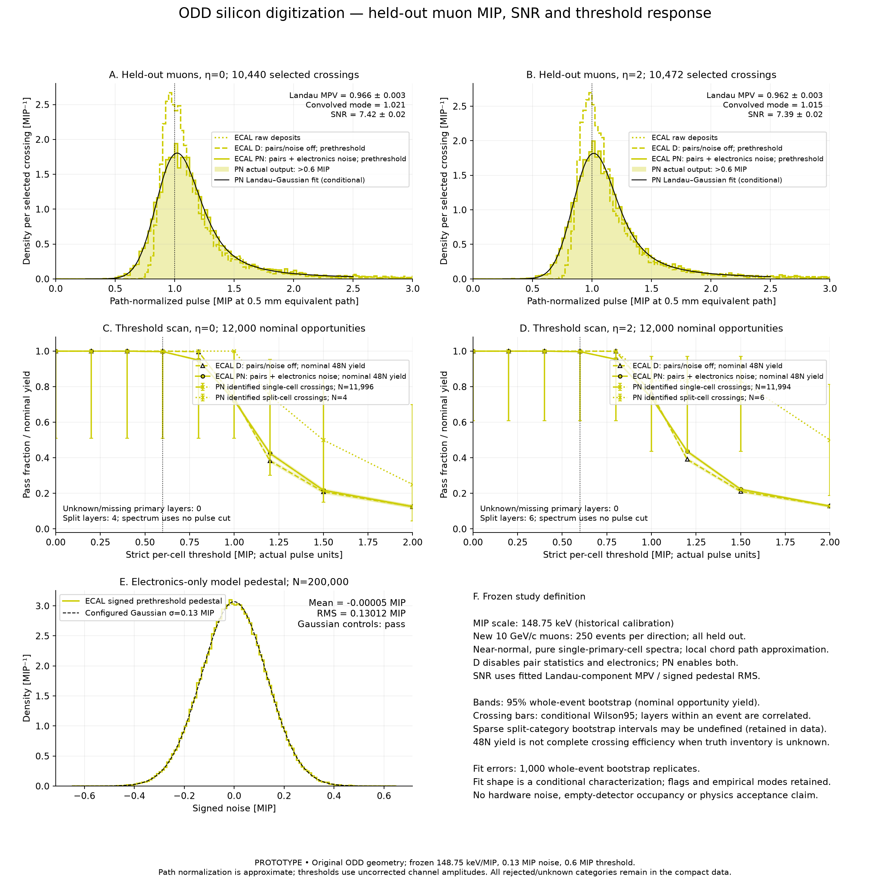
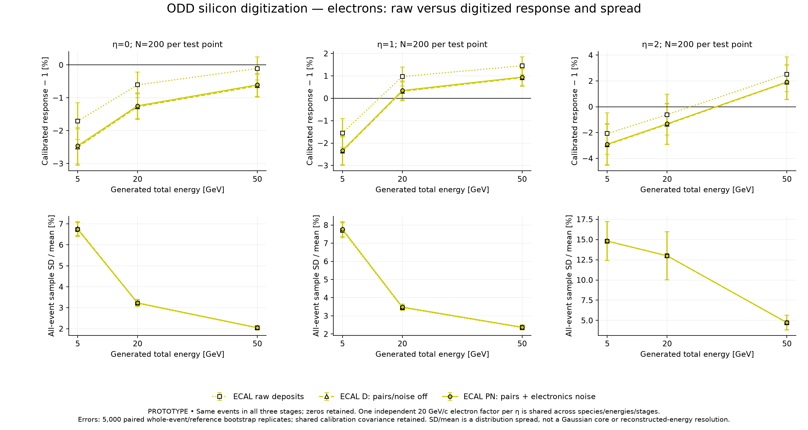
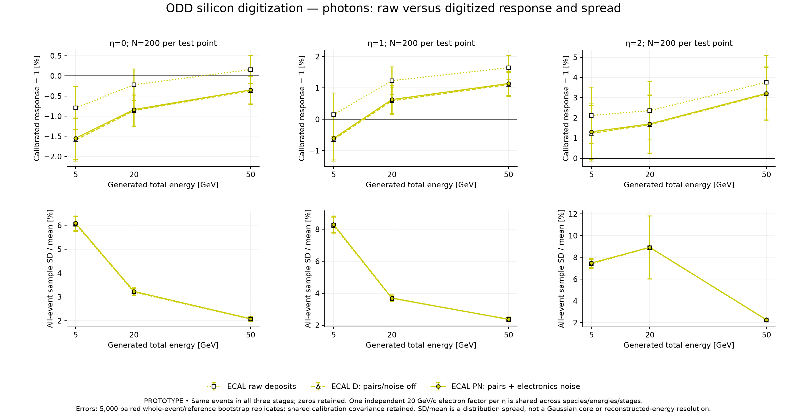

# PR #118 — original-framework silicon digitization validation

Date: 2026-11-09. **PROTOTYPE**, governed by [DES-044](../../design/DES-044-calorimeter-digitization.md).
The current user request resumes the checks requested in
[the digitization review](https://github.com/asalzburger/nodd/pull/118#issuecomment-6684090541)
after [PR #123 installed the original runtime](pr123-framework-install.md).
The November 5 deferral and November 6 missing-runtime report are historical.
This report does not grant detector sign-off or physics acceptance.

The benchmark uses the unchanged upstream **ODD comparison geometry**, revision
`d70556f33b1c36abdf101a07ad8cf57eb56fbdf1`, with its full configured field.
The nODD ACTS adapter runs against the original EDM4hep-native Key4hep
`DigitiserSiliconMip`, pinned at `03b3676cecbdf85818f6de159ecf90ffe2482cec`.
This is a full original Gaudi event algorithm, independent of the nODD helper
that reuses the MarlinReco `255967eb855ebbc8f75ebaac190b268b63332e8b`
energy methods. No Marlin/LCIO bridge or copied helper is used as the reference.
The [nODD endcap tiling study](tiling-response.md) remains separate historical
geometry evidence; this digitizer study changes no production geometry.

The [protocol](digitization-protocol.md) was frozen at `baf36920`, with
pre-output selection/SNR/tail clarifications at `f2f57d10` following a separate
PhysVal agent assessment. Subsequent fixes retain execution provenance,
undefined bootstrap quantities and sparse-category denominators; they do not
change the selected physical inputs or tune a criterion to a result.

## Results

The requested deterministic and conditional stochastic **software gates passed**.
The fitted MIP and shower results are characterization under the frozen study
settings, without a detector-performance acceptance decision.

| Measurement | Result |
| --- | --- |
| Same-hit D comparison | 20 files, 4600 events, 2714303 input cells; **2357083 matched accepted cells**, zero selection/energy/event mismatches |
| P/PN original/native distributions | All four conditional replay cases passed mean, event-CDF and energy-width gates; maximum mean deviation 1.23 combined SE (limit 5) |
| Signed model pedestal | Mean −0.000050 ± 0.000291 MIP; RMS **0.130119 ± 0.000206 MIP**; frozen Gaussian controls passed |
| Paired shower mean PN/raw | Digitization reduces mean silicon signal by **0.495–0.847%** across the 18 test populations |

| η | Fitted PN Landau MPV [MIP] | Convolved peak [MIP] | SNR | PN passes at 0.6 MIP / nominal opportunities |
| ---: | ---: | ---: | ---: | --- |
| 0 | 0.9658 ± 0.0028 | 1.0205 ± 0.0033 | 7.422 ± 0.024 | 11965 / 12000 = **99.708% ± 0.054 percentage points** |
| 2 | 0.9617 ± 0.0026 | 1.0152 ± 0.0032 | 7.391 ± 0.023 | 11964 / 12000 = **99.700% ± 0.044 percentage points** |

Peak/yield errors are whole-event bootstrap standard errors; SNR additionally
propagates independent pedestal-RMS uncertainty. Neither the frozen calibration's
quantization nor path/model/systematic uncertainty is included in these errors.
There are **no missing primary layers** in these two samples, but the metric is
still named nominal-opportunity yield; no unseen crossing inventory is invented.
D passed all 12000 opportunities in each direction in this sample, which does
not establish a population efficiency of exactly one.

All six raw/D/PN fit populations converged, with **1000/1000 usable bootstrap
fits each**, no parameter-boundary/poor-shape flags under the recorded screen.
The asymptotic Poisson-deviance diagnostics range from p=0.145 to 0.957; they are
conditional diagnostics because layer trials are correlated. The raw and D
fit histograms happen to be identical at the frozen 0.025-MIP binning; PN visibly
broadens them. The numerical PN mode lies near one MIP without retuning the
historical bin calibration, while its underlying Landau-component MPV is lower.

The qualified spectra contain 10,440/10,472 crossings. Per direction there are
4/6 split layers and 1102/1069 contaminated single-cell layers; chord/end-point
rejections account for 454/453 more. No angle-cut rejection occurred. Mean
approximate path lengths are 0.51331/0.51873 mm. Chord paths average 1.886%/0.0134%
longer than the corresponding initial straight-ray estimates, illustrating the
field/path convention rather than assigning a path systematic from that number.
The split categories have only 4/6 trials: 17/1 of 1000 bootstrap replicas have no
such crossing. Counts and conditional Wilson intervals remain, while their
whole-event errors are **null**, not zero or silently conditioned estimates.

At 20 GeV and η=0, sample SD/mean is 3.208% raw versus 3.227% PN for electrons,
and 3.197% versus 3.229% for photons. Forward samples have much larger raw tails:
for example 20 GeV electrons at η=2 give 12.982% raw versus 12.991% PN. Thus the
large forward spread is already present in the raw events. No Gaussian core fit,
leakage correction, per-energy tuning or claim of reconstructed energy resolution
is made. The different CALICE benchmark retained in the original validation plan
provides scale context, not an acceptance band for this 48-layer ODD geometry.









## Settings and interpretation

| Stage | Pair energy | Electronics noise | Threshold / range |
| --- | ---: | ---: | --- |
| Raw | No digitizer | No digitizer | All stored silicon deposits |
| D | 0 eV, charge statistics disabled | 0 MIP | Strict >0.6 MIP; pre-noise range 2500 MIP |
| P | 3.6 eV | 0 MIP | Same; conditional reference replay only |
| PN | 3.6 eV | 0.13 MIP Gaussian RMS | Same |

The MIP scale remains **148.75 keV**, frozen from the first 250 historical central
muon events with a 2.5-keV bin convention; its 1.25-keV half-bin quantization
and unmeasured calibration systematics remain separate from statistical errors.
The comparator noise/threshold values are literature-context study settings,
not selected nODD operating parameters. Gains, dead cells and timing smearing
are disabled. Both frameworks integrate every contribution inside the same
wide numerical time window. Only energy/selection equivalence is tested:
original earliest-contribution and native energy-weighted times differ.
PN−D combines charge statistics and electronics effects.

All-event sample SD/mean is reported as a distribution spread, not a Gaussian
core fit or reconstructed calorimeter energy resolution. Silicon visible energy
is not active/(active+passive) sampling fraction. Sparse occupied-cell processing
cannot qualify detector-wide empty-channel noise occupancy, charge sharing,
ADC/pulses, timing, irradiation or pileup response.

## Deterministic full-framework gate

All 20 historical raw files passed: 18 electron/photon samples at 5/20/50 GeV/c,
η=0/1/2, 200 events each; two 10 GeV/c muon directions, 500 events each.
This is **4600 events**. The original output retains SimHits, contributions,
MC relation endpoints and ordered EventHeaders; the comparator checks unchanged
inputs, exact accepted-cell sets and float-precision MIP energies.

The comparator's symmetric tolerance is
`1e-5 + 5e-6*max(abs(native),abs(reference))` MIP. An additional conservative
bound using the occupied normalized-residual bins establishes the stricter
protocol reference-only formula for every matched cell: the worst normalized
upper bound is **0.250000313 < 1**. No threshold disagreement is excused by an
energy tolerance. The compact reference summary retains per-sample counts,
residual histograms and the bound proof.

## Stochastic original/native gate

The original processor uses ROOT and the native helper CLHEP. Replay inputs
repeat one held-out central muon event and one 20-GeV/c endcap photon event,
1000 times each, with only run/event identifiers changed. P and PN each use
independent framework streams on the same hashed input. These are conditional
model tests, not 1000 independently generated showers. Gates use event totals
and accepted-cell multiplicities; pooled cell spectra are descriptive.

An actual seed audit exposed a technical issue in the original path: adjacent
header changes could differ only in high UID bits, which `TRandom3.SetSeed`
truncates, repeating the draws. The replay varies both run and event IDs and
checks every effective low-32-bit seed is distinct and nonzero before interpreting
an ensemble. This workaround is confined to the software experiment; the pinned
upstream algorithm and services are unchanged. Cached podio Header objects also
required rebuilding the Header collection for changed IDs to persist. Full
non-identifier Header metadata and event payloads are verified after round trip.
Both findings and failed pilots remain in the ignored execution evidence.

## Held-out muons and threshold response

New detailed transport comprises 250 10-GeV/c muons at each η=0 and 2, all held
out from the historical MIP calibration. Detailed shower mode persists PDG and
step positions, allowing primary-muon relation checks; the old PDG-zero files
remain valid deterministic inputs but cannot supply this qualified MIP sample.

Native DD4hep volume lookup checks all **26258** persisted cell references,
14 reached module normals and the actual 0.5-mm silicon thickness. The maximum
reference residual is **0.0000976563 mm**, below the frozen 0.002-mm tolerance.
Ten virtual cell reference points overhang a physical sensitive footprint;
normals come from the registered sensitive-volume ID, not the material at that
virtual point. Barrel local-z and endcap local-y thin axes are distinguished.

MIP spectra use one uncontaminated primary-muon cell in a layer, adjacent-layer
primary contribution centroids and `abs(n dot u)>=0.9`, without a pulse-height
selection. Path normalization uses the local centroid chord; it is an
approximation rather than a Geant4 step-length measurement. Endpoints, split
cells, contamination, unavailable chords and angle rejections remain counted.

The fixed Landau–Gaussian fit uses 0.025-MIP bins, range [0.25,2.5] MIP,
bin-integrated Poisson means and a profiled normalization in that finite range.
The Landau-component MPV and numerical convolved mode are distinct; both and
1000 whole-event-bootstrap uncertainties are retained. Parameter-boundary or
poor-shape diagnostics remain visible; optimizer convergence alone is not a
validation of the physical line shape. Empirical modes/quantiles accompany fits.

Thresholds are applied to the same unnormalized per-cell pulses at
0/0.2/0.4/0.6/0.8/1.0/1.2/1.5/2.0 MIP. A split layer passes when any identified
primary-associated cell passes, rather than after summing cell pulses.
All 48 nominal opportunities per generated event remain in a separate yield
metric; missing/unknown truth is not silently fabricated as a zero-energy
crossing. Identified single/split crossing categories retain conditional Wilson
intervals and whole-event bootstrap errors. A rare category can be absent from
some bootstrap samples; those replicas are counted and the corresponding
bootstrap errors are null, without discarding events.

The signed electronics-only pedestal uses 200000 zero-input trials at the
configured 0.13 MIP noise, with pair statistics disabled. Negative values remain.
Its mean, RMS and >2σ tail are checked against frozen five-standard-error
Gaussian criteria. This bounded empty-channel experiment is separate from the
original sparse processor and detector noise occupancy. SNR uses the fitted
path-normalized Landau-component MPV divided by that pedestal RMS.

## Paired electron and photon response

All 3600 historical shower events are retained, including zeros. Each event is
processed through raw, D and PN stages, summed over barrel and endcap ECAL.
Three new, independent 100-event 20-GeV/c electron samples fix one D-response
factor per η. That same factor applies to both species, every energy and all
three stages; no point is independently tuned to unity.

The calibration factors are 37.5805 ± 0.1187, 37.3548 ± 0.1279 and
38.9578 ± 0.4942 for η=0/1/2, respectively (dimensionless; bootstrap SE).

MC truth confirms this DDSim gun configuration sets momentum magnitude; plotted
energy denominators use persisted generated **total energy**. Calibration
uncertainty is propagated with 5000 paired whole-event/bootstrap reference
replicates. The same resampled factor is shared across energies/species/stages,
with labelled full covariance retained. The common low-response tail is
`C_eta*S_stage/E_generated < 0.8`; conditional intervals and joint-reference
bootstrap uncertainty are retained. Raw/digitized distributions, first four
moments, paired covariances and zero counts accompany the response/spread curves.

## Numerical checks and provenance corrections

The six native CTest suites passed. Six focused numerical/provenance controls
passed, including all-zero widths, changed log/backend rejection, paired-event
resampling, ROOT Landau-MPV convention and exact serial/parallel fit equality.
Separate agent source assessments checked the protocol, implementation and
unchanged 1000-resample task sequence. The serial fit timing was 6.675 s for ten
fits; its interrupted analysis produced no summary. The same fixed fits ran in
eight spawned ROOT processes, without worker RNG draws or retries.

An independent standard-library audit of all 18 raw diagnostic shower populations
reproduced means, SEM, sample SD/mean and calibrated responses to maximum absolute
difference 8.89e-16. Full original-framework audits and final figure assessment
are recorded in the paired session journal. No agent assessment is human sign-off.

The original response summary `ca3479e6994773b2f6edbab58cded499d26df1e9631e598403bc12593454680a`
is preserved locally. A metadata-only correction renames its path ratio to
`chord_over_straight_path`, matching the actual `abs(n·u_initial)/abs(n·u_chord)`
formula. Values, fits, bootstrap results and all execution evidence are identical;
the committed JSON records the original summary hash, actual producer hashes
and correction source hash. No fits were rerun to change a label.

The reference summary's first snapshot accidentally included its still-open
controller stdout, whose final completion line invalidated its self-hash.
The corrected inventory excludes controller stdout while retaining it locally;
closed original/native/comparator logs and 55 execution receipts remain hashed.
Regeneration retained **all scientific, gate, receipt, source/runtime and protocol
fields exactly**. This was a provenance correction, not a relaxed comparison.

Compact JSON units: shower stage means/SD/SEM are GeV and kth sums are GeV^k;
response and SD/mean are dimensionless. Pedestal amplitudes/fit peaks are MIP;
path summaries are mm and direction cosines/path ratios dimensionless. Descriptive
cell-level path arithmetic SEs are not whole-event physical path uncertainties;
MIP-fit and threshold errors use the recorded event bootstrap instead.

## Reproduction and retained evidence

The local installation is the PR123 build in sibling checkout
`../nodd-pr123-frameworks/software/build/key4hep/install`; activation uses that
checkout's `software/env/key4hep_run.sh`. The shared Spack setup/lock are
unchanged. Node preflight warned of stale fingerprints; actual DD4hep/DDG4,
Geant4 and twelve dataset paths were reverified before dependent work.

Build ODD/native binaries and generate the 20 historical raw files using the
[original preparation recipe](README.md#prepared-reproduction-recipe--marlin-phase-deferred).
The new executable `nodd_silicon_validation` is built by the same standalone
calorimeter CMake target. Use pinned matching ACTS source/build and the original
MarlinReco source as described in the implementation guide. Full source and
binary hashes are retained with compact data; no shared dependency is installed
or changed by these commands.

New independent samples, with `ODD_SOURCE` and `ODD_LIBRARY` pointing to the
verified pinned source and factory:

```sh
software/env/run.sh python3 software/analysis/calorimeter_digitization/generate.py \
  --odd-source "$ODD_SOURCE" --odd-library "$ODD_LIBRARY" \
  --output build/issue117/nov9/electron-calibration --events 100 \
  --energies 20 --etas 0 1 2 --particles e- --seed 119100
software/env/run.sh python3 software/analysis/calorimeter_digitization/generate.py \
  --odd-source "$ODD_SOURCE" --odd-library "$ODD_LIBRARY" \
  --output build/issue117/nov9/detailed-muons --events 250 \
  --energies 10 --etas 0 2 --particles mu- --seed 119000 --detailed-showers
```

Reference execution, using fresh work directories and the PR123 installed
wrapper for each command:

```sh
../nodd-pr123-frameworks/software/env/key4hep_run.sh python3 \
  software/analysis/calorimeter_digitization/reference_validation.py prepare \
  --work build/issue117-reference-validation/reproduction
../nodd-pr123-frameworks/software/env/key4hep_run.sh python3 \
  software/analysis/calorimeter_digitization/reference_validation.py deterministic \
  --work build/issue117-reference-validation/reproduction
../nodd-pr123-frameworks/software/env/key4hep_run.sh python3 \
  software/analysis/calorimeter_digitization/reference_validation.py replays \
  --work build/issue117-reference-validation/reproduction
../nodd-pr123-frameworks/software/env/key4hep_run.sh python3 \
  software/analysis/calorimeter_digitization/reference_validation.py stochastic \
  --work build/issue117-reference-validation/reproduction
../nodd-pr123-frameworks/software/env/key4hep_run.sh python3 \
  software/analysis/calorimeter_digitization/reference_validation.py summarize \
  --work build/issue117-reference-validation/reproduction \
  --output build/issue117-reference-validation/reproduction-summary.json
```

The reference CLI exposes explicit framework, source, library, comparator,
backend and native-validation executable overrides. Its defaults reproduce the
local layout. Commit exact source/protocol before bulk, as enforced by the
runner. Earlier execution used `run-02`; the summary identifies each executed
producer snapshot and protocol digest. Refuse existing case outputs; retain
failed attempts and choose a fresh case/work directory.

Native response execution uses the same frozen manifests at all stages:

```sh
software/env/run.sh python3 software/analysis/calorimeter_digitization/digitized_response.py run \
  --samples build/issue117/showers/samples.json \
  --calibration-samples build/issue117/nov9/electron-calibration/samples.json \
  --muon-samples build/issue117/nov9/detailed-muons/samples.json \
  --mip-calibration build/issue117/calibration.json \
  --binary /path/to/native-build/EDM4hep/nodd_silicon_validation \
  --backend /path/to/native-build/nodd_marlin_silicon_backend \
  --work build/issue117/nov9/digitized-response --jobs 4
```

Use the same arguments with stage `geometry`, adding `--odd-source` and
`--odd-library`, then stage `analyze --fit-workers 8 --output /fresh/compact-summary.json`.
Geometry summaries refuse overwrite. The local native build was
`/private/tmp/nodd-digitization117-build`. Analysis rechecks actual execution
receipts, input/configuration/output/log/executable hashes and expected settings,
then primary truth and ordered event identities. Source and runtime identities
remain distinct from unmeasured acceptance. Exact commands, exits, seeds,
source snapshots and raw/output hashes remain in ignored work manifests.

Replot from only the committed compact summaries, using NumPy and Matplotlib:

```sh
python3 software/analysis/calorimeter_digitization/plot_digitized_validation.py \
  --response docs/validation/issue117/previews/digitized-response.json \
  --reference docs/validation/issue117/previews/digitization-reference.json \
  --output /fresh/figure-directory
```

Full same-hit provenance, MC/step/path selection and repeated bootstrap fits
require the hashed local ROOT/JSONL inputs. Replotting and histogram/count/
covariance inspection need only compact data. Full ROOT events, replay payloads,
raw JSONL, pedestal draws, caches and detailed logs remain local and ignored.
