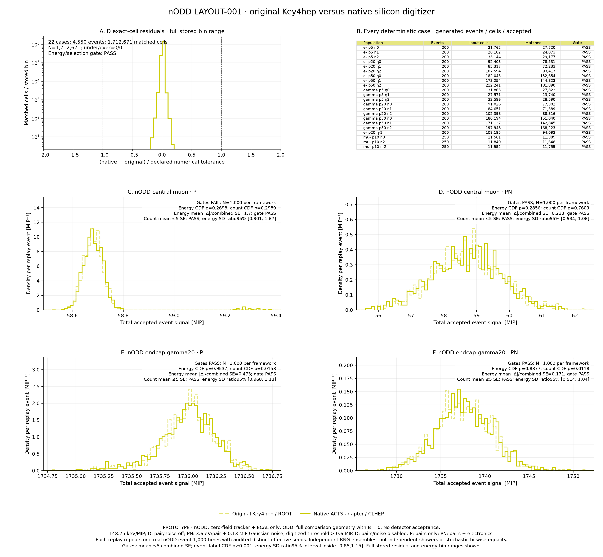

# nODD geometry and silicon digitization comparison

Date: 2026-11-09. **PROTOTYPE; frozen comparison completed with one failed stochastic gate. No detector acceptance.**
Requested in [PR118 comment6744059438](https://github.com/asalzburger/nodd/pull/118#issuecomment-6744059438).
Noise-off software agreement passes on 1,712,671 accepted cells, while the
pair-only muon replay fails the frozen energy-width equivalence gate. The other
three stochastic cases pass. **Full stochastic validation is not established**;
the failed result is retained without new seeds, retries or changed criteria.
The large nODD/ODD raw-response difference is separate geometry evidence.

The [frozen protocol](nodd-digitization-protocol.md) and
[pre-analysis clarifications](nodd-digitization-analysis-notes.md) govern this
extension. The earlier [fielded ODD digitizer study](digitization-results.md)
and [isolated positive-endcap tiling/control study](tiling-response.md) retain
their separate configurations and numerical evidence.

## Actual scope and current checks

This study uses the maintained **LAYOUT-001 tracker plus Si–W ECAL stage**:
beam pipe/tracker systems0–7, full DES031 barrel8 and both DES030 tiled endcaps9.
Local hardware and all sectors/layers remain. The baseline has no solenoid,
magnetic field, HCAL, FCAL or muon system. It is not a complete fielded detector.

The newly exported native union passes construction, exact ten-system root
mapping and a complete ROOT overlap/extrusion scan at **1e-5 mm (10 nm)**:
13,506,030 physical nodes, 650,387 volume UIDs, zero reported overlaps/extrusions.
The scan considered16,946,408 candidate pairs. Point preparation took1372.71s;
the24-thread candidate check took35.734s. Normal cleanup and process exit0 were
verified. This geometric software check grants no engineering sign-off.
The [compact native proof](previews/nodd-geometry-validation.json) retains the
source, exported geometry/material/factory identities, original report/log
hashes, aggregate counts and runtime registration fingerprints.

The matched control uses ODD
`d70556f33b1c36abdf101a07ad8cf57eb56fbdf1`, with its original component scope
and a task-owned root-copy wrapper removing only the field block. Both transports
use an explicitly audited5-mm charged-particle maximum step in sensitive ECAL
silicon,0.7-mm production range cut and FTFP_BERT. Other geometry/material scope
differences remain intentional; this does not isolate a tiling-only effect.

The excluded two-block technical pilot verified actual initialized G4 field0,
both ECAL detector identities, effective region cuts0.7mm, silicon Birks0,
charged StepLimiter processes/maxstep5mm, and independent reset RNG states.
Four pilot muons have exact origin0, ordered run/event identities and momentum
residual at most3.6e-15GeV. They never enter response denominators.

All **9,500 transport events** and **48 native digitization jobs** now close
normally. Four transport receipts bind the full frozen inventory, actual
initialized field/cuts/step settings, source/configuration/library hashes and
independent RNG states. Every population passes truth, ordered header, count,
unique-cell and raw-hash checks. The [compact transport/native execution
record](previews/nodd-transport-validation.json) retains all 48 population
identities, aggregate counts, seeds and hashes, without event payloads.
The nODD shower and muon groups take 12,389.345 s and 7,215.299 s respectively.
Slow DDG4 path mapping and repeated Geant4 material/cut-couple scans are retained;
no runtime, factory or geometry is modified to bypass them.

Both actual cell-position audits and the closed six-muon analysis pass. A
separate PhysVal agent reproduces its counts, spectra, uncertainty calculations
and all central fits before author conclusions. Full shower statistics and response figures pass separate scientific assessment.
The complete original/native nODD comparison finishes with a deterministic pass
and one retained stochastic width-gate failure, described below. The earlier
ODD-only pass remains separate evidence.

## Frozen samples and interpretation

The main matrix is e−/γ at5/20/50GeV/c andη0/1/2,200events per point per geometry.
A bounded e−20GeV/c,η−2 control adds200events per geometry. Detailed10GeV/c
muons have250events at eachη0/2/−2 per geometry. Four independent zero-field
ODD electron references have100events at20GeV/c,η0/1/2/−2.
Total:4550nODD validation events plus4950ODD events = **9500new transport events**.
The negative control is not a full negative-η energy/species scan.

The native Geant4 gun receives the requested momentum directly. Denominators
use persisted generated **total energy**. The origin, PDG, momentum/direction,
monoenergetic total energy, run/event order, counts and every raw hash are checked.
The shared fixed response is148.75keV/MIP, strict>0.6MIP threshold,2500MIP
pre-noise range,3.6eV pair energy and0.13MIP electronics RMS. D disables both
random coefficients; PN enables both. These remain unsigned comparator settings.

One independent ODD-reference calibration perη is shared across both geometries,
species, energies and stages. Unscaled visible fractions remain primary, so a
separate nODD calibration cannot hide geometry effects. Raw/D/PN are paired on
the same event within a geometry; the two geometry transports are independent.
The5000-replicate whole-event/reference bootstrap retains their shared-scale
and paired-stage covariance. Distribution SD/mean is not reconstructed resolution.

Muon spectra use primary-qualified single-cell crossings, actual native normals
and immediate constructed neighbouring planes. Missing deposits remain unknown
transported crossings. Nominal opportunity yield and conditional identified
crossing yield are separate; straight-ray active-mask predictions are explicitly
approximate. The fixed Landau–Gaussian model/1000-event bootstrap can remain
unavailable or flagged; the MIP scale and fit range are never retuned.

## Original Key4hep comparison on actual nODD hits

The deterministic full-processor comparison closes normally on **22 files /
4,550 events**: 2,008,792 input simulated cells and **1,712,671 matched accepted
cells**, with zero energy, event, missing-cell or extra-cell mismatches.
The original Key4hep `DigitiserSiliconMip` runs through Gaudi/GeoSvc with the
maintained nODD compacts and factories. The wrapper adds only the two required
readout-encoding metadata constants; canonical detector geometry is unchanged.
Original hit collections, MC endpoints, ordered event headers and all
18,734,621 contributions are audited unchanged. Measured input coverage is
1,194,614 barrel cells, 694,681 positive-endcap cells and 119,497 negative-endcap
cells across the full file inventory.

The comparator's symmetric float tolerance is `1e-5 + 5e-6·max(|native|,|ref|)`
MIP. Occupied residual-bin bounds separately prove the stricter frozen
reference-only tolerance `1e-5 + 5e-6·|ref|` for every cell, with worst normalized
upper bound **0.2000002000002002 < 1** and exact accepted-cell sets. The largest
absolute difference, 0.000244140625 MIP, occurs under that energy-dependent
tolerance; it is not compared to the absolute term alone. The controller exits
0 in 1,691.860 s, after all per-file identity/payload checks.

A separate PhysVal agent directly rechecks all 22 files / 4,550 events /
1,712,671 accepted cells: exact sets, headers, residual histograms and all
18,734,621 contribution counts/times agree. Its directly measured maximum
strict normalized residual is 0.1966895445, consistent with the conservative
0.2000002000 bound. Independent deep retained-payload/MC-endpoint checks cover
1,264 events (the first six populations and four distributed events in each
remaining file), alongside verification of the producer's unchanged complete
4,550-event audit receipts. This separate assessment grants no human sign-off.

Both prescribed event-0 fixtures pass 1,000-frame header/collection/MC-endpoint
roundtrip checks. Each of the four P/PN cases has 1,000 original and 1,000 native
responses, and 2,000 distinct nonzero effective ROOT seeds across the two
collection algorithms. These are conditional repetitions of two real events,
not independent showers. All mean checks and event-energy/count CDF checks pass,
but the **central-muon P energy-width gate fails**:

| Fixture, mode | Energy CDF p | Count CDF p | Native/original energy SD | SD-ratio 95% interval | All gates |
| --- | --- | --- | --- | --- | --- |
| Central muon, P | 0.269773 | 0.298870 | 1.21369 | [0.90142, 1.66978] | **FAIL** |
| Central muon, PN | 0.285571 | 0.760924 | 0.99369 | [0.93449, 1.05634] | PASS |
| Endcap γ20, P | 0.953705 | 0.015798 | 1.04529 | [0.96782, 1.12911] | PASS |
| Endcap γ20, PN | 0.887711 | 0.011799 | 0.97701 | [0.91410, 1.04456] | PASS |

The frozen gate requires the entire 10,000-bootstrap interval inside
[0.85, 1.15]; the muon-P interval does not satisfy it. Its mean shift is 1.696
combined SE and the interval includes unity, so this result neither establishes
width equivalence nor by itself proves an implementation defect. There are no
undefined width replicas. No alternative fixture, seed, trial count or gate is
tried after observing the failure. The runtime stages close normally, but the
outer controller deliberately returns **1** for this retained failed gate.
Further stochastic qualification requires a separately specified follow-up;
this result must not be relabelled as a full pass.

An independent post-run variance decomposition isolates sparse threshold
migration in the existing muon-P draws: one threshold-adjacent cell is the only
variable accepted cell, giving 46 accepted cells in 9/1,000 original and
15/1,000 native events, with 45 cells otherwise. The two count strata explain
70.6% / 79.8% of the original/native event variance. Descriptively excluding
that cell gives core SDs 0.037049 / 0.037317 MIP (ratio 1.00724), while the
unchanged analytic Poisson model predicts about 12.09 crossings per 1,000 in
both implementations. This identifies the measured width's sensitivity to
rare threshold migration. It is **not a replacement gate**: the original
all-event distributions, failed interval and criteria remain unchanged. These
draws do not establish equivalence or exclude a model difference.

PhysVal independently reproduces all eight energy/count gate calculations,
all four original/native event ensembles and their source/configuration/output/
ordered-header bindings. Per case, 2,000 distinct nonzero original effective
seeds and 2,000 distinct native engine seeds are verified. Independent deep
replay-payload/MC-endpoint checks sample ten distributed events per case,
alongside the producer's complete 1,000-event audit.

The [compact original/native result](previews/nodd-digitization-reference.json)
retains all 22 cases, four distributions and gates, source/runtime identities,
365 artifact hashes, 812 immutable input hashes and 59 execution receipts.



## Electron/photon response and geometry comparison

Across all 19 matched gun points, the nODD/ODD mean **raw silicon visible-energy
ratio is 0.48801–0.62934**; after PN digitization it is 0.48593–0.62823.
The substantial difference already exists in transport. These geometries differ
in tracker, ECAL sampling construction, inactive material and overall scope;
this study cannot isolate its cause or assign it to tiling alone. It provides
no area-averaged tiling loss or detector acceptance. The earlier isolated
[tiled/continuous-silicon control](tiling-response.md) addresses a narrower
question and retains its own input geometry.

For a concrete construction difference, both ECAL descriptions specify 48
layers with 1.9-mm tungsten and 0.5-mm silicon, but nODD also represents the
3-mm copper cooling plates and detailed board/ASIC/service/guard structures
described in [DES031](../../design/DES-031-siw-barrel-prototype.md) and
[DES030](../../design/DES-030-ecal-edge-sensors.md). The pinned
[ODD sampling stack](https://github.com/OpenDataDetector/OpenDataDetector/blob/d70556f33b1c36abdf101a07ad8cf57eb56fbdf1/xml/detectors/CalorimeterECal.xml)
has no such copper plate. This identifies a material-scope difference; this
study does not measure its individual contribution to the observed deficit.

Representative 20 GeV/c mean ratios are below (± whole-event bootstrap SE).
The negative-η electron point is a bounded control, not a complete signed scan.

| Particle, η | Raw nODD / ODD | PN nODD / ODD |
| --- | --- | --- |
| e-, +0 | 0.62219 ± 0.00244 | 0.62113 ± 0.00247 |
| e-, +1 | 0.57006 ± 0.00247 | 0.56892 ± 0.00249 |
| e-, +2 | 0.51654 ± 0.00299 | 0.51468 ± 0.00301 |
| gamma, +0 | 0.61688 ± 0.00278 | 0.61580 ± 0.00281 |
| gamma, +1 | 0.57191 ± 0.00239 | 0.57092 ± 0.00240 |
| gamma, +2 | 0.53747 ± 0.00349 | 0.53574 ± 0.00351 |
| e-, -2 | 0.51551 ± 0.00292 | 0.51380 ± 0.00292 |

PN reduces mean silicon signal relative to raw by **0.664–1.214% in nODD** and
**0.486–0.793% in ODD**, using paired events. These modest digitizer changes do
not explain the much larger geometry response difference. Across this matrix,
PN SD/mean spans 3.06–14.26% (nODD) and 1.90–7.20% (ODD). These are all-event
visible-response spreads, not Gaussian-core fits or reconstructed resolutions.
No shower population has a zero-energy event, histogram underflow or overflow.

The independent ODD D-reference calibration factors at η=0/1/2/−2 are
37.97949 ± 0.13751 / 37.22087 ± 0.13951 / 38.11792 ± 0.12742 /
38.18039 ± 0.12908 (bootstrap SE). No nODD factor is fitted. All 3,800 nODD
shower events satisfy the frozen low-response diagnostic `Cη·S_PN/Etrue < 0.8`,
compared with 3/3,800 ODD events. The common ODD scale makes this geometry
response difference visible; this tail is not a measured electronic inefficiency.

The [compact response](previews/nodd-digitized-response.json) contains all 38
population moments, paired changes, histograms/flow counts, observed
region/side/layer means and errors, 19 geometry comparisons, and full shared
114-axis response/width/tail covariance matrices from 5,000 replicates.
The [descriptive quantile attachment](previews/nodd-response-quantiles.json)
adds exact unbinned quantiles, including zero totals, to the unchanged closed
response. The frozen producer omitted this protocol requirement; the separate
source-identified attachment reproduces every closed mean/SD/zero count before
export. Its probability grid and linear-interpolation convention were specified
after execution as descriptive summaries; they introduce no acceptance gate.
Per-layer sums are checked against event totals; late-layer signal is not a
measurement of escaping-energy leakage.

## Muon response and geometric opportunities

Each entry below uses 250 independent 10 GeV/c muons at fixed φ=0.123 rad.
The opportunity denominator is 250 × 48 nominal depths = 12,000. The
path-normalized PN fit reports the **underlying Landau MPV**, rather than the
mode of its Gaussian convolution; uncertainties are whole-event bootstrap SE.
SNR divides that MPV by the signed model-pedestal RMS, 0.130119 MIP.

| Geometry, η | PN Landau MPV ± SE (MIP) | Model SNR | Identified depths / 12,000 | PN >0.6 MIP / 12,000 | PN yield among identified depths |
| --- | --- | --- | --- | --- | --- |
| nODD, 0 | 0.95767 ± 0.00304 | 7.360 | 10,513 | 10,474 (87.283%) | 99.629% |
| nODD, +2 | 0.96670 ± 0.00305 | 7.429 | 10,704 | 10,658 (88.817%) | 99.570% |
| nODD, −2 | 0.96187 ± 0.00304 | 7.392 | 10,698 | 10,657 (88.808%) | 99.617% |
| ODD, 0 | 0.96118 ± 0.00280 | 7.387 | 12,000 | 11,964 (99.700%) | 99.700% |
| ODD, +2 | 0.95871 ± 0.00257 | 7.368 | 12,000 | 11,972 (99.767%) | 99.767% |
| ODD, −2 | 0.96188 ± 0.00266 | 7.392 | 12,000 | 11,969 (99.742%) | 99.742% |

nODD has 1,487 / 1,296 / 1,302 missing deposits at η=0/+2/−2. Their transported
crossing status is **unknown**. These nominal-layer yields cannot be interpreted
as measured electronics inefficiency, acceptance or hardware performance.
Actual native cell-position checks find 2,304 constructed plane groups in each
geometry and maximum reference residuals 0.000195313 / 0.000097656 mm (nODD/ODD),
below the fixed 0.002-mm tolerance, with no encoded plane collisions.
Initial straight native rays intersect 42/43/43 nODD depths versus 48/48/48 ODD
depths; these are approximate geometric diagnostics, not transported truth.
Layer-to-layer chords and the single-cell/primary selection also limit the
interpretation of the normalized MIP peak.

All 18 central fits and 18,000/18,000 fixed bootstrap fits converge. The 18
central fits have no boundary or shape/deviance flags; the bootstrap fitter
does not compute the full central-fit diagnostics for each replica.
Independent checks reproduce all 18 central fits,
all 1,500 muon frames/74,767 hit references and the full 1,000-fit nODD central
PN bootstrap. Rare split categories retain undefined uncertainty replicas and
null errors where appropriate; no failed or undefined replicas are discarded.
The 200,000-draw signed pedestal is reused only after exact backend, request,
output and receipt identity checks. It tests the configured Gaussian model;
empty detector channels and real detector occupancy are outside this study.

## Response figures

The following figures use only the committed compact response, fixed component
colors and the source-identified renderer. All four are visually
checked by CaloTech, PhysVal and the coordinator; the MIP image reproduces the earlier
closed-subset preview byte for byte.


## Source and execution provenance

Transport/protocol freeze:`5afb019eac6e152608639d02223dda73098a197f`.
Native geometry/factory source bytes are unchanged from the input baseline;
the fresh native report and every binary/XML/material/configuration identity
are bound before nODD events. Analysis correction
`855ccf7886bfb78718d16887b2b39145af5c6293` closes separately reproduced module16,
empty-population and configuration/input-binding defects before new digitization.
All42focused controls pass, including a native DD4hep encoder check and rejection
of outer geometry/population labels inconsistent with the bound sample.

ODD physically numbers modules1–16, while the actual four-bit readout encoder
maps physical16 to encoded0. The analysis retains all physical/decoded fields
in a local crosswalk and rejects collisions. It changes no detector ID.

The original G4 launch lacked tracker plugin registrations. Building the five
`Components_*` targets fixed discovery; all six factory binaries remained
byte-identical to the native PASS. Five files from the failed pre-event attempt
were retained byte-identically with relocation metadata. No failed output enters
the sample inventory. Registration hashes are retained separately.

Node preflight warned of changed setup/lock fingerprints. Actual DD4hep1.38,
Geant411.4.3, ROOT6.40.04, DD4hep/DDG4 imports and all12dataset paths were
reverified. Existing Key4hep/Gaudi imports passed. No shared install changed.
Raw ROOT/JSONL samples, RNG states and detailed logs stay local and ignored;
only compact binwise/statistical evidence, plots and exact recipes are kept.

## Reproduction boundary

Use the recorded source revision, fresh task-owned directories and reverified
node environment. Build all required tracker **Components_*** registration
targets as well as their libraries; the calo target is
`Components_nODDCalorimeterPrototype`. Run the complete baseline native audit
before nODD transport. The executed generation entry point is
`software/analysis/calorimeter_digitization/nodd_generate.py` with stages
`prepare`, four geometry/population `run` calls, then `index`. The prepared
manifest fixes48populations, source/configuration/library/SDK fingerprints,
all seed pairs, compacts and the source/native-PASS binding.

Native diagnostics/common-scale analysis use `nodd_response.py`; original full
Key4hep comparison uses `nodd_reference_validation.py`. The plotter
`plot_nodd_digitization.py` reads compact summaries without ROOT or event files.
The commands below identify the completed execution. A normal runtime exit
is distinct from the failed stochastic acceptance gate.

## Export, build and transport recipe

The following uses the executed task-owned directory layout and macOS library
suffixes. Choose fresh directories for a new execution; completed manifests and
raw files are immutable. Use the pinned clean ODD checkout and the reverified
Spack runtime described above. Build the native response executables and the
original Key4hep reference with the existing [implementation recipe](../../../software/source/ActsExamples/Calorimeter/README.md)
and [PR123 installation recipe](pr123-framework-install.md); no shared packages
are installed by this study.

```sh
python3 /Users/salzburg/.codex/skills/acts-spack/scripts/preflight.py
software/env/run.sh python3 software/env/doctor.py

task_work=build/issue117/nodd
odd_source=../nodd-software-layout/software/submodules/OpenDataDetector
python3 -B tools/calorimeter_baselines/export.py \
  --layout LAYOUT-001 --output "$task_work/geometry/nodd"
software/env/run.sh cmake -S . -B "$task_work/factories/tracker" \
  -G Ninja -DCMAKE_BUILD_TYPE=Release -DBUILD_TESTING=OFF
software/env/run.sh cmake --build "$task_work/factories/tracker" --parallel 3 \
  --target Components_nODDPixelBarrel Components_nODDBeamPipe \
  Components_nODDShortStripBarrel Components_nODDShortStripEndcap Components_nODDLongStrip
software/env/run.sh cmake -S prototypes/calorimeter -B "$task_work/factories/calo" \
  -G Ninja -DCMAKE_BUILD_TYPE=Release
software/env/run.sh cmake --build "$task_work/factories/calo" --parallel 3 \
  --target Components_nODDCalorimeterPrototype

nodd_libraries=(
  --library "$task_work/factories/tracker/detector/libnODDPixelBarrel.dylib"
  --library "$task_work/factories/tracker/detector/libnODDBeamPipe.dylib"
  --library "$task_work/factories/tracker/detector/libnODDShortStripBarrel.dylib"
  --library "$task_work/factories/tracker/detector/libnODDShortStripEndcap.dylib"
  --library "$task_work/factories/tracker/detector/libnODDLongStrip.dylib"
  --library "$task_work/factories/calo/libnODDCalorimeterPrototype.dylib"
)
software/env/run.sh python3 -B tools/calorimeter_baselines/native.py \
  --directory "$task_work/geometry/nodd" "${nodd_libraries[@]}" \
  --output "$task_work/geometry/nodd-native.json"
software/env/run.sh python3 -B software/analysis/calorimeter_digitization/nodd_generate.py prepare \
  --work "$task_work" --nodd-directory "$task_work/geometry/nodd" \
  --native-report "$task_work/geometry/nodd-native.json" "${nodd_libraries[@]}" \
  --odd-source "$odd_source" --odd-library build/odd/factory/libOpenDataDetector.dylib
```

The six library paths must identify the binaries used by the native PASS. Build
ODD at its pinned source with the earlier recipe if its task-owned library is
absent. The native scan can take tens of minutes. DDG4 path-map initialization
for the integrated nODD geometry is substantially slower than ODD; a successful
conversion message alone is not evidence that any event has run.

Run these four independent groups, retaining each controller output. They may
run in separate processes, subject to available memory. Every group must close
normally and pass postflight checks before indexing:

```sh
software/env/run.sh python3 -B software/analysis/calorimeter_digitization/nodd_generate.py run \
  --work "$task_work" --geometry nodd --population showers
software/env/run.sh python3 -B software/analysis/calorimeter_digitization/nodd_generate.py run \
  --work "$task_work" --geometry nodd --population muons
software/env/run.sh python3 -B software/analysis/calorimeter_digitization/nodd_generate.py run \
  --work "$task_work" --geometry odd-zero --population showers
software/env/run.sh python3 -B software/analysis/calorimeter_digitization/nodd_generate.py run \
  --work "$task_work" --geometry odd-zero --population muons
```

Indexing and full native response execution now close normally. The following
commands reproduce the executed incremental analysis order. They require the
full local event/diagnostic files; the canonical 48-population transport
manifest remains unchanged when the six-muon subset is selected. Subset native
seeds retain global indices 38–43. The final analysis independently revalidates
the complete inventory and attaches the closed muon result only after matching
its source/settings/inputs/receipts/completion and pedestal identities.

```sh
software/env/run.sh python3 -B software/analysis/calorimeter_digitization/nodd_generate.py index \
  --work "$task_work"
python3 - <<'PY_SUBSET'
import json
from pathlib import Path
b = Path('build/issue117/nodd')
data = json.loads((b/'samples.json').read_text())
subset = dict(manifest_sha256=data['manifest_sha256'],
              receipts=[r for r in data['receipts'] if Path(r['path']).parent.name.endswith('-muons')],
              samples=[r for r in data['samples'] if r['kind'] == 'muons'])
with (b/'muon-samples.json').open('x') as output:
    json.dump(subset, output, indent=2)
    output.write('\n')
PY_SUBSET

software/env/run.sh python3 -B software/analysis/calorimeter_digitization/nodd_response.py run \
  --population muons --transport-manifest "$task_work/manifest.json" \
  --samples "$task_work/muon-samples.json" --work "$task_work/response" --jobs 4
software/env/run.sh python3 -B software/analysis/calorimeter_digitization/nodd_response.py geometry \
  --population muons --geometry nodd --transport-manifest "$task_work/manifest.json" \
  --samples "$task_work/muon-samples.json" --work "$task_work/response"
software/env/run.sh python3 -B software/analysis/calorimeter_digitization/nodd_response.py geometry \
  --population muons --geometry odd-zero --transport-manifest "$task_work/manifest.json" \
  --samples "$task_work/muon-samples.json" --work "$task_work/response"
software/env/run.sh python3 -B software/analysis/calorimeter_digitization/nodd_response.py muons \
  --population muons --transport-manifest "$task_work/manifest.json" \
  --samples "$task_work/muon-samples.json" --work "$task_work/response" --fit-workers 16 \
  --output "$task_work/response/muon-summary.json"
software/env/run.sh python3 -B software/analysis/calorimeter_digitization/nodd_response.py run \
  --transport-manifest "$task_work/manifest.json" --samples "$task_work/samples.json" \
  --work "$task_work/response" --jobs 4
software/env/run.sh python3 -B software/analysis/calorimeter_digitization/nodd_response.py analyze \
  --transport-manifest "$task_work/manifest.json" --samples "$task_work/samples.json" \
  --work "$task_work/response" --fit-workers 16 \
  --muon-summary "$task_work/response/muon-summary.json" \
  --output "$task_work/response/summary.json"
```

The subset recipe above is checked to produce exactly the executed six-muon
JSON object. Its geometry caches are bound to that subset and reused through
the closed-muon result, rather than substituted into a fresh full-scope fit.
Producer source bytes are frozen at
`c9f2fa7992391987a46c81f038623a2d14e79990`; the full native/shower execution HEAD
is `e43bd0d2d5431237cd50bddb9a593bc1aa01b1df`. The closed runtime response SHA is
`adbdbe66978e033c415aa6aea905a409b554aacf37758ae69eacd37248abc58d`.
Public response JSON uses compact serialization with exactly equal decoded
content (SHA `ae770b1113ee96df5f9667d8bd590e27ffde0c6f89582cc5a81ddca66ae53fd8`).
No event totals or bootstrap draws are exported.

The separate descriptive attachment executes after source commit
`45e17d0e797d4ab6c2a1dee835f50d73f966b638`, using the same NumPy 2.5.4 runtime:

```sh
/Users/salzburg/Documents/work/installed/acts-nodd/pyvenv/bin/python -B \
  software/analysis/calorimeter_digitization/nodd_response_quantiles.py \
  --response docs/validation/issue117/previews/nodd-digitized-response.json \
  --runs "$task_work/response/runs.json" \
  --output docs/validation/issue117/previews/nodd-response-quantiles.json
```

For re-execution choose a fresh output path; accepted evidence is not overwritten.
The attachment SHA is
`5e06a66c69d0638c6a09796db17715fbeccf36668b023368080e7cd2f90f74fe`.
All 3,078 quantile values are independently reproduced from event totals.

Original framework processing is a separate sequence through the existing
command-scoped Key4hep runtime. All six runtime stages below close normally.
The outer execution controller returns 1 because the statistical summary
retains the muon-P width-gate failure; runtime completion is not a gate pass:

```sh
../nodd-pr123-frameworks/software/env/key4hep_run.sh python3 -B \
  software/analysis/calorimeter_digitization/nodd_reference_validation.py prepare
../nodd-pr123-frameworks/software/env/key4hep_run.sh python3 -B \
  software/analysis/calorimeter_digitization/nodd_reference_validation.py pilot
../nodd-pr123-frameworks/software/env/key4hep_run.sh python3 -B \
  software/analysis/calorimeter_digitization/nodd_reference_validation.py deterministic
../nodd-pr123-frameworks/software/env/key4hep_run.sh python3 -B \
  software/analysis/calorimeter_digitization/nodd_reference_validation.py replays
../nodd-pr123-frameworks/software/env/key4hep_run.sh python3 -B \
  software/analysis/calorimeter_digitization/nodd_reference_validation.py stochastic
../nodd-pr123-frameworks/software/env/key4hep_run.sh python3 -B \
  software/analysis/calorimeter_digitization/nodd_reference_validation.py summarize
```

The compact-only overall gate check below returns **1** for this retained result:

```sh
python3 - <<'PY_GATES'
import json
from pathlib import Path
data = json.loads(Path('docs/validation/issue117/previews/nodd-digitization-reference.json').read_text())
passed = data['deterministic']['passed'] and data['stochastic']['passed']
print('Deterministic:', data['deterministic']['passed'], 'stochastic:', data['stochastic']['passed'])
raise SystemExit(0 if passed else 1)
PY_GATES
```

Defaults select this task's `build/issue117/nodd/reference-input.json`, fresh
`build/issue117/nodd-reference-validation` directory and existing native/backend
binaries. Indexing generates the reference input. The actual run retains that
input unchanged as `reference-input.generated.json` and adds two closed metadata
proof artifacts (plugin-registration audit and full-inventory validation), for
10 artifacts total and input SHA
`6c1a3904b9e2b40e992f71baa875d6014e64fea321e66cb20ce8d7e76c4d4db7`.
These are provenance additions; physics inputs and all 22 raw-file hashes stay
unchanged. The full-inventory proof records the exact validator/helper source
hashes and immutable manifest, samples, native PASS, registration and four
closed transport receipts. A fresh run must create its own proofs after its
own successful validation; fingerprints from this run are not execution proof
for another run.

All five figures can be reproduced without ROOT, simulation, native
binaries or event files:

```sh
MPLCONFIGDIR=/private/tmp/nodd-issue117-matplotlib \
  /Users/salzburg/Documents/work/installed/acts-nodd/pyvenv/bin/python -B \
  software/analysis/calorimeter_digitization/plot_nodd_digitization.py \
  --response docs/validation/issue117/previews/nodd-digitized-response.json \
  --reference docs/validation/issue117/previews/nodd-digitization-reference.json \
  --output build/issue117/nodd/replot
```

The executed renderer uses Matplotlib 3.11.2 and source SHA
`4c53f0254f245329dd9f8eb7c51fefb72d713971607bfd6724991611bab7f06f`
at source commit `7db84cd42fdfd2d091b4c9686c92c4fc411354cd` (table layout only). It preserves the four prior
response PNGs byte for byte and displays the failed gate in the fifth figure.
The initial private reference figure had an overlapping table title; that image
is retained, and the committed renderer fits all 22 case rows within its panel. Raw transport, native diagnostics, event-level
longitudinal/selection checks, fits and quantile recomputation require the local
full data; plotting and histogram/count/provenance inspection use public compact
summaries alone.
