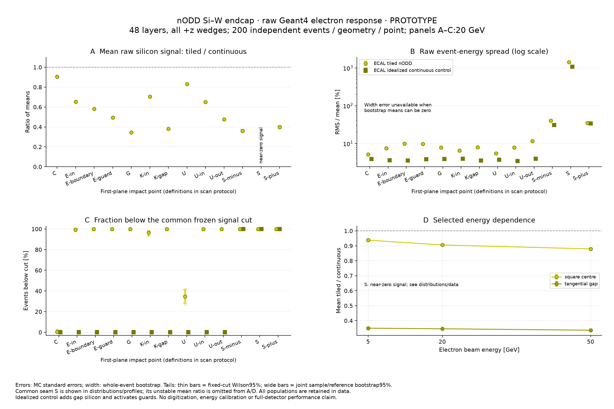
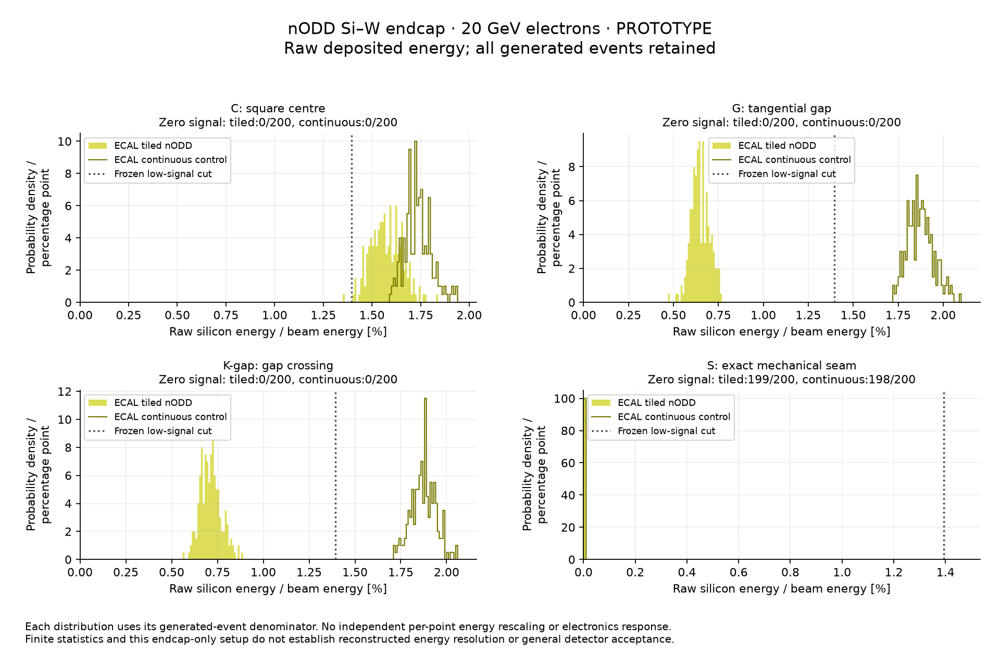
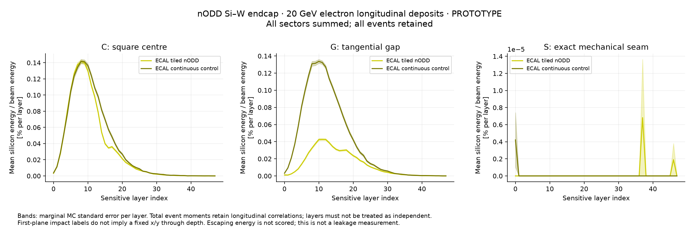

# nODD tiled Si–W endcap: raw electron response

Date: 2026-11-06. **PROTOTYPE characterization**, associated with issue #117,
PR #118 and [DES-030](../../design/DES-030-ecal-edge-sensors.md).
The Marlin/original-framework study remains deferred. This study uses raw
Geant4 silicon deposits, with no electronics, digitization or energy calibration.

## Results

The tiled layout has a substantial **position-dependent reduction in raw silicon
signal** relative to the idealized plane. At 20 GeV, the first-plane square-centre
point C gives **9.4% less signal** (statistical error 0.4 percentage points);
gap G gives **65.4% less** (error 0.2 percentage points). These are local
comparisons of sensitive-hit energy, not an area-averaged detector loss.

| 20 GeV impact | Mean tiled Si energy, GeV | Mean control Si energy, GeV | Tiled/control mean ± MC standard error |
| --- | ---: | ---: | ---: |
| C | 0.314757 | 0.347491 | 0.9058 ± 0.0041 |
| E-in | 0.230915 | 0.353038 | 0.6541 ± 0.0039 |
| E-boundary | 0.20482 | 0.353078 | 0.5801 ± 0.0043 |
| E-guard | 0.175612 | 0.354675 | 0.4951 ± 0.0037 |
| G | 0.129679 | 0.374962 | 0.3458 ± 0.0021 |
| K-in | 0.249155 | 0.354236 | 0.7034 ± 0.0038 |
| K-gap | 0.142635 | 0.374807 | 0.3806 ± 0.0024 |
| U | 0.283336 | 0.34139 | 0.8299 ± 0.0039 |
| U-in | 0.211291 | 0.324261 | 0.6516 ± 0.0039 |
| U-out | 0.151518 | 0.318686 | 0.4754 ± 0.0041 |
| S-minus | 0.0271662 | 0.0753511 | 0.3605 ± 0.0129 |
| S | 1.74304e-06 | 8.43355e-07 | 2.0668 ± 2.5916 † |
| S-plus | 0.0281907 | 0.0707085 | 0.3987 ± 0.0138 |

† S is a common mechanical-gap diagnostic. Its 20 GeV samples have only one
nonzero tiled event and two nonzero control events: **199/200 and 198/200 zero
signals**. The formal point ratio and its first-order error are statistically
unstable. Ratios at S are omitted from the overview’s A/D panels, while all
samples remain in the summary, spectra, profiles and zero-count reporting.
At 50 GeV, tiled S is entirely zero and its RMS/mean and bootstrap width
uncertainties are correctly undefined. A zero observed SEM is not evidence of
a precisely known underlying mean at these sparse points.

The raw 20 GeV RMS/mean at C is **5.13% tiled versus 3.91% control** (bootstrap
standard errors 0.25 and 0.21 percentage points); at G it is **7.86% versus
3.88%** (errors 0.41 and 0.18 percentage points). This describes the sensitive-energy
distribution, rather than reconstructed energy resolution. The logarithmic
width panel retains the extremely broad, zero-dominated seam population.

| Beam kinetic energy, GeV | Centre C: tiled/control | Gap G: tiled/control |
| --- | ---: | ---: |
| 5 | 0.9381 ± 0.0082 | 0.3499 ± 0.0052 |
| 20 | 0.9058 ± 0.0041 | 0.3458 ± 0.0021 |
| 50 | 0.8795 ± 0.0026 | 0.3364 ± 0.0013 |

Across 5–50 GeV, C loses about 6–12% of the control signal and G about 65–66%.
The centre label is a first-plane impact, with natural IP incidence through
the repeating layout. No independent calibration at each point/energy is applied.







The common tail cut is `E_Si/E_kinetic < 0.0139423408399`
(about 1.394% of beam kinetic energy). It is fixed by the independent reference
sample. The summary retains conditional Wilson95% bounds, joint reference/sample
bootstrap intervals, and their labelled 38×38 covariance in squared-fraction units.

The [compact data](previews/nodd-tiling-response.json) contain all 38 response
populations (7,600 events), the separate 100-event reference and exact provenance.
The first two numerical comparisons above were independently reproduced from
the completed ROOT files before the complete analysis; the final summary agrees.

## Question and scope

The user requested a response comparison using the tiled nODD geometry restored
by PR #115. The [frozen scan protocol](tiling-response-plan.md) specifies the
physical control, impact points, sample populations and statistical treatment.
This is distinct from the older upstream ODD response previews and the sparse
three-layer muon segmentation display.

Both geometry cases contain the complete **positive endcap**: 16 sectors,
48 layers, absorber, local readout hardware, cooling and supported frames.
The tiled case retains 112 sensors per wedge/layer: 76 square and 36 custom.
The opposite endcap, tracker, barrel, other calorimeters and collider magnetic
field are absent. The result characterizes this isolated endcap, rather than
the integrated detector response.

## Continuous-silicon control

The idealized control replaces the active and guard silicon in each layer/wedge
with one sensitive 0.5 mm silicon sheet at the same layer-local depth, 2.5 mm.
Its outline is the existing sensor-board envelope, `carrier_face_mm`:
radial x from 130 to 2098.2 mm, with
`|y| <= x tan(pi/16) - 6 mm`. Absorber, films, PCBs, ASIC material, cooling,
supports, layer/sector placements and mechanical wedge gaps remain the same.
The original detector factory and production geometry are unchanged; only
task-owned compact XML defines the control.

This deliberately adds silicon in previous air gaps and makes guards sensitive.
It changes both transport material and scoring. It compares a physical tiled
layout with an idealized continuous plane; it does not isolate a pad-rebinning
effect. The added silicon volume is 47,127,913.929 mm³ over the positive endcap,
corresponding to 109.760912 kg in the declared material model.

| Native geometry check | Tiled nODD | Continuous control |
| --- | ---: | ---: |
| Layer/wedge replicas | 768 | 768 |
| Supported frame replicas | 16 | 16 |
| Sensitive placements | 86,016 | 768 |
| Silicon volume per wedge/layer, mm³ | 362,995.722795 | 424,360.194057 |
| Positive-endcap mass, kg | 49,474.319652 | 49,584.080563 |
| Logical-layer overlaps at 0.00001 mm | 0 | 0 |

Native ROOT checks verify the full layer contents and volume/mass/count invariants.
Retained frame/sector/layer transforms are source-identical to the previously
audited baseline. The new overlap check covers each complete logical layer;
it is not presented as a new integrated-detector overlap acceptance.

## Beam, denominators and observables

The primary scan uses 200 independent electrons at each of 13 first-sensitive-
plane impact positions, for each geometry at 20 GeV. Square centres, finite
offsets around active edges, guards, gaps, a corner, custom edges and both sides
of a wedge seam are included. Centre C, gap G and exact seam S also run at
5 and 50 GeV. The total is 7,600 bulk events. Every direction starts at the
origin and points at the prescribed physical coordinate at z = 3952.5 mm.
Impact labels describe the first plane; the direction naturally moves radially
through subsequent layers. See the protocol's exact coordinate table.

**INFERENCE from the frozen masks and transforms:** a straight, unscattered
ray at C intersects active silicon in 43 of 48 planes; the ray at G remains in
the intersensor gap in all 48. This is a geometric diagnostic, not a calorimeter
efficiency prediction. Showers and scattered tracks spread into neighbouring
sensors, so a primary ray with no active crossings can still produce substantial
silicon energy. The longitudinal distributions test that transport response.

Generation uses the native Geant4 gun, whose energy is **kinetic**. Primary
truth must have PDG 11, the intended direction, and total energy equal to that
kinetic energy plus the electron rest mass. All reported visible fractions
divide by the requested kinetic energy. `FTFP_BERT`, zero field and a 0.7 mm
range cut are common to both cases. There is no analysis hit or event threshold.
That transport range cut is not an electronics energy threshold.

The effective DDSim calorimeter action is
`Geant4ScintillatorCalorimeterAction`, with the `edep0` filter
(`EnergyDepositMinimumCut/Cut0`, `Cut = 0.0`). The action requests Birks
attenuation, but a separate runtime probe using the identical material XML
measured silicon's Birks constant as exactly **0 mm/MeV** after one event.
There is therefore no silicon Birks attenuation in this configuration. The
probe and software pilots are excluded from the response populations; action,
filter, material and runtime evidence identities accompany the compact results.

Each event sums all positive stored `EDGEHits` deposits over every sector and
layer. Zero-hit events remain in the denominator. Every event/run identity,
primary and sensitive cell ID is checked against the executed geometry.
Neither passive deposited energy nor escaping energy is scored, so the visible
silicon fraction is not an active/(active+passive) sampling fraction or a leakage
measurement.

Means use their all-event standard error. Raw event-energy RMS/mean uses a
whole-event bootstrap, retaining non-Gaussian tails and zeros; this is not a
calibrated or reconstructed energy resolution. Tiled/control mean ratios use
both independent samples. Undefined zero-denominator quantities are null,
and undefined bootstrap replicates are explicitly counted.

A separate 100-event continuous-C sample at 20 GeV fixes the common low-signal
cut to 80% of its mean visible fraction. Calibration events are excluded from
the response estimates. This one fractional cut is held fixed for all beam
energies, points and geometries. Conditional tail intervals use 95% Wilson
intervals; a joint bootstrap also varies the independent reference cut.
Bootstrap zero-tail intervals do not replace the finite-sample Wilson bound.

The spatial grid deliberately concentrates on boundaries and is not uniform
in area or solid angle. Its points must not be averaged into an overall
detector energy-loss percentage.

## Execution and reproducibility

The environment registry preflight returned 2 for changed setup/lock fingerprints.
The warning was communicated before use; actual DD4hep/DDG4 imports and all
12 Geant4 dataset presence checks passed. The existing environment supplies
DD4hep 1.38, Geant4 11.4.3 and ROOT 6.40.04. No shared installation was changed.
The setup/lock identities match the parent report's environment table and were
rechecked for this run. A native query measured the common world material as
Air, density 0.0012 g/cm³, with DD4hep's default standard-condition handling.
The gun traverses that world from the origin to the endcap; upstream detector
material is absent in this component setup.

Geant4 initialization is expensive for the complete endcap. Fixed gun settings
run as separate macro blocks in one initialized kernel per geometry, with
disjoint recorded seeds and a separate ROOT output for every block. Run/event
headers and primary truth verify the block boundaries. A preliminary one-output
test reset the writer between runs; separate output files corrected that before
the campaign. The 20-event software pilot is excluded from all response estimates.

Full ROOT samples, compacts, factory binaries and detailed logs remain local and
ignored. The retained summary supplies histograms with edges/counts/underflow/
overflow, event-energy moments through fourth order, zero counts, quantiles,
bootstrap summaries, per-layer sums, source/configuration/producer/library/raw
hashes, seeds and commands. No per-event payload is committed.

Both transport groups exited normally. The tiled group generated 3,800 events
in 2,380.51 s, with measured peak child RSS 2,920,857,600 bytes; the continuous
group generated 3,900 including its reference in 2,175.66 s, RSS 2,780,364,800
bytes. Six focused software regressions pass. Main independently reproduced
C20/G20/S20 numerical checkpoints from ROOT, and the complete analysis agrees.
The runtime-version lookup was corrected using the actual factory CMake
configuration; reanalysis preserved every physics/statistics/evidence field.
Plots render with Python 3.14.5, NumPy 2.5.4 and Matplotlib 3.11.2.

The generation and analysis stages are implemented in
[`tiling_response.py`](../../../software/analysis/calorimeter_digitization/tiling_response.py).
To regenerate, use the source revision enclosing this report and first run
the node preflight and runtime doctor described in the parent report. Fresh
task-owned input, factory and work directories preserve the executed evidence
and avoid changes to shared installations. Choose new input, factory and work directories for each
independent reproduction:

```sh
python3 -B tools/calorimeter_hardware/edge_export.py --output build/nodd-tiling-input
software/env/run.sh cmake -S prototypes/calorimeter -B build/nodd-tiling-factory -G Ninja -DCMAKE_BUILD_TYPE=Release
software/env/run.sh cmake --build build/nodd-tiling-factory --target Components_nODDCalorimeterPrototype --parallel 4
python3 -B software/analysis/calorimeter_digitization/tiling_response.py prepare \
  --component build/nodd-tiling-input --factory build/nodd-tiling-factory \
  --work build/nodd-tiling-response-reproduction
software/env/run.sh python3 software/analysis/calorimeter_digitization/tiling_response.py native --geometry tiled --work build/nodd-tiling-response-reproduction
software/env/run.sh python3 software/analysis/calorimeter_digitization/tiling_response.py native --geometry continuous --work build/nodd-tiling-response-reproduction
software/env/run.sh python3 software/analysis/calorimeter_digitization/tiling_response.py sensitive --work build/nodd-tiling-response-reproduction > build/nodd-tiling-response-reproduction/sensitive-diagnostic.log 2>&1
software/env/run.sh python3 software/analysis/calorimeter_digitization/tiling_response.py run --geometry tiled --work build/nodd-tiling-response-reproduction
software/env/run.sh python3 software/analysis/calorimeter_digitization/tiling_response.py run --geometry continuous --work build/nodd-tiling-response-reproduction
software/env/run.sh python3 software/analysis/calorimeter_digitization/tiling_response.py analyze --work build/nodd-tiling-response-reproduction \
  --output build/nodd-tiling-response-reproduction/recomputed-summary.json
```

The two generation commands can run in separate fresh shells concurrently;
each sample retains its own files and seed pair. Existing completed samples
are reused only after their recorded identities validate. Analysis and plotting
need no original Marlin runtime. The local run reused the previously built,
source-matched nODD factory; exact identities are in the retained metadata.

The standalone plotting script needs only NumPy and Matplotlib and can replot
the committed summaries without ROOT, DD4hep or Geant4:

```sh
/path/to/matplotlib-python software/analysis/calorimeter_digitization/plot_tiling_response.py \
  docs/validation/issue117/previews/nodd-tiling-response.json \
  docs/validation/issue117/previews
```

## Interpretation boundary

No model parameter or detector dimension is tuned to flatten the results.
The comparison includes added-silicon material and guard sensitivity, while
nonuniform electronics material and mechanical seams remain. It does not
qualify sensor charge collection, digitization, reconstruction, full-detector
containment, jets/MET, pileup, radiation performance or engineering acceptance.
Human design sign-off remains pending.
