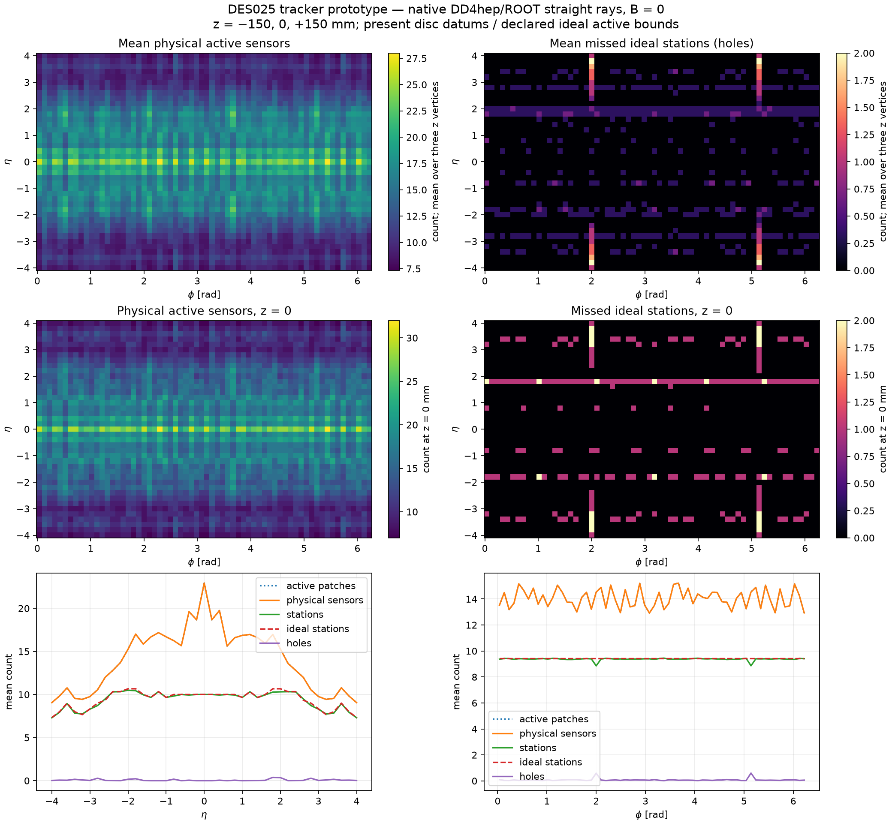
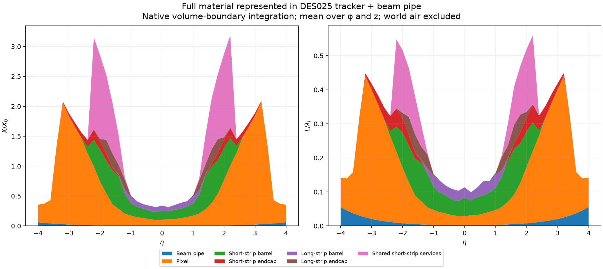

# Issue #38 — native full-tracker coverage and material

Date: 2026-10-15. Status: **PROTOTYPE CHARACTERIZATION; no human sign-off or
scientific acceptance**. Assignment: VAL-SOFTENG. Geometry input revision:
`5b4e5d9e563505aea17e9b792458708c3175ec4a`, DES019–025. The validation producer is
new code, recorded independently by its SHA-256 in [summary.json](summary.json).

The reviewer-requested plots have now actually been run against the native
DD4hep full-tracker assembly. They include the represented passive material,
rather than only the silicon/beam-pipe surface slabs available in ACTS.





## Count definitions and sample

There are 7,872 main B=0 straight rays: eta=−4..+4 in steps of 0.2, 64 uniform
phi values with phase 0.371 bins, x=y=0 and z=−150,0,+150 mm with equal weights.
There are 576 **separate** half-phi-bin controls at x=y=z=0 and integer eta
values −4..+4. The control does not contribute to the plotted averages. This is
a defined sampling measure, not a collider event distribution. It does not
sample transverse luminous offsets or establish continuous acceptance.

`active_patches` counts sensitive volume crossings. `physical_sensors`
deduplicates pixel chip islands to the module substrate, counts short-strip
sensors once and counts the two long-strip faces separately. A logical station
requires any pixel/short-strip active sensor or both long-strip faces of the
**same module**. Raw face counts, complete pairs and orphan faces are retained.
Holes are the **set difference** of ideal station IDs and reached station IDs;
overlapping sensors or extra stations cannot conceal another station's hole.

The ideal denominator keeps the original declared active radial bounds and
barrel radii, using present endcap datums. Pixel active annuli are
32.3–181.4550267061104 mm; passive/support apertures are not the denominator.
The pixel B1 ideal radius remains 34 mm despite alternating active centres near
31.5078/36.4922 mm. Endcap ideal datums are signed versions of the current
615..3070 mm pixel list, 1335..3080 mm short-strip list and 1470..3120 mm
long-strip list. Actual staggered active planes retain their true native
positions. Consequently holes/extras near ideal boundaries include this
reference-to-finite-geometry difference, not only chip/stave seams.

This **present-datum diagnostic differs from frozen earlier study denominators**.
For example, the earlier strip-endcap ideal first datums were 1295.5 and
1403.65 mm. Their historic coverage results remain unchanged; these samples
must not be presented as a before/after improvement or regression. All current
ideal definitions and aggregates by eta, phi and vertex are retained in the
summary, with all ray-level data in [rays.json.gz](rays.json.gz).

## Observed results

| Main-grid quantity | Minimum | Mean | Maximum |
| --- | ---: | ---: | ---: |
| Active-patch crossings | 7 | 14.0476 | 32 |
| Physical sensor crossings | 7 | 14.0459 | 32 |
| Logical stations reached | 5 | 9.3717 | 11 |
| Ideal stations expected | 7 | 9.4309 | 11 |
| Holes | 0 | 0.07622 | 2 |
| Extra stations | 0 | 0.01702 | 1 |
| X/X0 | 0.20027 | 1.28359 | 4.87848 |
| L/lambda_I | 0.07732 | 0.28332 | 0.83417 |

The sampled fraction with no holes is 94.40%, 91.46% and 92.80% at z=−150,0,
+150 mm respectively. These fractions are geometric diagnostics for these
samples, not tracking efficiencies. Vertex-averaged plots and direct z=0 maps
are both shown so that averaging does not erase individual sampled gaps.

The offset-phi control reveals grid-phase sensitivity: at eta=0,z=0 the main
phi grid has zero mean holes, while the shifted grid has mean 0.03125 and a
one-hole maximum. The eta=1 control has the same change. At eta=3,4 the phase
shift removes holes seen on the main grid. The retained adverse control is
evidence that a single coarse phi grid cannot establish hermeticity.

The large material values are retained. The maximum sampled X/X0=4.87848 is
at eta=2.2, phi=2.4907921004445823 rad, z=0, with L/lambda_I=0.83417. Shared
short-strip services contribute 2.49947 X0, pixels 1.36839 X0, short-strip barrel
0.66308 X0 and short-strip endcap 0.33718 X0. This motivates reviewing the
represented service inventory/routing and its known packing limits; no geometry
or material was tuned to reduce the result, and no acceptance threshold was
invented. A two-hole sample at eta=−3.8, phi=1.9999182483211773 rad,z=−150 mm
misses pixel stations `2:8` and `2:9`.

## Material scope and actual software checks

Native ROOT boundary navigation integrates the exclusive deepest-volume path
through every represented active/passive component, including guards, ASICs,
supports, cooling and service mixtures. It stops at the first r=1200 mm or
|z|=4100 mm boundary, beyond the tracker services and full finite beam pipe.
World air is excluded; explicit component-enclosed air/vacuum is included.
Stacks show subsystem ownership, including reconciled shared short-strip
services. Native material names/properties and aggregate paths are retained.
Radiation and interaction lengths are the native ROOT material properties;
this is not a new Geant4 material-map/transport comparison.

The actual native construction has 680,700 nodes and 45,646 sensitive patches.
All expected sensitive placements were checked against native centres, u/v axes
where specified, and bounds before scanning. No fixed steps or boundary nudges
were needed. Unknown material ownership, nonpositive material lengths and
invalid/zero boundary steps fail execution.

| Executed check | Maximum residual / outcome |
| --- | ---: |
| Native sensitive count | 45,646 matched |
| Centre comparison | 5.22e−13 mm |
| Local-axis comparison | 5.12e−16 |
| Bound comparison | 2.01e−14 mm |
| Be wall path versus 0.8 mm × cosh(eta), all 8,448 rays | 2.31e−13 mm |
| Stacked sums versus directly accumulated totals | 7.11e−15 |
| Independent material-path reintegration versus totals | 7.99e−15 |
| Invalid/zero boundary steps | 0 |
| Counting/ideal-reference unit tests | 6 passed |
| Full native repeated main/control ray arrays | Exact equality |

Comparison limits are 1e−7 mm for transforms/bounds, 1e−9 for axes, 1e−6 mm for
the analytic pipe path, and 1e−12 for material closure. These are numerical
software checks, not physical acceptance criteria. No new overlap, field,
Geant4 transport or ACTS reconstruction validation is claimed by this run.

## Configuration and reproducibility

The fresh export of revision `5b4e5d9e563505aea17e9b792458708c3175ec4a` has a
**byte-identical tracker.xml** and identical entity/material inventories to the
available build in `nodd-software-layout/build/dd4hep/detector/tracker`.
The associated clean source checkout was
`530080cfe16c7513228bf60238b99d4b9938538a`; every reused factory C++/header file
matched the assigned source bytes. Libraries were reused read-only and their
hashes are separate from source/configuration identities. No dependencies were
installed or shared build artifacts modified.

The ACTS Spack preflight warned that the setup script/lockfile had changed from
the registry. Fresh activation then verified DD4hep **1.38** (`7deaacd`), Geant4
**11.4.2** (`cpge6jj`), ROOT **6.40.04**, Python **3.14.5**, NumPy **2.5.3** and
Matplotlib **3.11.2**. DD4hep/DDG4 imports passed; all 12 Geant4 datasets were
present. Geant4 is available but not invoked by this scan. Sandbox `sysctl`/`ps`
and font-cache warnings did not prevent native geometry construction or plots.
Exact setup/lockfile, library, producer, compact, materials, expected inventory
and ideal-input hashes are retained in the summary.

The executed export command from the assigned checkout was:

```sh
python3 -B tools/tracker_dd4hep/export.py \
  --output /private/tmp/issue38-native-scan-source
```

The native run used this same shell setup and command:

```sh
source /Users/salzburg/cernbox/configs/acts/acts_setup.sh
unset ACTS_SPACK_SETUP
setup_spack
source /Users/salzburg/Documents/work/externals/ci-dependencies/.spack-env/view/bin/thisdd4hep.sh
MPLCONFIGDIR=/private/tmp/issue38-native-scan-mpl \
/Users/salzburg/Documents/work/installed/acts-nodd/pyvenv/bin/python -B \
  tools/issue38_validation/scan.py \
  --compact /private/tmp/issue38-native-scan-source/tracker.xml \
  --expected /private/tmp/issue38-native-scan-source/expected.json \
  --library-dir /Users/salzburg/Documents/ChatGPT/agentic-detector/nodd-software-layout/build/dd4hep/detector \
  --factory-source /Users/salzburg/Documents/ChatGPT/agentic-detector/nodd-software-layout \
  --output docs/validation/issue38-review
```

The [tool README](../../../tools/issue38_validation/README.md) gives portable
fresh-output and verified `--plot-only` commands. Initial probe/output artifacts
were preserved in the task scratch directory before the final producer rerun;
only the final matched producer and artifacts are delivered here.

Field-dependent tracking, response, digitization, reconstruction and
engineering qualification remain separate validation work. Finite native rays and a passing software consistency check do not close
them or authorize detector design acceptance.

## Independent scientific consistency assessment

PhysVal reviewed `fbed1779adef22f659152200b9c35d84f2c22d71` in a separate agent
context. No actionable findings were returned. In addition to the six unit
controls, the assessment verified producer/archive/ideal-input hashes and all
8,448 rows for count identities, ideal eligibility, stack/path reintegration
and analytic beam-wall length. An independent finite oriented-box intersection
calculation against all45,646 sensitive elements for262selected rays found
zero differences in crossings, pair/orphan/station/hole/extra counts or missing
IDs. It covered every two-hole ray, eta=0 phase controls, the maximum-material
ray and a distributed deterministic sample. Inspected figures matched the
reviewed commit. This separate assessment checked retained data and independent
intersections; it did not repeat native ROOT navigation and is not human
scientific acceptance or material-model qualification.
