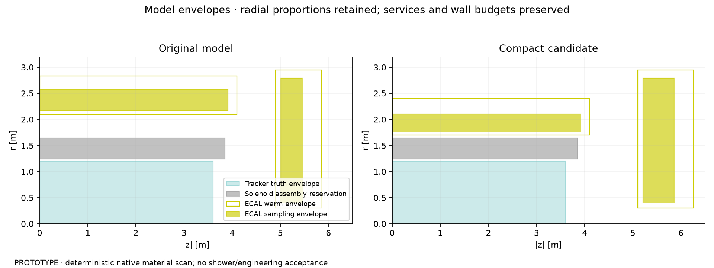
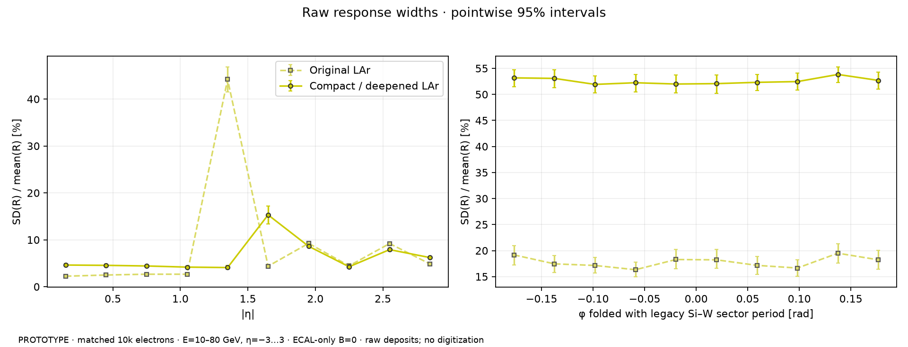
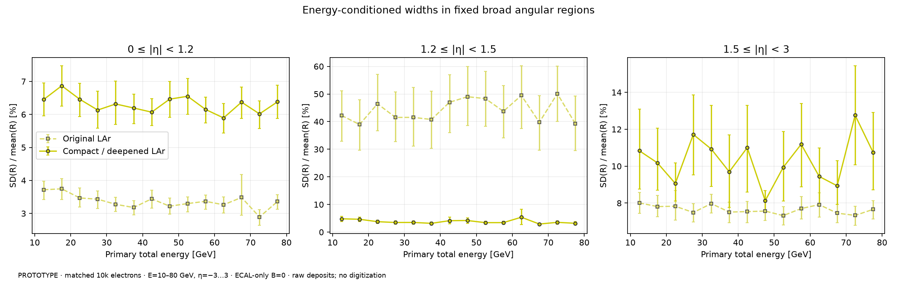
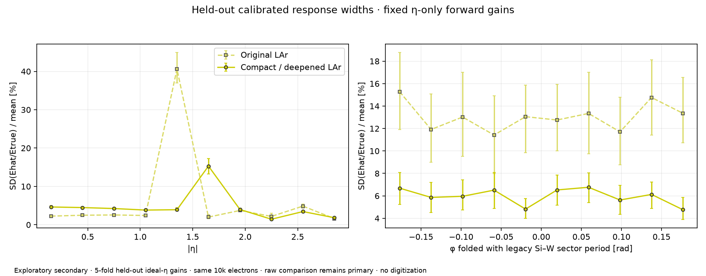
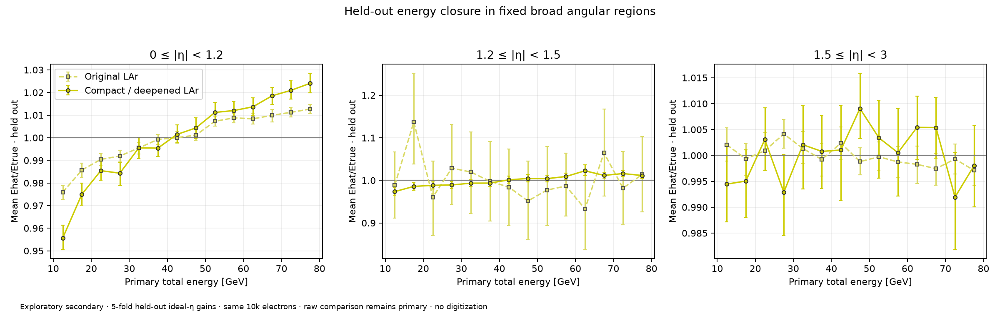

# Compact LAr ECAL: native depth and matched electron controls

**DRAFT / isolated PROTOTYPE · 2026-11-18 · DES026/032/033.** The compact barrel
fits outside the retained tracker/solenoid reservation. Inclination and relative
sampling radii are retained; physical material/service choices are explicit in
the [design input](../../design/inputs/DES-032-compact-hadron-prototype.md).
The maintained LAYOUT-002 geometry and approval states remain unchanged.

| Boundary | Original | Compact candidate |
| --- | ---: | ---: |
| Barrel warm bore |2100 mm |1700 mm |
| Barrel sampling front/back |2172.8 /2578.3 mm |1772.8 /2103.649779 mm |
| Barrel rear bath |170 mm |210 mm |
| Barrel warm outer radius |2830 mm |2395.349779 mm |
| Endcap sampling front/back |5010 /5460 mm |5210 /5860 mm |
| Endcap warm front/back |4900 /5860 mm |5100 /6260 mm |

The smaller circumference needs three repacked cold-board banks; their physical
board size is unchanged. The external pipe-bend screen needs a1000 mm front
reservation and actual400 mm bend radii. Wall/vacuum budgets and the endcap rear
bath are retained. Pressure, thermal, routing and support qualification remain
open; spare slots do not imply spare cooling power.

## Sampling depth

The native ROOT navigator separates actual absorber/electrode/active/glue/skin
pieces from vessel walls, baths and services. **9,088 finite probes** cover
η0–3 at0.05 steps, uniform global azimuths and32 within-period phases for each
actual barrel/wheel period count. The compact candidate's minimum sampled
sampling depth is **25.613359 X0**, versus0.081382 X0 in the original model's
transition. This is a deterministic grid minimum, not a continuous bound.
Positive-η geometry scans are supplemented by signed-η controls in transport.

The first600 mm endcap candidate had24.389619 X0 at a support-band direction
nearη2.7. Increasing depth to650 mm before response analysis addresses that
material gate; that adverse case and prior startup failures remain local.
The final sampling screen excludes upstream/downstream dead material from X0.

[Material partition](figures/material-partition.png) ·
[Compact material values and raw-report hashes](material-summary.json) ·
[Execution controls](controls.json) · [Reproduction](reproduce.md).

## Electron comparison

The frozen10,000 matching primaries use totalE10–80 GeV, flatη−3…3/fullφ,
12workers, event-seededFTFP_BERT,0.7mm cuts,5mm active charged-step cap and
ECAL-onlyB=0. The original full audited LAr10k sample is the reference.
[Prospective protocol](protocol.md) and [exact hashes](contract.json) retain
all events, zeros/tails and original angular bins, plus core-region energy
controls and envelope transition migration. This primary raw comparison fits no
calibration; a separate exploratory diagnostic is reported below.

The complete10k transport and full primary/cell readback passed, with all12
workers and6,754,284 positive canonical hits. Raw response uniformity is **not
preserved**: the transition improves strongly, while core-barrel/endcap widths
broaden and the relative barrel/endcap gains change substantially.

| Region | Events | Original raw width | Compact raw width | Paired difference [95% interval], percentage points |
| --- | ---: | ---: | ---: | ---: |
| Inclusive |10000 |17.84% |52.57% |+34.73 [34.10,35.40] |
|0≤abs(η)<1.2 |3999 |3.52% |6.56% |+3.05 [2.89,3.18] |
|1.2≤abs(η)<1.5 |999 |44.18% |4.09% |−40.10 [−42.83,−37.42] |
|1.5≤abs(η)≤3 |5002 |7.66% |10.42% |+2.76 [2.23,3.34] |

R=active deposited energy/primary total energy; width=sampleSD(R)/mean(R), with
all events/zeros. Intervals are paired, pointwise95% bootstrap bounds, conditional
on the represented transports; no noninferiority margin is adopted. These
energy/angular mixtures are not intrinsic reconstructed energy resolution.

The mean barrel response changes from14.19% to5.79%, while the broad endcap mean
changes17.77%→17.56%. Exact between-region sums of squares account for95.34% of
the candidate's inclusive raw variance (42.11% in the reference). The large global
width therefore combines different gains with fluctuations. Even within original
broad regions/energy slices, however, the raw core controls are broader; the
result cannot be described as preserved precision. Calibration might remove mean
shifts; it cannot be assumed to recover lost sampling information.

[Mean response](figures/angular-means.png) ·
[Underlying distributions](figures/response-distributions.png) ·
[Ten |η| distributions](figures/distributions-abs_eta.png) ·
[Ten legacy folded-φ distributions](figures/distributions-siw_folded_phi.png) ·
[Paired contrasts](figures/paired-width-difference.png) ·
[Full statistics and principal covariance](summary.json).

Zero events remain0/10000 in both models. Below half each model's own inclusive
mean, counts are183/10000 and3029/10000; these inclusive-gain diagnostics are not
calibrated efficiencies or common energy thresholds. Fullφ/signedη, mean, tail,
transition migration and energy controls remain in the figure set. PNG/PDF/SVG
exports are retained. All per-bin statistics/intervals/histograms are committed;
principal global/|η|/legacy-fold covariances are exact submatrices of the retained
full local covariance, with the original summary hash and selection recorded.

The final650mm serial/MT24 control reproduces all15,584 canonical hits exactly.
Both100-event step-policy pilots passed. Production took811.96s wall/8115.73CPU-s,
peak3.383GiB RSS and20.213GB ROOT. Full events, XML and logs stay local. These are
observations, not a dedicated benchmark. Physics sourceafc79974; paired analysis
sourceaf94172, which separately pins the two primary metadata origins while
requiring identical physical primary bytes/IDs/policies.

A separate [exploratory η-only calibration diagnostic](calibration-protocol.md)
is complete. Five held-out folds use training-only forward gains in 60 fixed
|η| bins. The family was chosen after inspecting the raw sample: this is
exploratory cross-validation, not independent validation. Application takes
signal and direction, with no true-energy input. Truth η supplies ideal direction;
no held-out recentering, clipping or tail rejection is applied.

| Fixed population | Events | Original calibrated CV | Compact calibrated CV | Paired change, percentage points (pointwise 95% CI) |
|---|---:|---:|---:|---:|
| Inclusive | 10000 | 13.12% | 6.00% | −7.11 [−8.67, −5.81] |
| Core barrel, 0 ≤ abs(η) < 1.2 | 3999 | 2.43% | 4.30% | +1.87 [+1.72, +2.04] |
| Transition, 1.2 ≤ abs(η) < 1.5 | 999 | 40.62% | 3.92% | −36.70 [−41.16, −32.98] |
| Endcap region, 1.5 ≤ abs(η) < 3 | 5002 | 3.09% | 7.36% | +4.27 [+3.39, +5.14] |

The improved inclusive width combines transition recovery and gain correction.
Core-barrel and broad-endcap widths remain worse. Core-barrel mean energy closure
also changes from 0.976→1.013 across the lowest/highest energy bins in the
reference, versus 0.956→1.024 in the compact model. The requested preservation of
precision is therefore **not established**. A thicker sampling annulus is a
conditional next design option; changing the global radius ratio requires
clarifying the intended meaning of relative sampling radii.

All 1000 shared event-bootstrap replicas refit the five training folds for each
geometry (5000 refits/model); none has an invalid gain. The original raw result
remains primary. [Calibrated bin statistics and covariance](calibrated-summary.json),
[evaluated fold models and separate full-fit reuse table](calibration-models.json),
[underlying response distributions](figures/calibrated-response-distributions.png)
and [energy-conditioned widths](figures/calibrated-energy-by-region.png) are retained.
The full-fit table was not independently evaluated and needs fresh validation
before deployment. Model reuse requires matching compact/material hashes and the
documented ECAL-only, B=0 scope; this is not an electronics calibration.

The25X0 screen is an unsigned LHC-informed choice. Neither it nor10–80GeV
controls certifies multi-TeV containment, pileup/radiation or hadron/jet response.
No detector acceptance or human design sign-off is created.
