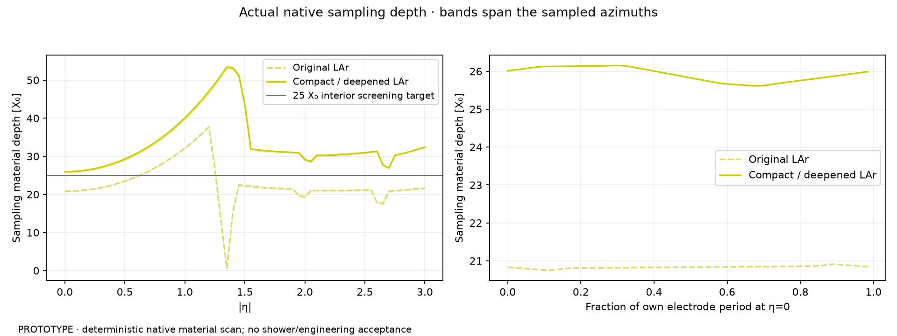

# Compact LAr ECAL: native depth and matched electron controls

**DRAFT / isolated PROTOTYPE · 2026-11-18 · DES026/032/033.** The compact barrel
fits outside the retained tracker/solenoid reservation. Inclination and relative
sampling radii are retained; physical material/service choices are explicit in
the [design input](../../design/inputs/DES-032-compact-hadron-prototype.md).
The maintained LAYOUT-002 geometry and approval states remain unchanged.

| Boundary | Original | Compact candidate |
| --- | ---: | ---: |
| Barrel warm bore |2100 mm |1700 mm |
| Barrel sampling front/back |2172.8 /2578.3 mm |1772.8 /2103.649779 mm |
| Barrel rear bath |170 mm |210 mm |
| Barrel warm outer radius |2830 mm |2395.349779 mm |
| Endcap sampling front/back |5010 /5460 mm |5210 /5860 mm |
| Endcap warm front/back |4900 /5860 mm |5100 /6260 mm |

The smaller circumference needs three repacked cold-board banks; their physical
board size is unchanged. The external pipe-bend screen needs a1000 mm front
reservation and actual400 mm bend radii. Wall/vacuum budgets and the endcap rear
bath are retained. Pressure, thermal, routing and support qualification remain
open; spare slots do not imply spare cooling power.

## Sampling depth

The native ROOT navigator separates actual absorber/electrode/active/glue/skin
pieces from vessel walls, baths and services. **9,088 finite probes** cover
η0–3 at0.05 steps, uniform global azimuths and32 within-period phases for each
actual barrel/wheel period count. The compact candidate's minimum sampled
sampling depth is **25.613359 X0**, versus0.081382 X0 in the original model's
transition. This is a deterministic grid minimum, not a continuous bound.
Positive-η geometry scans are supplemented by signed-η controls in transport.

The first600 mm endcap candidate had24.389619 X0 at a support-band direction
nearη2.7. Increasing depth to650 mm before response analysis addresses that
material gate; that adverse case and prior startup failures remain local.
The final sampling screen excludes upstream/downstream dead material from X0.

[Material partition](figures/material-partition.png) ·
[Compact material values and raw-report hashes](material-summary.json) ·
[Execution controls](controls.json).

## Electron comparison

The frozen10,000 matching primaries use totalE10–80 GeV, flatη−3…3/fullφ,
12workers, event-seededFTFP_BERT,0.7mm cuts,5mm active charged-step cap and
ECAL-onlyB=0. The original full audited LAr10k sample is the reference.
[Prospective protocol](protocol.md) and [exact hashes](contract.json) retain
all events, zeros/tails and original angular bins, plus core-region energy
controls and envelope transition migration. No calibration is refitted.

**The full production is running; precision results are pending.** The final
650 mm serial/MT24 control reproduces all15,584 saved canonical hits exactly.
Both100-event step-policy pilots and full primary/cell readbacks passed.
The raw mixed-spectrum width is not intrinsic digitized energy resolution;
transition improvement must not hide worse barrel sampling precision.

The25X0 screen is an unsigned LHC-informed choice. Neither it nor10–80GeV
controls certifies multi-TeV containment, pileup/radiation or hadron/jet response.
No detector acceptance or human design sign-off is created.
