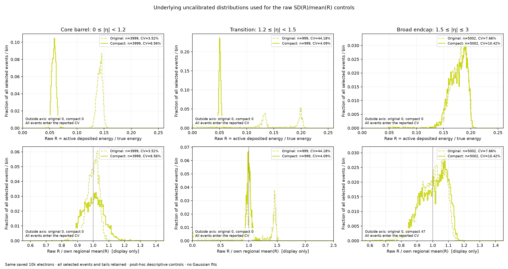
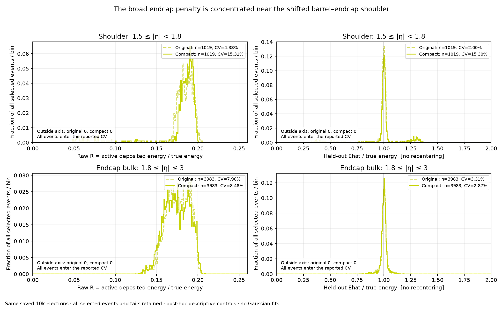

# Barrel sampling diagnosis and underlying distributions

**PROTOTYPE / post-hoc diagnostic, 2026-11-18.** Same saved matched10k sample,
transport, raw result and evaluated five-fold gains as PR148. No new simulation
or calibration fit. Width means sample SD/mean over all selected events, not a
Gaussian fit or a digitized intrinsic resolution.

## Why the barrel broadens

**FACT — model parameters and measured controls:**

| Quantity | Original | Compact |
|---|---:|---:|
| Pb plate thickness |1.8mm |2.6mm |
| Inner single LAr gap |about1.196mm |about0.484mm |
| Sampling radial thickness |405.5mm |330.85mm |
| Mean active LAr chord at eta0, finite native probes |209.65mm |107.72mm |
| Mean raw barrel signal / true energy, abs(eta)<1.2 |14.19% |5.79% |
| Raw barrel SD(R)/mean(R) |3.52% |6.56% |
| Held-out eta-calibrated barrel SD/mean |2.43% |4.30% |
| Same calibrated width,45–50GeV barrel slice,283events |1.97% |3.92% |

Parameter sources: [barrel configuration](../../../tools/lar_calorimeter/barrel.json),
[compact specification](../../../tools/lar_calorimeter/compact-prototype.json),
[design derivation](../../design/inputs/DES-032-compact-hadron-prototype.md).
[Native active-path evidence](diagnosis-material.json) summarizes the original
executed scans, with hashes; path length is a ray diagnostic, not the shower
sampling fraction. Mean R is the measured active signal fraction, not a direct
measurement of total active/passive deposited-energy ratio.

**INFERENCE:** the leading explanation is the sampling tradeoff made to obtain
more X0 inside the smaller annulus: thicker Pb, much less active LAr, and more
relative longitudinal sampling-fraction variation. Shower-to-shower differences
in energy deposited in active/passive material then give a larger relative
spread. The mean gain shift can be calibrated; the broadened shape remains
within a narrow energy slice. An eta-only gain cannot remove those fluctuations.
No electronics noise or charge-collection efficiency is simulated here.

This interpretation is consistent with **SRC-PDG-DETECTORS-2024**, section35.10.1
PDF82 and35.10.2 PDF85–86: sampling fraction/frequency affect the stochastic term;
for fixed total X0 the approximate scale is sqrt(plate thickness/sampling fraction).
[Actual primary review](https://pdg.lbl.gov/2024/reviews/rpp2024-rev-particle-detectors-accel.pdf).
That scaling is qualitative support, not a prediction for these mixed-spectrum
widths. Several geometry parameters changed together; no one-parameter ablation
has established their individual causal contributions or excluded leakage and
other geometry effects.

Numerical sensitivity is also unquantified: both runs use0.7mm range production
cuts, which is not a convergence demonstration for the compact~0.484mm initial
gaps. This does **not** mean Geant4 fails to resolve those gaps. Production
thresholds govern secondary creation; tracking respects volume boundaries and
is not stopped at that range. See **SRC-GEANT4-CUTS-FAQ-11-4**,
[official physics/cuts FAQ](https://geant4.web.cern.ch/documentation/dev/faq_html/FAQ/physicsAndCuts.html).
A matched finer-cut control should precede a precise attribution of the loss.

## Raw distributions behind the widths



Top: uncalibrated R=S/Etrue. Bottom: the same distributions divided by each
model's own regional mean, solely to compare shapes. This bottom row is not a
new calibration or held-out precision measurement. Means and SDs use every
event, including tails/zeros. Histograms divide by the full selected population;
axis exclusions and histogram flow remain explicit. No Gaussian fits or cuts.
[SVG](figures/regional-raw-distributions.svg) ·
[Fixed-energy barrel comparison](figures/barrel-energy-slice-distributions.png).

## The broad endcap result includes a shifted shoulder



| Descriptive subregion | Events | Original held-out CV | Compact held-out CV |
|---|---:|---:|---:|
|1.5 ≤ abs(eta)<1.8 |1019 |2.00% |15.30% |
|1.8 ≤ abs(eta)≤3 |3983 |3.31% |2.87% |

The previously reported broad1.5–3 penalty is concentrated in the new shoulder's
large tails. It is not a uniform endcap-core penalty. This split uses an existing
ten-bin edge, chosen after examining the curves, and is descriptive; no new
bootstrap, uncertainty contrast or independent validation is claimed. The bulk
point estimate alone is not a noninferiority result. The original common
populations and broad result remain unchanged. Further localized geometry/dead-
material/leakage studies are needed before assigning the shoulder tail to a
particular wall, support or partial shower path.

## Mitigations to test

**Conditional design option:** the already screened thicker annulus restores
Pb1.8mm and roughly1.2mm inner gaps: sampling radii1772.8–2350mm,1248periods,
warm outer2641.7mm, unchanged50.18° inclination and normalized radial compartment
fractions. This allows the global radius ratio to change. Native geometry,
depth/transition/services and a new matched10k comparison remain necessary;
there is no measured precision recovery for this option yet.

**Calibration option:** test forward longitudinal-compartment weights/gains,
with eta and response nonlinearity, on training folds and evaluate held-out
primaries. This could reduce sensitivity to shower depth and changing sampling
fraction; it cannot be assumed to restore information lost in passive layers.
True energy may label training but must not be an application input. No such
new correction was fitted here. The14fixed energy-bin means explain18.80% and
19.07% of reference/compact held-out barrel variance; that descriptive fraction
is not an attainable correction or an isolated stochastic component.

## Reproduce and inspect

Source helper frozen at09053daaa5f74cc3bf7094bfddcc83610bdf8fa6. Existing analysis
Python uses NumPy2.5.4/Matplotlib3.11.2; no new dependency or native activation.

```sh
"$plot_python" -B software/analysis/lar_response/compact_diagnose.py analyze \
  --reference-run ../nodd-lar-10k-response/build/lar10k-resume/production12 \
  --candidate-run build/lar-compact/production12 \
  --contract docs/validation/lar-compact/contract.json \
  --raw-summary docs/validation/lar-compact/summary.json \
  --calibrated-summary docs/validation/lar-compact/calibrated-summary.json \
  --models docs/validation/lar-compact/calibration-models.json \
  --output build/lar-compact/diagnosis-repeat
MPLCONFIGDIR=build/lar-compact/mpl-cache XDG_CACHE_HOME=build/lar-compact/cache \
  "$plot_python" -B software/analysis/lar_response/compact_diagnose.py plot \
  --summary docs/validation/lar-compact/diagnosis-summary.json \
  --output build/lar-compact/diagnosis-figures-repeat
```

[Compact binwise summary](diagnosis-summary.json) supports replotting without
events. Regenerating it requires the original local audited event ledgers and
saved models. The helper rechecks ledger/receipt/readback identities against both
frozen summaries, primary matching, whole-fold exclusions and exact broad-region
moments. ROOT is not rehashed and native transport is not repeated. Raw events
remain local. [Render hashes](figures/diagnosis-render.json).
