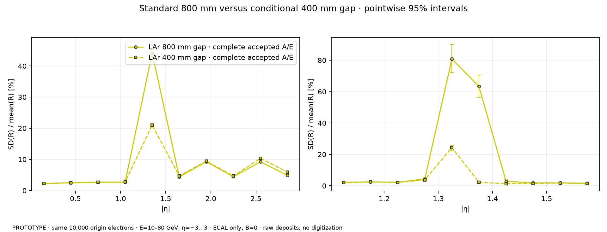

# Conditional LAr gap: matched 10k electron response

**DRAFT / PROTOTYPE · 2026-11-14 · DES-032 / DES-033 · TASK-LAR-GAP10K.**
Reducing the warm barrel/endcap gap from 800 to 400 mm substantially improves
the raw response of the represented LAr ECAL in this sample. The fixed
999-primary transition region narrows from 44.18% to
21.00% in sample SD/mean. This is a conditional gap-sensitivity
result; it does not establish that a complete service installation fits 400 mm.

## Geometry and sample

Translate each entire signed endcap 400 mm towards the IP, with a fixed barrel.
The active axial gap becomes 700 mm instead of 1100 mm. Preserve every internal
shape, material recipe, local service, rotation, readout ID and segmentation
reference. Only 4,964 root-relative XML z attributes change; 38,210 daughter-local
placements are untouched. The routing prototype in [PR143](https://github.com/asalzburger/nodd/pull/143)
keeps the original calorimeter coordinates. Its unresolved pipe overlay is
absent from both response variants. No wall cut or guessed cable material is
introduced here, and the maintained default geometry is unchanged.

Both variants use the exact same 10,000 origin electrons, uniform total E=10–80
GeV, eta −3…3 and full phi. ECAL-only, B=0; DD4hep 1.38 / Geant4 11.4.3,
FTFP_BERT, 0.7 mm range cuts, 5 mm charged-step cap in active LAr, seed 133812341,
MixMaxRng with event seeding and twelve workers. No charge collection,
calibration, digitization or noise model. Tracker, beam pipe, solenoid, HCAL and
FCAL are absent consistently with the retained reference.

## Complete accepted sensitive-deposit response

A is the independent sum of all positive, accepted sensitive-step deposits;
R=A/primary total energy. Width is sample SD(R)/mean(R). Include every primary,
including zero signal. The transition selection is fixed before new showers;
it contains the same 999 records in both geometries.

| Warm gap [mm] | Primary region | N | Mean A/E | Raw width [pointwise 95% interval] | Zeros | Common low tails |
| ---: | --- | ---: | ---: | --- | ---: | ---: |
| 800 | All primaries | 10000 | 15.9323% | 17.84% [17.31, 18.40] | 0 | 183 |
| 400 | All primaries | 10000 | 16.1142% | 13.56% [13.44, 13.67] | 0 | 0 |
| 800 | 1.2 ≤ \|η\| < 1.5 | 999 | 13.6915% | 44.18% [41.50, 46.88] | 0 | 183 |
| 400 | 1.2 ≤ \|η\| < 1.5 | 999 | 16.5217% | 21.00% [20.40, 21.53] | 0 | 0 |

Candidate minus standard width is **-4.29 percentage points [-4.80, -3.78]** globally and
**-23.19 percentage points [-25.93, -20.60]** in the fixed transition region.
All width differences are paired whole-primary bootstrap contrasts.

The common tail cut is **R < 0.079661357096224086**, fixed from half
the original standard saved-hit global mean and held unchanged for A, H, all
bins and bootstrap replicates. The original gap has 183/10000 inclusive tails
and 183/999 in the fixed transition region; the candidate has zero in both.
Zero empirical tails and a degenerate empirical-bootstrap interval do not
exclude a nonzero population tail rate.

The fine 0.05-wide |eta| bins from 1.1 to 1.6 keep the displaced transition visible;
no bin boundaries are selected after observing the result.
[Angular means](figures/angular-means.png), [common tails](figures/angular-common-tails.png),
[energy and signed/full-phi controls](figures/direction-energy-controls.png),
[paired transition differences](figures/transition-differences.png) and
[raw distributions](figures/raw-response-distributions.png) accompany the width plot.

Uncertainty uses 1,000 shared whole-primary multiplicity bootstrap replicates,
seed 13001000, jointly across both geometries, A/H/U and all fixed projections.
The [84-variable covariance](width-covariance.json) retains explicit ordering for
all four saved/accepted series' global, ten |eta| and ten fine-transition widths;
its hash is bound by [the compact summary](summary.json). Intervals are pointwise
95% percentiles conditional on the transport, input spectrum and frozen tail cut.
Matching primaries does not make the different-geometry shower histories equal.

## Saved hits and unassigned energy

The original action rejects a positive step when the arithmetic midpoint of an
annular traversal falls inside its hole and cannot map to a canonical cell.
The observed failures are not all infinitesimal roundoff. The existing 1e−8 mm
segmentation guard, midpoint policy and physical geometry remain unchanged.
Source semantics are catalogued as SRC-DD4HEP-1-38-SENSITIVE-ENERGY, pinned to
[DD4hep v01-38](https://github.com/AIDASoft/DD4hep/tree/142cbb7eb29ec4feafb1af9317fac38775872085/DDG4).
Installed headers/Python bindings were checked; full installed plugin sources
and binary-to-source identity are not claimed.

The independent observer separately accumulates A, successful native-cell
energy S, and unassigned U. It proves A=S+U within derived binary64 bounds and
checks every saved float32 cell H equals the native MeV sum converted to GeV and
rounded to binary32. H−S quantization is reported separately. No failed deposit
is given an invented cell or silently added to the old hit files.

| Warm gap [mm] | Failed steps / affected primaries | Total U [MeV] | Mean U/E [ppm] | ΣU/ΣA [ppm] |
| ---: | ---: | ---: | ---: | ---: |
| 800 | 3 / 3 | 1.18839102 | 0.00501669563 | 0.016643289 |
| 400 | 2 / 2 | 0.148996567 | 0.000496221742 | 0.00206244971 |

These two missing fractions have different denominators. Per-axis values,
bootstrap intervals, maximum/quantile U/E, mean/variance identities and
A−H contrasts remain in the compact summary. At the displayed two-decimal
precision, saved H/E widths reproduce the complete A/E table above. The rare
readout loss does not explain the gap improvement; canonical cell assignment
still needs a separate fix before readout acceptance.

[Saved-H angular-width diagnostic](figures/saved-H-angular-widths.png) ·
[Unassigned transition accounting](figures/unassigned-transition.png)

## Executed validation and provenance

[Native proof](native-validation.json): 290,216 physical placements compared,
82,598 signed-translated descendants, 166 exact solid definitions and 43,648
sensitive placements. Both full ECAL-only overlap/extrusion scans find zero at
10 nm. Exact solids, recursive Boolean operands/matrices, recipes, densities,
rotations and topology establish a material-region bijection; this is not a new
absolute mass measurement from stochastic Boolean Capacity subtraction.

Both geometries pass 24-event serial/12worker exact cell controls and 100-event
pilots. Six actual map chains are revalidated in the [strict guard record](controls-map-verification.json);
[short replay controls](serial-controls.json) preserve the original identities.
Both full observed 10k transports exit0 at clean source
2860f2620ef84e12c21e3d6108876dd7e0609f5e. Corrected readback passes all 10k event
identities, per-cell precision/energy closure, all-step A=S+U, worker/source/library
and hash-bound native-map checks. Saved event/cell/energy/position vectors replay
**exactly against the retained 10k run for each geometry**. The observer makes no
RNG calls. Full detailed bindings are in [execution.json](execution.json).

The original 800 mm reference transport ran clean at 327dd042; its earlier sample
preparation declared 5ef3db3 with dirty component exports. The exact original
producer bytes are separately pinned, not misrepresented as clean sample
preparation. Native shape proof executes at b24f9db2. A separately versioned
postprocessing auditor introduced at d3f49420 and executed unchanged at e8450d75 corrects logical-versus-physical volume-name
correspondence using the actual native placement catalog; all runtime producers
stay byte-identical. Original failed/partial audits are retained locally.

All 47 focused pure tests pass and a nonauthor SoftEng exact-source review clears
the correction. The separate final PhysVal assessment is recorded in the session
journal once complete. [Frozen physical protocol](protocol.md),
[observer protocol](observer-protocol.md), [readback addendum](readback-addendum.md),
[verified environment](environment.json), [exact reproduction](reproduce.md) and
[work/usage journal](../../../logs/design/SESSION-2026-11-14-lar-gap10k.md) distinguish
source stages and their limitations. Raw ROOT, XML, inputs, event/step/native
ledgers and bulky logs remain ignored; compact summaries support replotting,
while full re-audit and bootstrap inference require the retained raw data.

## Interpretation and remaining interfaces

The represented ECAL benefits strongly from the smaller gap in this matched
sample. These widths mix the energy spectrum, angles, sampling, dead material,
leakage and tails; they are **not fixed-energy intrinsic resolution**. This is
not another LAr-versus-Si–W technology comparison. Statistical intervals omit
engineering, geometry, physics-list, material and electronics systematics.

A realizable 400 mm gap still requires qualified side ports/collars, bundle and
board clearances, cooling/thermal and structural checks, installation access and
forward-system interfaces. The standalone rerouting contacts in PR143 are not
resolved by translating an ECAL-only model. No minimum achievable gap, integrated
fit, human sign-off, production adoption or detector acceptance is established.
