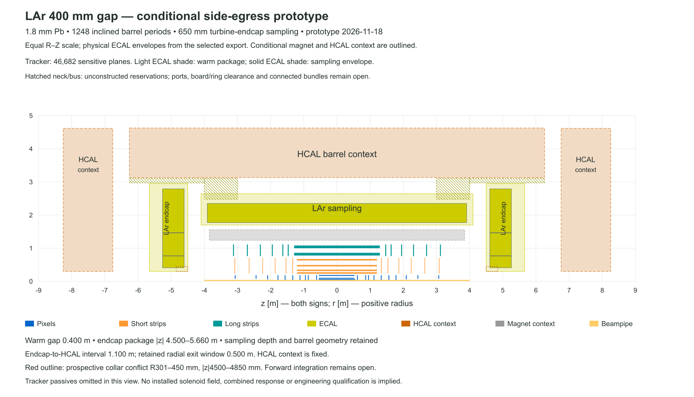

# Conditional 400 mm LAr gap prototype

2026-11-18. **DRAFT / isolated PROTOTYPE**, above the selected1m-gap baseline
in PR150. [Design and source choices](../../design/inputs/DES-032-gap400-prototype.md).
The maintained selection manifest remains the validated1m-gap geometry.



[SVG](../../layouts/figures/LAYOUT-002-gap400-rz.svg) ·
[Named inputs](../../layouts/LAYOUT-002-gap400.json) ·
[Geometry identity](geometry-identity.json) · [Native controls](native-controls.json) ·
[Finite native ray grid](material-rays.json) · [Transport controls](transport-controls.json)

## Implemented change and its boundary

Both complete endcaps move600mm toward the IP. Warm bounds are4500–5660mm;
sampling4610–5260mm retains650mm depth. Barrel warm ends4100mm, leaving400mm
between warm envelopes and700mm between axial sampling bounds. Barrel XML and
materials remain byte-identical to the restored control. All local endcap
sampling pieces, frame rotations, materials, masses and readout counts are
unchanged; native world replica positions move toward the IP by600mm on both
signed ends. Endcap side IDs are1/2, not signed numbers.

The opt-in route policy keeps R400 bends and checks two20mm face clearances in
a1000mm pre-end band. Annular-sector lanes atR2969.5–3109.5mm avoid flat-box
corner intrusion and leave20.5mm at each radial face. Barrel/endcap utility
stations occupy distinct sectors, and mixed/ordinary bundle areas are checked.
HCAL context stays6260/6760mm: the rear axial interval becomes1100mm, but its
radial exit window remains500mm. Original front-S-bend validation still rejects
400mm without this explicit alternative policy.

**These are empty spatial reservations.** No connected side neck, wall opening,
header or external pipe/cable material is constructed. The band crosses populated
boards/H-rings; swept clearance and pressure/vacuum/thermal/support engineering
remain open. Native zero overlaps therefore establishes the ECAL body, not an
engineered service route. The moved endcap also conflicts with the historical
prospective collar reservation overR301–450mm,abs(z)=4500–4850mm, shown in red.
That conditional forward interface is retained and unresolved.

## Actual validation

- **46 standard-library calorimeter tests passed**, including unchanged defaults,
  four new gap/route guards, complete endcap translation and negative controls.
- Generated barrel compact/material bytes match the restored control; endcap
  local pieces and replica rotations match, both signs translate correctly,
  and component material totals/masses are exactly unchanged. The initial
  diagnostic incorrectly treated side ID2 as a signed value; checking world-Z
  signs corrected that diagnostic. Geometry and native transforms were unchanged.
- **Native signed endcap audit: PASS**,9856raw IDs,1,203,200virtual cells, all
  configured shape/material/readout controls and **zero overlaps at1e-5mm**.
- **Native ECAL union: PASS**, zero overlaps at1e-5mm,405finite common-grid
  material/sensitive-path rays over eta−4…4 and five phi values. Barrel native
  evidence is reused only through exact XML/material byte identity. No tracker,
  magnet, HCAL, FCAL or field is constructed in this isolated ECAL union.
- **Matched24-event serial/12-worker transport and readback: PASS.** All19,568
  canonical hit-cell IDs, energies and positions match exactly by event ID.
  All12workers are audited, primary/ID/material/step/cut checks pass. Controls
  use the saved common electron input, seed133812341,5mm numerical cap,.7mm
  production cuts andB=0, as in the baseline protocol.

The sample is a transport smoke test. There is **no new10k resolution result or
precision-equivalence claim**. A future response study must keep the missing
external service/port material explicit and bind any calibration to this new
compact identity. Old ECAL-only calibration artifacts are not transferred.

## Reproduction

Use the existing verified DD4hep1.38/ROOT6.40.04/Geant411.4.3 runtime after
acts-spack preflight/reverification. No new dependencies were installed. Existing
restored factory/audit libraries were reused by exact hashes; their C++ sources
are unchanged. Full XML/expected exports, event ROOT/JSONL, exported native ROOT
geometry and logs remain local under ignored build/. Only compact aggregate
controls, geometry-ray values, source/recipe and figures are retained.

```sh
python3 -B -m unittest discover -s tools/lar_calorimeter -p 'test_*.py' -v
python3 -B tools/lar_calorimeter/compact_prototype.py \
  --spec tools/lar_calorimeter/gap400-prototype.json --output build/lar-gap400/model
```

Build the existing standalone factories and response-audit library using
[the restored recipe](../lar-restored/reproduce.md). Replace its model export
with the explicit specification above. Then run:

```sh
software/env/run.sh python3 -B tools/lar_calorimeter/endcap_native.py \
  --compact build/lar-gap400/model/endcaps/endcaps.xml \
  --expected build/lar-gap400/model/endcaps/expected.json \
  --library build/lar-gap400/factories/libnODDLArEndcapPrototype.dylib \
  --output build/lar-gap400/endcap-native.json
software/env/run.sh python3 -B tools/lar_calorimeter/combined_native.py audit \
  --directory build/lar-gap400/model/combined \
  --barrel-library build/lar-gap400/factories/libnODDLArBarrelPrototype.dylib \
  --endcap-library build/lar-gap400/factories/libnODDLArEndcapPrototype.dylib \
  --output build/lar-gap400/combined-native.json
python3 -B software/analysis/lar_response/transport.py prepare \
  --baseline build/lar-gap400/model/combined \
  --primary-sample ../nodd-ecal10k/build/ecal10k/production-input --output build/lar-gap400/sample
```

Use `transport.py run` from the restored recipe with `--events 24`, `--threads 1`
and then `--threads 12`, separate output directories and the same seed/step cap.
Run `transport.py audit` on each, then:

```sh
software/env/run.sh python3 -B software/analysis/lar_response/compact_controls.py \
  --serial build/lar-gap400/control1 --mt build/lar-gap400/control12 \
  --output build/lar-gap400/serial-mt.json
python3 -B tools/lar_calorimeter/draw_gap400.py --model build/lar-gap400/model \
  --input docs/layouts/LAYOUT-002-gap400.json --output docs/layouts/figures/LAYOUT-002-gap400-rz.svg
rsvg-convert docs/layouts/figures/LAYOUT-002-gap400-rz.svg \
  -o docs/layouts/figures/LAYOUT-002-gap400-rz.png
```

Use `.so` names on Linux. Omitting `--model` redraws the committed named input
without native dependencies. The extended renderer also reproduces the retained
1m baseline SVG byte-for-byte. The new PNG was visually inspected. Existing
librsvg2.62.3 supplies PNG rendering. Native exports were made from an explicitly
dirty49b4326d working tree; scientific source hashes bind the executed bytes,
which are committed unchanged inccc119813a918a694ed04d7a3fc087ce580677b2.
