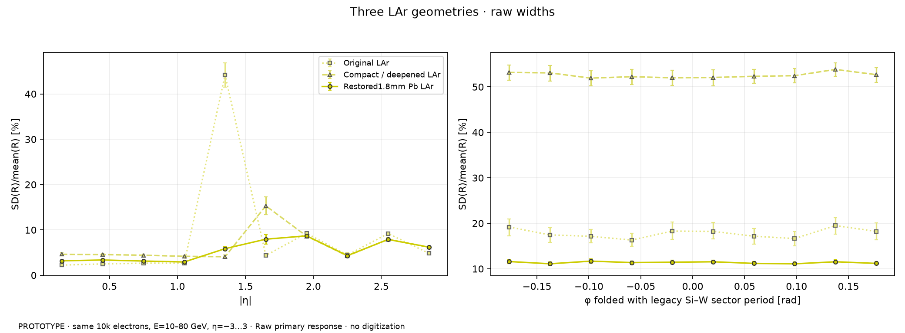
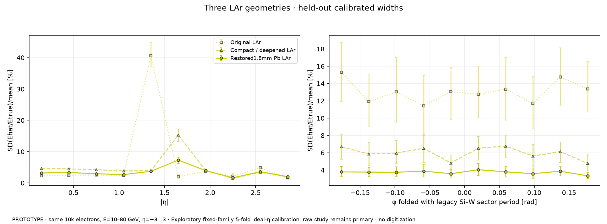
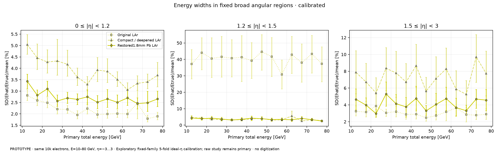
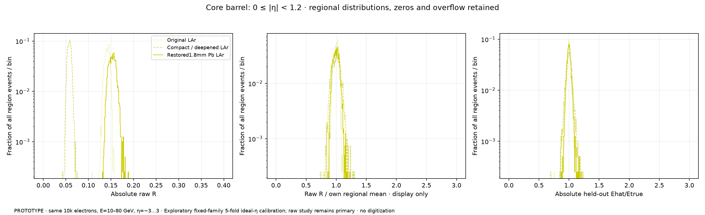

# Restored1.8mm Pb LAr sampling prototype

[LAr baseline / Si–W raw energy resolution versus eta and phi, 15 bins](../ecal-raw-angular/README.md).

**DRAFT / isolated PROTOTYPE ·2026-11-18 ·DES026/032/033.** The user-directed
variant restores1.8mm barrel Pb while allowing a larger outer radius. It retains
50.18° inclination and all11normalized radial compartment boundaries. The strict
2.6mm case remains a distinct control; maintained LAYOUT-002 and approval states
are unchanged. Endcap650mm XML/materials remain byte-identical.

| Boundary or sampling choice | Restored variant |
|---|---:|
| Warm bore |1700mm |
| Sampling inner/outer radius |1772.8/2350mm |
| Warm outer radius |2641.7mm |
| Barrel Pb / periods |1.8mm /1248 |
| Initial single LAr gaps |about1.207/1.209mm |
| Inclination |50.18° |
| Rear bath |210mm |
| Front service reservation |1000mm |

Native component/union mass, shape, transform, readout and containment checks
pass with0overlaps. The9088-ray actual-period sampling-only minimum is
26.8001969X0; it is a finite-grid result, not a continuous bound or multi-TeV
containment certification. All6strict-default physical files and2endcap files
remain byte-identical. Tracker/solenoid reservation has60mm radial interface.
Actual ports/supports/pressure/thermal/hydraulics remain unqualified.

The matched10k controls show **partial recovery of the barrel penalty**: held-out
width4.30→3.04%, while the original remains2.43%. Precision preservation is not
established; the paired residual relative to original remains positive.

## Complete matched10k controls

All10000events/12workers pass complete readback with8,544,489positive canonical hits. Wall845.96s, peakRSS3.543GiB, ROOT21.408GB; no disk abort or sample trimming. Free space after transport107.2GiB exceeds30GiBreserve. These are observed resource measurements, not a dedicated benchmark.

The exact original primaries/IDs are retained: totalE10–80GeV, flateta−3…3/fullphi,
FTFP_BERT/0.7mmcuts/5mmcap, eventseed133812341, ECAL-onlyB0. Serial/12-thread24-event
controls reproduce19065canonical hits exactly; both100-event step-policy pilots
and all saved readbacks pass. Production and statistical source frozen at
`ec8815821a6530bbb6c6133332a5369d795b59f3` with clean working tree. Producers and
libraries remain unchanged. Model source53797385/native-contract source9913d958.

## Primary raw response widths

R=active deposited energy/primary total energy; width=sampleSD(R)/mean(R).
All events/zeros/tails retained; mixed-spectrum raw widths are not intrinsic
reconstructed resolution. Pointwise paired95% intervals use1000shared whole-event
bootstraps(seed13001000); no noninferiority margin or simultaneous acceptance.

| Population | Events | Original | Dense2.6mm | Restored1.8mm |
|---|---:|---:|---:|---:|
| Inclusive | 10000 | 17.84% | 52.57% | 11.37% |
| Core barrel,0–1.2 | 3999 | 3.52% | 6.56% | 4.74% |
| Transition,1.2–1.5 | 999 | 44.18% | 4.09% | 5.87% |
| Broad endcap,1.5–3 | 5002 | 7.66% | 10.42% | 8.73% |

## Fixed-family held-out gain diagnostic

Same fixed60abs_eta gainbins/five shared folds(seed14865017), training-only
forward mean(S/Etrue); application Ehat=S/gain(abs_eta), no true-energy input.
Ideal truth direction, no held-out recentering/cuts/clipping;1000shared refit
bootstrap replicas(seed14865018) with5000fold refits/model. Family selection
preceded this sample but followed earlier studies; results remain conditional
exploratory cross-validation, not independent detector validation.

| Population | Events | Original | Dense2.6mm | Restored1.8mm |
|---|---:|---:|---:|---:|
| Inclusive | 10000 | 13.12% | 6.00% | 3.74% |
| Core barrel,0–1.2 | 3999 | 2.43% | 4.30% | 3.04% |
| Transition,1.2–1.5 | 999 | 40.62% | 3.92% | 3.74% |
| Broad endcap,1.5–3 | 5002 | 3.09% | 7.36% | 4.22% |

Core-barrel calibrated paired changes, restored minus original: **+0.609pp [+0.482,+0.727]**; restored minus densecompact: **-1.260pp [-1.437,-1.104]**. Intervals are pointwise95%, in percentage points.

[Raw paired differences](figures/raw-restored-paired-differences.svg) ·
[Held-out paired differences](figures/calibrated-restored-paired-differences.svg) ·
[Absolute energy closure](figures/calibrated-three-model-closure-regions.svg).
Raw-to-calibrated point changes are descriptive; uncertainty contrasts compare
the two models under the same respective procedure. No cross-procedure
uncertainty test or three-model joint covariance is claimed.

## Underlying distributions and shifted shoulder

RawR, rawR divided by each model's own regional mean(display only), and absolute
held-outEhat/Etrue are shown separately. All-event denominators and histogram
flow are retained; no Gaussian fits or tail rejection. Complete original/restored
10abs_eta/10legacyfold distributions and signedeta/fullphi/energy/tail controls
are in [raw figures](raw-figures/) and [held-out figures](calibrated-figures/).
The fold is the legacy SiW sector coordinate, not LAr symmetry.

| Post-hoc subregion | Events | Original held-out CV | Dense held-out CV | Restored held-out CV |
|---|---:|---:|---:|---:|
| 1.5–1.8 | 1019 | 2.00% | 15.30% | 7.30% |
| 1.8–3 | 3983 | 3.31% | 2.87% | 2.96% |

These focused subregions are descriptive, selected in the prior diagnosis;
original fixed broad regions remain primary. The bulk point estimate alone
cannot establish noninferiority. [Three-model shoulder context](figures/regional-three-model-endcap.png).

## Saved calibration and reproduction

[Evaluated fold models and separate full-fit reuse tables](calibration-models.json)
are bound to exact compact/material/primary/source identities. The restored table
is `models.candidate.full_fit_reuse_only`; it was fitted on all10k and needs fresh
validation before deployment. Application interface:
`compact_calibrate.apply_calibration(model, signal_GeV, eta, geometry)` takes
no true energy and rejects compact/material/binning mismatches. Scope is this
ECAL-onlyB0 ideal deposition model, not electronics or full-detector calibration.

[Protocol](protocol.md) · [Reproduction](reproduce.md) ·
[Native controls](native-controls.json) · [Execution controls](controls.json) ·
[Original/restored raw statistics](original-summary.json) ·
[Dense/restored raw statistics](dense-summary.json) ·
[Original/restored calibrated statistics](original-calibrated-summary.json) ·
[Dense/restored calibrated statistics](dense-calibrated-summary.json) ·
[Distribution bins](diagnosis-summary.json).

PNG/PDF/SVG and compact binwise statistics/intervals/principal covariance remain
inGit; full ROOT/events/XML/logs/native reports and duplicate overlayJSON remain
local and hashed. Replotting uses committed summaries; event-level regeneration
needs the retained originals and exact recipe. Common production cuts are not a
convergence study. Digitization/noise, pileup/radiation, high-energy leakage and
engineering/detector acceptance remain open. Several geometry changes form this
variant, so the comparison does not isolate Pb thickness alone.
