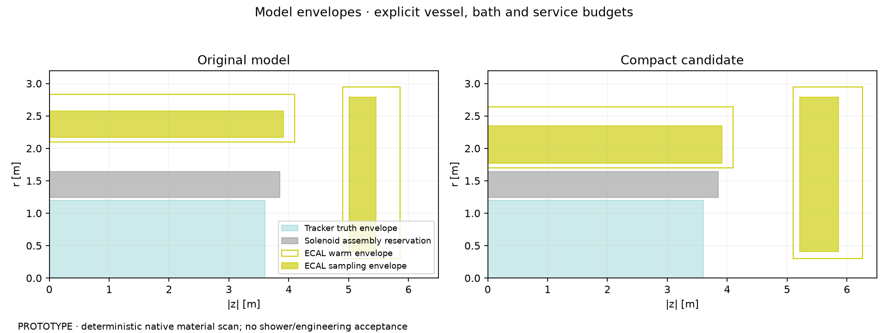
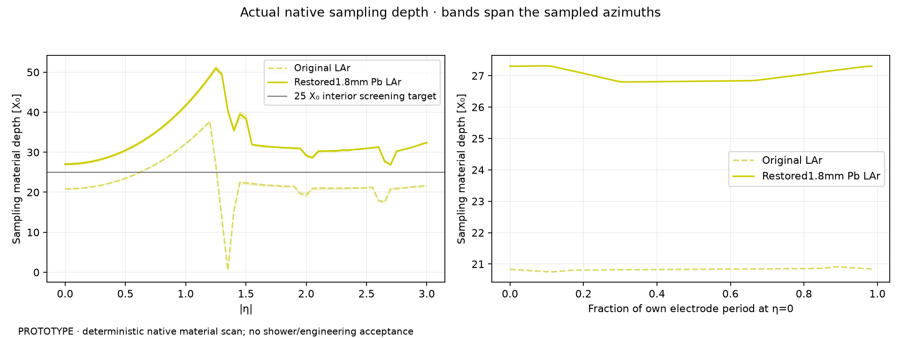

# Restored1.8mm Pb LAr sampling prototype

**DRAFT / isolated PROTOTYPE ·2026-11-18.** User-directed follow-up to PR148.
Selected BEFORE new response outcomes: warmbore1700mm, sampling1772.8–2350mm,
1248periods, Pb1.8mm,50.18° inclination and original normalized radial compartment
fractions. Warmouter2641.7mm;210mm rear bath and explicit wall/vacuum/service
budgets retained. Endcaps unchanged from the650mm compact candidate.

[Design choice](../../design/inputs/DES-032-compact-hadron-prototype.md) ·
[Prospective protocol](protocol.md). Native component/combined shape, mass, readout and overlap checks pass. The
9088-ray native sampling-only minimum is26.800197X0. Strict-default and endcap
physical XML/material files remain byte-identical. Matched10k/12-worker
transport/results are pending. No precision recovery or engineering acceptance
is claimed. The maintained baseline and strict2.6mm prototype remain distinct.

[Native controls](native-controls.json) · [Material summary](material-summary.json) ·
[Original/restored contract](contract.json) · [Dense/restored contract](dense-contract.json).
