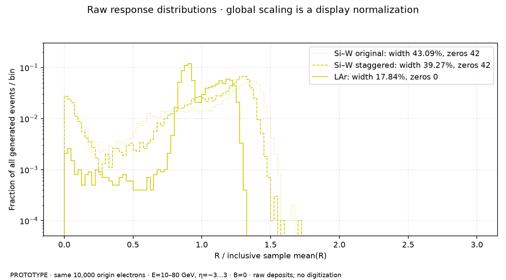
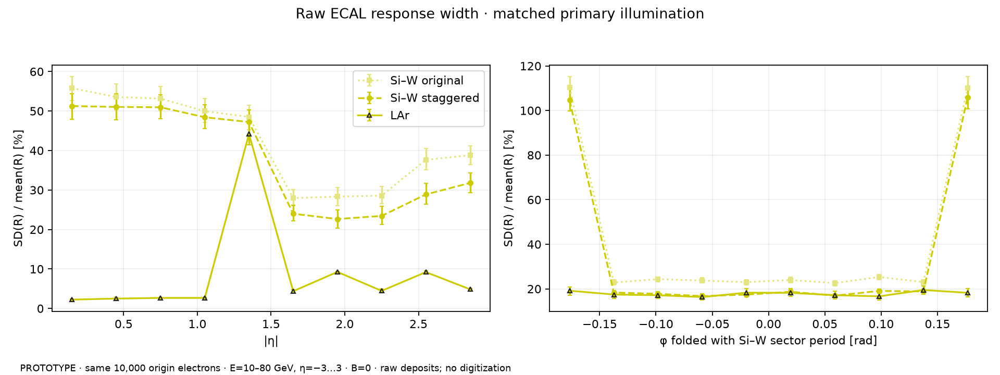
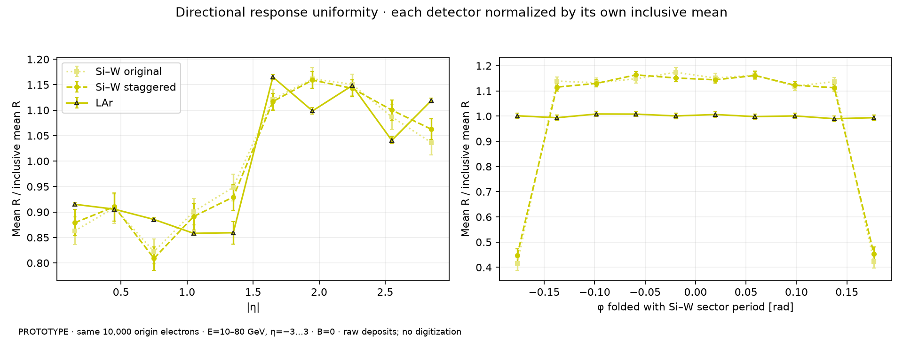
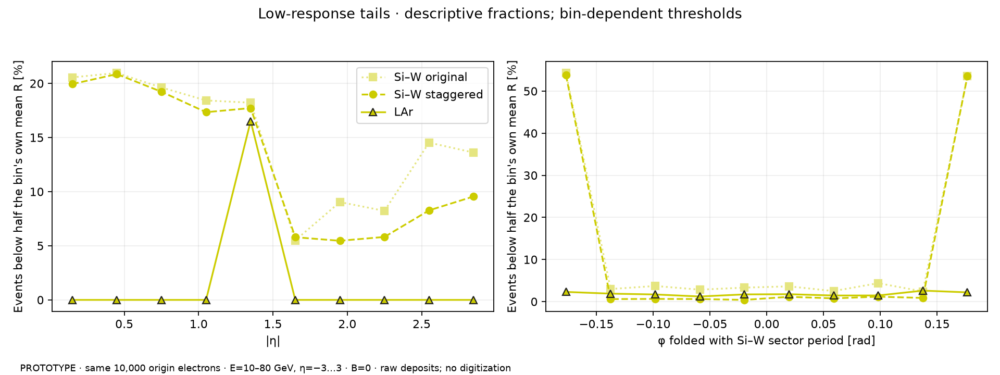

# Matched 10k electrons: ALLEGRO-style LAr and Si–W

**DRAFT / PROTOTYPE · 2026-11-13 · DES030–033 · PR140.** The LAr candidate
has a narrower raw active-deposit response distribution and fewer low-response
events in this matched sample. This compares the represented detector candidates,
including their different geometry, material and envelopes; it does not isolate
the active medium or select a technology.

Each model uses the exact same 10,000 origin electrons: total E10–80GeV,
eta−3…3 and full phi, ECAL-only B=0, FTFP_BERT,0.7mm cuts and5mm charged-step
cap. The LAr hierarchy is the maintained reusable-period default after PR139.
Original and staggered Si–W are the retained matched10k raw samples, distinct
from PR137's larger calibration study. No calibration, noise, charge collection
or digitization is fitted here.

## Inclusive raw response

`R = active ECAL deposited energy / primary total energy`; width is sample
`SD(R)/mean(R)`. All events, including zeros, remain in the denominators.
Different mean sampling fractions are expected and do not rank performance.

| Candidate | Mean R | Raw width [95% interval] | Zeros /10000 | Below half own mean R /10000 |
| --- | ---: | ---: | ---: | ---: |
| Si–W original | 1.172% | 43.09% [42.22, 43.95] | 42 | 1433 (14.33%) |
| Si–W staggered | 1.182% | 39.27% [38.36, 40.20] | 42 | 1298 (12.98%) |
| LAr | 15.932% | 17.84% [17.31, 18.40] | 0 | 183 (1.83%) |

Staggered Si–W minus LAr raw width is **21.43 percentage
points**, with paired pointwise95% interval **[20.42, 22.48]**.
Intervals use1,000 shared whole-primary-event bootstrap replicates, seed13001000.
They condition on these saved transports/configurations; they exclude detector,
physics-list, material and electronics systematics. Shown intervals cover means,
widths and response uniformity; tail counts and quantiles are descriptive.
These spectrum/angular mixtures are not fixed-energy intrinsic energy resolution.

## Directional controls and transition

| Absolute eta | Common events | Si–W original width | Si–W staggered width | LAr width |
| --- | ---: | ---: | ---: | ---: |
| 0–1.2 | 3999 | 53.24% | 50.62% | 3.52% |
| 1.2–1.5 | 999 | 48.50% | 47.21% | 44.18% |
| 1.5–3 | 5002 | 32.50% | 26.36% | 7.66% |

The LAr transition remains the main broad-response region. It stays in the
inclusive result. The narrower interior-region spreads do not establish
realistic reconstructed resolution, and the present cryostat/services/readout
approximations remain unqualified.

The folded coordinate is the Si–W22.5degree sector phase applied to both models,
not the LAr electrode pitch. Signed-eta and full-phi controls accompany it.
Tail-panel thresholds use each angular bin's own mean; the inclusive table uses
each detector's inclusive mean. Histograms use R/inclusive mean(R) solely as
display normalization, with all bin edges/counts and overflows retained.

[Energy controls](figures/energy-controls.png) ·
[Signed direction/full azimuth](figures/direction-controls.png) ·
[Underlying |eta| distributions](figures/distributions-abs_eta.png) ·
[Underlying sector-phase distributions](figures/distributions-siw_folded_phi.png)

## Execution and integrity

The complete LAr production transported and persisted10,000 unique primaries,
IDs0–9999, with all12workers audited. Full readback passed8,354,800 positive
finite canonical hits:3,054,943barrel and5,299,857endcap;2,561,316distinct cells.
It verifies primary four-vectors, complete unique event IDs, canonical readout
membership, material/cut/step/field/RNG policies, source/library stability and
raw ROOT/worker-audit hashes. The comparison also pins the distinct Si–W compact
and material hashes and the common primary files, rejecting mislabeled inputs.

LAr transport took820.11s wall,8448.03CPU-s, peak3.185GiB RSS and20.961GB ROOT
(compression algorithm1,level1). These are descriptive observations from this
run, not a dedicated throughput benchmark. Production source is
`327dd042b6b3d1be1a4325af3d444c38dd70f720`; analysis source and artifact hashes
are recorded separately in the compact summary.

The serial24/MT24 control reproduces all19,027saved hit IDs, energies and
positions bit-for-bit by event ID. Both100-event native-limit/5mm pilots passed;
their differing showers are a gross sensitivity diagnostic, not convergence.
The predeclared5mm policy was retained. Native volume managers and all43,648raw
contexts are initialized serially before workers, addressing the earlier pilot's
first-hit initialization race. The failed legacy pilot remains separate and is
excluded from all response/timing comparisons. No source geometry or physical
response parameter was tuned to these results.

[Prospective protocol](protocol.md) · [Compact controls/environment](controls.json) ·
[Complete statistics and principal width covariance](summary.json) ·
[Reproduction recipe](reproduce.md). The summary retains the global,10|eta|,
10sector-phase,14energy,16full-phi,12signed-eta and3broad-region bins, underlying
histograms and63-variable cross-model/angular width covariance with explicit order.
Full ROOT, event ledgers, XML and logs remain local and ignored. Committed data
support replotting; independently repeating event-level/bootstrap inference needs
the retained/regenerated event samples. No engineering or design acceptance.
