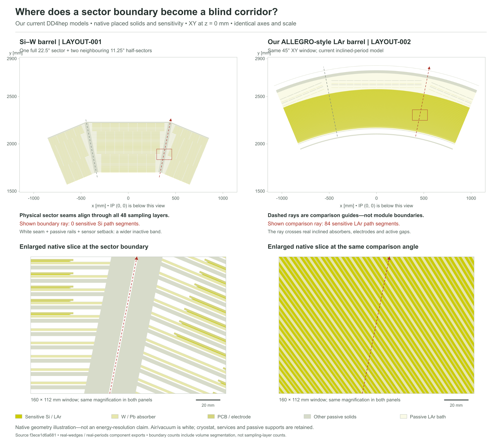

# Si–W / ALLEGRO-style sector gap: current DD4hep XY slices

**PROTOTYPE geometry illustration**, requested 2026-11-18 and explicitly steered
to the project's current DD4hep models. Model source is
`f3ece1d6a6816c8172dfa841d63e5424730e8228`.



[SVG with vector annotations and embedded native rasters](../../design/figures/sector-gap-native/siw-allegro-sector-gap.svg) ·
[Native model/input hashes and ray probes](../../design/figures/sector-gap-native/native-slice-provenance.json)

Both views are at **z=0 mm**, through the interaction point, with identical XY
axes and scale. Si–W shows the full 22.5° sector centred at φ90° and the inner
11.25° halves of its two neighbours. The second panel shows the same 45° window
of **our maintained ALLEGRO-style LAr model**, not a replacement using an ideal
ALLEGRO sketch or its older source-XML material proxies. Native cryostat,
supports, services, electrodes, absorbers and sensitive masks are retained.

## What is actually drawn

The maintained LAYOUT-001 barrel exporter is run with `--real-wedges`;
LAYOUT-002 uses `--services .../barrel_services.py --real-periods`, exactly as
the baseline composer selects them. Fresh current-source factory libraries load
these compacts into DD4hep. ROOT's navigator then traverses the **actual placed
volumes**, identifies the native material and uses `dd4hep.Volume.isSensitive`
for active color. LAr material alone is never treated as a sensitive shell.
There is no hand-drawn replacement of the sampling solids or their placements.

All periods participate in navigation, including those starting outside the
display window and crossing into it. Only the final view is clipped to 45°.
The LAr model retains its actual 0.2 mm total steel, 1.8 mm Pb, 1.2 mm electrode
and 50.18° inclination. No source-XML 0.1 mm steel override is applied.

The overview uses 1000×620 pixels, exact native X-boundary segments integrated
over each pixel, and eight Y subrows per pixel. Each zoom is 800×560 over
160×112 mm, with two Y subrows. Thus thin Si films are not discarded simply
because an X pixel is wider than a film. Material edges retain finite raster
resolution; SVG geometry content is these native rasters, while axes, guides
and annotations are vector. Substrate, packages, steel and other passive solids
are grouped into the declared passive palette; air/vacuum remains white.

## Interpretation and limits

The Si–W white seam is only part of the inactive corridor: native passive side
rails, board-edge reservation and incomplete sensor fill also contribute.
The seam/rails are aligned through the 48 sampling layers. Internal board
staggering cannot remove that retained sector interface. This drawing uses the
current maintained model; it does not substitute the archival PR136/137
staggered-sample geometry into that model.

The marked IP ray at φ78.75° has **0 sensitive Si path segments** and
**84 sensitive LAr path segments** in the corresponding current models.
Nearby ±0.001 rad probes have 0/0 Si and 95/95 LAr segments. These counts include
physical volume/longitudinal segmentation; they are **not sampling-layer
counts, shower efficiencies or an energy-resolution comparison**. The LAr
±11.25° guide lines are comparison markers, not physical 16-sector boundaries.
The current LAr sampling geometry has no analogous projective blind corridor
at the shown angle; other passive material, interfaces and other z slices
remain separate issues.

The inclined-plane explanation is consistent with
[Morange, PoS(EPS-HEP2025)510 §2/Fig.1](https://inspirehep.net/files/d3705f643a55e10919902f5d198bd618)
and the repository's existing `SRC-ALLEGRO-EPS-2025` /
`SRC-ALLEGRO-K4GEO-2026` records. Those references explain the design precedent;
the current nODD geometry is the authority for every material pixel here. No
published ALLEGRO performance or engineering qualification is transferred.

## Reproduction

Run from this PR's checkout, which contains the drawing scripts. The model source
predates those scripts: use a separate detached checkout at the pinned model
commit, as below. The renderer verifies model-source hashes against that commit's
Git blobs, so later changes to the renderer checkout cannot silently replace the
pinned geometry inputs. Read the ACTS Spack skill and verify the existing runtime
before native use; do not install or modify shared dependencies.

```sh
render_repo="$PWD"
model_repo="$render_repo/build/sector-gap/model-source"
git worktree add --detach "$model_repo" f3ece1d6a6816c8172dfa841d63e5424730e8228
(
  cd "$model_repo"
  python3 -B tools/calorimeter_hardware/barrel_export.py --output build/sector-gap/siw --real-wedges
  python3 -B tools/lar_calorimeter/barrel_export.py --output build/sector-gap/lar \
    --services tools/lar_calorimeter/barrel_services.py --real-periods
)
software/env/run.sh cmake -S "$model_repo/prototypes/calorimeter" \
  -B "$model_repo/build/sector-gap/factories" -G Ninja
software/env/run.sh cmake --build "$model_repo/build/sector-gap/factories" \
  --target nODDCalorimeterPrototype nODDLArBarrelPrototype --parallel 4
software/env/run.sh python3 -B tools/calorimeter_hardware/sector_slice_native.py \
  --compact "$model_repo/build/sector-gap/siw/calorimeter.xml" \
  --library "$model_repo/build/sector-gap/factories/libnODDCalorimeterPrototype.dylib" \
  --output build/sector-gap/slices --name siw
software/env/run.sh python3 -B tools/calorimeter_hardware/sector_slice_native.py \
  --compact "$model_repo/build/sector-gap/lar/barrel.xml" \
  --library "$model_repo/build/sector-gap/factories/libnODDLArBarrelPrototype.dylib" \
  --output build/sector-gap/slices --name lar
python3 -B tools/calorimeter_hardware/draw_sector_comparison.py \
  --slices build/sector-gap/slices --output build/sector-gap/figure
rsvg-convert build/sector-gap/figure/siw-allegro-sector-gap.svg \
  -o build/sector-gap/figure/siw-allegro-sector-gap.png
software/env/run.sh python3 -B tools/calorimeter_hardware/test_sector_slice.py
```

On Linux use the built `.so` library names. Native extraction verified the source
fingerprints from each expected-model manifest and records the actual compact,
library, extractor and ROOT version hashes. Runtime was reverified after changed
setup/lock fingerprints: current factory build and DD4hep/DDG4 imports succeeded,
ROOT 6.40.04 with native mm=0.1. No particle transport was run. Four independent
native raster views repeated byte-identically on this runtime. Rendering/font
versions can alter annotated PNG pixels; the geometry data remain separately
hashed. Full XML/expected-model dumps, libraries and runtime logs stay ignored;
only figure products, compact provenance and source/recipe are committed.
