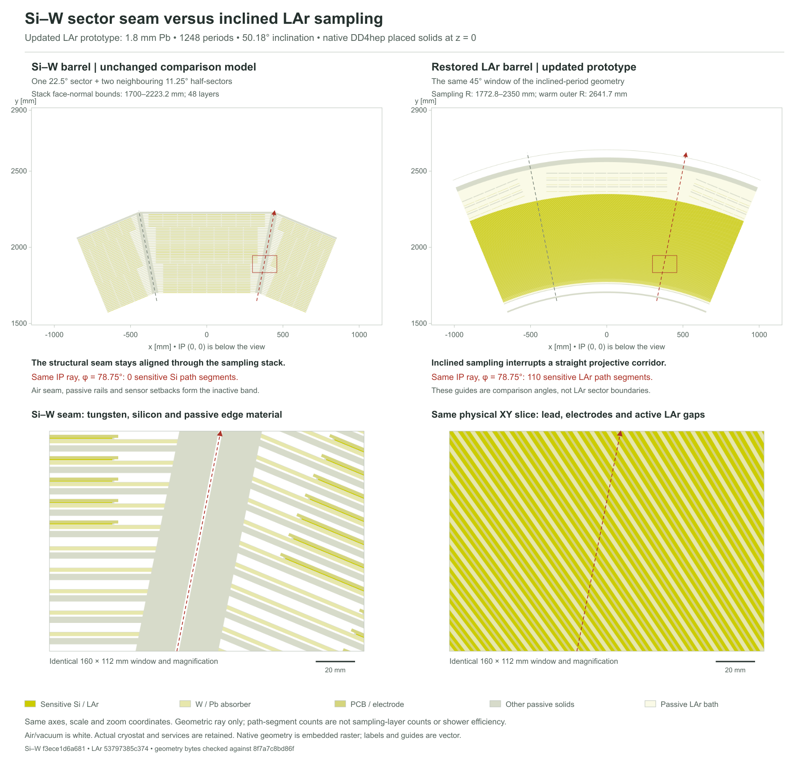

# Si–W and updated LAr sector views

**PROTOTYPE illustration — 2026-11-18.** This redraw uses the restored 1.8 mm Pb
LAr barrel from [PR148](https://github.com/asalzburger/nodd/pull/148), the model
used for its restored 10k-electron control. It preserves the Si–W comparison
from [the earlier drawing](../sector-gap-native/README.md). No geometry changes
or new particle transport are made by this illustration.



[SVG](../../design/figures/sector-gap-restored/siw-restored-lar-sector-gap.svg) ·
[PDF](../../design/figures/sector-gap-restored/siw-restored-lar-sector-gap.pdf) ·
[Compact native provenance](../../design/figures/sector-gap-restored/native-slice-provenance.json)

## Model identity and interpretation

Every geometry pixel comes from ROOT navigation of the actual DD4hep placed
solids. Active color uses native `isSensitive()`, not just material identity.
All periods participate before clipping the displayed angular window. The
SVG embeds those native rasters; annotations and guides are vector.

| Quantity | Si–W comparison | Restored LAr prototype |
| --- | --- | --- |
| Declared model source | `f3ece1d6a6816c8172dfa841d63e5424730e8228` | `53797385c374118838b2ade1ec3362328683cf75` |
| Stack face-normal bounds / annular sampling radii | 1700–2223.2 mm (apothem bounds) | 1772.8–2350 mm (circular radii) |
| Warm bore / warm outer radius | Not a LAr vessel | 1700 / 2641.7 mm |
| Absorber / active / sampling repetition | 1.9 mm W / 0.5 mm Si / 48 layers | 1.8 mm Pb / inclined sensitive LAr / 1248 periods |
| Inclination | Sector-normal slabs | 50.18° at the sampling inner radius |
| Marked IP ray, φ=78.75° | 0 sensitive path segments | 110 sensitive path segments, 325.495 mm total |
| Nearby probes, φ±0.001 rad | 0 / 0 segments | 107 / 109 segments |

**NODD DESIGN CHOICE:** the LAr variant retains the 11 normalized radial
compartment fractions while allowing the thicker sampling annulus, as directed
by the user. PR148 owns that geometry and its response evidence. This drawing
also verifies every declared geometry-source hash for **both** input models
against the updated prototype revision
`8f7a7c8bd86f4d9c67c11b37d91aea76790feee4`. Exact compact, expected-manifest,
factory-library, extractor, inline C++, image and renderer hashes are retained
in the provenance JSON. The LAr factory bytes match the restored production
control (`de693d3bd949e748d867a8f768c628afa1d4259c681214c377cd79fdf5243b33`).

The Si–W seam, passive rails and sensor setbacks stay projective through the
stack. The same straight IP ray crosses inclined sensitive gaps in LAr instead
of following an analogous inactive corridor at this angle. The maintained Si–W
geometry is retained; the archival PR136/137 staggered-sample geometry is not
substituted into it. Both freshly extracted Si–W raster hashes are identical to
the previous published drawing.

The overview axes are identical: x=−1150…1150 mm, y=1490…2916 mm, z=0 mm. Si–W
shows a full 22.5° sector plus two neighbouring 11.25° half-sectors. LAr shows the
same 45° angular window; its dashed guides are comparison angles, not LAr module
boundaries. **Both zooms now use the exact same coordinates**, x=300…460 mm and
y=1834…1946 mm, as well as the same magnification. The Si–W apothem and LAr
circular radius labels deliberately identify different geometric definitions.

Counts are native sensitive-volume path segments, **not independent sampling
layers, shower efficiencies or energy-resolution measurements**. This is one
transverse slice and four geometric probes. Cryostat/services and other passive
material are retained; other angles, axial interfaces, scattering and shower
leakage need their own evidence. No engineering approval or detector acceptance
is inferred. The palette follows the project ECAL colors, with labelled lighter
shades for absorbers, electrodes and other passive material.

## Reproduction

Use this PR checkout for the drawing tools. Fetch PR148's branch first to make
its immutable source objects available, then create separate detached model
checkouts. Do not replace the declared source with the current working tree.
Read the acts-spack skill and reverify the existing runtime before native use.
This run warned about changed setup/lock fingerprints, then verified ROOT 6.40.04,
DD4hep/DDG4 imports and Geant4 11.4.3. No shared installation was changed.

```sh
render_repo="$PWD"
git fetch origin codex/lar-compact-hadron-prototype
git worktree add --detach build/sector-gap-restored/siw-source f3ece1d6a6816c8172dfa841d63e5424730e8228
git worktree add --detach build/sector-gap-restored/lar-source 53797385c374118838b2ade1ec3362328683cf75
siw_source="$render_repo/build/sector-gap-restored/siw-source"
lar_source="$render_repo/build/sector-gap-restored/lar-source"
(
  cd "$siw_source"
  python3 -B tools/calorimeter_hardware/barrel_export.py --output build/drawing/siw --real-wedges
)
(
  cd "$lar_source"
  python3 -B tools/lar_calorimeter/compact_prototype.py \
    --spec tools/lar_calorimeter/restored-sampling.json --output build/drawing/model
)
software/env/run.sh cmake -S "$siw_source/prototypes/calorimeter" \
  -B "$siw_source/build/drawing/factories" -G Ninja -DCMAKE_BUILD_TYPE=Release
software/env/run.sh cmake --build "$siw_source/build/drawing/factories" \
  --target Components_nODDCalorimeterPrototype --parallel 4
software/env/run.sh cmake -S "$lar_source/prototypes/calorimeter" \
  -B "$lar_source/build/drawing/factories" -G Ninja -DCMAKE_BUILD_TYPE=Release
software/env/run.sh cmake --build "$lar_source/build/drawing/factories" \
  --target Components_nODDLArBarrelPrototype --parallel 4
software/env/run.sh python3 -B tools/calorimeter_hardware/sector_slice_native.py \
  --compact "$siw_source/build/drawing/siw/calorimeter.xml" \
  --library "$siw_source/build/drawing/factories/libnODDCalorimeterPrototype.dylib" \
  --geometry-revision 8f7a7c8bd86f4d9c67c11b37d91aea76790feee4 \
  --zoom-bounds 300 460 1834 1946 --output build/sector-gap-restored/slices --name siw
software/env/run.sh python3 -B tools/calorimeter_hardware/sector_slice_native.py \
  --compact "$lar_source/build/drawing/model/barrel/barrel.xml" \
  --library "$lar_source/build/drawing/factories/libnODDLArBarrelPrototype.dylib" \
  --geometry-revision 8f7a7c8bd86f4d9c67c11b37d91aea76790feee4 \
  --zoom-bounds 300 460 1834 1946 --output build/sector-gap-restored/slices --name lar
python3 -B tools/calorimeter_hardware/draw_restored_sector_comparison.py \
  --slices build/sector-gap-restored/slices --output build/sector-gap-restored/figure
rsvg-convert build/sector-gap-restored/figure/siw-restored-lar-sector-gap.svg \
  -o build/sector-gap-restored/figure/siw-restored-lar-sector-gap.png
rsvg-convert -f pdf build/sector-gap-restored/figure/siw-restored-lar-sector-gap.svg \
  -o build/sector-gap-restored/figure/siw-restored-lar-sector-gap.pdf
python3 -B tools/calorimeter_hardware/test_restored_sector_comparison.py
software/env/run.sh python3 -B tools/calorimeter_hardware/test_sector_slice.py
```

Use actual `.so` filenames on Linux. The run here reused the exact locally
validated compacts/libraries, additionally requiring their previously recorded
library SHA-256 through `--library-sha256`. A fresh build records its own library
hash, which can vary with toolchain/platform. Full XML/expected exports,
libraries and runtime logs remain local under ignored build directories.
Renderer: existing librsvg 2.62.3, Cairo 1.18.4, Pango 1.58.0; fonts/rendering can
alter annotated output pixels. Four portable provenance guards and the analytic
native thin-film/chord fixture passed. PNG layout was visually inspected.
