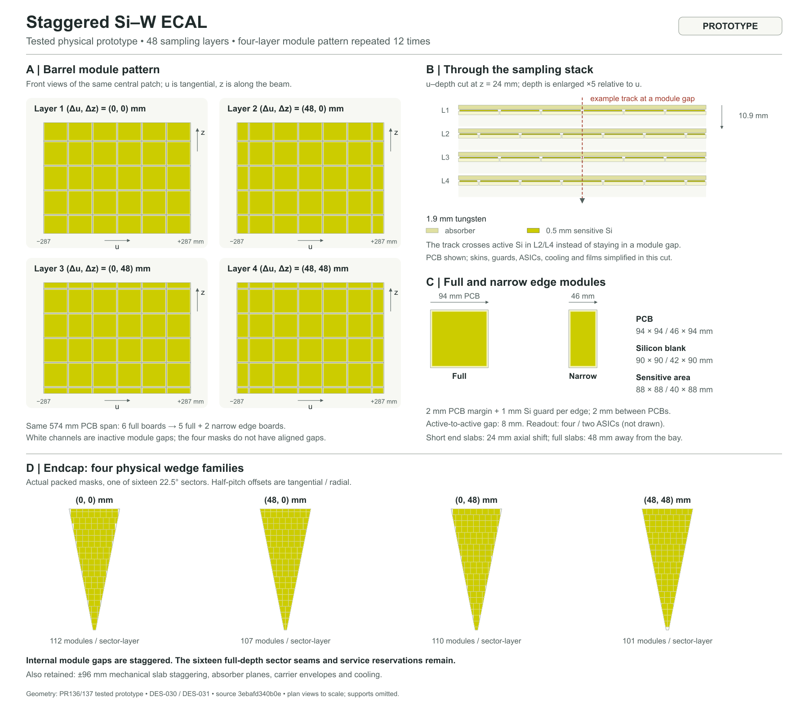

# Drawing of the tested staggered Si–W ECAL

**PROTOTYPE illustration**, requested 2026-11-13. This depicts the physical
staggering tested in PR136/137 at source revision
`3ebafd340b0e084c5e42e57123de115e3f489244`. It does not replace the maintained
DES-030/DES-031 baseline or claim engineering/design approval. That historical
study source is required explicitly for regeneration; the drawing must not
silently use another packing implementation from current main.



[Vector SVG](../../design/figures/DES-031/staggered/staggered-siw-layout.svg) ·
[Input hashes and drawing provenance](../../design/figures/DES-031/staggered/staggered-siw-layout.provenance.json)

The drawing shows the first four barrel layers in common tangential/axial
coordinates, a tungsten/silicon sampling cut, full/narrow board dimensions,
and the four actual endcap wedge packings. Layers are numbered 1–4 for display
(native indices 0–3). All dimensions are in mm. Plan views are to scale; depth
is enlarged by 5 relative to the tangential coordinate in the cutaway. Skins,
guards, electronics, cooling and thin films are simplified or omitted there.

The tested four-layer pattern is (0,0), (48,0), (0,48), (48,48) mm. A tangential
half-phase replaces one 94 mm board with two 46 mm edge boards; the six-column
example retains a 574 mm outer PCB span. Full barrel slabs shift rows 48 mm away
from their service bay, while short end slabs use 24 mm. The inherited ±96 mm
mechanical slab staggering is retained. Internal gaps move between layers;
the sixteen full-depth sector seams and service reservations remain.

The sampling cut is at z=24 mm and u=0 for the example track. Its sensitive
intersection is absent in displayed L1/L3 and present in L2/L4. This illustrates
module-gap staggering, not a shower-efficiency or resolution prediction.

## Reproduction

No DD4hep/Geant4 runtime or additional Python package is required. Use a separate
clean historical source worktree; leave the active detector checkout unchanged:

```sh
# Fetch the named source first if it is not already available locally.
git fetch origin 3ebafd340b0e084c5e42e57123de115e3f489244
git worktree add --detach ../nodd-staggered-drawing-source 3ebafd340b0e084c5e42e57123de115e3f489244
python3 -B tools/calorimeter_hardware/draw_staggered_siw.py \
  --repo ../nodd-staggered-drawing-source --output build/staggered-siw-drawing
rsvg-convert build/staggered-siw-drawing/staggered-siw-layout.svg \
  -o build/staggered-siw-drawing/staggered-siw-layout.png
```

SVG generation uses the standard library and the frozen source's own packing
functions. The optional PNG renderer used here was pre-existing librsvg
`rsvg-convert 2.62.3` (Cairo 1.18.4, Pango 1.58.0). No installation was performed.
Other rendering/font versions can change PNG pixels without changing geometry.

Generation checks the exact source commit, clean input bytes, recorded recipe
hash, four phases, 96 mm pitch, 94 mm boards, 10.9 mm sampling pitch, first-layer
column counts and endcap counts 112/107/110/101. Actual module polygons come
from the original packer with electronics-fit filtering enabled. SVG/PNG were
rendered and visually inspected. No geometry, material, calibration or native
simulation is changed or rerun.
