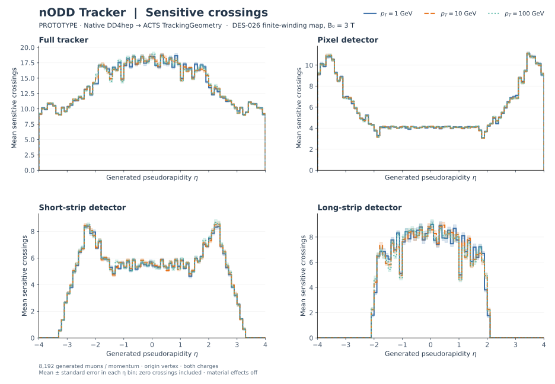

# Current tracker propagation in the 3 T solenoid map

**PROTOTYPE · 2026-10-23.** Current DES-025 DD4hep tracker → native ACTS
TrackingGeometry → ACTS EigenStepper/Navigator/PropagationAlgorithm. The field
map is generated from the current DES-026 finite, homogeneous-current-density
annular vacuum winding, as explicitly requested by the user. Detector geometry,
materials and design approval states are unchanged.



The [seven-system figure](sensitive-crossings-systems.svg) separates the native
DD4hep system IDs. [PDF overview](sensitive-crossings.pdf) and
[PDF system plots](sensitive-crossings-systems.pdf) are retained for export.
These are mean **sensitive-plane crossings**: individual pixel chips, overlaps
and both strip faces count separately. They are not reconstructed hits,
independent stations, tracking efficiency or detector performance.

## Measured sample

[study.json](study.json) fixes 8,192 muons at each of pT 1, 10 and 100 GeV,
uniform generated η in [−4,4], uniform full azimuth, origin vertex and seeded
random charge signs (seed 20261023). Directions and charges are paired across
momenta. Energy loss and multiple scattering are disabled. Each of the 80 η
bins has 79–131 generated probes. Zero crossings remain in the denominator;
shading is the population-profile standard error, not a field/model uncertainty.

| pT (GeV) | Full tracker | Pixel | Short strip | Long strip |
| --- | ---: | ---: | ---: | ---: |
| 1 | 13.9972 | 5.7948 | 4.4803 | 3.7220 |
| 10 | 14.0007 | 5.7877 | 4.5173 | 3.6957 |
| 100 | 14.0254 | 5.7906 | 4.5302 | 3.7046 |

These are means over the uniformly sampled η/φ population. The near-overlap of
the profiles is descriptive for this sample and field. No momentum-independent
performance claim follows.

All 24,576 generated probes have unique expected `(event_nr,track_nr=0)` entries
in particles, summaries and step tables. Requested pT is checked from the saved
initial momentum components. Every sensitive crossing maps through its exact
64-bit GeometryIdentifier to a DD4hep source system; seven-system sums equal
ACTS `nSensitives` for every probe. No missing probes, duplicate probe IDs,
repeated sensitive IDs or full-tracker zero-crossing probes were observed.
Short/long-strip zero-crossing probes are retained explicitly in the
[profile statistics](profiles.json) and compressed per-track evidence.

Every final step lies on the native outer World portal within 0.001 mm,
with world r≤1111.327337 mm and |z|≤4001 mm. This excludes step/path aborts.
Recorded trajectories plus a 50 mm full integration-step margin remain inside
the map's r≤1300 mm, |z|≤4200 mm support. This bounds intermediate step queries
for the current run; it does not assert accuracy outside the sampled domain.

The fresh conversion checks at all three momenta PASS: 45,646 unique
source-matched sensitive surfaces and 117 ACTS volumes. Systems 1–7 contain
6794,2506,2506,8064,4320,13968,7488 surfaces respectively. Per-case
`pt-…GeV-run.json` and `pt-…GeV-geometry-check.json` retain the complete accounting,
source/runtime binary hashes and geometry comparisons.

## Field and numerical scope

[field-report.json](field-report.json) retains the source hashes, winding
parameters and map checks. Eight Gauss radial sheets with 1,000 axial coils each
represent the retained uniform-J winding. The 131 × 421 RZ map uses 10 mm radial and
20 mm axial spacing, signed z and explicit mm/T units. Central Bz is 3 T.
At 149 selected tracker-domain positions the largest interpolation difference
from direct ACTS sheet evaluation is 0.305 mT; sampled doubled axial-coil and
radial-quadrature differences are 0.00343 mT and2.1×10⁻¹¹ mT. Independent
continuous-winding axis values also agree within the declared 1 mT check tolerance.
These are sampled numerical checks, not global error bounds or magnet qualification.
No ODD field-map substitution, iron return structure or conductor-margin claim
is included.

[Numerical diagnostics](controls/diagnostics.json) retain paired controls and
all affected source surfaces. Halving the maximum step to 25 mm changes no
per-system counts in 512 paired probes at any momentum. Halving map spacing
to 5/10 mm changes seven of 512 1 GeV probes (1.37%) by one crossing each, with zero changes
at 10 and 100 GeV. These forward probes (|η|≈2.9–3.8) lie close to pixel/strip
sensor edges: adjacent-step interpolation gives signed local edge clearances
that cross zero, with common-surface trajectory shifts of 0.029–0.066 mm.
The edge distances are diagnostic linear interpolations, not exact propagated
miss distances. The mean absolute change is 7/512 crossings per probe; affected control-bin means
change by up to 0.2 crossings. Four gains and three losses give a net full-tracker
mean shift of +1/512 crossings in that paired subset; this is not a claim of per-track map convergence. The diagnostic
status deliberately remains `DIFFERENCES_REQUIRE_REVIEW` so downstream users
inspect these effects before using fine acceptance differences.

An independent seed (20261024, 2,048 probes per momentum) completes with the same
identity/source/endpoint checks. Charge, eta-sign and eight-sector phi summaries
are retained as descriptive sampling checks; no exact detector symmetry is
assumed. Engineering, alignment, material, sensor response and reconstruction
uncertainties remain outside this crossing study.

## Reproduce and reuse

The [workflow instructions](../../../tools/tracker_propagation/README.md) provide
`make tracker-propagation`, `make tracker-propagation-controls` and
`make tracker-propagation-plot`. Native execution needs the verified node runtime
with its DD4hep-backed nODD Gen3 adapter and the isolated pinned unrooted environment.
Sampling, map, maximum-step and output settings are explicit; no shared ACTS
source/build or dependency installation is modified by this study.

To regenerate the figures from this Git evidence without ACTS:

```sh
python3 tools/tracker_propagation/restore_counts.py \
  --source docs/validation/tracker-propagation --output build/retained-tracker-propagation
make tracker-propagation-plot PROPAGATION_OUTPUT="$PWD/build/retained-tracker-propagation"
```

The plotter writes standard ROOT TProfiles plus per-track TTrees, validates
unrooted's TProfile and branch-profile means/variances against independent bin
sums, and exports SVG/PDF/PNG and self-contained interactive HTML. The native
step ROOT files, full surface arrays, text field map and regenerated profile
ROOT/HTML stay in ignored build outputs. Compressed counts and statistics here
are sufficient to recreate the profiles and plots.

Native execution source is `7f65054f1b8196eac989111334664af3a86c6295`; individual
reports distinguish generator, accounting and rendering script hashes. The
installed ACTS version reports the development placeholder `(999,999,999)`;
its binaries are identified by SHA256. Sister-source HEAD `555c66e71d0639665c2fa3d5574a0fe7f3f62cde`
had pre-existing dirty patches and was not rebuilt or modified. That source HEAD
is context, not proof of the installed binaries' exact source tree. DD4hep 1.38,
Geant4 11.4.3 and the required imports were checked after stale Spack setup/lock
fingerprints were reported. This is a measured supported-node reproduction,
not a claim that an arbitrary ACTS release or unverified node will run it.

The [separate PhysVal assessment](physval.md) reproduces the retained profiles,
native accounting and edge-flip controls at its exact review revision. The
[software assessment](software-review.md) preserves earlier defects and fixes.

An [end-to-end Make replay](replay.json) with 2,048 probes per momentum passed.
Every saved count-table field exactly matches the first 2,048 nominal probes,
and the regenerated field-map bytes are identical.
