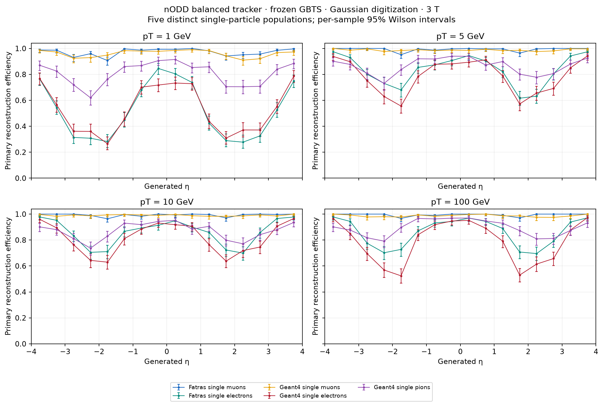
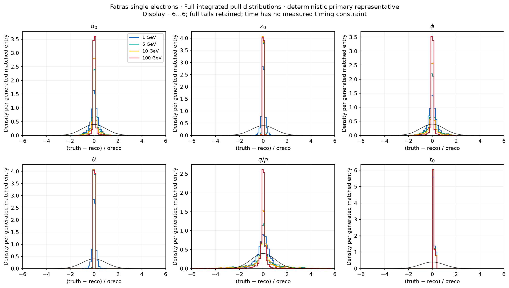
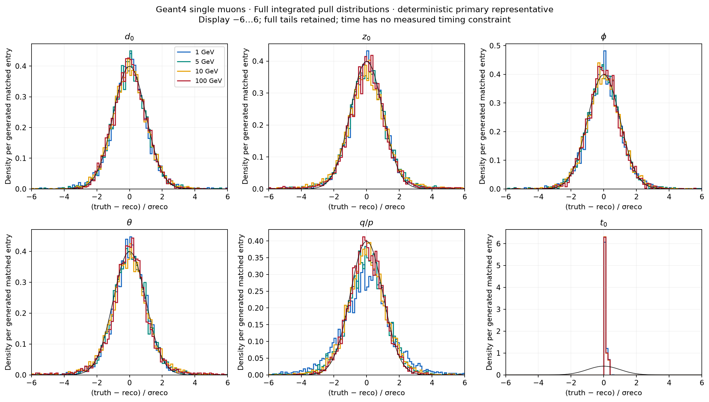
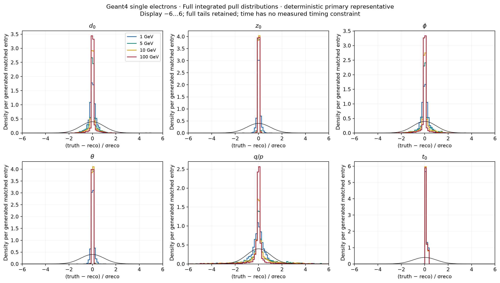
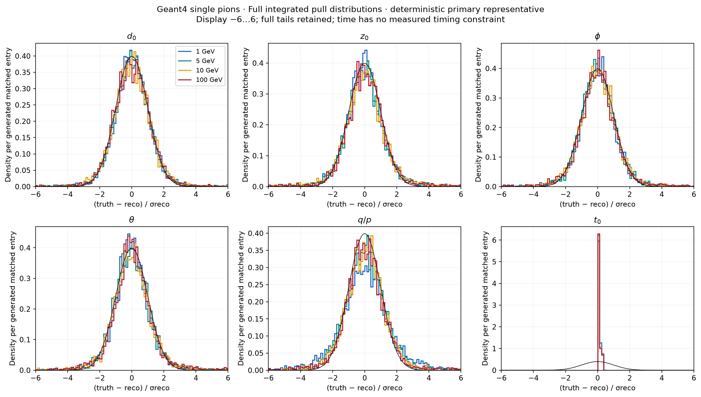

# Single-particle tracker reconstruction across transport models

DES041 DRAFT / isolated PROTOTYPE. Human expert review and acceptance remain pending.

The frozen `pt4-nominal-triplet` GBTS configuration reconstructs single muons, electrons and charged pions at pT 1/5/10/100 GeV on the maintained balanced PR104 geometry, at constant 3 T and uniform signed η∈[−4,4]. Frozen Gaussian digitization remains 2D for pixels/short strips and 1D for long strips. No species validation result enters seeder tuning.

The Fatras muon sample is the immutable original reference. Every table uses each sample's own generated-event denominator; species and transport populations are compared without statistical pooling or an assumption of paired events.

## Efficiencies and candidate categories

Efficiencies show 95% Wilson intervals. Conditional efficiency requires ≥6 unique sensitive sensors and ≥3 physical pixel groups; the nested four-group result is retained in JSON. Quality/matching are frozen at ≥7 unique inliers, valid reference/covariance, purity ≥0.5 and completeness ≥0.5. Every generated primary remains in the headline denominator.

| Sample | pT [GeV] | Efficiency [95% Wilson] | Conditional efficiency | Unmatched / accepted | Secondary matches | Duplicates after ambiguity | Wrong charge / matched |
|---|---:|---:|---:|---:|---:|---:|---:|
| Fatras single muons | 1 | 97.18% [96.68, 97.60] | 97.63% | 1/4860 | 0 | 0 | 0/4859 |
| Fatras single muons | 5 | 99.28% [99.00, 99.48] | 99.92% | 1/4965 | 0 | 0 | 0/4964 |
| Fatras single muons | 10 | 99.30% [99.03, 99.50] | 99.80% | 2/4967 | 0 | 0 | 0/4965 |
| Fatras single muons | 100 | 99.44% [99.19, 99.61] | 99.96% | 0/4972 | 0 | 0 | 95/4972 |
| Fatras single electrons | 1 | 51.72% [50.33, 53.10] | 58.29% | 109/2757 | 62 | 0 | 0/2586 |
| Fatras single electrons | 5 | 83.70% [82.65, 84.70] | 86.02% | 210/4849 | 453 | 2 | 27/4185 |
| Fatras single electrons | 10 | 86.18% [85.20, 87.11] | 87.63% | 229/5176 | 638 | 0 | 90/4309 |
| Fatras single electrons | 100 | 86.10% [85.11, 87.03] | 86.57% | 358/5633 | 967 | 3 | 520/4305 |
| Geant4 single muons | 1 | 96.10% [95.53, 96.60] | 96.18% | 18/4823 | 0 | 0 | 0/4805 |
| Geant4 single muons | 5 | 98.78% [98.44, 99.05] | 98.86% | 12/4951 | 0 | 0 | 1/4939 |
| Geant4 single muons | 10 | 99.06% [98.75, 99.29] | 99.14% | 9/4962 | 0 | 0 | 1/4953 |
| Geant4 single muons | 100 | 98.76% [98.41, 99.03] | 98.94% | 2/4940 | 0 | 0 | 92/4938 |
| Geant4 single electrons | 1 | 53.04% [51.65, 54.42] | 53.91% | 328/3083 | 102 | 1 | 1/2652 |
| Geant4 single electrons | 5 | 78.84% [77.69, 79.95] | 79.39% | 529/5149 | 676 | 4 | 38/3942 |
| Geant4 single electrons | 10 | 81.76% [80.67, 82.81] | 82.00% | 684/5713 | 939 | 2 | 84/4088 |
| Geant4 single electrons | 100 | 78.68% [77.52, 79.79] | 78.85% | 1310/7004 | 1759 | 1 | 523/3934 |
| Geant4 single pions | 1 | 80.66% [79.54, 81.73] | 90.80% | 38/4078 | 7 | 0 | 0/4033 |
| Geant4 single pions | 5 | 86.48% [85.50, 87.40] | 95.68% | 27/4389 | 38 | 0 | 0/4324 |
| Geant4 single pions | 10 | 87.02% [86.06, 87.92] | 95.98% | 39/4464 | 74 | 0 | 6/4351 |
| Geant4 single pions | 100 | 89.58% [88.70, 90.40] | 98.27% | 191/6113 | 1443 | 2 | 141/4479 |

Unmatched candidates are defined by the frozen double-matching rule and can include incomplete primary segments. Simulated-secondary matches remain separate from unmatched candidates; additional matches to a particle are duplicates. For interacting or decaying pions, primary efficiency refers to the original charged-pion identity and its own associated measurements. Daughter-only tracks do not count as a reconstructed primary. Mixed candidates can satisfy the frozen ≥50% primary-purity rule; daughter measurements are not reassigned to the primary identity. The analysis does not relabel a matched primary segment as a complete pre-interaction pion trajectory.

Candidate fractions retain event-block bootstrap intervals in [performance.json](performance.json); fake-event rates include exact one-sided 95% limits for zero observations. Single-particle fake rates do not establish dense-event or pile-up performance.

## Resolutions, bias and full distributions

One deterministic matched-primary representative supplies all six bound parameters. Residuals are truth−reconstruction, with wrapped φ. Central 68% means (q84−q16)/2; these descriptive widths have no claimed confidence interval. Bias and tail statistics retain every finite matched entry, including wrong-charge tracks. Nonfinite entries are separately counted. Relative momentum residual is (pT,true−pT,reco)/pT,true.

| Sample | pT [GeV] | Central d0 width / mean bias [µm] | Central z0 width / mean bias [µm] | Central relative pT width / mean bias | ≥10 inliers / all generated |
|---|---:|---:|---:|---:|---:|
| Fatras single muons | 1 | 52 / 2.24 | 78.7 / 3.76 | 0.59% / 0.17% | 94.58% |
| Fatras single muons | 5 | 19.2 / -0.314 | 30 / 2.72 | 0.67% / 0.04% | 97.32% |
| Fatras single muons | 10 | 13.5 / -0.24 | 20 / 1.62 | 0.68% / 0.02% | 97.52% |
| Fatras single muons | 100 | 7.01 / 0.0862 | 11.4 / 0.176 | 0.83% / -0.00% | 97.80% |
| Fatras single electrons | 1 | 82.8 / -2.98 | 134 / 2.09 | 4.57% / 1.34% | 42.30% |
| Fatras single electrons | 5 | 35.2 / -0.203 | 47.2 / -1.04 | 7.36% / 4.63% | 75.82% |
| Fatras single electrons | 10 | 30.9 / 0.966 | 39.4 / -0.937 | 10.20% / 3.89% | 79.58% |
| Fatras single electrons | 100 | 26.9 / -0.446 | 36.9 / -0.0418 | 102.93% / -184.30% | 82.30% |
| Geant4 single muons | 1 | 55 / -4.5 | 83.4 / 6.15 | 0.96% / -0.10% | 92.42% |
| Geant4 single muons | 5 | 19.3 / -0.462 | 34.1 / -0.19 | 0.70% / -0.06% | 96.16% |
| Geant4 single muons | 10 | 13.5 / 0.387 | 23.3 / -0.279 | 0.77% / -0.00% | 96.82% |
| Geant4 single muons | 100 | 6.94 / 0.364 | 11.3 / 0.655 | 0.88% / -0.07% | 96.40% |
| Geant4 single electrons | 1 | 67.9 / -1.01 | 105 / 5.71 | 3.80% / 1.19% | 45.98% |
| Geant4 single electrons | 5 | 37.5 / -1.3 | 45.7 / 1.3 | 7.18% / 4.25% | 72.56% |
| Geant4 single electrons | 10 | 32.5 / -1.52 | 41.8 / 1.61 | 10.81% / -16.98% | 75.88% |
| Geant4 single electrons | 100 | 27.9 / 0.459 | 37.6 / -0.3 | 82.04% / -544.22% | 74.90% |
| Geant4 single pions | 1 | 52.8 / 2.19 | 92.4 / 10.5 | 0.94% / -0.16% | 73.50% |
| Geant4 single pions | 5 | 18.9 / -0.313 | 35 / 2.94 | 0.79% / -0.02% | 79.74% |
| Geant4 single pions | 10 | 13.4 / -0.657 | 24 / -0.63 | 0.71% / -0.02% | 80.44% |
| Geant4 single pions | 100 | 7.48 / 0.723 | 11.6 / 0.808 | 0.88% / -0.37% | 83.64% |

The central table uses |η|<0.5. Full signed-η and all-acceptance distributions, mean/median biases, extrema, quantiles, d0/z0 tails beyond 100/1000 µm and relative-pT tails beyond 10/50/100% are retained in JSON. These thresholds describe tails and never select tracks.

Efficiency alone does not establish momentum or charge accuracy. At 100 GeV, Geant4 pions have 141/4479 wrong-charge representatives, 476 relative-pT errors beyond 50%, and 147 q/p pulls beyond 5σ (maximum absolute pull 130). These failures remain in every distribution; they are not confined to the far-forward acceptance.

The electron fit also needs further work: 100 GeV Fatras electrons have 520/4305 wrong-charge representatives and 2285 relative-pT errors beyond 50%. Their central |η|<0.5 relative-pT central68 width is 102.93%. Narrow electron pull cores coexist with these momentum failures; fitted uncertainties are not established as calibrated. This campaign benchmarks the frozen muon-selected reconstruction across species, without species-specific retuning.

The corresponding 100 GeV Geant4 electron sample has 523/3934 wrong-charge representatives and 2099 relative-pT errors beyond 50%, with central |η|<0.5 relative-pT central68 width 82.04%. These limitations affect both electron transport samples; a matched-primary efficiency is not a momentum-quality requirement.

Each pull panel overlays 1/5/10/100 GeV and integrates over the full η acceptance. The displayed range is −6…6; density uses the full finite-entry denominator, so overflow is not renormalized away. Arrays retain all tails; JSON records underflow/overflow, extrema and |pull|>3/5. Bound time is native ct[mm], converted to ns with 299.792458 mm/ns; without timing measurements its pull is prior dominated.

### Fatras single electrons

[Efficiency](figures/fatras/electron/efficiency.pdf), [resolution versus η](figures/fatras/electron/resolution-eta.pdf), [resolution versus pT](figures/fatras/electron/resolution-pt.pdf), [pull width versus η](figures/fatras/electron/pull-width-eta.pdf), [pull width versus pT](figures/fatras/electron/pull-width-pt.pdf), [momentum/hits/fake bounds](figures/fatras/electron/momentum-hits-fakes.pdf), [full pull-tail statistics](figures/fatras/electron/pull-tails.json).

### Geant4 single muons

[Efficiency](figures/geant4/muon/efficiency.pdf), [resolution versus η](figures/geant4/muon/resolution-eta.pdf), [resolution versus pT](figures/geant4/muon/resolution-pt.pdf), [pull width versus η](figures/geant4/muon/pull-width-eta.pdf), [pull width versus pT](figures/geant4/muon/pull-width-pt.pdf), [momentum/hits/fake bounds](figures/geant4/muon/momentum-hits-fakes.pdf), [full pull-tail statistics](figures/geant4/muon/pull-tails.json).

### Geant4 single electrons

[Efficiency](figures/geant4/electron/efficiency.pdf), [resolution versus η](figures/geant4/electron/resolution-eta.pdf), [resolution versus pT](figures/geant4/electron/resolution-pt.pdf), [pull width versus η](figures/geant4/electron/pull-width-eta.pdf), [pull width versus pT](figures/geant4/electron/pull-width-pt.pdf), [momentum/hits/fake bounds](figures/geant4/electron/momentum-hits-fakes.pdf), [full pull-tail statistics](figures/geant4/electron/pull-tails.json).

### Geant4 single pions

[Efficiency](figures/geant4/pion/efficiency.pdf), [resolution versus η](figures/geant4/pion/resolution-eta.pdf), [resolution versus pT](figures/geant4/pion/resolution-pt.pdf), [pull width versus η](figures/geant4/pion/pull-width-eta.pdf), [pull width versus pT](figures/geant4/pion/pull-width-pt.pdf), [momentum/hits/fake bounds](figures/geant4/pion/momentum-hits-fakes.pdf), [full pull-tail statistics](figures/geant4/pion/pull-tails.json).

## Primary transport outcomes and time limits

Native outcome codes are retained without removing events: Alive, KilledInteraction, KilledVolumeExit, KilledTime and KilledSecondaryParticle. `KilledInteraction` is the native outcome label and does not identify a particular hadronic interaction or decay process. Fatras can stop at its momentum threshold while retaining `Alive`; that label does not establish passage through the outer tracker. Missing primary records remain explicit. In the 5 GeV Fatras electron sample, events 3047 and 4270 reached the maximum propagation steps and lack final primary records; these are transport failures, not physical absorption, and both remain in the 5,000-event denominator. The immutable original Fatras muon sample lacks these extra outcome arrays; its outcomes are unavailable.

| Sample | pT [GeV] | Recorded primary / generated | KilledInteraction | KilledVolumeExit | KilledTime [95% Wilson] | Reconstructed given KilledTime | KilledTime final t range [ns] |
|---|---:|---:|---:|---:|---:|---:|---:|
| Fatras single electrons | 1 | 5000/5000 | 0.32% | 0.00% | 0.00% [0.00, 0.08] | — (0/0) | —…— |
| Fatras single electrons | 5 | 4998/5000 | 0.16% | 0.00% | 0.00% [0.00, 0.08] | — (0/0) | —…— |
| Fatras single electrons | 10 | 5000/5000 | 0.12% | 0.00% | 0.00% [0.00, 0.08] | — (0/0) | —…— |
| Fatras single electrons | 100 | 5000/5000 | 0.02% | 0.00% | 0.00% [0.00, 0.08] | — (0/0) | —…— |
| Geant4 single muons | 1 | 5000/5000 | 0.04% | 99.96% | 0.00% [0.00, 0.08] | — (0/0) | —…— |
| Geant4 single muons | 5 | 5000/5000 | 0.00% | 100.00% | 0.00% [0.00, 0.08] | — (0/0) | —…— |
| Geant4 single muons | 10 | 5000/5000 | 0.00% | 100.00% | 0.00% [0.00, 0.08] | — (0/0) | —…— |
| Geant4 single muons | 100 | 5000/5000 | 0.00% | 100.00% | 0.00% [0.00, 0.08] | — (0/0) | —…— |
| Geant4 single electrons | 1 | 5000/5000 | 20.26% | 78.94% | 0.80% [0.59, 1.09] | 2.50% | 25…26.5 |
| Geant4 single electrons | 5 | 5000/5000 | 10.10% | 89.74% | 0.16% [0.08, 0.32] | 12.50% | 25…25.4 |
| Geant4 single electrons | 10 | 5000/5000 | 7.88% | 92.00% | 0.12% [0.06, 0.26] | 0.00% | 25…25.4 |
| Geant4 single electrons | 100 | 5000/5000 | 2.78% | 97.22% | 0.00% [0.00, 0.08] | — (0/0) | —…— |
| Geant4 single pions | 1 | 5000/5000 | 23.26% | 76.74% | 0.00% [0.00, 0.08] | — (0/0) | —…— |
| Geant4 single pions | 5 | 5000/5000 | 20.12% | 79.88% | 0.00% [0.00, 0.08] | — (0/0) | —…— |
| Geant4 single pions | 10 | 5000/5000 | 19.60% | 80.40% | 0.00% [0.00, 0.08] | — (0/0) | —…— |
| Geant4 single pions | 100 | 5000/5000 | 19.90% | 80.10% | 0.00% [0.00, 0.08] | — (0/0) | —…— |

Per-pT and signed-η outcome rates and KilledTime final ct, radius and z distributions are retained in JSON. The configured Geant4 simulation limit is 25 ns and the kill boundary is the highest tracking volume. These limits remain part of the benchmark. Their causal contribution to inefficiency has not been measured with an uncut control, and the time limit is not established as unbiased for electrons.

## Model and validation boundaries

Geant4 uses FTFP_BERT and the detailed maintained DD4hep tracker, including charged secondary hits and particles without hits. Fatras and reconstruction use the retained role-transported effective ACTS material map, including the homogeneous added-disc approximation. Differences therefore include the existing material representations; this campaign does not establish a fresh Geant4 material map.

Fatras keeps its unchanged 0.5 GeV absolute-momentum cutoff and electromagnetic interactions. Its Bethe–Bloch ionization approximation is explicitly limited for electrons, and this electron sample is not precision electromagnetic-shower validation. Native electron hypotheses select the existing multicomponent bremsstrahlung-recovery CKF in one-way mode; muons and pions use ordinary two-way CKF. One-way electron processing avoids a demonstrated native reverse-state Jacobian FPE, without masking FPE checks. No separate GaussianSumFitter refit is scheduled.

Task-owned SafeFatras preserves the native Bethe–Heitler sampling and updates while avoiding demonstrated libm underflow traps: the loss expression exp(−u)−1 returns its binary64 rounded result +0 for 0≤u<2⁻⁵⁴ and −1 for u>40. Other exponents use the original expression. Sampling draws, parent/photon updates, numerical build flags and FPE checks are preserved. All 15,000 native event audits and all nine ROOT tree contents at 1/5/10 GeV are bitwise identical to the original same-seed runs that failed the final FPE gate. Those failed attempts and independent numerical/replay checks remain in [diagnostics](diagnostics/); the validated sample uses the passing guard implementation.

Gaussian response is species independent and unmerged. Electron showers and secondary-rich pion events do not include charge sharing or merging between nearby hits; comparisons therefore do not validate realistic shower digitization or dense-event reconstruction.

All new samples use the native uint32 maximum ambiguity iteration budget, with the original shared-hit threshold and minimum hit count. Independent replay requires every native survivor to have fewer than three shared measurements. The immutable muon Fatras reference used 1,000 iterations; its independent 20,000-event replay finds zero shared measurements among survivors and at most two initial candidates, so that cap was not limiting. A separate electron shower smoke exhausted the old limit, motivating this pre-validation computation-budget correction. GBTS settings and physics cuts are unchanged.

Source/config/runtime/input identities and actual native outcomes are retained in the run evidence. The historical field loaded_Geant4_version contains the observer header version; actual library hashes and CLI version identify the installed runtime. No claim is made that Geant4-internal floating-point exceptions are checked by ACTS event-algorithm FPE monitoring. Software checks and numerical results grant no human design approval.
