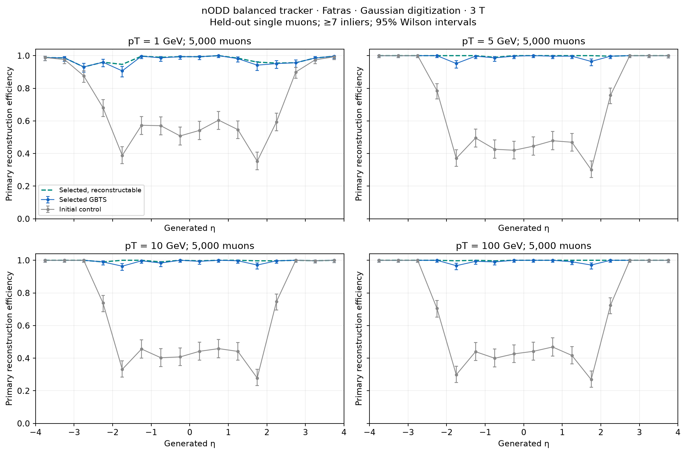
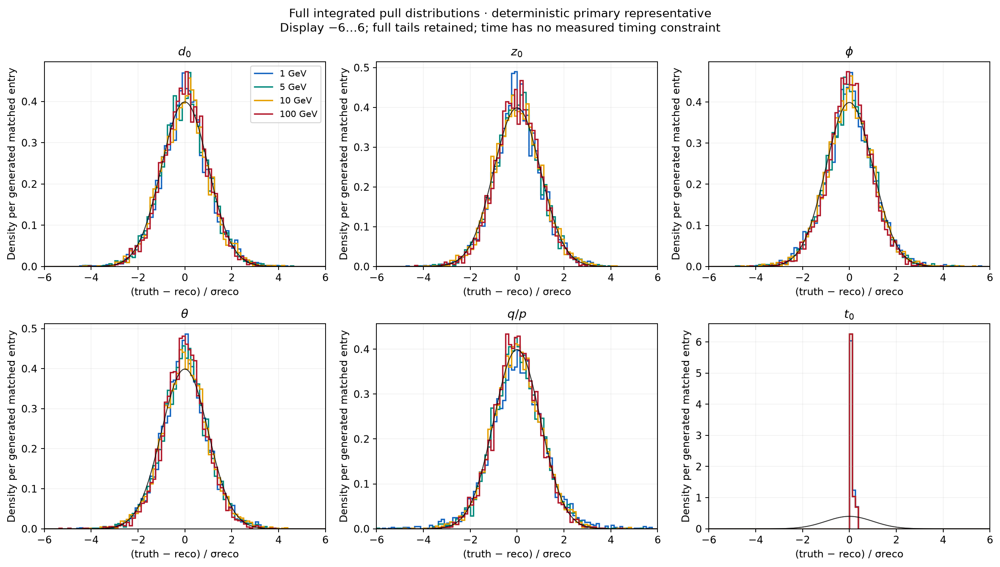
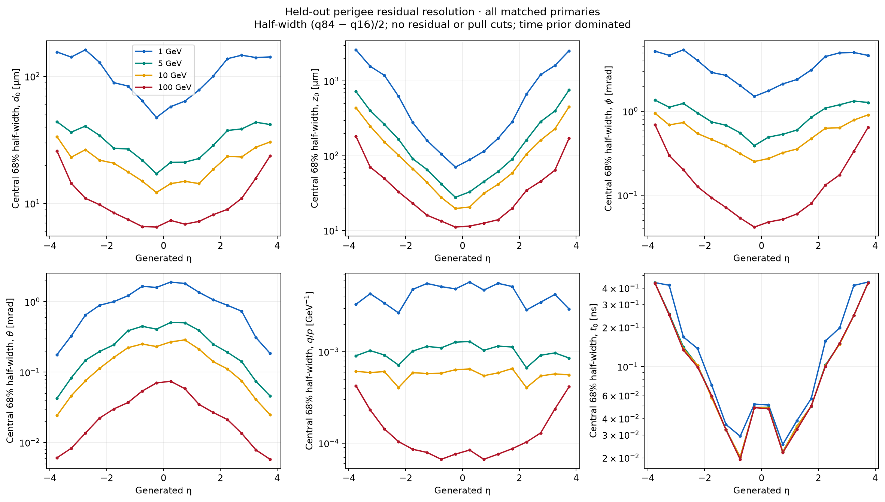

# Full tracker reconstruction with GBTS

DES041 DRAFT / isolated PROTOTYPE; 2026-10-30. Human expert review and design sign-off remain pending.

A native hit-based chain reconstructs single muons on the maintained balanced PR104 geometry: Fatras → frozen Gaussian digitization → measured pixel space points → ACTS Core GBTS → hit-based parameter estimates → two-way CKF using every tracker measurement → greedy ambiguity resolution. Constant 3 T, origin vertex, randomized charge, uniform signed η∈[−4,4] and full φ are unchanged. No truth momentum seeds, truth track grouping or primary-based hit filtering enter reconstruction.

The frozen `pt4-nominal-triplet` profile uses minPt 0.4 GeV, minSeedLevel 2, addTriplets, |η|4.1 triplet recovery and disables the optional innermost z0 histogram. Nominal tau cuts remain 0.007 / 0.009 / 0.006. The full 13-profile scan, adverse outcomes and initial nODD adapter control are retained. The histogram amendment was diagnosed using 10 smoke events before the 500-event tuning scan. The control already shares the nODD study overrides (3 T, minPt 0.5 GeV, |η| ≤ 4.1 and z0 ±15 mm); it preserves the stock optional histogram and remaining GBTS cuts. Exact effective settings are retained in each native report. The amendment changes an optional reconstruction cut; geometry, material and response remain fixed.

## Independent validation

One profile was frozen at 780edf14acd16e5bed9e3f77545308e649f3eef8 before validation. Final native runs launched at 0e3b921 (full source SHA in retained reports), with 5,000 events per momentum and fresh seed 123042. The initial 103042 attempt aborted on an optional ROOT-state-writer FPE and was quarantined. A separate 113042 diagnostic isolated that writer. The replacement native observer retains state parameters/variances; ROOT summaries and measurements remain. No FPE mask/check or scientific reconstruction cut changed. The fresh validation plan was frozen before launch; no held-out result entered tuning.

| pT [GeV] | Initial control efficiency | Selected efficiency (95% Wilson) | Conditional efficiency | Unmatched / accepted | Wrong charge / matched |
|---:|---:|---:|---:|---:|---:|
| 1 | 69.28% | 97.18% [96.68, 97.60] | 97.63% | 1/4860 | 0/4859 |
| 5 | 68.58% | 99.28% [99.00, 99.48] | 99.92% | 1/4965 | 0/4964 |
| 10 | 67.04% | 99.30% [99.03, 99.50] | 99.80% | 2/4967 | 0/4965 |
| 100 | 66.34% | 99.44% [99.19, 99.61] | 99.96% | 0/4972 | 95/4972 |

Headline efficiency includes **all generated muons**, including no-hit, no-seed and no-output events. The conditional denominator requires ≥ 6 unique sensitive-sensor measurements and≥3 physical pixel groups; the nested ≥ 4-group denominator is also retained. Accepted tracks require≥7 unique inliers, reference surface, finite parameters/χ², positive ndf and positive-definite covariance. Matching requires unique-inlier purity ≥ 0.5 and completeness ≥ 0.5 against all original associated measurements. Simulated-secondary matches are separate; none were observed.

After ambiguity resolution there are no duplicate candidates. Before ambiguity resolution, 24 duplicate candidates at 1 GeV and 5 at 100 GeV are retained; seven-measurement/reference/covariance quality rejects are separately counted. Every completed CKF output and ambiguity survivor is retained; native propagation failures without output objects are not exact candidate/fit-error counters.

The four unmatched candidates are pure-primary partial tracks failing completeness: 8/19 at 1 GeV, 7/15 at 5 GeV, and 8/18 plus 8/17 at 10 GeV. They count as fakes under the frozen double-matching convention; they are not evidence of mixed-origin combinations. At 100 GeV, 0/5,000 fake events gives an exact one-sided 95% upper limit 0.0599%. Nonzero fake-event intervals and event-block bootstrap candidate fractions are retained per momentum. Repeated tuning cases and paired control/momentum samples are not pooled into independent trials. This single-muon benchmark does not establish high-occupancy or pile-up fake rates.

## Resolutions, pulls and remaining limitations

One deterministic representative per primary supplies all six perigee parameters: most inliers, then lowest χ²/ndf, then stable track index. Residuals use truth−reconstruction and wrapped φ. Every residual/pull tail is retained in compressed numerical arrays; plots show a stated finite display window without renormalizing away overflow. Time uses native ct[mm] in arrays and ns on public axes. With no measured timing, its prior-dominated pull is not a detector timing-resolution measurement.

| pT [GeV] | d0 central 68% [µm], abs(η) < 0.5 | z0 central 68% [µm], abs(η) < 0.5 | Relative pT central 68%, abs(η) < 0.5 | ≥10 inliers / all generated |
|---:|---:|---:|---:|---:|
| 1 | 52.01 | 78.71 | 0.592% | 94.58% |
| 5 | 19.21 | 29.99 | 0.669% | 97.32% |
| 10 | 13.54 | 20.01 | 0.680% | 97.52% |
| 100 | 7.01 | 11.35 | 0.834% | 97.80% |

Central 68% is (q84−q16)/2, not a fitted Gaussian width. These resolution points are descriptive; no bootstrap confidence interval on widths is claimed. Full signed-η and momentum dependence, pull widths, full integrated pulls, hit multiplicity and fake-event upper bounds are linked below.

At 1 GeV the q/p pull has population SD 1.766 and 60/4,859 entries beyond 5σ; its central peak alone would hide those tails. Frozen measurement errors were not rescaled. At 100 GeV, 95/4,972 matched tracks (1.91%, 95% Wilson 1.57–2.33%) have wrong charge, concentrated in the far-forward region; 390 have |ΔpT/pT|>50%. Such tracks remain matched and in the uncut residual/pull distributions. Improved seeding efficiency does not remove the forward momentum/charge limitation. No further tuning used this validation sample.

[Resolution versus pT](figures/resolution-pt.pdf), [pull width versus eta](figures/pull-width-eta.pdf), [pull width versus pT](figures/pull-width-pt.pdf), [momentum/hits/fake-event bounds](figures/momentum-hits-fakes.pdf), and [uncut-tail statistics](figures/pull-tails.json).

## Provenance and reproducibility

- Maintained 46,250-sensor/120-volume Gen3 geometry; 12,410 pixel sensor planes map to 24 signed logical pixel layers, including physical endcap order 1,2,10,3,…,9. All 176 outward physical layer links are geometry-derived and eta-pruned by ACTS; no ITk table or truth-trained connection sample is substituted.
- The existing PR104 effective material prescription and PR101 pooled Gaussian widths are remapped by physical role/donor. Material-map, width and digitization payloads reproduce the retained balanced confirmation exactly. Added disks retain the approved homogeneous downstream approximation; this is not a fresh Geant4 map.
- Installed matching ACTS source 355ea68493b326956756c9386d2fd9eaf9328568, actual Core/Framework/example libraries, sidecars and all five DD4hep factory libraries are fingerprinted. Current external development HEAD is not runtime provenance. Native source/config/input/library checks run at launch and close. Source preflight still warns about changed setup/lock fingerprints and unverified full DD4hep/G4 source; no shared dependency or source was installed/modified.
- Native audit verifies the CKF subset contains every measurement. Independent reduction checks all seven systems, 2D systems 1–5 / 1D systems 6–7, exact frozen native double variances and exact float32 measured-local→global pixel SP coordinates. ROOT persistence is cross-checked separately at float32.
- All 52 tuning cases and 8 final validation cases retain run metadata/hashes, one array entry per generated muon, rates/intervals, full uncut residuals/pulls, seeds, stage and matching diagnostics. Raw ROOT/event-state files stay ignored under build/tracker-reconstruction; their hashes and compact numerical outputs are retained here. Summary gzip decompression preserves original bytes and frozen input fingerprints.

Use the [execution and replay guide](../../../software/analysis/tracker_reconstruction/README.md). [DES041](../../design/DES-041-tracker-gbts-reconstruction.md), [frozen selection](frozen/selection.json), [final validation campaign](frozen/validation-campaign.json), [numerical performance](performance.json), [native tuning reports](native-tuning-reports.json.gz), [native validation reports](native-validation-reports.json.gz) and [artifact manifest](manifest.json) define this result. Separate role assessments and all failed attempts/corrections are recorded in the paired project journal. Native/synthetic checks and software review are not human sign-off.
