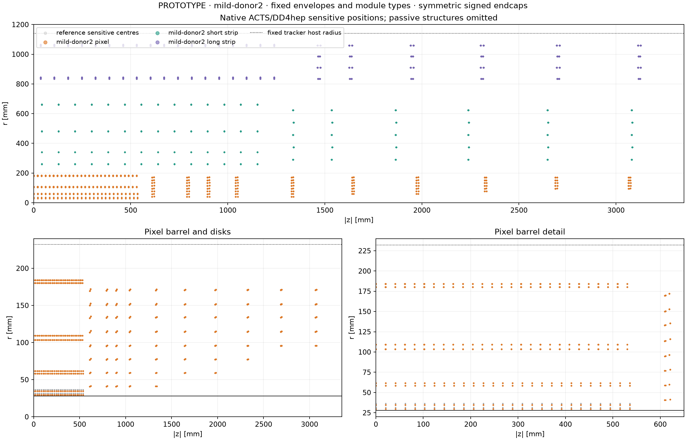
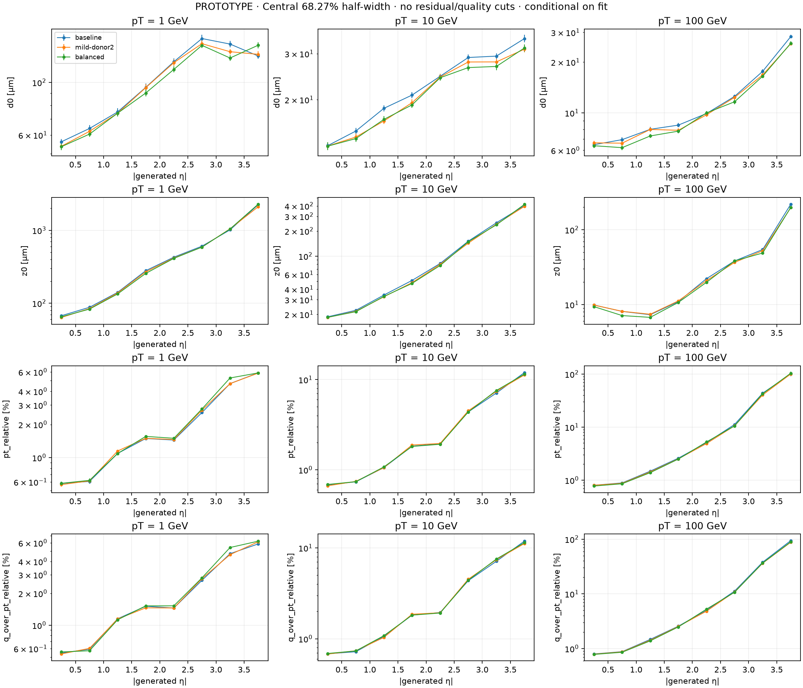
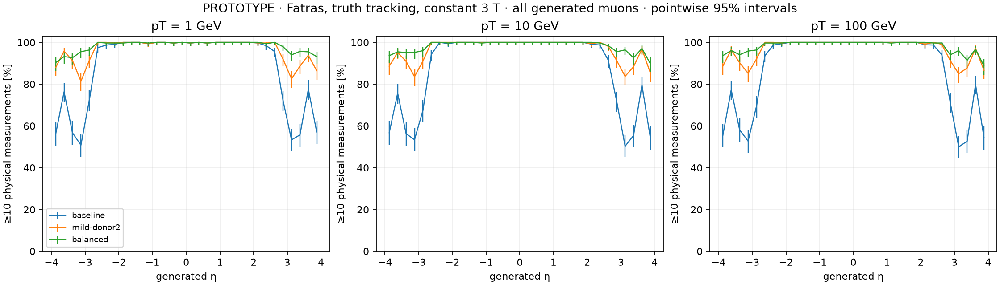
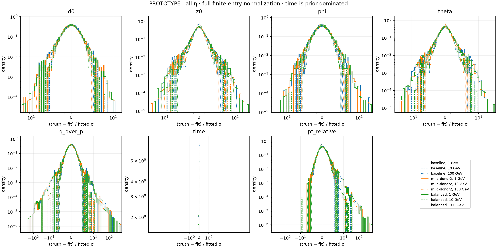

# Tracker resolution optimisation — constrained prototype

The study identifies useful tradeoffs, but **no tested layout satisfies every
objective**. The mild candidate is the preferred starting point under the
requested geometric response: it improves global impact-parameter core widths
and increases ten-hit coverage from about88% to97%. Its Gaussian cross-check
has a resolved1GeV momentum regression. Forward holes and large high-momentum
residual tails remain. No production geometry is changed or recommended for
acceptance by this numerical study.

Governed by [DES040](../../design/DES-040-tracker-resolution-optimization.md),
[issue103](https://github.com/asalzburger/nodd/issues/103) and
[PR104](https://github.com/asalzburger/nodd/pull/104), following merged PR101.
All numerical findings below are **FACTS of the retained simulation**, not
claims about an engineered detector. Candidate placements are **NODD DESIGN
CHOICES**; their physical rationale and rejected alternatives are in DES040.
The interpretation and preference are **INFERENCES** limited by this experiment.

## Experiment and source identities

Native Gen3 geometry, Fatras and the unchanged PR101 truth-associated Kalman
chain use a constant3T field, origin single muons, random charge, full phi and
uniform generated eta in[-4,4], at pT1/10/100GeV. The primary response is geometric:
50µm ×50µm pixels, unchanged short-strip module design, one measured coordinate
per long-strip face. The frozen PR101 cluster-size error table is remapped by
physical system/layer; the Gaussian cross-check uses the frozen pooled table.
New disks inherit the named donor layer. No error retraining or pull rescaling.

There are48,000 exploratory events (24cases ×2000) and300,000 confirmation
events (30cases ×10,000). Development100-event smoke/control runs are separate.
Seed42042 explores; seed52042 confirms baseline/mild/balanced in both responses;
seed62042 separately confirms baseline/late-disk in both responses. The late
schedule was registered before reading any52042 residuals. All layouts were
frozen before confirmation analysis; no confirmation-driven retuning occurred.
Generated truth arrays match exactly within each comparison, enabling paired
event bootstrap despite geometry-dependent transport random streams.

Native confirmation code was frozen at`e80f9826e085f3cd0ccca38e6c5b67215cf9f634`
(the same executed source hashes are recorded by later launches). Reduction
source is`9873280239728ebaceb1f72387b70484a2382f5e`; complete data/figure evidence
was pinned at`4c0910045a40869ec4af9b3b0fcf2eb6a8a757ec`; display-only axis
tick spacing was refined at`171cd0f8a7a3287d28262226f33fc0598336f43e` from the
same numerical data. Adapter revision is
`530080cfe16c7513228bf60238b99d4b9938538a`, compiled ACTS is
`355ea68493b326956756c9386d2fd9eaf9328568`, ROOT6.40.04, native Python3.14.5.
The changed Spack setup fingerprints were warned about; actual runtime imports,
factory hashes and native execution were verified. Each portable report retains
source, binary, compact, map, calibration and ROOT-output fingerprints.

## Candidate geometry

All variants preserve subsystem envelopes, module types and local stave
structures. Strip placements remain fixed. The added disk is mirrored, so the
exception adds one disk per end. Every physical pixel/short-strip measurement
counts once; each distinct long-strip face counts once.

| Candidate | Pixel barrel nominal radii [mm] | Pixel disk datums | Staves |
| --- | --- | --- | --- |
| Reference |34 /60 /106 /182|615 /795 /1046 /1333 /1645 /1977 /2328 /2692 /3070mm per end|12 /22 /18 /30|
| Mild, donor2 |32 /60 /106 /182|Reference nine, plus900mm|Reference|
| Balanced |31.5 /57 /96 /182|615 /865 /1115 /1333 /1565 /1780 /2090 /2440 /3070mm, plus950mm|Reference|
| Late-disk control |31.5 /57 /96 /182|Balanced nine, plus2900mm|Reference|

The figure shows native sensitive centres, with both ends folded into|z|;
passive structures are omitted. The full compacts, not the drawing, define
clearances and overlap checks.

## Primary geometric results

Ratios are candidate/reference central68.27% half-widths, integrated over all
eta and conditional on valid fitted parameters. Coverage includes every
**generated** event, including zero-hit and selection failures. The existing
seven-hit fit threshold is unchanged. Values are in pT order1/10/100GeV.

| Layout | ≥10 hits [%] | d0 width ratio | z0 width ratio | Relative-pT width ratio |
| --- | --- | --- | --- | --- |
| Reference |88.09 /87.73 /87.74|1 /1 /1|1 /1 /1|1 /1 /1|
| Mild |96.53 /96.65 /96.83|0.967 /0.949 /0.976|0.963 /0.935 /0.955|1.015 /1.009 /0.956|
| Balanced |98.20 /98.28 /98.18|0.954 /0.931 /0.947|0.965 /0.955 /0.906|1.056 /1.025 /0.988|
| Late, separate seed |94.77 /94.28 /94.18|0.942 /0.967 /0.942|0.954 /0.962 /0.948|1.010 /1.003 /0.957|

Late ratios use their own fresh baseline, whose coverage is87.59 /87.04 /87.21%.
They are not paired against the52042 samples. Exact absolute widths, biases,
full SD/RMS,95% paired bootstrap intervals and regional exceptions are in
[the complete tables](confirmation-tables.md) and retained CSV below.

For mild, global geometric d0 widths improve by2.4–5.1% and z0 by3.7–6.5%.
The100GeV d0 interval still includes unity. Relative-pT width ratios at1/10GeV
have95% intervals[0.983,1.044] and[0.980,1.041];100GeV gives
0.956[0.906,0.996]. No half-unit absolute-eta bin has a relative-pT interval
entirely above unity in this primary comparison. This is statistical
compatibility, **not a proof of momentum noninferiority**: no tolerance was
registered and these pointwise intervals omit material/response systematics.

Balanced is rejected as a combined-objective solution: its1GeV relative-pT
ratio is1.056[1.025,1.089] and signed-curvature ratio1.049[1.013,1.075]. At
|eta|3–3.5, the ratios are1.125 and1.144; at|eta|3.5–4, d0 worsens by11.0%
[4.8%,19.4%]. More ten-hit events do not imply better fitted resolution.
The late control also has1GeV forward d0/curvature regressions.

The literal ten-hit-everywhere target remains unmet. Worst signed quarter-unit
eta-bin fractions for mild are81.35 /83.60 /84.94%, for balanced90.27 /89.73 /
88.70%, and for late74.22 /72.36 /73.61%. Joint eta/phi coverage and hit-count
histograms remain in every reduced matrix. A global fraction does not certify
every trajectory or a simultaneous acceptance bound.

## Cross-check and tails

Gaussian response confirms global impact-parameter gains broadly, but mild's
1GeV relative-pT ratio is1.040[1.005,1.066], with signed q/pT ratio
1.027[1.0004,1.054]. Its highest-eta d0 also worsens at1GeV. Balanced shows
larger1GeV and resolved10GeV momentum regressions. Late has a10GeV global
curvature ratio1.034[1.005,1.068] and low-momentum forward regressions.
These prevent a response-robust combined-objective success claim. All regional
intervals entirely above unity are listed in the complete tables; the multiple
pointwise tests are diagnostics, not familywise hypothesis tests.

No residual/quality cuts or finite-tail removals are applied. At100GeV the
nonlinear pT inverse has very long tails: geometric full relative-pT SD is
1177% reference versus2652% mild (late949% versus7698% on its own seed).
The corresponding signed-curvature SD improves from42.27% to39.57% for mild,
but that does not erase the pT tails. Wrong-charge counts at100GeV are200/9999
reference,176/10000 mild,202/10000 balanced; late215/10000 versus209/10000.
These sample-sensitive full moments and charge errors are retained separately
from the central-width metric. Global core gains do not mean full-distribution
momentum preservation. Fit attempts all return tracks; every fit has finite,
positive6D covariance. Missing fits are the explicitly counted selection losses.

All six bound-parameter pulls use(truth−fit)/fitted sigma with wrapped phi;
pT pulls use the full theta–q/p covariance. Full and core views retain every
finite entry and explicit missing-fit counts. Time is prior dominated and does
not measure detector timing. The plotting scale includes its density peak.

## Mechanical and material qualification

Full native ROOT overlap/extrusion checks at1e-5mm find zero overlaps for
reference, corrected coverage candidate, balanced, mild and late compacts.
The initial coverage compact failed with13486 collector/rail conflicts; that
[failed evidence](coverage-native-overlaps.json.gz) is preserved. Disk-owned
collectors and all rail cutouts now follow their stations. The corrected
[coverage](coverage-corrected-native-overlaps.json.gz),
[balanced](balanced-native-overlaps.json.gz), [mild](mild-donor2-native-overlaps.json.gz)
and[late](late-disk-native-overlaps.json.gz) reports retain exact compact and
factory identities. These numerical checks do not qualify installation
allowances, cumulative cable connectivity, service capacity or thermal design.
Global service reference cells and fixed envelopes remain unchanged.

Native material and calibration keys are rebuilt by complete logical roles.
Per-bin area/count Jacobians conserve the declared effective X0/L0/areal-mass
inventories within3e-6; observed discrepancies are below2e-7. ACTS's actual
slab-combination code constructs the added homogeneous donor2 disk downstream
of every sensitive face on each end. Donor2 normal mean is about0.03082–0.03091X0 across the two ends;
donor1's0.1036X0 includes barrel-transition aggregate and was rejected before
native performance as an isolated-disk proxy. Native sensor material is cleared
to avoid double counting.

This is **effective-profile relocation, not a new Geant4 map**. Aggregated
transition material cannot be split into moved components. Curved supports,
extra collectors/rail slots and service inventory changes are not a new
component-resolved material calculation. Frozen calibration likewise does not
validate changed incidence. New component-resolved mapping, service design and
independent larger samples are necessary before proposing production integration.

## Retained evidence and reproducibility

[Execution/source tools](../../../software/analysis/tracker_optimization/README.md)
include isolated compact generation, native helper, map/calibration audits,
loss-accounted ROOT reduction, bootstrap, plotting and offline hash checks.
CI runs20 portable controls (one native-helper skip), audits all30 confirmation
cases and replays primary figures. The helper was separately exercised in the
activated native runtime. Analysis/export use uproot/NumPy/Matplotlib in the
isolated unrooted-compatible environment; no ROOT dependency is needed for replay.

| Comparison | Reduced data | Native report fingerprints | Figures | CSV tables |
| --- | --- | --- | --- | --- |
| Primary geometric |[data](confirmation-geometric.json.gz)|[reports](native-confirmation-geometric-reports.json.gz)|[PDF](geometric-figures/resolution_width68.pdf), [full SD](geometric-figures/resolution_std.pdf), [pulls](geometric-figures/pulls_full.pdf), [residuals](geometric-figures/residuals_full.pdf)|[performance](geometric-tables/performance.csv), [changes](geometric-tables/paired-changes.csv), [coverage](geometric-tables/coverage.csv), [pulls](geometric-tables/pulls.csv)|
| Gaussian |[data](confirmation-gaussian.json.gz)|[reports](native-confirmation-gaussian-reports.json.gz)|[resolution](confirmation-gaussian-figures/resolution_width68.pdf), [pulls](confirmation-gaussian-figures/pulls_full.pdf), [full SD](confirmation-gaussian-figures/resolution_std.pdf)|[performance](confirmation-gaussian-tables/performance.csv), [changes](confirmation-gaussian-tables/paired-changes.csv)|
| Late geometric |[data](late-confirmation-geometric.json.gz)|[reports](native-late-confirmation-geometric-reports.json.gz)|[resolution](late-confirmation-geometric-figures/resolution_width68.pdf), [pulls](late-confirmation-geometric-figures/pulls_full.pdf), [full SD](late-confirmation-geometric-figures/resolution_std.pdf)|[performance](late-confirmation-geometric-tables/performance.csv), [changes](late-confirmation-geometric-tables/paired-changes.csv)|
| Late Gaussian |[data](late-confirmation-gaussian.json.gz)|[reports](native-late-confirmation-gaussian-reports.json.gz)|[resolution](late-confirmation-gaussian-figures/resolution_width68.pdf), [pulls](late-confirmation-gaussian-figures/pulls_full.pdf), [full SD](late-confirmation-gaussian-figures/resolution_std.pdf)|[performance](late-confirmation-gaussian-tables/performance.csv), [changes](late-confirmation-gaussian-tables/paired-changes.csv)|

Exploratory evidence remains separate: [first five layouts](exploratory.json.gz),
[balanced](balanced-exploratory.json.gz), [no-addition/late controls](material-controls.json.gz),
[24 native reports](native-exploratory-reports.json.gz), [finite-patch screen](finite-screen-donor2.json)
and[all16000 proposals](finite-screen-donor2.trials.json.gz). Straight rays ignore
curvature/material and cannot establish tracking performance. The exploratory
coverage candidate reaches about99% but is rejected for forward resolution loss;
mechanically colliding compact-barrel alternatives were rejected before physics.

DES040 remains DRAFT. Separate SysArch and PhysVal assessments are recorded in
the task journal; neither is human engineering approval. The mild configuration
is a follow-up candidate under the geometric primary response, while the full objective remains
open. The production DES025 compact and all PR101 reference analyses are unchanged.
