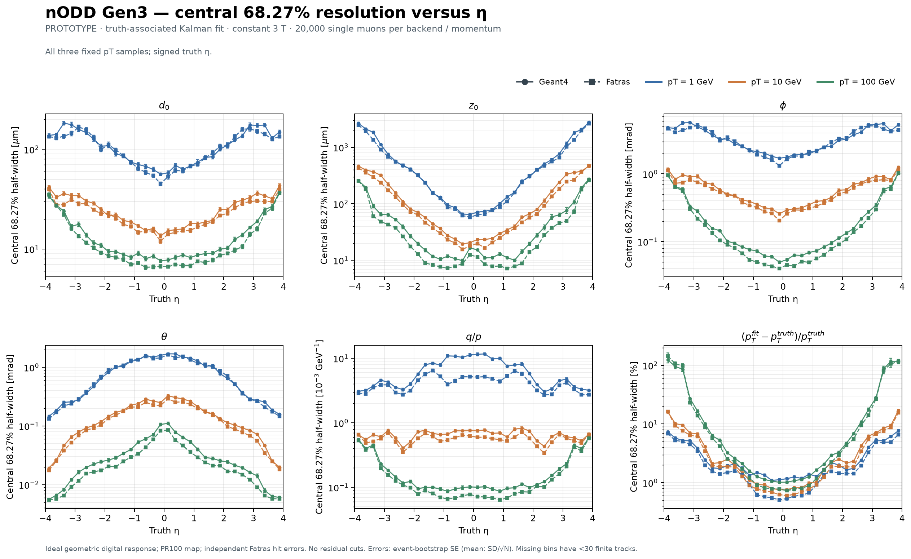
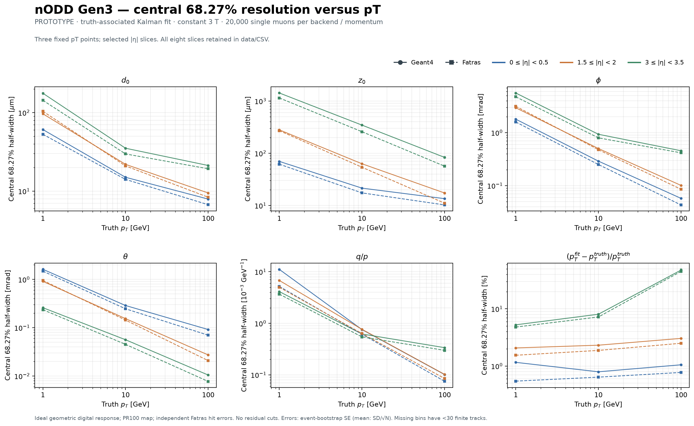
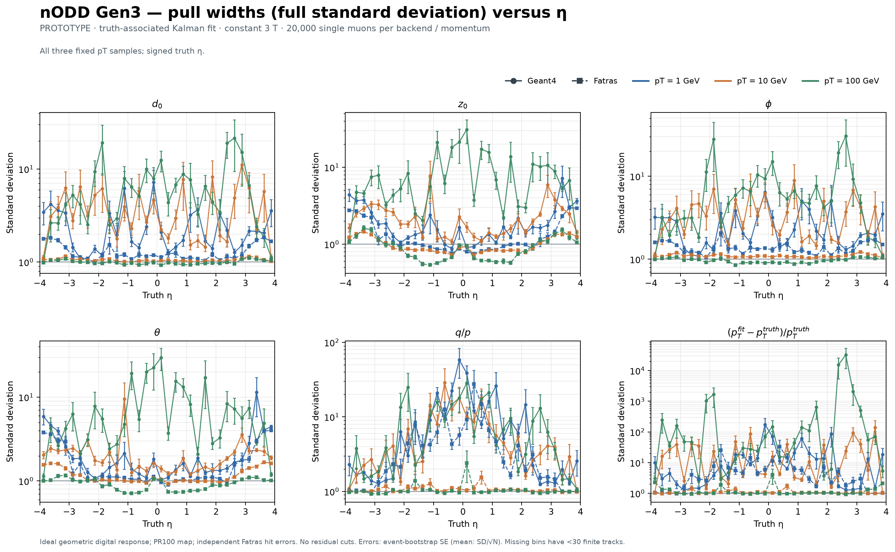

# Gen3 truth-associated tracking baseline

**PROTOTYPE / DRAFT — 2026-10-26.** This characterizes the exact Gen3 nODD
tracker and material map merged in [PR100](https://github.com/asalzburger/nodd/pull/100),
with the human-selected **constant 3 T** field. It follows
[DES025](../../design/DES-025-tracker-dd4hep-gen3.md),
[issue102](https://github.com/asalzburger/nodd/issues/102) and
[PR101](https://github.com/asalzburger/nodd/pull/101).
The requested ODD baseline here is that PR100 Gen3 tracker; upstream ODD surface
identities are incompatible with this map. No detector design acceptance is
inferred from this characterization.

## Observed result

All six cases completed. **119,982 / 120,000 generated muons** have finite fitted
parameters: 14 fail the seven-measurement selection and 4 selected Geant4 1 GeV
candidates fail fitting. No fitted covariance is invalid under the independent
five-parameter positive-definiteness check. Three native-unmatched partial fits
are included using the guarded seed association described below.

| Backend | pT [GeV] | Generated | Selected / attempted | Finite fits | Native Fake | Wrong charge |
| --- | ---: | ---: | ---: | ---: | ---: | ---: |
| geant4 | 1 | 20,000 | 19,998 | 19,994 | 1 | 16 |
| geant4 | 10 | 20,000 | 19,999 | 19,999 | 0 | 25 |
| geant4 | 100 | 20,000 | 20,000 | 20,000 | 1 | 560 |
| fatras | 1 | 20,000 | 19,992 | 19,992 | 1 | 0 |
| fatras | 10 | 20,000 | 19,998 | 19,998 | 0 | 0 |
| fatras | 100 | 20,000 | 19,999 | 19,999 | 0 | 467 |

Representative central values for **0≤|eta|<0.5** follow. Resolution uses the
central 68.27% half-width; uncertainties and all six quantities are retained in
the profiles. Pulls below are for pT; full SD includes every tail.

| Backend | pT [GeV] | d0 [µm] | z0 [µm] | Relative-pT resolution [%] | Pull central half-width | Pull full SD |
| --- | ---: | ---: | ---: | ---: | ---: | ---: |
| geant4 | 1 | 60.84 | 69.85 | 1.157 | 3.428 | 96.198 |
| geant4 | 10 | 15.01 | 21.50 | 0.791 | 1.186 | 8.665 |
| geant4 | 100 | 7.92 | 13.51 | 1.050 | 1.273 | 84.286 |
| fatras | 1 | 52.92 | 61.75 | 0.543 | 1.506 | 17.902 |
| fatras | 10 | 14.11 | 17.42 | 0.638 | 0.952 | 1.092 |
| fatras | 100 | 6.72 | 10.26 | 0.771 | 0.937 | 2.210 |

The core and tail diagnostics differ substantially. For central 1 GeV muons,
the |pT pull|>3 fraction is 35.76% in Geant4 and 10.23% in Fatras. At 10 GeV it
is 5.26% and 0.845%, respectively. These are observed model discrepancies,
not unit-pull validation; no clipping or pull tuning is applied. The mechanism
is not uniquely diagnosed by this campaign.

Forward high-momentum resolution degrades strongly in both simulations: at
100 GeV, central 68.27% relative-pT half-widths are 47.74% (Geant4) and 45.29%
(Fatras) for 3≤|eta|<3.5, and 113.54%/113.97% for 3.5≤|eta|≤4. In the latter
slice, 421/2529 Geant4 and 401/2529 Fatras fits have the wrong charge sign.
Large nonlinear pT tails coexist with better-behaved q/p pulls; full SD is a
finite-sample tail diagnostic, not a Gaussian resolution.

All **3,199,735 written measured-coordinate variances** match the frozen SD²
table exactly after ROOT float conversion, with all 90 trained volume/coordinate
pairs covered in every case. Both backends have identical generated truth at
each momentum; only simulation/reconstruction outcomes differ.

The requested [full all-eta pull distributions](pulls/README.md) now overlay
1,10 and100 GeV for every bound parameter, with truth-minus-reconstructed sign,
full finite tails and companion core views. Time is explicitly unmeasured.

## Configuration and interpretation

Each backend has 20,000 independent, one-muon events at each fixed transverse
momentum 1, 10 and 100 GeV: **120,000 performance events** in total. Charge is
randomized, eta uniform in [-4,4], phi uniform over the full azimuth, and the
vertex is the origin. Seed 42042 is shared across backends; generated samples
are checked by event/primary identity. Both transport and the fitter use the
same constant 3 T provider. The finite DES026 solenoid is not part of this test.

| Sensitive response | Physical pitch | Measured coordinates |
| --- | --- | --- |
| Pixels | 50 × 50 µm | loc0, loc1 |
| Short strips, DES007 C01 | 75 µm × 0.5 mm | loc0, loc1 |
| Long strips, DES008 C05 | 80 µm, one full-length along-strip bin | loc0 per actual sensor face |

All 45,646 sensitive sensors across seven subsystem IDs use geometric digital
cell-centre clustering: exact path-length charge, zero threshold, no added drift
or diffusion. Native 1D geometric measurements work with two physical
segmentation axes and only loc0 measured; the authorized smearing fallback is
therefore unnecessary. The physical face rotations supply long-strip stereo.
This ideal response does not emulate calibrated RD53 electronics.

Geant4 uses FTFP_BERT and detailed DD4hep physical material. Fatras transport and
both Kalman fits use the saved **65-portal / 8,550-bin** ACTS material map. The
original ACTS silicon/pipe/volume slabs are cleared before keyed map reloading,
avoiding double counting. Exact keys/grids are checked at runtime.

At least seven **unique physical measurements** select a generated primary.
The native truth-parameter extractor and zero-smearing seed stage provide the
true initial trajectory with finite covariance: location sigmas 1 mm, angular
sigmas 1 degree, q/pT term 0.1 GeV⁻¹, relative-pT term 0.1, unit variance inflation.
The native muon Kalman filter/smoother targets the origin perigee. This measures
truth-associated fit performance with ideal truth seeds; it does not measure
pattern recognition or CKF efficiency.

## Independent hit-error parameterization

A separate **50,000-event Fatras** sample uses seed 142042 and log-uniform pT
from 1 to 100 GeV, with the same geometry, field and digitization. Its **699,273
measurements** cover 52 sensitive volumes and 90 measured volume/coordinate pairs.
No training event enters performance profiles, and no track pull tunes errors.
Both backends use the same frozen [table](hit-error-parameterization.json).

The pinned ACTS script is named
[error_parameterisation.py](https://github.com/acts-project/acts/blob/355ea68493b326956756c9386d2fd9eaf9328568/Examples/Scripts/Digitization/error_parameterisation.py).
Its unchanged [raw output](hit-error-parameterization-raw.json) is preserved.
The script appends an exact cluster-size SD before pooling its final plotted
size group, while native lookup clamps all larger sizes to the final entry.
The audited table recomputes exact-size groups before that entry and the
pooled overflow group at it. All 106 groups were independently reproduced from
actual ROOT data; counts range 3,346–44,400 and no unsupported-tail merge was
needed. The largest correction, volume 38 loc1, is 0.01020946→0.03904524 mm.

The JSON field `rms` follows the upstream convention of **centered population
SD**, in mm. Bias and uncentered RMS are separately retained in the
[training audit](hit-error-training-audit.json). Native cluster merging replaces
earlier variance-map values, so an isolated post-cluster adapter applies SD²
once to measured marginal variances, retaining positions, dimensions, IDs and
associations. Output coordinates are checked exactly against that table after
ROOT float conversion. Incidence conditioning, coordinate correlations and
training uncertainty are not included.

## Metrics and retained figures

Native double matching requires at least 50% completeness as well as purity.
It labels three partial fits Fake and writes zero barcodes/NaN truth: G4 1 GeV
event 2129 (3/20 measurements), G4 100 GeV event 27 (7/19), and Fatras 1 GeV
event 17622 (11/23). They remain in **seed-associated** resolutions/pulls, using
the independently verified unique primary-derived input candidate and generated
truth. Selected ROOT barcodes/counts, one attempted candidate and track index 0
are checked; any nonzero conflicting native barcode is an error. Native Fake
counts/event IDs remain separate. Native matching efficiency and finite-fit
fraction are different quantities. This avoids a hidden completeness cut on
poor fits or tails.

Residuals are independently computed from generated origin truth and fitted
perigee d0,z0,wrapped phi,theta,q/p. Relative-pT residual is
(pTfit−pTtruth)/pTtruth. Its pull propagates the full theta–q/p covariance,
including the cross term and charge sign. Pulls require a finite, symmetric,
positive-definite five-parameter covariance. Residuals remain when covariance
is invalid; invalid cases and wrong-charge fits are counted.

Resolution is half the central empirical 68.27% interval. Full sample SD, RMS,
bias and median are also retained, without residual or pull cuts. Pull width
is the full sample SD (ddof1); it is not a Gaussian core fit. Event bootstrap
400 replicates supplies width/SD/RMS/median standard errors, mean SE is SD/√N,
and fractions use Wilson z=1 intervals. These are statistical uncertainties
conditional on the frozen table and detector model. Bins with fewer than 30
finite entries have null estimates.

Signed-eta bins have width 0.25. Momentum plots show |eta| ranges 0–0.5,
1.5–2 and 3–3.5; all eight half-unit |eta| slices remain in
[compressed profiles](profiles.json.gz) and the
[complete CSV](figures/performance-summary.csv).

Additional PNG/PDF/SVGZ figures in [figures](figures):
[pull widths versus pT](figures/pull_width_pt.png),
[pull means versus eta](figures/pull_mean_eta.png),
[pull means versus pT](figures/pull_mean_pt.png),
[full residual SD including tails](figures/resolution_std_eta.png), and
[generated-event attrition](figures/fit_fraction_eta.png),
and central 68.27% pull half-widths versus
[eta](figures/pull_width68_eta.png) and [pT](figures/pull_width68_pt.png).

## Source, execution and validation

Native source is frozen at 39cd5185d21a0ef47445023000c0381dc4b5360f for all six
performance cases. ACTS is 355ea68493b326956756c9386d2fd9eaf9328568; the compatible
nODD geometry adapter is 530080cfe16c7513228bf60238b99d4b9938538a. Actual source,
loaded library, factory, compact, map, table and output hashes are retained in
[portable native reports](native-run-reports.json.gz), with each original report
hash preserved and machine-local absolute paths omitted. Source-at-launch and
end-of-run Git inventory are distinct: metadata commits during execution do
not change the frozen native content hashes. Large ROOT outputs stay under
ignored build/truth-tracking-baseline directories.

Task-local adapters correct the pinned truth finder's second sim-hit-index
lookup and deduplicate primary/measurement pairs before selection, matching and
proto-track ordering. Complete measurement/sim-hit contributions remain for
truth averages. The unsafe original finder is excluded entirely; identical
native parameter-extraction/smearing stages are scheduled directly. Its legacy
count is an explicitly disabled zero sentinel in final reports. Four completed
first-pass cases and two Geant4 crashes from that reference algorithm are
[excluded controls](excluded-controls.json), never performance inputs.

An ordinary persistent Geant4 run avoids repeated cut-table initialization.
Each ACTS event still invokes one standard ProcessOneEvent/TerminateOneEvent,
with native per-event reseeding and event-store reset. A five-event
[standard/persistent comparison](lifecycle-equivalence.json) exactly matches
210 branches across particles, 95 hits, 80 measurements, tracks and event audits.
The separate [reference-removal comparison](reference-removal-equivalence.json)
checks all particle, measurement and track-summary branches in the three Fatras
samples and completed Geant4 1 GeV sample: before/after payloads agree exactly.
This bounded lifecycle comparison predates final association/covariance/reference-removal
changes and has an older observer identity; it is not a full final-executable
equivalence test. Static source review checks the final lifecycle contract.

The training report's observer/source end hashes describe later inventory,
not an executed observer-binary identity. Executed transport/digitization
libraries and Python startup hashes plus the training ROOT hash are retained.
Training measurement positions precede downstream observer/tracking operations;
all 106 training groups were numerically audited independently. Exact training
observer replay remains qualified.

Calibrated native reports retain a legacy native-default variance-description
string. The explicit error-table hash, post-cluster adapter and all-coordinate
audit describe the applied calibrated covariance. Native ROOT histogram-fit
warnings for unmeasured time are separate from Kalman track-fit failures.
Individual KF failure categories are unavailable at frozen WARNING verbosity;
failed event counts remain in the generated denominators.

All 25 analytic/native controls passed in the actual activated ACTS environment,
including wrong hit-index/duplicate controls, 1D segmentation, overflow SD²,
positive-definite covariance, pT cross-term propagation, wrapped phi and an
unsafe-finder scheduling guard. Portable CI checks retained source/table/count
identities and replays all ten figures; hosted CI does not rerun native
physics. See the [analysis guide](../../../software/analysis/truth_tracking/README.md)
and [native build/run guide](../../../software/source/ActsExamples/TruthTracking/README.md)
for exact reproducible commands.

Independent [PhysVal03](../../../logs/codex/SESSION-2026-10-26-truth-tracking-baseline/PhysVal-03-result.md)
reviewed exact scientific revision f7b14c60c8be613ce9165684d6ef03007ce1a456 and
found no blocking implementation, reduction or presentation finding for this
qualified prototype. It independently reproduced 17,712 scalar statistics
(maximum difference 7.28×10⁻¹²), all 3,199,735 measured variances, all 1,440 CSV
rows/21,600 numerical fields and 688 before/after branch pairs, and inspected
all ten original PNGs. The separate training/native assessment is retained in
[PhysVal02](../../../logs/codex/SESSION-2026-10-26-truth-tracking-baseline/PhysVal-02-result.md).
These technical assessments grant no human design acceptance.

## Limits and next comparisons

PR100 deliberately averages material into one phi bin and has substantial
intermediate material-location differences, despite close integrated totals.
Those approximations affect scattering/energy-loss placement and remain a
qualification of this baseline. Training-table and material-map uncertainties,
misalignment, luminous-region spread, dead channels, radiation damage and a
finite solenoid field are absent. Non-unit pulls diagnose this combined model;
there is no unit-pull acceptance threshold or tuning to achieve it.

This is a reproducible first truth-tracking characterization. More realistic
response, incidence-conditioned errors, material locality/phi studies and
pattern-recognition tracking remain separate follow-ups requiring new evidence.

The reviewer-requested [Gaussian-smearing Fatras cross-check](smearing/README.md)
uses total training-cluster widths to test the response independently of
geometric clustering and cluster-size error lookup.
