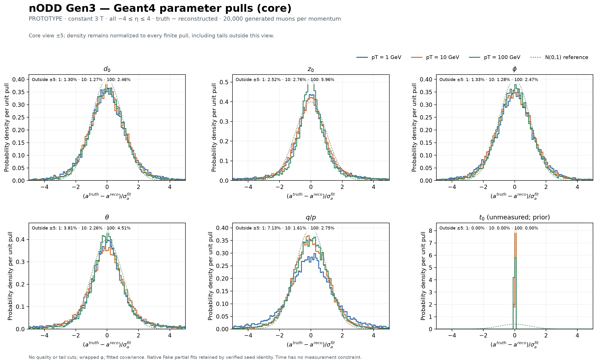
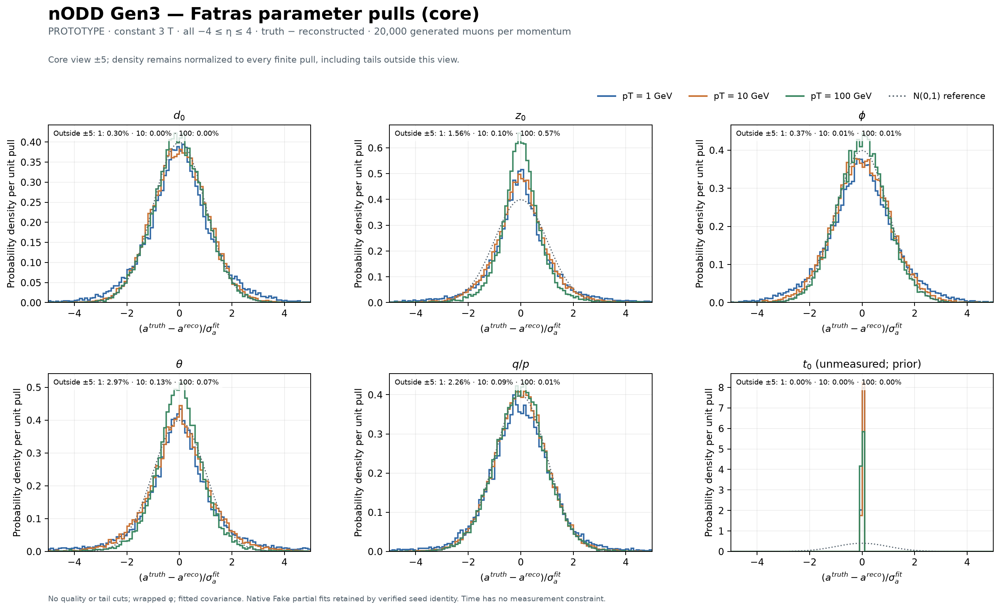
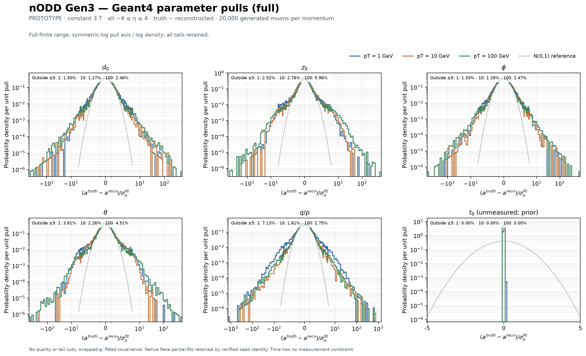
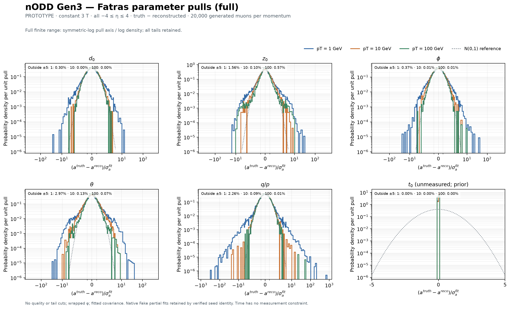

# Full all-eta pull distributions

**PROTOTYPE — 2026-10-26, PR101.** Each parameter overlays the 1, 10 and 100 GeV
muon samples, integrating the complete generated eta range **−4≤eta≤4**.
Geant4 and Fatras have separate panels/figures. The requested convention is

`pull(a) = (a_truth − a_reconstructed) / sigma_a_fitted`.

Phi uses the shortest wrapped angular difference. All six ACTS bound parameters
are included: **d0,z0,phi,theta,q/p,t0**. Derived pT is shown separately, with
its uncertainty propagated through the full theta–q/p covariance. The earlier
[eta/pT profiles](../README.md) retain their original reconstructed-minus-truth
sign; these new distributions explicitly reverse that convention.

## Distributions

The conventional **±5 views** show shapes and a standard-normal reference:

The **complete finite-range views** retain every observed tail, using a
symmetric-log pull axis and logarithmic density:

Derived pT: [core](figures/pulls_pt_core.png) and
[full range](figures/pulls_pt_full.png). Each figure also has a PDF and SVGZ
export in [figures](figures). The dotted N(0,1) curve is a reference, not a fit
or an acceptance test.

**Time is not measured in this baseline.** Its narrow t0 distribution reflects
the unconstrained seed/fitter prior and propagation. It is included for
completeness and must not be interpreted as detector timing resolution.
Generated vt, fitted eT and cov_eT_eT use compatible native ACTS length units
(ct/mm) in the pinned ROOT writers; the units cancel in the dimensionless pull.

## Counts and normalization

| Backend | pT [GeV] | Generated | Fitted / finite in each histogram | Native Fake retained |
| --- | ---: | ---: | ---: | ---: |
| Geant4 | 1 | 20,000 | 19,994 | 1 |
| Geant4 | 10 | 20,000 | 19,999 | 0 |
| Geant4 | 100 | 20,000 | 20,000 | 1 |
| Fatras | 1 | 20,000 | 19,992 | 1 |
| Fatras | 10 | 20,000 | 19,998 | 0 |
| Fatras | 100 | 20,000 | 19,999 | 0 |

All **119,982 fitted tracks** have finite parameters and positive-definite
full six-parameter covariance, and enter each of the seven distributions.
The 14 selection losses and 4 failed fits remain in the campaign denominator;
no pull is defined for them. The three native Fake partial fits retain their
independently verified primary-derived seed association, as described in the
[parent report](../README.md).

There are **42 histograms**, with zero nonfinite entries, underflow and overflow.
Per-quantity bin edges are shared across all six samples: width 0.1 inside ±5,
then 16 logarithmic bins/decade, extending beyond the largest finite absolute
pull. Density is `count / (all finite entries × bin width)`, so each full
histogram integrates to 1. The core view uses the same density normalization;
it does not renormalize away tails. Each panel states its fraction outside ±5.

The complete [bin counts and provenance](distributions.json.gz) and
[42-row summary CSV](figures/pull-summary.csv) retain counts, means, full sample
SD, central 68.27% half-widths, minima/maxima and tail counts. No quality or tail
cut is introduced. The largest derived-pT pull is about 806,908 in Geant4 100 GeV;
it remains in the full histogram and moments. Full SD is a finite-sample tail
diagnostic, not a Gaussian core width.

## Reproduction and assessment

The original six simulation outputs, frozen hit-error table and independent
50k Fatras training sample are unchanged. No new simulation or error tuning is
performed for these histograms. The exporter repeats strict native file/hash,
primary-identity, fitted-track and covariance checks before histogramming.

~~~sh
build/truth-tracking-baseline/analysis-venv/bin/python \
  software/analysis/truth_tracking/export_pulls.py \
  --input build/truth-tracking-baseline \
  --output docs/validation/truth-tracking-baseline/pulls/distributions.json.gz

build/truth-tracking-baseline/analysis-venv/bin/python \
  software/analysis/truth_tracking/plot_pulls.py \
  --data docs/validation/truth-tracking-baseline/pulls/distributions.json.gz \
  --output docs/validation/truth-tracking-baseline/pulls/figures
~~~

[Display binning configuration](../../../../software/analysis/truth_tracking/pulls_config.json)
is configurable. Exporter/helper/configuration and native source/output hashes
are retained in the compressed data. Offline CI checks source identities,
cohort consistency, exact bin-count closure, normalized variable-bin density,
all-parameter coverage and full finite-tail containment before replotting.
Four analytic controls check truth-minus-fit/wrapped-phi/time signs, invalid
six-dimensional covariance, extreme-tail/missing-value accounting, and
unequal-bin density normalization.

Independent fixed-revision histogram assessment is pending. The prior
[PhysVal03 assessment](../../../../logs/codex/SESSION-2026-10-26-truth-tracking-baseline/PhysVal-03-result.md)
covers the original six-run baseline. Ideal response, mapped-material locality
and phi averaging, omitted training/model uncertainty and ideal truth-seed
qualifications still apply. No detector acceptance is granted.
