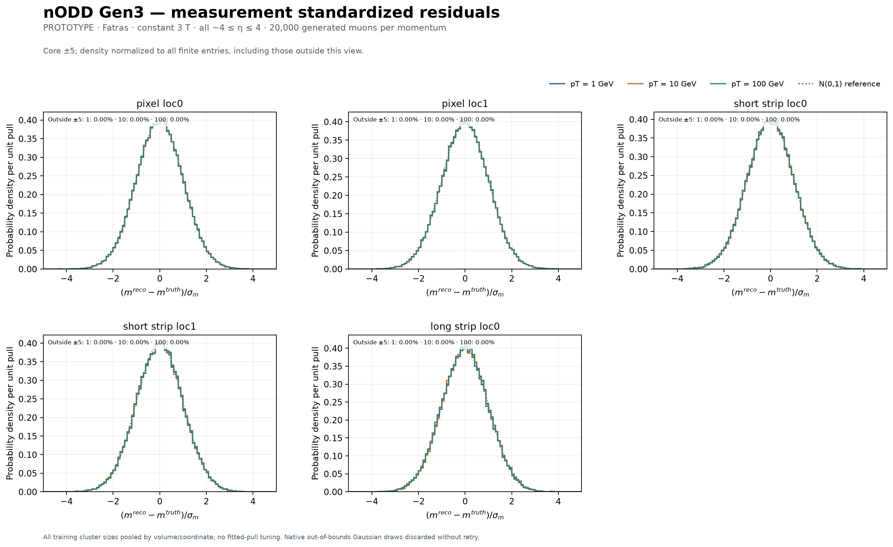
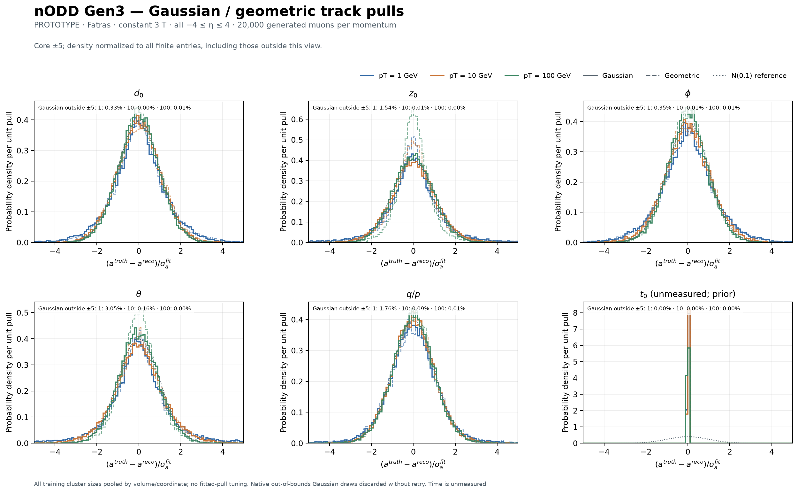

# Fatras Gaussian-smearing cross-check

**PROTOTYPE — PR101, 2026-10-26.** The
[reviewer request](https://github.com/asalzburger/nodd/pull/101#issuecomment-6419397508)
asks whether the original digitization uses cluster-size-dependent measurement
errors, and requests a Gaussian-smearing Fatras comparison.

**Yes:** the original geometric baseline uses the frozen
[cluster-size parameterization](../hit-error-parameterization.json), trained on
an independent 50k Fatras sample. The post-cluster adapter applies its SD²
by ACTS volume, measured coordinate and cluster size, with a pooled final
overflow group. It preserves geometric cluster positions. This report adds a
separate smearing-only fixture, preserving that original baseline.

## Results

The measurement-level check is close to N(0,1): pooled standardized-residual
population SDs are **1.000165, 0.999683, 1.000024** at 1/10/100 GeV, with means
**0.002226, 0.002389, 0.001913**. Across the five family/coordinate aggregates,
SDs range from **0.9959 to 1.0041**. All observed tails remain; each sample has
one measured coordinate beyond |5| and none beyond |10|.

All-eta track pulls, Gaussian solid and original geometric dashed:

[Complete finite-tail comparison](figures/comparison_full.png); Gaussian alone:
[core](figures/pulls_gaussian_core.png), [full](figures/pulls_gaussian_full.png).
Derived pT: [core](figures/pt_core.png), [full](figures/pt_full.png). All seven
figure sets also have PDF/SVGZ exports; the [42-row CSV](figures/summary.csv)
and [complete distributions/provenance](comparison.json.gz) retain the numbers.

| Fatras pT [GeV] | Generated | Selected / fitted | Measurements | Measured-coordinate checks |
| --- | ---: | ---: | ---: | ---: |
| 1 | 20,000 | 19,992 | 280,368 | 486,521 |
| 10 | 20,000 | 19,998 | 279,217 | 484,735 |
| 100 | 20,000 | 19,999 | 279,930 | 485,772 |

All **59,989 fits** have finite six-parameter values and positive-definite
6×6 covariance; every fit enters each of seven track distributions. All written
**1,457,028** coordinate variances exactly equal frozen sigma² after float32
conversion. Eleven generated events fail the seven-measurement selection;
there are zero fit failures, native Fake fits or simhit-to-measurement losses.
The original geometric reference has one native Fake partial fit and includes
it under its verified seed association. Both modes have the same generated
particles and fitted-event counts; no failed or poor fit is removed.

Gaussian measurement errors do **not** remove every track-level tail:

| pT [GeV] | q/p pull SD, geometric → Gaussian | Derived-pT pull SD, geometric → Gaussian |
| --- | ---: | ---: |
| 1 | 6.990 → 4.277 | 9.281 → 7.461 |
| 10 | 1.074 → 1.070 | 1.098 → 1.093 |
| 100 | 1.086 → 1.083 | 1.424 → 1.435 |

These full sample SDs include finite extreme tails. At100GeV the z0 central
68.27% pull half-width changes from0.685 to0.960, and theta from0.832 to0.937;
the sharper geometric cores become closer to unit-normal widths. Low-pT tails
and derived-pT nonlinear tails remain after bypassing geometric clustering and
cluster-size error lookup. This comparison does not isolate material effects
from propagation, fitting or other modeling assumptions, and is not a detector
acceptance or unit-pull certification.

## Measurement model

[Fixed Gaussian widths](pooled-widths.json) pool **all 699,273 training
measurements**, over all cluster sizes in each of **52 ACTS volumes / 90 measured
coordinates**. Sigma is the centered population SD of reconstructed minus true
local positions, matching the existing ACTS script's RMS convention. Each group
also retains its mean and uncentered RMS. Pooling keeps both within-group and
between-cluster-size variation; it does not average the conditional widths.

| Sensor family | Coordinate | Fixed sigma range across volumes [µm] |
| --- | --- | ---: |
| Pixel | loc0 | 9.221–14.418 |
| Pixel | loc1 | 5.533–39.045 |
| Short strip | loc0 | 7.503–21.269 |
| Short strip | loc1 | 81.123–137.082 |
| Long strip | loc0 | 8.588–20.798 |

Native ACTS `Gauss` shifts true local positions by independent zero-mean
Gaussian draws. The fitter receives the same diagonal sigma². Pixels and short
strips measure two coordinates, each physical long-strip face one. No geometric
channelization, cluster-size lookup, covariance replacement, measurement merging,
response-tail model, tuning or extra fit-quality cut is used in this fixture.

Native `BoundParametersSmearer` checks sensor bounds after drawing. With default
`maxRetries=0`, an out-of-bounds draw is discarded without retry; this acceptance
can condition observed measurement residuals. Losses remain accounted for.
Persisted float32 coordinates add storage rounding to the residual diagnostics.

## Campaign and interpretation

The three new Fatras samples use **20,000 origin muons at each pT=1,10,100 GeV**,
constant3T, uniform −4≤eta≤4 and fullphi, randomized charge and seed42042. The
PR100 map, Gen3 tracker, Fatras interactions, seven-unique-measurement selection,
truth-derived zero-smearing seed with finite covariance, native muon Kalman
fitter and perigee reference match the original geometric baseline. Generated
truth identity is checked per momentum.

Track pulls use **(truth − reconstructed)/fitted sigma**, wrapped phi and full
theta–q/p covariance for derived pT. Six bound parameters and derived pT are
retained over all eta, including every finite tail and guarded native Fake fit.
Measurement standardized residuals use **(reconstructed − truth)/fixed sigma**.
The reference normal density is not a fit or acceptance threshold. Time remains
unmeasured and prior-dependent.

Gaussian local shifts do not guarantee Gaussian, unit-width track pulls:
material interactions, nonlinear propagation, weak constraints and the native
sensor-edge acceptance remain. The pooled widths describe the training mixture,
not an angle-dependent response model. Existing map-locality, ideal-field/seed,
training-provenance and omitted training/model-uncertainty qualifications apply.

## Reproduction

~~~sh
# Read-only reduction of the original independent training output.
build/truth-tracking-baseline/analysis-venv/bin/python \
  software/analysis/truth_tracking/pool_errors.py \
  --training build/truth-tracking-baseline/training-fatras \
  --output docs/validation/truth-tracking-baseline/smearing/pooled-widths.json

# Native runtime: source the existing isolated setup in a fresh shell.
source software/env/truth_tracking.sh
# Repeat at --pt 10 and --pt 100 with distinct fresh output directories.
python software/running/nodd_truth_tracking_smearing.py --pt 1 --events 20000 \
  --manifest docs/validation/gen3-material-map-run/selection.json \
  --nodd-dir ../nodd-software-layout \
  --build-dir ../nodd-software-layout/build/dd4hep \
  --output build/truth-tracking-smearing/fatras-pt1

# Reduction and portable plot replay in the analysis environment.
build/truth-tracking-baseline/analysis-venv/bin/python \
  software/analysis/truth_tracking/export_smearing.py \
  --input build/truth-tracking-smearing \
  --reference build/truth-tracking-baseline \
  --output docs/validation/truth-tracking-baseline/smearing/comparison.json.gz
build/truth-tracking-baseline/analysis-venv/bin/python \
  software/analysis/truth_tracking/plot_smearing.py \
  --data docs/validation/truth-tracking-baseline/smearing/comparison.json.gz \
  --output docs/validation/truth-tracking-baseline/smearing/figures
~~~

Native execution source pin: **dc9a9272153a4dcf9b06901911195527b5c64f50**.
Analysis export source: **06af067** (full source hashes retained). Startup hashes
cover runtime/input/source bytes; each completed report retains all seven native
output hashes. The exporter independently repeats covariance, unique-primary,
count, table, generated-truth and **27 unchanged geometry/runtime file** checks.
All 42 comparison histograms have zero nonfinite pulls, underflow and overflow.

Controls: two pooled-mixture checks, six new native/portable smearing checks,
and the existing analysis suite. Portable total37:32 passed, five native-only
skipped; those skips are not claimed as native execution. Actual native pilot
and full runs passed the dimension and exact covariance checks. Original profile
and pull replay audits still pass without changing their numerical evidence.

Independent fixed-revision PhysVal assessment is pending. No detector acceptance
is granted.
